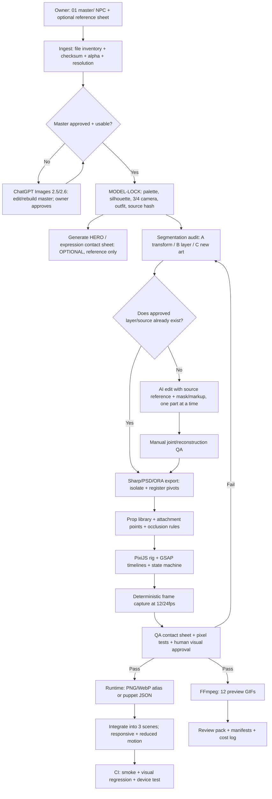
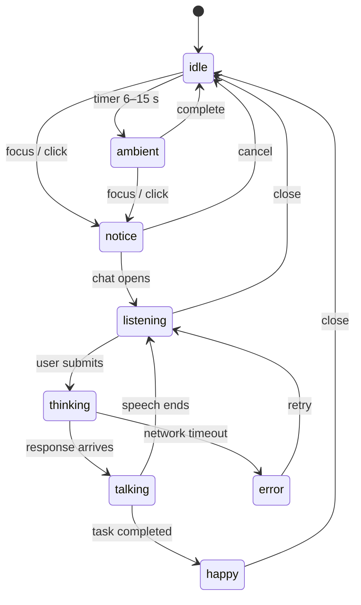

# ENGLISH CAFÉ / CÀ PHÊ VỈA HÈ
# NPC ASSET & ANIMATION PRODUCTION PIPELINE — MASTER → HERO → LAYERS → GIF → APP

**Document ID:** ENG-CAFÉ-NPC-PIPELINE-003  
**Version:** 3.0 — Proposal for implementation / Codex handover  
**Reviewed:** 05/11/2026  
**Language:** Vietnamese; prompts, API fields và kỹ thuật code dùng tiếng Anh để dễ thực thi  
**Scope:** Sáu NPC, mỗi NPC có `idle` 5–10 giây và `interaction` 1–3 giây; các trạng thái hội thoại bổ sung chạy trong app.  
**Status:** *Production design / implementation specification*, **không phải báo cáo đã tạo thành công 12 GIF**.

> **Mục tiêu kinh doanh:** giảm tối đa số ảnh người dùng phải chuẩn bị, đồng thời giữ nhận dạng nhân vật, chất lượng nét vẽ, độ mượt, chi phí API có kiểm soát và khả năng bảo trì trong ứng dụng Next.js/PixiJS.
>
> **Đề xuất chốt:** Mỗi NPC bắt đầu bằng **01 approved master 3/4 PNG RGBA** + **01 ảnh reference sheet nếu có**. Codex tự dựng tài nguyên kỹ thuật, Images 2.5/2.6 chỉ bổ sung phần *art còn thiếu*, artist/QA duyệt các khớp hoặc vùng bị che. **Không** gọi model tạo mới toàn bộ nhân vật cho mỗi frame. Hero/turnaround là tài liệu thiết kế, không phải yêu cầu bắt buộc để render Idle/Interaction.

---

## 0. Nguồn, mức độ xác nhận và xử lý mâu thuẫn

### 0.1. Thứ tự ưu tiên

1. **Quyết định trực tiếp mới nhất của product owner:** `Mây → Cloud Daisy`, `Đèo Explorer → Bear Explorer` và hai tạo hình: **Cloud Daisy đầu mèo trắng, thân người, đồ mùa đông**; **Bear Explorer đầu gấu, thân người, đồ thám hiểm**. Đây là *override design* trong giai đoạn hiện tại.
2. **`ENG_CAFE_VIA_HE_MASTER_SPEC_FINAL_v2.0.md`**, phần `CHARACTER BIBLE — 6 NPC GỐC`, world/scene graph, scene layering, QA, giao tiếp, trải nghiệm `scenic_train_ride`.
3. `Cafe_Via_He_Developer_Handover_v1.3.md` (animation/state machine/điểm neo), khi không xung đột với master v2.0.
4. `Huong_dan_NPC_Animation_ChatGPT_Codex_PixiJS_v2.md`, `npc_12_animation_prompts_v2.json` là tư liệu triển khai có trước; **được thay thế/bổ sung bởi tài liệu v3 này** nếu có xung đột kỹ thuật.
5. Các reference đã duyệt và version record của từng NPC. **Reference approved thực tế quyết định màu sắc, đường nét, kiểu trang phục**, thay cho các mô tả sáng tạo chưa duyệt.

**Xung đột còn tồn tại trong master v2.0:** phần Character Bible vẫn dùng `MÂY` như chim hồng phấn và `ĐÈO EXPLORER` như gấu trúc đỏ; phần QA vẫn có tên cũ. **Không sinh ảnh theo mô tả cũ** cho hai NPC đã đổi. Giữ ID legacy dưới dạng alias và thực hiện migration có test, không sửa DB ồ ạt. Trong một số chỗ master gọi Owl Daily/Bunny Hobbies; `ollie_owl` và `mimi_bunny` là ID/display đề xuất đã dùng trong pipeline trước, phải map theo ID hiện có trước khi deploy.

**Ảnh Mr.Pink mà người dùng gửi** có turnaround, expression sheet, key poses và body-part sheet là **ví dụ về cấu trúc art pack**; **không phải một trong sáu NPC gốc**. Không sao chép ngoại hình Mr.Pink cho NPC khác, không lấy thumbnail trong sheet làm asset production.

### 0.2. Yêu cầu từ master spec v2.0 (đã đối chiếu)

- Cảnh: `inside_cafe` → `outdoor_terrace` → `mountain_view` rồi có chiều quay ngược; **không tạo scene thứ tư** chỉ vì có hoạt động tàu.
- Scene logical 1920×1080, cố định tỷ lệ 16:9; NPC là sprite RGBA tách khỏi clean background và hotspot DOM; góc 3/4 front, ánh sáng trên-phải, silhouette đọc được ở cỡ cao khoảng 150–260 px trong cảnh toàn.
- Nhân vật nguyên bản, khoảng 2,5 đầu, có `model-lock`, bóng tiếp xúc là lớp scene riêng, không bake bóng vào ảnh master.
- Các state có ý nghĩa riêng: `idle`, `ambient`, `notice`, `talking`, `listening`, `thinking`, `happy`, `error` (không bắt buộc xuất mỗi state thành GIF khác nhau).
- State priority: `error > talking > thinking > listening > notice > ambient > idle`; ambient thử nghiệm sau 6–15 giây, dừng khi đang tương tác/nói; reduced-motion có fallback.
- Không dùng ảnh AI để vẽ chữ UI/menu, không gắn click hotspot giả vào frame, không để thân/tay xuyên bàn, ghế hoặc lan can.

### 0.3. Phân biệt **yêu cầu**, **đề xuất** và **việc đã triển khai**

- **Yêu cầu xác nhận:** 6 NPC; 2 clip mỗi NPC; tên mới; quy chuẩn kỹ thuật chung từ v2.0.
- **Đề xuất thiết kế v3:** pipeline hybrid, tên asset, ngưỡng QA, manifest, bộ script export, cấu trúc thư mục, các timeline cụ thể bên dưới.
- **Chưa xác thực với repository:** dependency thật, code base, ảnh approved nào hiện được chọn, có tách layer hay không, PixiJS đã được cài chưa, endpoint API có được cấp quyền theo tài khoản chưa. Codex **phải inspect** và báo cáo thay vì tự tuyên bố hoàn thành.

### 0.4. Phạm vi kiểm thử của agent

Trước khi chọn hoặc chạy test, đọc và áp dụng [Test scope trong AGENTS.md](../AGENTS.md#test-scope). Các gate, checklist và phase dưới đây là danh mục để chọn case cho phần mới tạo hoặc vừa sửa; chúng không tự cấp quyền chạy test tổng thể. Báo cáo đúng phạm vi đã kiểm tra theo quy tắc của owner trong `AGENTS.md`.

---

## 1. Sơ đồ pipeline mục tiêu



**Nhánh thử nghiệm riêng:** Image 2.6 *text-to-GIF* có thể làm *concept preview* nhanh, **không** thay thế bắt buộc pipeline rig. Khi không đủ layer hoặc API không khả dụng: tạo Idle tối giản bằng PNG toàn thân và ghi rõ `degraded-mode`.

### 1.1. Phân vai các thành phần

| Thành phần | Việc nên giao | Việc **không** được mặc định làm |
|---|---|---|
| Codex trong VSCode | đọc spec + repo, viết TS/JS, script dựng asset, kiểm tra, xuất file, tích hợp, QA tự động | tự có kỹ năng vẽ bổ sung mọi phần bị che từ một PNG mà không dùng model/artist |
| ChatGPT Images 2.5 Flare / 2.6 Flare | concept, variants, tạo nháp props, thử pose ít chi tiết, GIF ideation (2.6) | lock danh tính tuyệt đối giữa hàng loạt frame |
| ChatGPT Images 2.5 Sunburst / 2.6 Sunburst | edit master có reference, vẽ bù khớp/tay, tạo đạo cụ, hero, key poses độ chi tiết cao, GIF thử (2.6) | xuất rig PSD nhiều layer hoặc segmentation pixel-perfect một cách bảo đảm |
| Krita/GIMP/artist | layer mask, inpaint vùng che, sửa mép và khớp, duyệt nghệ thuật | tự động dựng timeline/ứng dụng |
| Sharp | metadata, alpha, crop có padding, resize, composite, optimize | tạo mới tay/mặt bị che theo ngữ nghĩa |
| PixiJS v8 | scene graph, sprite/pivot, texture, event, renderer WebGL/WebGPU | vẽ lại art chất lượng cao |
| GSAP | timeline, easing, pause/seek/kill, loop | tự tạo ảnh mới |
| Playwright | screenshot deterministic, mô phỏng click/viewport | quyết định mọi lỗi thẩm mỹ thay người duyệt |
| FFmpeg | palette, GIF, WebM/MP4 preview tùy nhu cầu | khôi phục chi tiết không có trong source |

---

## 2. INPUT tối thiểu và các mức chất lượng

### 2.1. Ba mức đầu vào

| Mức | Owner chuẩn bị | Codex có thể tạo | Giới hạn chất lượng |
|---|---|---|---|
| **M0 / Minimal** | 6 PNG master full body duyệt, alpha thật | breathing/idle nhẹ, ấn click → bounce/tilt toàn thân, một phần GIF preview | khó làm độc lập tay, mắt, miệng, props; **không hứa** đủ hành động đặc trưng |
| **M1 / Recommended** | 6 file PSD/ORA tách bộ phận hoặc 6 master + AI/artist bổ sung lớp thiếu | 12 animation 2D rig với eye blink, wave, talking, props cơ bản | cần QA khớp vai/cổ, occlusion, props |
| **M2 / Premium** | M1 + 1–3 key poses đặc biệt/ NPC | hoạt động lau ly, gõ máy, lật sách, ngắm trời, mở bản đồ, đọc guide sinh động | nhiều art hơn, tăng chi phí duyệt nhưng không cần tạo mỗi frame bằng AI |

### 2.2. Cần nộp trước khi Codex chạy

**Bắt buộc về dữ liệu/spec:**

- [ ] `ENG_CAFE_VIA_HE_MASTER_SPEC_FINAL_v2.0.md` (hoặc bản override đã được hợp nhất).
- [ ] Tài liệu v3 này và 12 prompt v2 JSON để tham chiếu ý đồ chuyển động.
- [ ] Repository thực và `package.json`, bố cục scene hiện có (Codex được quyền đọc và chạy lệnh kiểm thử).
- [ ] 1 master được duyệt/ NPC (`cloud_daisy`, `ollie_owl`, `mimi_bunny`, `astro_bean`, `bear_explorer`, `gray_boo`), hoặc đánh dấu `MISSING_MASTER` để dừng sinh art production.
- [ ] Ảnh/ảnh sheet nào **được duyệt** làm đúng gốc; ảnh demo/AI concept nào **chưa duyệt**.

**Không bắt buộc owner tự chuẩn bị:** nhiều góc nhìn, 12 GIF, 8 trạng thái ảnh riêng, hàng trăm frames, 6 bộ turnaround, texture atlas, GIF encoder, toàn bộ prop variant. Những thứ đó thuộc pipeline hoặc chỉ bổ sung khi thiếu.

**Khuyến nghị master:** RGBA 1024×1024 (nhân vật tròn) hoặc 768×1024 (dáng cao) theo v2.0, full body, front 3/4, nền trong suốt thật. Nếu nguồn chỉ có ảnh trên nền trắng, cần thao tác tách nền + kiểm tra viền. Nếu nguồn chỉ có thumbnail từ sheet Mr.Pink, xem là *reference*, không phải master.

### 2.3. `hero` nghĩa là gì trong pipeline?

- **Master:** bản sắc nhân vật chuẩn, dùng làm nguồn thiết kế.
- **Hero:** một ảnh minh họa nhân vật ấn tượng/cử động đặc trưng, có thể có bố cục/khung riêng để giới thiệu nhân vật. Tạo **tự động từ master đã duyệt**, nhưng **không được thay thế master**.
- **Turnaround sheet:** Front, 3/4, Side, Back; *chỉ bắt buộc khi phải quay thật* hoặc sản xuất nhiều góc, không cần cho Idle/Interaction 3/4.
- **Expression sheet:** contact sheet để reviewer xem, còn asset production phải xuất phần mắt/miệng/biểu cảm riêng.
- **Rig parts:** PNG/WebP alpha tách `head/body/arms/eyes/mouth/props` có anchor để chạy animation.

**Lưu ý quan trọng:** ảnh hero và sheet có thể đẹp nhưng các ô thumbnail nhỏ không đủ độ phân giải để phóng thành sprite. Dùng master + layers cho animation; sheet chỉ dùng so sánh nhận dạng và cử động.

---

## 3. MODEL-LOCK: khóa thiết kế nhân vật trước khi tạo thêm ảnh

### 3.1. Trường bắt buộc cho mỗi nhân vật

```json
{
  "npcId": "cloud_daisy",
  "displayName": "Cloud Daisy",
  "approved": false,
  "masterPath": "assets/npc/cloud_daisy/source/master_rgba.png",
  "masterSha256": "GENERATE_FROM_FILE",
  "visualReferencePaths": ["assets/npc/cloud_daisy/reference/approved_ref.png"],
  "angle": "three-quarter-front",
  "light": "upper-right",
  "camera": "fixed",
  "designConstraints": {
    "headSpecies": "white cat",
    "body": "humanoid chibi with human arms",
    "outfit": "exactly as approved winter outfit reference",
    "mustNotInclude": ["bird beak", "bird wings", "red panda tail"]
  },
  "approval": {"owner": null, "timestamp": null, "version": 1},
  "assetStatus": "awaiting_owner_approval"
}
```

`approved=false` là trạng thái mặc định cho đến khi owner xác nhận. **Không hardcode màu áo/hoa văn chưa thấy rõ trên master**, không thay tạo hình theo prompt đời trước. Ghi hash, model, prompt, input image, output filename, reviewer và ngày để tái lập/soát lỗi.

### 3.2. Quy tắc identity preservation

1. AI phải nhận **master/reference đã duyệt làm input**, không dùng tên nhân vật đơn thuần rồi tự tưởng tượng.
2. Chỉ yêu cầu **một thay đổi trên một lượt edit**: ví dụ “vẽ lại cánh tay phải ở tư thế chào”.
3. Ghi rõ các phần **giữ nguyên**: đầu, mắt, outfit, tỷ lệ, họa pháp, ánh sáng, viền, palette, hướng nhìn.
4. Chỉnh ảnh ở khung hình/canvas và kích thước ổn định; không tự thay background/zoom/perspective.
5. Sau mỗi output, so sánh bằng contact sheet cùng master; AI visual scoring chỉ là gợi ý, **không thay được QA người duyệt**.
6. Một edit bị trôi danh tính quá 2 lần thì chuyển sang manual/part rig, **không tiếp tục thử vô hạn tốn phí**.

### 3.3. Quy chuẩn RGBA và bóng

- Master/parts: PNG RGBA thực, không có nền caro/vàng/đen giả, không chữ, không khung, không nameplate.
- Không bake bóng dưới chân vào sprite; đặt bóng riêng trong `npc_ground_shadow` tại scene.
- Không crop tay, tai, mũ, đuôi, đạo cụ; chừa padding 6–12% quanh bbox, nhưng cả nguồn 1024×1024 không bắt buộc đều chứa nhân vật full-width.
- Tại mép alpha phải kiểm tra halo trắng/đen khi composite trên nền sáng, tối và xanh café.

---

## 4. Phân loại chuyển động: code-only, layer, art mới

| Chuyển động | Loại | JS/Codex tự xử lý? | Cần art thêm? |
|---|---|---|---|
| Thở/lắc người 1–3 px, blink mô phỏng bằng scale nhỏ toàn mắt* | A | Có | Không, *nhưng blink kiểu scale có thể méo mắt* |
| Bounce nhẹ, lắc thân, nghiêng 2–5°, zoom | A | Có | Không |
| Chớp mắt có mí đẹp | B | Có sau khi có texture | `eyes_closed`/eyelid |
| Quay đầu 10–15° và lắc tai/cánh | B | Có sau khi rig | `head`, `ear/wing` riêng |
| Miệng nói chuẩn 2–4 phoneme giản lược | B | Có | `mouth_closed/half/open` (hoặc beak) |
| Vẫy tay/chào và giữ bàn tay có hình đúng | B hoặc C | Có với part + pivot | thường cần arm tách hoặc pose nối khớp |
| Lau ly và đặt ly xuống | B/C | timeline/attachment | tay, ly, khăn và 1–2 hand poses |
| Đưa ly lên miệng | B/C | timeline/attachment | arm + cup + front/back occlusion |
| Gõ laptop | B/C | timeline | wings/hands + laptop/keyboard; không cần chi tiết ngón nếu cỡ nhỏ |
| Lật trang sách | B/C | tween + replace texture | trang trước/sau hoặc 2 frames book |
| Bung bản đồ | C | tween scale không đủ | map closed/open + hand holds |
| Rút camera lên mắt | B/C | tween | camera + tay/arm và occlusion |
| Xoay 3/4 thành mặt bên hoặc sau | C | Không tái tạo đúng hình học bằng xoay PNG 2D | cần new-angle art nếu bắt buộc |
| Tự vẽ phần bị che sau áo/tay/cổ | C | Code xử lý chỉ khi art có | AI inpainting/artist phải tạo rồi duyệt |

**Quy tắc lựa chọn:** A trước nếu đáp ứng; B khi chuyển động nhìn ra được ở 150–260px; C chỉ cho “signature action” tăng giá trị nhận dạng. Không vẽ lại khuôn mặt mỗi frame.

---

## 5. GPT Image 2.5 / 2.6: lựa chọn model và API route

### 5.1. Bảng điều phối (ưu tiên theo chất lượng và chi phí)

| Job | Default đề xuất | Khi nào nâng cấp/chuyển hướng |
|---|---|---|
| Hero nháp/concept/prop đơn giản | `gpt-image-2.6-flare` | sang `2.6-sunburst` khi cần giữ danh tính/chi tiết cao |
| Hero chính thức từ ảnh master, chỉnh một chi tiết | `gpt-image-2.6-sunburst` | nếu 2.6 không có, thử `2.5-sunburst` với cùng reference |
| Tách/bổ sung tay, khuôn mặt, vẽ bù khớp bị che | `gpt-image-2.6-sunburst` qua edit với mask/markup nếu hỗ trợ | QA pixel và manual cleanup **bắt buộc** |
| Đạo cụ độc lập (cup, scarf, book, camera, map) | `2.6-flare` draft → `2.6-sunburst` nếu cần | dễ dùng AI hơn so với anatomy |
| Expression/pose biến đổi từ master | `2.6-sunburst` edit từ master | nếu drift, chuyển cut-out/manually painted |
| GIF ý tưởng/marketing (không làm asset source) | `2.6-sunburst/flare` GIF generation | không có API/GIF entitlement → rig + FFmpeg |
| Legacy/làm lại job cũ của 2.5 | `2.5-sunburst` / `2.5-flare` | cần giữ prompt/model log; không đổi model lặng lẽ |

**Về hỗ trợ chính thức tại 05/11/2026:** OpenAI liệt kê 2.5 Sunburst/Flare và 2.6 Sunburst/Flare trong Images API. 2.6 được công bố ngày 04/11/2026 với GIF trong ChatGPT/Codex/API, Flare nhanh hơn, Sunburst ưu tiên độ chính xác/chi tiết. `complexity` (2.6) và `quality` là hai tham số khác nhau. **Quyền truy cập và giá API phải được kiểm tra trên account**; không đồng nhất gói ChatGPT và API billing.

### 5.2. Chọn endpoint chính xác

- **Tạo mới:** `POST /v1/images/generations` với `model`, `prompt`, `background`, `size`, `quality`, `output_format`; với 2.6 có `complexity` theo tài liệu.
- **Chỉnh sửa từ master (quan trọng nhất):** `POST /v1/images/edits`, truyền master image và reference; có thể dùng `mask` hoặc `markup` tùy model/endpoint được xác nhận. `markup` là lớp chú thích trong suốt cùng kích thước ảnh để khoanh vùng cần sửa; `mask` chỉ là gợi ý theo prompt, **không bảo đảm pixel-perfect**. Không gửi `mask` và `markup` cùng lúc.
- **GIF trực tiếp (để thử):** `POST /v1/images/generations`, `output_format="gif"`, `frame_count`, `frame_duration_ms`. Tài liệu API reference ngày rà soát nêu **2–16 frame** và cần entitlement GIF; GIF generation không hỗ trợ mask/streaming như nhánh PNG. Thời lượng = `frame_count × frame_duration_ms / 1000`, không đồng nghĩa chuyển động sẽ mượt như 24 fps.
- **Không mặc định** rằng `/images/edits` có thể biến master PNG thành GIF chuẩn danh tính: ưu tiên `/images/edits` xuất **PNG** để tạo parts/poses, rồi rig + FFmpeg.

### 5.3. Ví dụ thông số đề xuất (config nội bộ, không phải nguyên body áp dụng cho mọi endpoint)

```json
{
  "imageGeneration": {
    "modelDraft": "gpt-image-2.6-flare",
    "modelFinal": "gpt-image-2.6-sunburst",
    "fallbackModel": "gpt-image-2.5-sunburst",
    "output_format": "png",
    "background": "transparent",
    "quality": "high",
    "size": "1024x1024",
    "complexityWhenSupported": "low",
    "maxAttemptsPerAsset": 2,
    "dryRun": true,
    "manualApprovalRequired": true
  },
  "gifConceptOnly": {
    "model": "gpt-image-2.6-sunburst",
    "output_format": "gif",
    "frame_count": 12,
    "frame_duration_ms": 500,
    "duration_seconds": 6
  }
}
```

**Không gửi nguyên JSON trên lên API:** đây là *pipeline config* của ứng dụng. Codex phải map từng trường sang từng endpoint/sdk thực tế và bỏ các field mô tả nội bộ. Mỗi request ghi log response size, model, số lần thử, usage nếu API trả về, không đoán chi phí từ số prompt.

### 5.4. Vai trò của ChatGPT UI và Codex

- **ChatGPT UI:** chủ sản phẩm dễ duyệt master, hero, trang phục/đạo cụ và sửa từng ảnh thông qua hội thoại.
- **Codex:** viết và chạy script tự động gọi API **khi môi trường có API key, billing, quyền truy cập và network**, xử lý ảnh trả về, lưu file/metadata; ngoài ra còn viết rig, exporter và test không cần AI.
- **Không lưu API key trong repo, browser hoặc `NEXT_PUBLIC_`**; chỉ dùng biến môi trường server/CI secret, không đẩy raw reference nhạy cảm lên third-party nếu chưa có quyền.
- Trong môi trường chưa có API key, script phải chạy được `--dry-run` và báo cần bổ sung art; không tự phát sinh chi phí.

---

## 6. Asset Forge: tạo hero, tách ảnh, biểu cảm và đạo cụ

### 6.1. Chia 7 job types để Codex orchestration

| Job type | Input | Output | AI? | Approval |
|---|---|---|---|---|
| `VALIDATE_MASTER` | approved source | metadata, alpha audit, master hash | Không | Tự động + owner xác nhận hình |
| `CREATE_HERO` | master + approved bible | 01 hero PNG giới thiệu/marketing | Có thể | Owner duyệt; **không làm nguồn rig** |
| `DERIVE_CONTACT_SHEET` | master + approved parts/poses | sheet biểu cảm/turnaround đẹp để review | Có thể | Owner duyệt; reference-only |
| `ISOLATE_PART` | master + part mask/PSD layer | một phần body RGBA, điểm gốc | Sharp/artist/AI edit | QA khớp/border bắt buộc |
| `INPAINT_OCCLUSION` | master + mask xác định vùng bị che | phần thân/đầu hoàn chỉnh sau khi xóa tay/cốc | Images edit hoặc artist | Bắt buộc duyệt thủ công |
| `GENERATE_PROP` | palette + master + prop type | PNG prop alpha, front/back variants | Có thể | Owner duyệt kích thước/họa pháp |
| `GENERATE_KEY_POSE` | master + current rig + exact one pose | PNG pose, chỉ các chi tiết thay đổi | Có thể | Duyệt và chuyển thành layer/spriteframes |

### 6.2. Quy trình tạo HERO tự động

1. Khóa `master.png` và source hash; không overwrite master.
2. Codex tạo `hero_job.json` tham chiếu file master, persona, pose mục tiêu, màu sắc chuẩn và góc 3/4.
3. Dùng Image 2.6 Sunburst qua **edit-from-reference** nếu đã có input master; không dùng text-only generation tạo “cùng tên” như một nhân vật mới.
4. Tạo tối đa 2 candidate mỗi vòng; đưa owner so sánh cạnh ảnh master ở cùng kích thước.
5. Khi duyệt, lưu `hero_v1.png` + `hero_approval.json`; khi chưa duyệt, đặt `draft/`.
6. Không dùng hero làm master vì nhiều hero có tóc/cánh tay/props che khớp, hoặc trang phục bị đổi.

**Hero đề xuất theo cá tính (không thay thế approved design):** Cloud Daisy cầm ly mời khách; Ollie ngẩng từ laptop; Mimi cười với sách hoặc ukulele; Astro Bean giơ cánh lên bầu trời; Bear Explorer cầm bản đồ/point an toàn; Gray Boo đọc Earth Guide, tò mò quan sát mây. Với mỗi ảnh giữ toàn thân và nhận diện, ánh sáng upper-right.

### 6.3. Quy trình tự tách parts hợp lý

1. **Ưu tiên PSD/ORA đầu vào** nếu nguồn có layer thực: xuất từng nhóm bằng script hoặc định dạng trung gian tương thích; dùng Sharp để chuẩn hóa/crop/pack. **Sharp không đọc và dựng lại cấu trúc layer PSD đầy đủ theo nghĩa rig**; cần công cụ phù hợp để export.
2. Nếu chỉ có PNG phẳng: phân vùng bằng mask (polygon/alpha) hoặc công cụ segmentation; **mặt nạ tách pixel chỉ thu được phần đang nhìn thấy**.
3. Với lớp cần nằm phía sau lớp khác, yêu cầu AI edit/mask vẽ bù vùng thiếu hoặc artist bổ sung; ví dụ phần ngực sau cánh tay, vai sau tay đang giơ, gáy sau khăn.
4. Kiểm tra từng layer trên nền tương phản; bỏ viền màu trắng/đen, giữ nếp áo đúng; không kéo dài khớp bằng các pixel nhân bản vô thức.
5. Đặt các lớp vào **cùng coordinate space của master** trước khi crop: mỗi layer có `sourceRect` / `offsetX,Y` / `pivot`. Việc crop mà không lưu offset làm rig nhảy vị trí.
6. Reassemble toàn bộ parts vào neutral pose và so sánh overlay 50% với master; nếu lỗi mặt/chi tiết khớp rõ, không được chuyển gate.
7. Lưu cả mask/edited PNG/hashes, có thể replay nhưng không dùng script cũ overwrite input approved.

**Lưu ý:** Semantic segment chỉ là **hỗ trợ**; không có API OpenAI Image 2.5/2.6 nào được tài liệu hiện tại bảo đảm trả ngay PSD với đầy đủ named layers, bone hierarchy, pivots. Codex phải chịu trách nhiệm manifest và QA.

### 6.4. Chiến lược tách theo khả năng

- **Zone dễ:** ly, khăn, cốc, sách đóng, camera treo, mũ rời — có thể tách/nhân bản, giảm công AI.
- **Zone trung bình:** tay đang đặt bên hông, tai, kính, miệng — tách và sửa viền/occlusion.
- **Zone khó:** vai/tay chéo trước ngực, lông sau đầu, mắt mở khác góc, tay giữ vật, bản đồ đang mở, cổ sau khăn — dùng AI edit trên reference + QA hoặc artist.
- **Zone không nên tự phát sinh:** xoay cả nhân vật sang back view khi source chỉ có 3/4, chuyển chim thành mèo, gấu trúc đỏ thành gấu, tạo thêm ngón/cánh/đuôi, vẽ chữ trong sách/menu.

### 6.5. Tạo prop từ tính cách NPC

| NPC | Prop cơ bản (M1) | Prop chỉ khi cần (M2) | Quy tắc attachment |
|---|---|---|---|
| Cloud Daisy | 1 cốc gốm, khăn lau | khay, 1 cốc phụ | cốc gắn `hand_r` khi lau, gắn `counter` khi đặt; khăn gắn `hand_l` |
| Ollie Owl | laptop riêng, ly cà phê | notebook, đồng hồ chỉ giờ | laptop nằm trong scene/chỗ bàn; cốc đi theo wing/hand, không xuyên mặt |
| Mimi Bunny | sách đóng/mở, trang sách | ukulele, camera instant | sách có `page_front`/`page_back` hoặc 2 pose; tai phải tách nếu twitch |
| Astro Bean | huy hiệu sao (trên suit), kính ngắm rời | cốc ngôi sao | kính ngắm gắn cánh; visor nên đứng cố định trên đầu, mặt luôn đọc được |
| Bear Explorer | bản đồ đóng/mở, camera | giỏ dâu/hộp quà khi scenic train | camera/map có trạng thái `held`/`stowed`; tuyệt đối không cánh tay xuyên lan can |
| Gray Boo | Earth Guide không chữ, ly | biểu tượng dấu hỏi render UI riêng | sách thuộc hand/book group; không vẽ chữ thật lên sprite |

**Kích thước props:** xác định tương đối với `headWidth`, `handSize` và kích thước scene thực, **không áp đặt số pixel cố định**. Prop có vector design nếu hình đơn giản và có duyệt; phụ kiện có nét đặc trưng nên dùng ảnh alpha render cùng style.

### 6.6. Quy tắc render khi giữ đạo cụ

- `hand_near` có thể ở phía trước prop; `hand_far` ở sau prop. Trong cây scene, prop không tự trở thành con của cả hai tay cùng lúc.
- Khi đặt vật xuống bàn: chuyển parent từ `handAttachment` sang `sceneSurface` nhưng **bảo toàn world transform** (position/rotation/scale); không nhảy 1 frame.
- Không gắn vật vào `body` nếu cần tay độc lập; không để cup bay khi tay đổi tư thế.
- Đạo cụ có `idlePlacement`, `holdPlacement`, `occlusionGroup`, `scale` và `interpolation` trong rig config.
- Nếu vật được đặt lại đúng chỗ trong Idle loop, frame đầu và frame cuối phải cùng trạng thái parent, transform và z-order.

### 6.7. Prompt khung chung cho GPT Images

> **PROMPT — Identity Lock (áp vào tất cả image edits)**

```text
Use the attached APPROVED MASTER character as the sole canonical identity reference.
Keep the exact original species, face shape, eyes, outfit, pattern, colors,
body proportions, line weight, 2D/2.5D soft cel-shaded style and 3/4 front view.
Use a fixed orthographic-feeling camera, identical framing and upper-right light.
Do not invent new limbs, fingers, wings, markings, clothing, jewelry or props.
Keep full body or the requested isolated component entirely inside the canvas.
Use TRUE transparent PNG background (not a white or checkerboard imitation).
Do not add text, labels, shadows on the floor, borders, or background scenery.
Only perform the requested change; preserve everything else.
If the original reference hides anatomy, render a plausible matching continuation
and flag the result for human review rather than asserting pixel-perfect accuracy.
```

> **PROMPT — Hero (input: approved master)**

```text
Create ONE premium hero illustration of the EXACT character in the attached
approved master reference. Preserve identity and outfit without redesign.
Hero action: [ONE CHARACTER-SPECIFIC SIGNATURE POSE].
Character remains full-body, front three-quarter, consistent 2D/2.5D chibi
mobile game art, readable at small size, true transparent PNG background.
Character and prop must be anatomically connected with clean silhouette.
This is a separate promotional HERO image, not a replacement master or rig part.
```

> **PROMPT — Isolated layer (input: master + optional markup/mask)**

```text
Using the approved master as a strict reference, create ONLY the [PART_NAME]
for a 2D puppet rig. Reconstruct the hidden pixels beneath overlaps where
necessary, preserving the exact approved material, thickness, contours,
colors, lighting and outline. Neutral pose compatible with the source image.
The part must be on a transparent background, isolated, uncut, with enough
padding for rotation around [JOINT_DESCRIPTION]. No other body parts,
no shadows, no labels, no white background. Return as PNG RGBA.
```

> **PROMPT — Prop (input: master + swatch + description)**

```text
Generate ONE isolated game prop: [PROP_NAME], suitable for [NPC_ID].
Match the line art, rendering, proportions, shading, palette and upper-right
light of the approved master character. It must fit naturally into the
character's [HAND/WING] in a three-quarter front pose. Transparent PNG.
Include no hand/wing in this asset; it will be attached by a runtime rig.
No text, no background, no ground shadow, no other objects. Full prop visible.
```

> **PROMPT — Expression variant (input: approved head/eyes)**

```text
Edit only the facial expression to [BLINK / EYES_CLOSED / MOUTH_OPEN / THINKING].
Preserve the master identity, face boundaries, eye spacing, fur/feather marks,
colors, outline and original head orientation exactly. Produce an image aligned
to the same head canvas coordinate system; no changes to clothes or props.
No new head perspective, no camera move, no background. PNG RGBA.
```

> **PROMPT — Key Pose (input: master + rig preview)**

```text
Create ONE alternate key pose for [NPC_ID]: [EXACT ACTION].
Same character, same camera, scale, proportions, palette, outfit and line art.
Treat the approved source as immutable except the explicitly named moving
part(s). Hand/wing anatomy and held prop must remain coherent. Transparent
background, anchored feet/seat, full character visible. This is a key pose
for comparison and extraction, NOT a new master character.
```

### 6.8. Prompt sửa lỗi theo vùng (nên dùng markup)

```text
Input image 1 = approved master. Input image 2 = optional approved style ref.
A same-size transparent markup PNG highlights ONLY the right-arm joint.
Please repair this joint for puppet animation: draw the hidden sleeve/shoulder
continuation and preserve all neighboring pixels and facial features.
The original clothing fold and outline must remain consistent. Return PNG.
```

Sử dụng markup/mask **theo tài liệu của endpoint/model hiện tại**; không áp đặt `input_fidelity` cho 2.6 nếu reference yêu cầu omit. Mọi kết quả edit vẫn phải được kiểm tra bởi con người và so sánh với master.

---

## 7. Thiết kế rig và tạo bảng layer cho sáu NPC

### 7.1. Cấu trúc mặc định (những node không có thì bỏ)

```text
NPC_ROOT (feet/contact anchor; no fake shadow)
  body_root
    leg_back
    leg_front
    torso
      arm_far_shoulder
        upper_arm_far
          forearm_far
            hand_far
      neck_joint
        head_root
          hair_back_or_ear_back
          face_base
          eyes_open/eyes_closed  [texture switch]
          mouth_closed/half/open [texture switch]
          ear_left / ear_right  [independent if needed]
          hair_front_or_forehead
          glasses / scarf / visor [as appropriate]
      arm_near_shoulder
        upper_arm_near
          forearm_near
            hand_near
      held_prop_attachment
  scene_contact_shadow [separate in scene, NOT image child]
```

**Rủi ro của rig:** một ảnh đầu nguyên khối vẫn quay tốt vài độ; cánh tay toàn khối xoay quanh vai tốt với chuyển động nhỏ, nhưng khi giơ quá cao thường lộ hở áo/vai. Với những pose đó cần thêm **shoulder cap**, alternate hand pose hoặc frame vẽ bổ sung.

### 7.2. Bộ parts tối thiểu theo từng NPC

| ID | Base parts ưu tiên | Expression parts | Props | M2 khi cần |
|---|---|---|---|---|
| `cloud_daisy` | `torso, cat_head, ear_L/R, human_arm_L/R, legs` | `eyes_open/closed, mouth_closed/open, smile` | `cup, cloth` | `hand_cup_grip, arm_waving_pose, cup_on_counter` |
| `ollie_owl` | `torso, head, wing_L/R, legs, glasses` | `eyelid, beak_closed/open` | `laptop, coffee_cup` | `wing_typing_pose, wing_cup_hold, notebook` |
| `mimi_bunny` | `torso, head, ears_L/R, arms_L/R, legs` | `blink, smiling_mouth` | `book_closed, book_open` | `page_turn_01/02, ukulele, hand_strum` |
| `astro_bean` | `suit, head/face, wing_L/R, boots, visor` | `blink, beak_closed/open, excited_eyes` | `handheld_viewer` | `wing_pointing_pose, helmet_reflection_alt` |
| `bear_explorer` | `torso, bear_head, ears, human_arms, legs, backpack` | `blink, mouth_closed/open, brows` | `map_closed, map_open, camera` | `hands_on_map_pose, camera_hold_pose, scenic_train_gesture` |
| `gray_boo` | `hoodie, alien_head, arms, legs` | `eyes_open/closed, mouth_closed/open` | `earth_guide, cup` | `hand_book_hold, hand_thinking_pose` |

Đây là **danh sách yêu cầu art theo động tác**. Nếu master đã gồm đạo cụ và artwork đúng nhưng không có alpha riêng, Codex không được đánh dấu “part ready” cho đến khi việc isolate/reconstruction hoàn tất.

### 7.3. Chuẩn pivot, placement và z-order

- `feetAnchor` = tâm vùng chạm sàn/ghế, tọa độ local; dùng để scale cả NPC mà không trượt vị trí.
- `shoulder` = điểm xoay arm; `elbow` = nếu có forearm; `wrist/wingtip` = prop attachment khi cần.
- `neck` = điểm xoay head, thường ngay trên collar; tai attach vào head, không world.
- `eyes/mouth` có vị trí local cố định trong head, hoán đổi texture phải **giữ cùng registration**.
- z-order cho tay sau/thân/đạo cụ/tay trước phải rõ. Mỗi layer có `renderOrder` và `occlusionGroup` để tránh xuyên mặt/bàn.
- Ảnh layer crop có `trimmedWidth`, `trimmedHeight`, `origWidth`, `origHeight`, `offset`, `pivot` rõ ràng.

### 7.4. Rig manifest mẫu (đủ cho Codex dựng schema validate)

```json
{
  "schemaVersion": "3.0",
  "npcId": "cloud_daisy",
  "sourceMaster": "source/master_rgba.png",
  "sourceHash": "SHA256_REQUIRED",
  "approved": false,
  "coordinateSystem": {"width": 1024, "height": 1024, "unit": "source-pixels"},
  "root": {"anchor": {"x": 512, "y": 932}, "displayHeightPx": 220},
  "layers": [
    {"id": "torso", "file": "parts/torso.png", "order": 10,
     "origin": {"x": 0, "y": 0}, "pivot": {"x": 0.5, "y": 0.5}},
    {"id": "cat_head", "file": "parts/head.png", "parent": "neck",
     "order": 20, "origin": {"x": 0, "y": 0}, "pivot": {"x": 0.5, "y": 0.86}},
    {"id": "human_arm_r", "file": "parts/arm_right.png", "parent": "shoulder_r",
     "order": 30, "origin": {"x": 0, "y": 0}, "pivot": {"x": 0.16, "y": 0.12}}
  ],
  "joints": [
    {"id": "neck", "parent": "torso", "x": 512, "y": 326},
    {"id": "shoulder_r", "parent": "torso", "x": 630, "y": 415}
  ],
  "attachments": [
    {"id": "hand_r", "parent": "human_arm_r", "x": 0, "y": 0},
    {"id": "counter_surface", "scope": "scene", "x": 0, "y": 0}
  ],
  "variants": {
    "eyes": ["eyes_open", "eyes_closed"],
    "mouth": ["mouth_closed", "mouth_open"]
  },
  "status": "EXAMPLE_DO_NOT_ASSUME_COORDINATES"
}
```

**LƯU Ý:** mọi `x/y/pivot` trong manifest trên **chỉ minh họa cấu trúc**, không phải tọa độ thật của Cloud Daisy. Codex phải đo ảnh chuẩn, hiển thị rig calibration UI và cho phép điều chỉnh kéo thả điểm neo; không hardcode theo ví dụ.

---

## 8. Animation state machine và kế hoạch 12 clip

### 8.1. Phân biệt *clip export* với *runtime states*

- **Clip 1/ NPC:** `idle.gif` 5–10 giây, loop, gồm `idle + ambient signature` trong một chu kỳ xuất preview; trong runtime có thể scheduler ambient ngẫu nhiên 6–15 giây chứ không bắt buộc cử động biểu diễn liên tục 8 giây.
- **Clip 2/ NPC:** `interaction.gif` 1–3 giây, **one-shot** click/notice, kết thúc bằng pose `listening`; **không được mặc định loop vô hạn**.
- Runtime còn `listening`, `thinking`, `talking`, `happy`, `error` dưới dạng state rig dễ biểu đạt, không nhất thiết là 6 GIF bổ sung.



**Priority:** error > talking > thinking > listening > notice > ambient > idle. Khi API chậm, thinking dùng animation vòng nhẹ, không làm quá; khi TTS không bật, talking có mouth-flap trong thời gian hiển thị câu phù hợp (không khẳng định lipsync chính xác âm vị nếu chưa có phoneme data). Click lần 2 không chồng timeline cũ.

### 8.2. Timeline 6 NPC × 2 clip — thời gian *đề xuất để triển khai*

| NPC | Idle (seamless loop) | Interaction (one-shot) | Art phải có để đạt đúng động tác |
|---|---|---|---|
| **Cloud Daisy** | 8s: 0–1.5 giữ ly/thở → 1.5–3.8 lau ly → 3.8–5.0 đặt/đổi ly → 5.0–6.3 chớp mắt, nhìn khách → 6.3–8.0 về pose đầu | 2s: 0–0.35 dừng → 0.35–0.9 ngẩng đầu → 0.9–1.5 vẫy tay **một lần** → 1.5–2.0 listening | tay rời, ly, khăn, mắt, cat head; nếu vẫy cao cần arm pose |
| **Ollie Owl** | 8s: gõ laptop → xem note → chỉnh kính → nhấp coffee → trở lại laptop | 2s: ngẩng đầu → chỉnh kính → gật chào → listening | wing arm, glasses, laptop, cup; key pose cup hold tùy rig |
| **Mimi Bunny** | 7s: đọc → tai rung → lật trang → nhìn hoa/nhẹ cười → về đọc | 2s: tai dựng → nhìn lên → vẫy tay → listening | ears L/R, book open, page turn variants, arm |
| **Astro Bean** | 8s: nhìn trời → chạm badge → đưa kính ngắm/nhìn lên → hạ kính → về pose | 2s: quay mặt trong visor → nâng cánh chào → gật nhỏ → listening | wing, visor, eyes, viewer prop |
| **Bear Explorer** | 9s: mở map → quan sát → nâng camera → hạ camera → chỉ núi → khép map | 2.5s: ngẩng đầu → vẫy → gật/giới thiệu hướng → listening | map close/open, arms, camera; train uses separate timeline |
| **Gray Boo** | 9s: đọc Earth Guide → nhìn mây → nghiêng đầu → thử ngửi café → về đọc | 2.5s: ngẩng đầu → nghiêng 12° → blink → chào nhẹ → listening | head, eyes, guide book, cup optional |

**Khi thiếu art:** Codex hạ cấp hiệu ứng theo ma trận: ví dụ Bear Explorer chưa có camera thì chỉ làm `map + idle blink`, **không tự vẽ camera bằng hình mờ** và phải báo thiếu `camera.png`.

### 8.3. Chuyển động tự nhiên nên dùng

- Thở trong 2,4–3,0s, biên độ thử 1–3 px logical; không scale toàn thân liên tục quá lớn; nhịp chậm không đồng pha cả 6 NPC.
- Chớp mắt hiếm, rõ, không nháy liên tục; khi talking giảm ambient.
- Cánh/tay xoay tại vai, có ease in/out, dừng và trả về; không xoay nguyên cả hình như con lắc.
- Ánh mắt, head tilt và hand gesture là trọng tâm hơn việc nhún chân.
- Loop phải trở lại `neutralPose` cùng transform, parent, props, opacity, position. Dùng epsilon để so sánh transform; GIF loop *cảm nhận* mượt quan trọng hơn pixel tuyệt đối.
- Trong cảnh có nhiều NPC, ambient scheduler lệch pha; khi người học click 1 NPC, các NPC khác ngưng foreground attention hoặc giảm hoạt động để tập trung.

---

## 9. Chuẩn output runtime, preview GIF và chất lượng khung hình

### 9.1. Tách hẳn bản nguồn và bản vận hành

**Source** (không deploy công khai nếu nặng): `master_rgba.png`, PSD/ORA, masks, hero PNG, approved layer PNG, rig.json.  
**Runtime:** atlas RGBA (PNG/WebP lossless), `atlas.json`, animations.json + state machine; có thể giữ layer riêng nếu số texture ít.  
**Preview:** contact sheet, `*_idle.gif`, `*_interaction.gif`, video/webm tùy cần. GIF là đầu ra QA, không phải mặc định runtime.

**Kích thước tham khảo:** nguồn 768–1024 px cao; runtime scale khoảng cao 150–260px trên canvas logical 1920×1080. Với màn hình DPR 2, cần source đủ chi tiết để hiển thị sắc nét; đo thực tế trước khi xuất nhiều atlas. Không phóng thumbnail sheet nhỏ lên 4 lần để giả tăng chi tiết.

### 9.2. Frame rate và tính đúng thời lượng

- Với **puppet animation**: render preview ở **12–24 fps** (12 fps có thể hợp phong cách chibi tiết chế, 24 fps cho motion tay/camera nhanh). Ví dụ 8s × 12fps = **96 khung**; 2s × 24fps = **48 khung**. Đây là các frame được **tính từ rig**, không phải 96 lần gọi GPT Image.
- Nếu dùng **GPT Image 2.6 GIF trực tiếp**, endpoint documented cho phép 2–16 frame/ GIF ở ngày rà soát; 12 frame trong 8s là **1,5 frame/s**, vì vậy phù hợp preview hướng nghệ thuật, **không tương đương rig 12–24 fps**. Không ghi frame_count 96 cho API như thể được hỗ trợ.
- Interaction export `loop=false`; ở player HTML nên hold last frame/pose của state machine; GIF playback có thể khác giữa trình xem, do đó kiểm tra trong app preview độc lập.

### 9.3. Kiểm soát mất nét/màu

- PNG/WebP alpha lossless nên làm nguồn; GIF chỉ 256 màu/palette mỗi frame, dễ banding/viền alpha.
- Sharp `resize` một chiều **downscale** và dùng pipeline chất lượng cao; không upscale source thumbnail để tạo chi tiết giả.
- Kết hợp FFmpeg `palettegen` + `paletteuse` để chọn màu GIF, kiểm tra trên nền sáng/tối để phát hiện mép trong suốt xấu; với alpha mềm hãy dự kiến cảnh GIF có răng cưa ở biên.
- Test visual ở 1x/2x DPR và scale runtime, so sánh với master; không chỉ xem ảnh zoom 100%.

### 9.4. Quy tắc file đặt tên

```text
public/cafe/assets/npc/
  cloud_daisy/
    runtime/atlas.webp
    runtime/atlas.json
    runtime/rig.json
    runtime/animations.json
    preview/cloud_daisy_idle.gif
    preview/cloud_daisy_interaction.gif
  ollie_owl/...
  mimi_bunny/...
  astro_bean/...
  bear_explorer/...
  gray_boo/...
```

**Không cố gắng ghép file reference master vào `public/` nếu không dùng runtime.** Lưu source trong `art/` hoặc storage riêng để tránh deploy file lớn và để version control rõ ràng.

---

## 10. Triển khai code: thư mục, commands và API boundaries

### 10.1. Cấu trúc đề xuất trong repo

```text
project-root/
├── docs/cafe/
│   ├── ENG_CAFE_VIA_HE_MASTER_SPEC_FINAL_v2.0.md
│   ├── ENG_CAFE_NPC_ASSET_ANIMATION_PIPELINE_SPEC_v3.0.md
│   ├── npc_12_animation_prompts_v2.json
│   └── NPC_MODEL_LOCK.md
├── art/npc/                            # SOURCE, KHÔNG public
│   ├── cloud_daisy/
│   │   ├── reference/{approved_ref.png,turnaround_optional.png}
│   │   ├── source/{master_rgba.png,hero_draft.png,hero_approved.png}
│   │   ├── masks/
│   │   ├── parts/{torso.png,head.png,arm_l.png,arm_r.png,...}
│   │   ├── props/{cup.png,cloth.png,...}
│   │   ├── poses/
│   │   ├── model-lock.json
│   │   ├── rig.json
│   │   ├── animations.json
│   │   └── approval.json
│   ├── ollie_owl/...
│   ├── mimi_bunny/...
│   ├── astro_bean/...
│   ├── bear_explorer/...
│   └── gray_boo/...
├── scripts/npc/
│   ├── inspect-assets.ts
│   ├── model-lock.ts
│   ├── prepare-masks.ts
│   ├── generate-image.ts                # disabled unless --allow-api
│   ├── isolate-parts.ts
│   ├── pack-atlas.ts
│   ├── validate-rig.ts
│   ├── capture-frames.ts
│   ├── export-gifs.ts
│   ├── export-review-sheet.ts
│   └── audit-costs.ts
├── src/features/cafe/
│   ├── npc/NpcRegistry.ts
│   ├── npc/NpcRig.ts
│   ├── npc/NpcAnimator.ts
│   ├── npc/NpcStateMachine.ts
│   ├── npc/NpcAmbientScheduler.ts
│   ├── npc/NpcConversationBridge.ts
│   ├── npc/NpcAssetLoader.ts
│   ├── npc/NpcReducedMotion.ts
│   └── preview/NpcAnimationLab.tsx
├── public/cafe/assets/npc/
│   └── {npcId}/runtime/{atlas.webp,atlas.json,rig.json,animations.json}
├── public/cafe/previews/npc/
│   └── {npcId}_{idle|interaction}.gif
├── tests/npc/
│   ├── assets.spec.ts
│   ├── rig.spec.ts
│   ├── timeline.spec.ts
│   ├── scenes.spec.ts
│   └── visual.spec.ts
└── reports/npc/
    ├── asset-inventory.json
    ├── missing-art.json
    ├── generated-costs.jsonl
    ├── quality-gate.json
    └── review-contact-sheet.png
```

**Cảnh báo:** đây là layout **đề xuất**; Codex phải inspect repo Next.js/Pixi hiện hữu, dùng component/tên đường dẫn đang áp dụng, **không tạo song song một game engine hoặc cấu hình auth/API mới nếu project đã có**. Không bắt buộc xuất PSD/ORA trong repo nếu bản quyền/size lớn; có thể lưu storage riêng cùng hash/approved status.

### 10.2. Các thư viện đề xuất

| Thư viện/phần mềm | Công việc | Ghi chú triển khai |
|---|---|---|
| `pixi.js` v8 nếu repo dùng v8 | rig/container, texture, scene graph, sprite | kiểm tra version hiện có; không nâng major lặng lẽ |
| `gsap` | timeline `repeat`, `paused`, `seek`, easing, completion | một timeline foreground/NPC, kill/cancel khi đổi state |
| `sharp` | check RGBA, resize, trim, composite, atlas preliminary | không tự biến PNG phẳng thành parts có anatomy hoàn chỉnh |
| `playwright` | mở trang preview, screenshot deterministic, click/sizing tests | sử dụng browser installed/CI; không chạy screenshot theo wall clock |
| `ffmpeg` executable | GIF từ frame, poster/video preview | cài trên máy build/dev, hoặc dùng Docker trong pipeline |
| `zod` hoặc validation đang có | schema parse, constraint | ưu tiên thư viện đang dùng trong repo |
| `openai` Node SDK | gọi Image API opt-in | server/script only; không import vào client bundle |

**Cài đặt:** chỉ sau khi inspect `package.json`, lockfile và license hiện có. Ví dụ cho repo chưa cài (`npm`, không thay thế lệnh nếu repo dùng `pnpm`/`yarn`):

```bash
npm install pixi.js gsap sharp
npm install --save-dev playwright typescript tsx
# OpenAI chỉ khi owner đã duyệt ngân sách API:
npm install openai
# FFmpeg là binary hệ thống, kiểm tra: ffmpeg -version
```

### 10.3. Pipeline commands mục tiêu

```bash
# Chạy offline trước, không gọi AI:
npm run npc:inspect
npm run npc:validate-master -- --npc cloud_daisy
npm run npc:check-parts -- --npc cloud_daisy
npm run npc:preview -- --npc cloud_daisy
npm run npc:render -- --npc cloud_daisy --state idle --fps 12
npm run npc:render -- --npc cloud_daisy --state interaction --fps 24
npm run npc:gif -- --npc cloud_daisy
npm run npc:qa -- --npc cloud_daisy

# Được phép gọi AI khi owner chủ động bật:
npm run npc:generate-missing -- --npc cloud_daisy --dry-run
npm run npc:generate-missing -- --npc cloud_daisy --allow-api

# Chỉ khi pilot đã duyệt:
npm run npc:batch -- --approved-only
```

**Các lệnh này là acceptance target để Codex hiện thực**, không phải lệnh đã tồn tại trong repository. Nếu cần rename dựa vào cách gọi script hiện hành, giữ cùng chức năng và ghi mapping.

### 10.4. API wrapper tách hẳn khỏi code giao diện

```ts
// PSEUDOCODE CONTRACT — không phải SDK request body hoàn chỉnh.
type JobType = 'HERO'|'ISOLATE_PART'|'INPAINT'|'PROP'|'KEY_POSE'|'GIF_CONCEPT';
type JobStatus = 'planned'|'running'|'review_needed'|'approved'|'rejected'|'failed';

interface ArtJob {
  id: string;
  npcId: string;
  kind: JobType;
  model: 'gpt-image-2.5-sunburst'|'gpt-image-2.5-flare'|
         'gpt-image-2.6-sunburst'|'gpt-image-2.6-flare';
  sourceMasterHash: string;
  inputPaths: string[];
  promptVersion: string;
  outputPath: string;
  status: JobStatus;
  approvedBy?: string;
}

async function runArtJob(job: ArtJob, opts: {allowApi: boolean; dryRun: boolean}) {
  validateSourceHash(job);
  if (opts.dryRun || !opts.allowApi) return makePlanWithoutCharging(job);
  requireServerSecret('OPENAI_API_KEY');
  requireApprovedBudgetForJob(job.id);
  const apiArgs = mapToSupportedImageEndpoint(job); // endpoint-specific options
  const output = await callImageApi(apiArgs);        // SDK / current API docs
  await persistDraftAndUsageLog(job, output);
  await runTechnicalImageChecks(job.outputPath);
  return markReviewNeeded(job);                      // never auto-approve art
}
```

### 10.5. Ví dụ Image API Node.js: tạo prop PNG độc lập

Đây là ví dụ **minh họa cấu trúc API** cho một prop độc lập; để tạo prop **đúng họa pháp**, production nên dùng **edit endpoint kèm master reference**. Chỉ gọi khi có `OPENAI_API_KEY`, billing, quyền truy cập và owner cho phép.

```ts
// scripts/npc/quick-generate-prop.ts
import OpenAI from 'openai';
import { mkdir, writeFile } from 'node:fs/promises';
import path from 'node:path';

const client = new OpenAI(); // reads OPENAI_API_KEY server-side
if (process.env.NPC_ALLOW_API !== 'true') {
  throw new Error('AI cost disabled: set NPC_ALLOW_API=true after approval');
}

const result = await client.images.generate({
  model: 'gpt-image-2.6-sunburst',
  prompt: 'Create one isolated ceramic coffee cup prop for a cozy chibi 2D game. Soft cel shading, clean outlines, upper-right light, no hand, no letters, no shadow, true transparent background.',
  size: '1024x1024',
  background: 'transparent',
  output_format: 'png',
  quality: 'high',
  complexity: 'low'
});
const encoded = result.data?.[0]?.b64_json;
if (!encoded) throw new Error('Image API returned no b64_json; inspect API response');
const target = path.resolve('art/npc/cloud_daisy/draft/cup_candidate.png');
await mkdir(path.dirname(target), {recursive:true});
await writeFile(target, Buffer.from(encoded, 'base64'));
console.log(`Draft created; OWNER REVIEW REQUIRED: ${target}`);
```

**Điều quan trọng:** file cup tạo bằng prompt text-only trên chỉ để minh họa một request; nó *có thể khác palette master*. Với job production, thay bằng `images.edit` có input PNG từ master + prompt Prop. Codex đối chiếu API docs hiện hành trước khi viết code real. Không dùng default provider/model không rõ version.

### 10.6. Ví dụ PixiJS/GSAP rig timeline (simplified)

```ts
import { Container, Sprite, Assets } from 'pixi.js';
import gsap from 'gsap';

export async function createCloudDaisyRig() {
  const root = new Container();
  const bodyTex = await Assets.load('/cafe/assets/npc/cloud_daisy/parts/torso.png');
  const headTex = await Assets.load('/cafe/assets/npc/cloud_daisy/parts/head.png');
  const armTex  = await Assets.load('/cafe/assets/npc/cloud_daisy/parts/arm_r.png');

  const body = new Sprite(bodyTex);
  const neck = new Container();          // position = calibrated neck joint
  const head = new Sprite(headTex);
  const shoulder = new Container();      // position = calibrated shoulder joint
  const arm = new Sprite(armTex);

  // Calibration needed: local positions and child pivots come from rig.json.
  neck.addChild(head);
  shoulder.addChild(arm);
  root.addChild(body, neck, shoulder);

  const idle = gsap.timeline({paused:true, repeat:-1});
  idle.to(head, {rotation: 0.035, duration:1.5, ease:'sine.inOut'})
      .to(head, {rotation: 0, duration:1.5, ease:'sine.inOut'});

  const notice = gsap.timeline({paused:true});
  notice.to(head, {rotation:-0.08, duration:0.35})
        .to(arm, {rotation:-0.32, duration:0.45})
        .to(arm, {rotation:0, duration:0.45});

  return {root, idle, notice};
}
```

Ví dụ trên **chưa** tạo hoàn chỉnh Idle 8 giây và interaction 2 giây; đây là minh họa cách tổ chức nodes và timeline. Code production phải đọc `rig.json`, sử dụng transform theo joint, import all layers, apply correct props/occlusion, đảm bảo timeline duration và cleanup.

---

## 11. Cách render frame chính xác và xuất GIF

### 11.1. Vì sao cần deterministic render?

Render bằng setTimeout / sleep và chụp bất kỳ lúc nào sẽ bị **jitter** do frame rate/tab visibility/CPU. Phải render theo *thời gian tuyệt đối* (ví dụ `t=0, 1/12, 2/12...`) để có thể chạy lại cho cùng kết quả và so sánh.

**Giải pháp:** Tạo `NpcAnimationLab` chạy bằng Playwright; disable external ticker khi export; `setTime(t)` gọi state machine/timeline `seek(t)` rồi renderer draw một frame; browser screenshot canvas vùng đúng kích thước; repeat toàn bộ. Với Idle loop, bảo đảm state tại t=duration trùng pose t=0; thường chỉ export frame [0, duration), **không export trùng frame kết** nếu làm GIF loop.

```ts
// PSEUDOCODE: capture loop (browser-specific implementation in Codex)
const seconds = state === 'idle' ? 8 : 2;
const fps = state === 'idle' ? 12 : 24;
const total = Math.round(seconds * fps);
for (let i = 0; i < total; i++) {
  const t = i / fps;
  await page.evaluate(({t}) => {
    // window.NPC_PREVIEW.setTime must be exported ONLY on private preview route.
    (window as any).NPC_PREVIEW.setTime(t);
    (window as any).NPC_PREVIEW.renderOnce();
  }, {t});
  await page.locator('#npc-capture-canvas').screenshot({
    path: `tmp/cloud_daisy/${state}/frame_${String(i).padStart(4,'0')}.png`
  });
}
```

Cần đảm bảo `gsap.timeline({paused:true})`, mọi tween chỉ do timeline điều khiển; idle scheduler/Random seeded hoặc disabled trong export; không có frame rate lock chồng giữa Pixi ticker và GSAP ticker.

### 11.2. GIF export bằng FFmpeg

```bash
# Chạy trong thư mục chứa frame_%04d.png.
# Idle 8s @12 fps: 96 PNG frames → GIF lặp vô hạn:
ffmpeg -y -framerate 12 -i frame_%04d.png \
  -filter_complex '[0:v]split[a][b];[a]palettegen=reserve_transparent=1[p];[b][p]paletteuse=alpha_threshold=128' \
  -loop 0 cloud_daisy_idle.gif

# Interaction 2s @24 fps: 48 PNG frames → GIF không lặp:
ffmpeg -y -framerate 24 -i frame_%04d.png \
  -filter_complex '[0:v]split[a][b];[a]palettegen=reserve_transparent=1[p];[b][p]paletteuse=alpha_threshold=128' \
  -loop -1 cloud_daisy_interaction.gif
```

FFmpeg GIF muxer docs định nghĩa `-loop 0` = lặp vô hạn và `-loop -1` = không lặp. **Không đảm bảo mọi GIF viewer giữ frame cuối đúng ý:** app dùng sprite state machine và `listening` pose riêng; GIF interaction chỉ để review.

### 11.3. Preview bổ sung và nguồn lỗi thường thấy

- Tạo `*_contact_sheet.png` từ các frame ở các mốc có ý nghĩa (0%,25%,50%,75%,100% pose lý thuyết).
- Tạo `*_comparison.webp` đặt master và frame sau khi rig cạnh nhau; thẩm định mặt/outfit.
- Ghi `frame_count`, `duration_ms`, `fps`, `width/height`, palette, kích thước file, alpha/loop flags vào report.
- Nếu GIF nặng hoặc banding: giữ runtime texture RGBA; có thể xuất thêm WebM/MP4 preview khi hỗ trợ, không đánh đổi master.
- Không ép ảnh AI 16 frame thành 96 frame bằng duplicate rồi tuyên bố là 12 fps mượt; muốn mượt phải có rig tween hoặc motion interpolation thực sự phù hợp.

---

## 12. Tích hợp Next.js + PixiJS đúng master spec

1. **Không để `OpenAI` SDK hoặc API key chạy ở client**; tạo art offline trong `scripts/`, trên server được cấp quyền/CI riêng.
2. Map canonical NPCs qua `NpcRegistry` với scene hiện có: `inside_cafe` có Cloud Daisy/Ollie Owl/Mimi Bunny; `outdoor_terrace` có Astro Bean/Bear Explorer; `mountain_view` có Gray Boo.
3. Render NPC tại layer `npc_sprite`, shadow tại `npc_ground_shadow`, furniture trước/sau che đúng; background sạch không NPC, chữ hay hotspot.
4. DOM hotspot riêng trên canvas cùng container `aspect-ratio: 16/9; object-fit: contain`, hit area tối thiểu 44×44 CSS px, không phóng hotspot theo khác transform.
5. `pointer click` ⇒ transition `notice` (one shot), modal open ⇒ `listening`; user submit ⇒ `thinking`; reply start/TTS ⇒ `talking`; complete ⇒ `listening` hoặc `happy`.
6. Khi click nhiều lần: ưu tiên state machine và cancel timeline cũ, chỉ 1 foreground transition/NPC; không nhân bản event handlers, không có fake-hotspot trong sprite.
7. `prefers-reduced-motion` ⇒ đặt neutral/listening pose, tắt bounce và background parallax; vẫn dùng được hội thoại; dùng thiết kế không phụ thuộc motion để truyền đạt status.
8. `document.visibilityState=hidden` hoặc scene unmounted ⇒ pause ticker + timers; khi quay về không chạy bù hàng loạt; unload textures khi không dùng, preload scene kế tiếp có giới hạn.
9. Scenic train là **activity của mountain_view**, không scene thứ tư; Bear Explorer có timeline train-specific riêng khi tàu đứng/dừng, không đưa tay/người vượt ra ngoài thành tàu khi di chuyển.
10. Bất kỳ UI text, lời thoại, label topic, speech bubble phải render bằng DOM/SVG/React, không bake vào hình AI để tránh sai tiếng Anh/Vietnamese và khó dịch.

---

## 13. Bảo đảm chất lượng: quality gates bắt buộc

### Gate G0 — Spec / input
- [ ] File master spec v2.0 đọc được, issue về tên cũ được log.
- [ ] 6 canonical NPC với ID rõ và legacy alias có test.
- [ ] Đã chọn master approved hoặc trạng thái `MISSING_MASTER` rõ ràng.
- [ ] Không dùng demo Mr.Pink làm ảnh cho 6 NPC.

### Gate G1 — Master technical
- [ ] PNG RGBA thực / ảnh đủ phân giải để hiển thị.
- [ ] Không nền caro giả, không chữ/viền/bóng floor, không crop tai/tay/chân.
- [ ] Khóa source SHA-256 và lưu version.
- [ ] Hình đúng silhouette, species, outfit đã duyệt ở cỡ 150–260px.

### Gate G2 — Part / rig reconstruction
- [ ] Có source part có alpha; những vùng occluded quan trọng đã được vẽ bù.
- [ ] Neutral rig pose chồng sát ảnh master; không lộ khớp/hở áo/viền mép.
- [ ] Thay mắt/miệng giữ registration, không nhảy đầu.
- [ ] Có pivot/calibration + prop parent/z-index đúng.
- [ ] Những part AI-generated mới có approval riêng.

### Gate G3 — Motion / UX
- [ ] 6 idle 5–10 giây (loop có đầu/cuối tương thích).
- [ ] 6 interaction 1–3 giây, one-shot, stop ở listening pose.
- [ ] Không cử động tay chân sai giải phẫu; không trượt chân/camera jitter.
- [ ] Click, thinking, talking, happy, error, retry, close không xung đột.
- [ ] Không state stuck talk/think khi network timeout.

### Gate G4 — Output / performance
- [ ] Đủ 12 GIF preview thật và metadata, không chỉ tên file.
- [ ] App runtime có atlas/rig real, không load GIF preview làm animation chính nếu không có lý do đo được.
- [ ] Test được scale 150–260px, DPR 1/2, desktop/mobile; alpha trên nền sáng/tối.
- [ ] Reduced motion, hidden tab pause, fallback khi asset lỗi.
- [ ] Các kiểm tra cho phần mới tạo/vừa sửa đã qua, ghi rõ phạm vi theo mục 0.4; không để secret trong git/public.

### Gate G5 — Owner accept
- [ ] Owner duyệt riêng: ID, silhouette, palette, outfit, biểu cảm, pose, props, thời lượng, tốc độ, tính cách.
- [ ] Duyệt pilot Cloud Daisy trước; chỉ sau đó batch 5 NPC.
- [ ] Lưu manifest approval với date/version/asset hash và trạng thái accepted/rework.

**Chỉ số QA gợi ý (đề xuất, không phải benchmark đã đo):**
- Render timing: đúng thời lượng ±1 frame đối với FPS đã chọn.
- Alpha: không có nền đặc và biên halo thấy rõ ở kích thước thực.
- Positional stability: feet anchor không đổi khi Idle, trừ động tác nhún có chủ đích.
- Color/style drift: so sánh bằng contact sheet; không đặt chỉ số tự động “identity > 90%” nếu chưa có hệ đo chuẩn đáng tin.
- Motion budget mobile: chỉ update scene đang active; asset size/performance budget đo bằng Lighthouse/Playwright trên thiết bị mục tiêu, không tự bịa mức FPS cam kết.

### 13.1. Test matrix

| Test ID | Scenario | Expected |
|---|---|---|
| ANIM-001 | Master thiếu file | báo `MISSING_MASTER`, không tạo fake approved PNG |
| ANIM-002 | PNG background trắng giả | fail alpha audit hoặc đánh dấu cần tách nền |
| ANIM-003 | Tách layer mất offset | neutral compose không khớp → fail rig gate |
| ANIM-004 | Idle 8s Cloud Daisy | frame count đúng; pose đầu cuối loop mượt |
| ANIM-005 | Click liên tục 5 lần | 1 interaction active; không chồng tay/cup animation |
| ANIM-006 | Chuyển scene giữa Idle | unmount cleanup, không ghost NPC/ticker |
| ANIM-007 | User submit khi NPC wave | notice dừng/hoàn tất hợp lý rồi thinking |
| ANIM-008 | Provider timeout | error state + retry, không stuck thinking |
| ANIM-009 | `prefers-reduced-motion` | no bounce/parallax; interactive vẫn đúng |
| ANIM-010 | Mobile portrait | contain 16:9, không crop; hotspot đúng |
| ANIM-011 | White/black bg | không thấy halo/matte sai |
| ANIM-012 | Bear on scenic train | gesture không xuyên lan can, safe seating |
| ANIM-013 | API disabled | dry-run pass, 0 remote call |
| ANIM-014 | API budget exceeded | fail safely, không gọi tiếp |
| ANIM-015 | Art not approved | không đưa output AI vào production assets |
| ANIM-016 | Legacy aliases | ID cũ truy xuất được đúng NPC mới, không đổi session sai |

---

## 14. Chi phí, budget và giới hạn API

### 14.1. Nguồn chi phí

- PixiJS, GSAP, Sharp, FFmpeg (tùy build FFmpeg license) là các công cụ có thể sử dụng không tốn phí license phần mềm theo điều khoản tương ứng; **vẫn có chi phí thời gian/thiết bị/CI**.
- Images API được tính phí tách biệt khỏi gói ChatGPT; model và ảnh input/output, chất lượng, kích thước, số lần retry có thể làm chi phí thay đổi.
- Dùng API để tạo **đúng part/pose cần thiếu** thường tiết kiệm hơn việc tạo mỗi GIF frame bằng AI. Đây là định hướng kỹ thuật, không phải bảo đảm giá rẻ hơn cho mọi loại asset.
- Không đưa ra “giá 12 GIF cố định” nếu chưa biết số edit attempts, resolution, billing usage cụ thể.

### 14.2. Policy chạy API trong Codex

```json
{
  "apiPolicy": {
    "enabledByDefault": false,
    "requiresExplicitOwnerApproval": true,
    "dryRunDefault": true,
    "requireApprovedMaster": true,
    "allowModels": [
      "gpt-image-2.5-flare",
      "gpt-image-2.5-sunburst",
      "gpt-image-2.6-flare",
      "gpt-image-2.6-sunburst"
    ],
    "maxCandidatesPerJob": 2,
    "maxAttemptsPerAsset": 2,
    "stopOnBudgetExceeded": true,
    "stopOnMissingReference": true,
    "ownerReviewForNewArt": true
  }
}
```

Codex cần thêm `maxBudgetUSD` do owner cấu hình thật. Không tự đặt một số USD rồi xem đó là ủy quyền chi tiêu. Mỗi call ghi `jobId`, `model`, `endpoint`, `usage`, trạng thái, timestamp, số lần retry, output hash. Báo cáo tổng chi phí theo **usage/billing có thật**, không suy luận từ kích thước file ảnh.

### 14.3. Retry policy

- Lỗi mạng/5xx/rate limit: retry có backoff và giới hạn, theo response; không spam nhiều request đồng thời.
- Lỗi bad request/entitlement GIF/unsupported field: **không retry nguyên body**; ghi lỗi, hạ cấp model/format nếu đã duyệt hoặc hỏi owner.
- Art drift/khớp xấu: tối đa 2 lượt edit có mục tiêu rõ; sau đó đánh dấu `MANUAL_REVIEW`.
- Các job được idempotent theo `sourceHash + promptVersion + settings`, cache output approved để không gọi lại API vô ích.
- Không dùng cached AI output cho master phiên bản mới nếu source hash thay đổi.

---

## 15. Quy trình thực hiện thực tế từng pha (Codex implementation plan)

### Phase 0 — Repository & specification audit (chưa tạo art)

**Input:** các tài liệu, repo, ảnh owner đã cung cấp.  
**Codex thực hiện:**
1. Xác nhận thư mục dự án, package manager, PixiJS version, scene graph, NPC IDs, frontend/backend boundary.
2. Kiểm kê file art và quyền dùng, hash và metadata; dò file trùng, ảnh 3/4, alias tên cũ.
3. Đối chiếu master v2.0 với override hai NPC; sinh `reports/npc/spec-delta.md`.
4. Sinh `reports/npc/asset-inventory.json` và `missing-art.json` cho từng NPC.
5. Đề xuất nơi đặt modules để không ảnh hưởng UI/AI tutor/DB cũ.

**Output/accept:** báo cáo gap, không sinh ảnh hay gọi API. Đây là bước bắt buộc trước khi tự chạy batch.

### Phase 1 — Cloud Daisy MODEL-LOCK + master validation

1. Chọn chính xác master Cloud Daisy đầu mèo trắng/thân người/đồ mùa đông từ owner.
2. Check RGBA, DPI không quan trọng bằng pixel dimension, alpha, margin, full-body và palette consistency.
3. Khóa `model-lock.json`, approval manifest và `sourceHash`. Không tự ghép mặt/đồ từ reference khác.
4. Nếu master chỉ là ảnh 2D có nền white, tạo bản tách nền *draft* rồi owner duyệt halo/border.

**Output:** `source/master_rgba.png`, `model-lock.json`, `master-validation.json`. **Gate G1**.

### Phase 2 — HERO tự động (không chặn rig)

1. Hero là **OPTIONAL**: tạo một pose chào bằng ly từ master để kiểm tra style; không được bắt buộc chờ hero trước khi rig.
2. Gửi edit job dùng master reference và prompt HERO; ưu tiên 2.6 Sunburst; fallback 2.5 Sunburst nếu cần.
3. Owner duyệt và log. Không dùng hero đã đổi trang phục làm source.

**Output:** `source/hero_approved.png` hoặc `HERO_SKIPPED`. **Gate visual approval nếu tạo**.

### Phase 3 — Parts segmentation & reconstruction

1. Tạo sơ đồ part: head, human arms, torso, legs, eyes, mouth, cup/cloth.
2. Nếu có PSD/ORA, xuất layer. Nếu chỉ PNG phẳng, dùng mask/AI edit/chỉnh tay theo mức B/C.
3. Tạo những phần bị che bằng AI edit **từng vùng nhỏ**, như vai phía sau cánh tay; verify với ảnh original.
4. Lưu part PNG + pivot config; dựng neutral pose lại và compare với master.

**Output:** `parts/*`, `rig.json`, `rig_preview_neutral.png`, `missing-art.json` cập nhật. **Gate G2**.

### Phase 4 — Props / expressions / key poses

1. Tạo cup, cloth theo palette/hand scale; reuse các prop approved từ reference nếu phù hợp.
2. Tạo eyes-open/closed, mouth-closed/open; giữ registration.
3. Nếu “lau ly” cần tay nắm khác: AI/artist tạo **hand_cup_grip** một lần, không regen toàn nhân vật.
4. Không tạo thêm palette/prop vô cớ; mỗi request phải gắn với action của timeline.

**Output:** prop PNG, expression PNG, optional keypose PNG và từng review flag.

### Phase 5 — Rig + animation engine

1. Build `NpcRig` chạy từ config, attachments, z-order, shadow riêng.
2. Build `NpcAnimator` GSAP: Idle 8s, Interaction 2s, pause/resume/seek; state machine priority và cleanup.
3. Tạo private preview page có dropdown NPC/state, play/pause, timeline scrub, debug pivots, split-screen master vs rig.
4. Không cài animation cho 5 NPC còn lại trước khi owner duyệt demo Cloud Daisy.

**Output:** interactive preview trong browser + unit test timeline. **Gate G3**.

### Phase 6 — Renderer + GIF export + QA

1. Chụp frame đúng thời gian, riêng từng clip, canvas nền trong suốt khi được hỗ trợ.
2. Xuất contact sheet và 2 GIF; kiểm tra metadata loop/duration/fps.
3. Lập visual diff và chụp trên background sáng/tối; review font/outline/khớp/prop.
4. Sau khi owner duyệt, tạo runtime atlas/manifest và gắn Cloud Daisy vào inside_cafe.

**Output:** `cloud_daisy_idle.gif`, `cloud_daisy_interaction.gif`, runtime rig/atlas, QA report.

### Phase 7 — Nhân bản 5 NPC còn lại

- Tái sử dụng engine, **không** sao chép rig pivot của Cloud Daisy cho các loài khác.
- Ollie → Mimi → Astro → Bear → Gray theo availability art; mỗi NPC phải có approval riêng.
- Bear Explorer cần kiểm tra hoạt động `scenic_train_ride` riêng sau khi NPC outdoor đã pass, không yêu cầu tàu mới để xuất 12 GIF.
- Mỗi NPC xuất đúng 2 GIF preview; status bổ sung chỉ là rig timeline/state trong app.

**Output:** 12 GIF, 6 runtime assets, 6 approval records, tests.

### Phase 8 — Handover & release

- Gửi `art pack`, runtime resources, 12 preview GIF, source manifests/approval/cost logs, test report.
- Chọn smoke/E2E cho các cảnh và luồng vừa tạo/sửa theo mục 0.4: click/hover/close, network error, mobile viewport, hidden tab hoặc reduced motion khi có liên quan.
- Không tự sửa schema DB, product pricing, authentication hoặc AI Tutor Alex nếu không cần; tạo PR riêng nếu migration NPC IDs có tác động rộng.

---

## 16. Tiêu chuẩn bàn giao cuối cùng

| Output | Số lượng mục tiêu | Bắt buộc | Ai phê duyệt |
|---|---:|---|---|
| Approved master per NPC | 6 | Có | Owner |
| Model-lock + source hash | 6 | Có | Owner/technical reviewer |
| Rig + manifests | 6 | Có cho production | Technical + art QA |
| Hero illustrations | 0–6 | **Không**, tùy nhu cầu app/marketing | Owner |
| Turnaround sheets | 0–6 | **Không** cho Idle/Interaction 3/4 | Artist nếu tạo |
| Isolated props/expressions | Theo action | Có nếu timeline cần | Art QA |
| Idle GIF 5–10s | 6 | Có | Owner |
| Interaction GIF 1–3s | 6 | Có | Owner |
| Runtime atlas/texture parts + JSON | 6 | Có | Engineering |
| Automated tests and QA report | 1 bộ | Có | Engineering |
| AI generation usage/cost report | 1 bộ | Có nếu gọi API | Owner / engineering |

**Definition of Done:** Chỉ khi file sản phẩm tồn tại và pass Gate G0–G5 mới được báo “12 animation hoàn tất”. Các prompt, placeholder PNG, fake GIF lặp toàn thân, hoặc ảnh sheet bị crop/mờ không tính là hoàn tất.

---

## 17. PROMPT CHÍNH THỨC GIAO CODEX TRONG VS CODE

> Dán toàn bộ khối dưới đây vào Codex **sau khi đặt master spec v2.0, tài liệu v3 này, 12 prompt v2 JSON và 6 master PNG được duyệt vào repo**. Nếu mới có một master Cloud Daisy thì vẫn có thể dùng, Codex sẽ làm pilot + báo thiếu, không yêu cầu đủ 6 trước khi bắt đầu lập trình.

```text
You are the lead technical artist and TypeScript/PixiJS animation engineer
for Natural English / Cà Phê Vỉa Hè.

AUTHORITATIVE MATERIALS:
1. ENG_CAFE_VIA_HE_MASTER_SPEC_FINAL_v2.0.md
2. ENG_CAFE_NPC_ASSET_ANIMATION_PIPELINE_SPEC_v3.0.md
3. npc_12_animation_prompts_v2.json (creative motion references only)
4. Owner-approved master PNGs / reference sheets in the repository.

CRITICAL OVERRIDES:
- Cloud Daisy replaces Mây: WHITE CAT HEAD + HUMANOID BODY + approved winter outfit.
  No pink bird, beak or wings.
- Bear Explorer replaces Đèo Explorer: BEAR HEAD + HUMANOID BODY + approved explorer outfit.
  No red-panda head or striped red-panda tail.
- IDs: cloud_daisy, ollie_owl, mimi_bunny, astro_bean,
  bear_explorer, gray_boo; migrate legacy aliases safely.
- Mr.Pink sheets are STRUCTURAL ART PACK EXAMPLES ONLY. Do not copy that mascot.

TARGET:
A production-ready pipeline from approved master image to optional hero image,
parts/occlusion reconstruction, props/face variants, PixiJS 2D rig, GSAP timelines,
6 idle (5-10s) plus 6 one-shot interaction (1-3s) GIF previews,
AND optimized runtime assets for the existing app.

TEST SCOPE:
Before selecting or running checks, read and follow the Test scope section in
the repository root AGENTS.md. The checklists below do not expand that scope.

EXECUTION ORDER:
PHASE 0: Inspect the actual repo, package manager, dependency versions,
scenes, NPC IDs, available image assets, current renderer and tests.
Create SPEC_DELTA, asset inventory, missing-art list, source hashes.
Do not modify unrelated application features.
PHASE 1: Implement model-lock and PNG alpha/resolution/source validation.
Choose and request approval for Cloud Daisy master; do not invent approval.
PHASE 2: Make HERO optional; never replace approved master with hero.
PHASE 3: Build parts isolation/reconstruction workflow: preserve pixel offsets,
allow artist review of obscured shoulder/neck/face, and calibrate pivots.
PHASE 4: Build prop/expression/keypose job system with GPT Image 2.5/2.6
as OPTIONAL explicitly authorized API tool, not a default dependency.
PHASE 5: Implement a reusable PixiJS v8-compatible puppet rig (if repo v8),
GSAP timelines and explicit state machine with one active foreground timeline.
PHASE 6: Build a timeline-scrubbable preview lab and deterministic frame capture;
export clean RGBA PNG frames and FFmpeg GIF previews; test actual duration/loop.
PHASE 7: Complete Cloud Daisy Idle 8s / Interaction 2s, show preview and QA.
ONLY after approval: replicate for other 5 NPCs using their own joint maps/props.
PHASE 8: Integrate into 3 existing café scenes, respecting DOM hotspot mapping,
scene layering, train activity, reduced motion and tab pause behavior.

IMPORTANT TECHNICAL RULES:
- Prefer code-only transforms or existing separated layers; call AI only for
missing semantic artwork or tricky occlusion reconstruction.
- Do not pretend Sharp/JS can invent hidden body anatomy from a flattened PNG.
- Never crop and upscale tiny sheet thumbnails as production art.
- Do not regenerate a whole character every GIF frame.
- Do not claim a static PNG or 12 low-FPS AI keyframes are smooth animation.
- 2.6 GPT Image GIF generation is for concept comparison, not required runtime.
- Validate API model/endpoint options against official docs. Dry-run first.
- Never call a paid image API until the owner explicitly enables --allow-api
and provides a real budget. Keep OPENAI_API_KEY server-side; log real usage.
- Implement missing-art reports and actionable prompts for every required part.
- Never auto-approve AI artwork; owner must accept identity/pose/props.
- No background shadows, text, or fake transparent checkerboard in NPC assets.
- Do not create a fourth scene for the train; scenic_train_ride is an activity.
- Do not change Auth, DB, billing, tutor Alex or app navigation unnecessarily.

REQUIRED DELIVERABLES:
1. Implemented scripts and npm run targets (adapt paths to the existing repo).
2. Model-lock, art inventory, missing-art JSON and QA reports.
3. Correct Pixi rig + attachment/occlusion and state machine code.
4. Preview page with play/pause/scrub/debug pivots; screenshots/contact sheets.
5. Real GIF files cloud_daisy_idle.gif and cloud_daisy_interaction.gif first.
6. Six NPC rigs / twelve GIFs only after the pilot is approved and artwork exists.
7. Runtime textures/atlas and config for each approved NPC.
8. Targeted tests for newly created or modified behavior: select relevant cases
   from duration, loops, clicked state, no duplicates, scene lifecycle,
   mobile scaling, reduced motion, alpha, no sliding and fallback assets.
9. Final summary: generated, skipped, missing, validation failures,
   exact cost/usage for paid calls and commands to reproduce.

DO NOT STOP AT DOCUMENTATION OR PSEUDOCODE.
Implement runnable code and run relevant checks within the AGENTS.md test scope.
If something needs a designer, a missing file, credentials or user approval,
STOP THAT DEPENDENT ART STEP and report it precisely;
continue independent offline engineering tasks.
```

---

## 18. Các câu hỏi owner cần chốt (chỉ khi Codex thực sự chưa có thông tin)

1. Trong các ảnh Cloud Daisy/Bear Explorer đang lưu, **ảnh nào là approved master**? Không suy diễn chỉ từ tên file.
2. Có PSD/ORA layered source không? Nếu có dùng ngay, nếu không để Codex tạo missing-parts report.
3. Quyền gọi GPT Images API và **budget limit** thực tế là bao nhiêu? Mặc định `dryRun=true` và API disabled.
4. App production chỉ yêu cầu 2 clip hay muốn cả 8 state xuất GIF riêng? Theo scope hiện tại: **chỉ 2 clip**, các state khác là rig.
5. Các hình hero có phục vụ menu/profile app không? Nếu không, **skip hero** để tiết kiệm công; pipeline vẫn có khả năng tự tạo về sau.

---

## 19. Tài liệu chính thức dùng để xác minh kỹ thuật (ngày 05/11/2026)

**OpenAI / Models & API**

- Introducing Images 2.6 (04/11/2026): https://openai.com/index/introducing-images-2-6/
- Image generation guide: https://developers.openai.com/api/docs/guides/image-generation
- GPT Image 2.6 prompting guide: https://developers.openai.com/api/docs/guides/image-prompting
- Image generate endpoint: https://developers.openai.com/api/reference/resources/images/methods/generate
- Image edit endpoint: https://developers.openai.com/api/reference/resources/images/methods/edit
- GPT Image 2.6 Sunburst model: https://developers.openai.com/api/docs/models/gpt-image-2.6-sunburst
- Official pricing (verify on deployment date): https://openai.com/api/pricing/

**PixiJS / animation / imaging**

- PixiJS Sprite/transform: https://pixijs.com/8.x/guides/components/scene-objects/sprite
- PixiJS docs: https://pixijs.com/8.x/
- GSAP Timeline: https://gsap.com/docs/v3/GSAP/Timeline/
- Sharp composite: https://sharp.pixelplumbing.com/api-composite/
- FFmpeg GIF output/loop modes: https://ffmpeg.org/ffmpeg-formats.html#gif-2
- Playwright screenshot docs: https://playwright.dev/docs/screenshots

**Nội bộ**

- `ENG_CAFE_VIA_HE_MASTER_SPEC_FINAL_v2.0.md` — source of truth scene graph/Character Bible/state/QA, kèm hai art overrides trực tiếp của owner.
- `Cafe_Via_He_Developer_Handover_v1.3.md` — baseline kỹ thuật cũ.
- `npc_12_animation_prompts_v2.json` — creative motion reference, không phải API-ready request body.

### Những điều tài liệu nguồn **không chứng minh**

- Chưa có bằng chứng bất kỳ AI edit nào luôn giữ 100% chi tiết nhân vật qua nhiều lần edit, hoặc tự xuất các layer rig chính xác.
- Chưa có thông tin rằng Codex có quyền dùng Image 2.6 API trên mọi tổ chức; entitlement phải kiểm tra riêng. Công bố Images 2.6 trong Codex **không thay thế** yêu cầu API key/billing cho script.
- Chưa có benchmark FPS, VRAM, bundle size hay chi phí thực tế của chính repository English Café.
- Chưa xác định chính xác bộ ảnh master cuối cùng cho 6 NPC và không được tự phê duyệt thay owner.
- Tài liệu Mr.Pink là ví dụ tham chiếu art production, không chứng minh app đã có spritesheet/PSD riêng hay các layer có thể import trực tiếp.

---

## 20. Quyết định cuối cùng để tối ưu tài nguyên và chất lượng

1. **Tối thiểu owner đưa:** 6 approved master PNG RGBA. Nếu hiện chỉ có Cloud Daisy, bắt đầu pilot rồi làm tiếp.
2. **Bỏ qua turnaround/hero ở vòng MVP** trừ khi app thật sự cần màn hình giới thiệu nhân vật; vẫn định nghĩa job để mở rộng.
3. **Để Codex dựng hệ thống & rig một lần**, dùng GSAP/PixiJS cho chuyển động nhẹ và tương tác.
4. **Gọi GPT Image 2.5/2.6 chỉ cho art thiếu**: khớp bị che, prop rời, eye/mouth biến thể, hand pose đặc biệt, hero nếu cần.
5. **Không dùng AI GIF làm animation runtime mặc định.** Xuất GIF từ rig 12–24fps để review, deploy texture/puppet.
6. **Duyệt Cloud Daisy trước khi batch**. Phát hiện lỗi sớm sẽ rẻ và dễ sửa hơn sau khi làm tất cả 6 NPC.
7. **Cài cơ chế kill/cancel timeline và reduced motion**, giữ state machine + scene layering đúng v2.0.
8. **Không gọi paid API theo mặc định; không báo hoàn thành khi thiếu art/approval**.

**END — v3.0**
