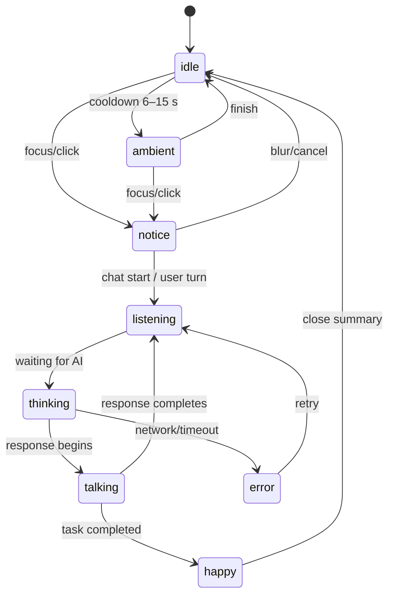
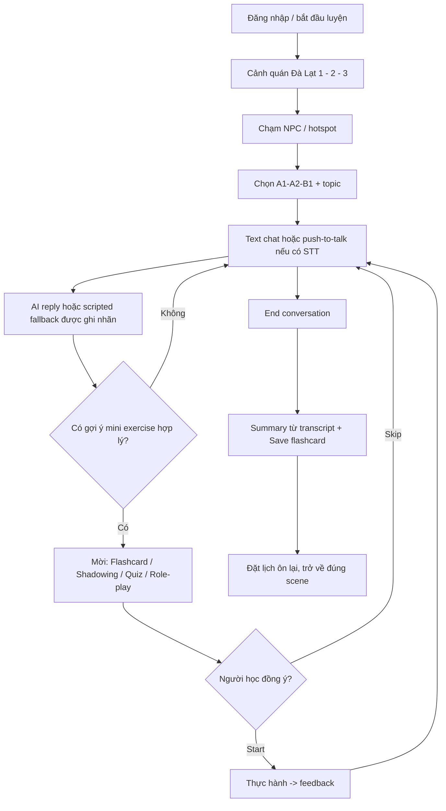
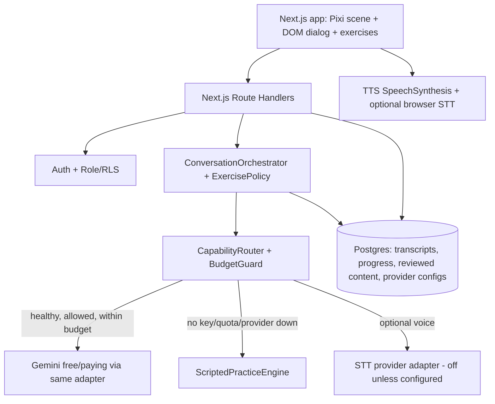
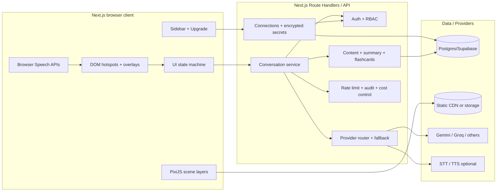
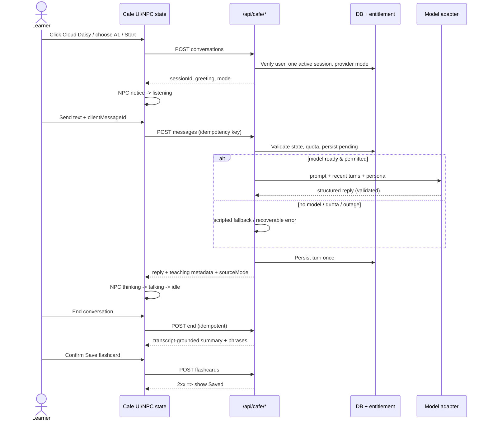
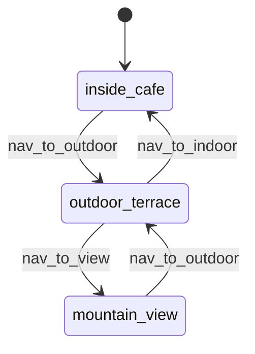
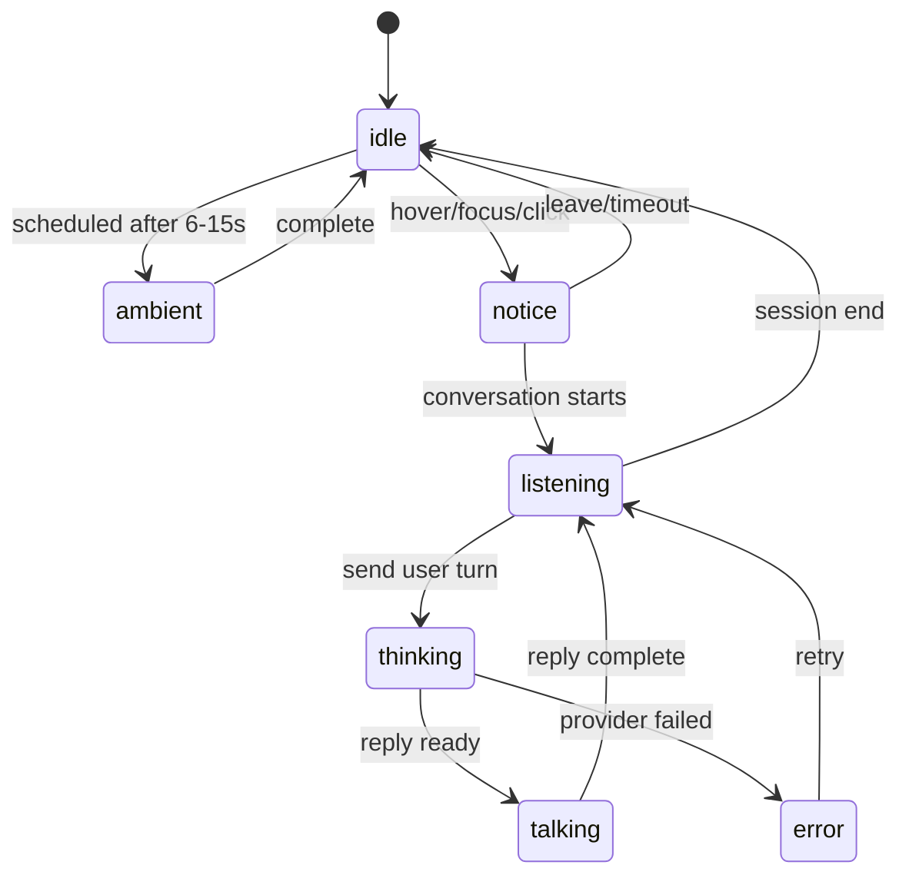

# CÀ PHÊ VỈA HÈ — ĐÀ LẠT
## MASTER SPECIFICATION v2.0.1 · TÀI LIỆU TRIỂN KHAI DUY NHẤT

**Dành cho:** Chủ dự án, Codex (VS Code), Product/BA, UI/UX, Game Art, FE/BE, AI/Content, QA.

> **Mục đích:** Tổng hợp và chuẩn hóa các yêu cầu từ v1.2 (thế giới Đà Lạt, 6 NPC, toa tàu, hội thoại), v1.3 (hạ tầng, đồ họa nhiều lớp, bảo mật), v1.4 (FREE-FIRST MVP + Admin Upgrade), giáo trình Lesson 01 và workflow kiểm duyệt ngôn ngữ, thành **một nguồn tham chiếu triển khai**. File này không phải bằng chứng các tính năng hay provider đã được lập trình/kết nối thành công.
>
> **Cách đọc ưu tiên:** (A) Quyết định & phạm vi áp dụng → (D) điều kiện MVP và (E) khung nâng cấp → (B/C) nội dung & mỹ thuật → (F–J) hợp đồng kỹ thuật, QA, backlog. Nếu ví dụ nguồn cũ khác với phần A, **phần A là tiêu chuẩn thực thi trong bản hợp nhất**.

### Cập nhật nhân vật — 05/11/2026 (revision 2.0.1, **không đổi tên file**)

- **Cloud Daisy** thay nhân vật Mây ở quầy S1: **đầu mèo trắng, thân người, trang phục mùa đông**, có tạp dề barista; giữ tính cách dịu dàng, chuyên môn cà phê và hội thoại gọi món. **Không còn hình dáng chim hồng/mỏ/cánh**.
- **Bear Explorer** thay nhân vật Đèo Explorer ở S2 và chuyến tàu T0–T5: **đầu gấu, thân người, trang phục thám hiểm**; giữ tính cách năng động, am hiểu Đà Lạt và vai trò dẫn tour. **Không còn gấu trúc đỏ/đuôi sọc**.
- Định danh canonical mới: `cloud_daisy`, `bear_explorer`; tên cũ chỉ phục vụ migration. **Cùng một NPC** trong UI, AI persona, asset, bài học, train và dữ liệu lịch sử; tổng NPC vẫn là 6.
- **Tương thích dữ liệu nếu đã có triển khai:** map `may → cloud_daisy` và `deo_explorer → bear_explorer` khi đọc bản ghi cũ; thực hiện migration transactional có backup + kiểm tra FK/index/RLS cho `npc_id`, `scene` config và asset references. Nếu chưa có database thì dùng ID mới ngay từ đầu. Không tự động tạo thêm 2 NPC, không duplicate conversations, progress hoặc flashcards.

### Mục lục

- **A.** Quyết định thống nhất, phạm vi, ngân sách, độ ưu tiên
- **B.** Mục tiêu học và chuẩn nội dung tiếng Anh
- **C.** World/Scene Bible Đà Lạt, Character Bible, toa tàu, kịch bản, mẫu câu
- **D.** PHẦN 1 — FREE-FIRST MVP: chức năng chạy thật, budget, memory, mini-games
- **E.** PHẦN 2 — Admin Upgrade: provider adapters, nhập key, test, activate, bảo mật
- **F.** Kiến trúc triển khai, scene runtime, animation, API, dữ liệu
- **G.** Prompt sản xuất art, asset manifest, content review
- **H.** Test matrix, bảo mật, Definition of Done
- **I.** Thứ tự triển khai trên VS Code + Codex, cấu trúc repo và prompt mẫu
- **J.** Nguồn kế thừa, thông số cần xác thực, quyết định còn mở

---

## A. QUYẾT ĐỊNH THỐNG NHẤT — PHẦN ÁP DỤNG ƯU TIÊN CAO NHẤT

### A.1. Quy mô triển khai

| Mục | Chốt cho bản hợp nhất |
|---|---|
| Người thực hiện | Chủ dự án tự xây dựng trong VS Code + Codex, tái dùng app English/Next.js đang có |
| Pilot | 5 học viên × 15 phút học/ngày × 30 ngày = **2.250 phút học/tháng** |
| Chi phí | **Free-first; mục tiêu $0 hoặc $5–10/tháng cho API biến phí do app quản lý**; *không phải cam kết hóa đơn tổng cộng* |
| Engine | 1 AI orchestration chung; **6 NPC có persona, chuyên môn, animation và lời thoại khác nhau** |
| Nền tảng | Next.js App Router + TypeScript + PostgreSQL/Supabase + PixiJS/DOM/CSS (tùy kiểm tra repo hiện tại) |
| Scene | Chính xác **3 scene điều hướng** `inside_cafe ↔ outdoor_terrace ↔ mountain_view` (mũi tên, không free roam) |
| Tàu | `scenic_train_ride` là **activity lồng trong `mountain_view`**, T0–T5; không phải scene thứ tư |
| FREE-FIRST | **Không có API key vẫn học được qua kịch bản**, không mạo nhận AI; khi có free key hợp lệ mới AI chat động |
| Upgrade | Đã code sẵn Admin/Backend/adapter cho **những provider có trạng thái supported**: Admin nhập key/config → Test → consent/cap → Activate; không chỉnh code/redeploy cho provider đã tích hợp |
| Trọng tâm | Giao tiếp tiếng Anh Mỹ A1/A2/B1, Basic → Better → Natural, flashcard, shadowing, phản xạ, spaced review, câu hỏi dựa ngữ cảnh |

### A.2. Những quyết định không được thay đổi tùy ý

1. Chỉ có 3 scene cấp cao; **cấm nhảy trực tiếp S1→S3**, không joystick/WASD/3D multiplayer. Tàu không làm thay đổi scene graph.
2. NPC/bàn/hotspot/label/UI/render text tách layer khỏi background; các cảnh là **cùng một quán lớn** ở Đà Lạt, không đặt quầy bar pha chế thứ hai ở sân ngoài.
3. **6 NPC canonical**: `cloud_daisy`, `ollie_owl`, `mimi_bunny`, `astro_bean`, `bear_explorer`, `gray_boo`; tên hiển thị lần lượt **Cloud Daisy, Ollie Owl (Owl Daily), Mimi Bunny (Bunny Hobbies), Astro Bean, Bear Explorer, Gray Boo**. Hai nhân vật đầu mèo trắng/thân người và đầu gấu/thân người **thay thế** mẫu tạo hình cũ, không tạo thêm NPC. Nếu repo/DB từng dùng `may` hoặc `deo_explorer`, phải migration/alias trước khi chuyển toàn bộ reference; không xóa dữ liệu học viên.
4. 1 active conversation/user; câu trả lời AI phải được validate; kết quả tổng kết dựa transcript thật, không bịa lỗi. Không chấm phát âm từ transcript STT đơn thuần.
5. NPC chỉ **mời** flashcard/shadowing/quiz đúng ngữ cảnh; người học chọn `Practice now`, `Not now` hoặc tắt gợi ý; không cắt ngang khi đang gõ/nói.
6. Learner memory là dữ liệu per-user có quyền kiểm soát; shared NPC knowledge chỉ chứa nội dung đã qua duyệt. Không coi RAG/memory là fine-tuning hay tự đào tạo mô hình.
7. `Nâng cấp / Upgrade` là trang **kết nối năng lực**, không phải thu tiền/mua Premium. Free mode luôn có đường lui.
8. API keys, encryption master key, service-role và DB URL **không bao giờ nằm trên client**. Admin key nhập qua HTTPS, mã hóa server-side, không đọc lại key cũ.
9. P0 có nguồn nội dung ngôn ngữ được duyệt; câu mới AI gợi ý không tự động được công nhận là nội dung xuất bản chính thức.
10. Các con số về giá/quota/provider/model là **giả định hoặc dẫn chứng theo ngày của tài liệu nguồn**; không hardcode làm cam kết thực tế. Xác nhận dashboard provider trước khi bật paid.

#### A.2.1. Hợp đồng tương thích nhân vật (Codex phải tuân thủ)

| Canonical ID (mới) | Display name | Old ID (để migrate, không render) | Scene | AI role | Asset prefix |
|---|---|---|---|---|---|
| `cloud_daisy` | Cloud Daisy | `may` | `inside_cafe` | Barista / Greetings / Ordering | `npc/cloud_daisy/` |
| `bear_explorer` | Bear Explorer | `deo_explorer` | `outdoor_terrace` + activity `scenic_train_ride` | Travel / Da Lat tour | `npc/bear_explorer/` |

**Nếu repo chưa có dữ liệu:** sử dụng canonical ID mới trong `configs/scenes.json`, persona JSON, DB seed, tất cả API, asset manifest và test. **Nếu đã có dữ liệu:** sử dụng migration/adapter phiên bản hóa: cập nhật `npc_id` trong sessions/progress/flashcard source refs và các FK liên quan, giữ nguyên UUID của bản ghi; chuyển đường dẫn asset sang ID mới, chỉ duy trì alias cũ ở lớp đọc dữ liệu trong giai đoạn chuyển tiếp. Test rollback và backup trước khi deploy. Hai ID cũ không có hotspot riêng.

### A.3. Phân kỳ thống nhất

| Năng lực | **P0 — phải chạy thật** (Free-first) | **Paid-ready — phải code sẵn khung từ P0** | **Mở rộng sau** |
|---|---|---|---|
| 3 cảnh, hotspot, NPC | Render scene và 6 NPC; 2.5D multilayer & animation cơ bản thực, không nút giả | Giữ nguyên runtime | Art/FX/phong cảnh động phức tạp |
| Text conversation | Scripted cho tất cả NPC; AI qua Gemini free nếu key & quota hợp lệ | Gemini/OpenAI adapter được test và chuyển routing qua Admin | Model/provider mới cần adapter mới |
| Mini practice | Flashcard, quick quiz, substitution, role-play, shadowing **có bản text/browser-TTS**, spaced review | TTS/STT/pronunciation adapter catalog; chức năng chỉ active nếu đã implemented | Đánh giá âm vị, prosody chuyên sâu |
| Voice | Text luôn dùng được; Browser TTS; STT browser *progressive enhancement* | Groq STT, OpenAI STT/TTS hỗ trợ khi triển khai & test thật | Realtime voice/streaming avatar |
| Memory/knowledge | Progress, learner preferences, due cards, curated SQL/tag search; opt-in learning facts | Optional embedding, pronunciation nếu adapter thật có | Fine-tuning chỉ sau đánh giá & quyền dữ liệu |
| Tàu ngắm Đà Lạt | **Bản hoạt động tối thiểu T0–T5 với kịch bản + 1 nền toa sạch + thẻ ảnh theo chủ đề**; nếu asset chưa hoàn thành, phải thể hiện rõ blocker (không gọi là done) | Không bắt buộc API trả phí để chạy tàu | Chuyển động tàu nhiều lớp, nhiều background riêng, âm thanh nâng cao |
| Admin Connections | Route, role, encrypted credential, catalog, test/activate/disable, budget/usage, audit **hoạt động thật** | Adapter đã code và qua test → chỉ nhập key để kích hoạt | Billing/subscription, BYOK cá nhân |

**Ghi chú hợp nhất:** Tài liệu v1.4 đánh dấu bản tàu mở rộng là optional/M8. Trong bản thống nhất này, do yêu cầu đưa tàu tham quan Đà Lạt vào trải nghiệm học, chọn **minimum viable scenic train** làm tiêu chí bàn giao nội dung/UX P0; phần art/animation cao cấp vẫn để sau. Đây là **quyết định tổ chức phạm vi được đề xuất trong bản hợp nhất**, chủ dự án có thể đổi bằng change request trước khi Codex làm art.

### A.4. Ngân sách thực tế & giới hạn của cam kết $5–10

| Tham số nội bộ | Giá trị khởi tạo đề xuất | Ghi chú |
|---|---:|---|
| `MAX_PILOT_USERS` | 5 | Allowlist test accounts do admin quản lý |
| `SESSION_GOAL_MIN` | 15 phút/ngày/user | Mục tiêu trải nghiệm, không đồng nhất với phút STT/TTS bị tính phí |
| `MONTHLY_AI_TURNS` | 1.500 lượt (minh họa) | 5 người × 10 lượt/ngày × 30; cần log thực |
| `MONTHLY_STT_MIN` | 900 phút (minh họa) | 6 phút ghi âm/người/ngày, không bắt buộc cho Free |
| `MONTHLY_TTS_MIN` | 900 phút phát tiếng (minh họa) | Browser TTS là mặc định, không có phí API TTS |
| `BILLING_MODE_DEFAULT` | `free_only` | Paid OFF, kể cả API key đã nhập |
| `MONTHLY_APP_VARIABLE_API_TARGET` | $8 (có thể chọn $5–10) | Không gồm Codex, điện/máy cá nhân, domain, subscription hosting ngoài app |
| `SOFT_WARNINGS` | 70% / 90% | App estimated usage |
| `APP_PREFLIGHT_STOP` | 95% | Không phải hard limit trên hóa đơn provider |

**Vấn đề bắt buộc:** 15 phút học/ngày **không có nghĩa** 15 phút gửi âm thanh + 15 phút tạo audio mỗi ngày. Quota miễn phí của Gemini/Groq/Supabase/hosting không được mặc định đảm bảo; khi hết quota phải fallback về scripted/text/browser. Một request đang bay, số liệu usage provider trễ, minimum billable duration hay thuế có thể làm hóa đơn vượt số app ước tính. Chỉ nhà cung cấp mới kiểm soát được hard spending cap nếu họ thật sự hỗ trợ.

### A.5. Ma trận chất lượng / phí / giới hạn (định tính, chưa phải benchmark)

| Thành phần | Free-first | Paid-ready | Khác biệt chất lượng / giới hạn |
|---|---|---|---|
| LLM | Gemini Free nếu được cấp, nếu không scripted | Gemini Paid/OpenAI | AI động linh hoạt hơn script; model paid **không tự động** tốt hơn mọi tình huống, phải test corpus |
| STT | Nhập text, Browser SpeechRecognition nếu browser hỗ trợ | Groq Whisper / OpenAI STT | STT dịch vụ có thể ổn định hơn across browsers; vẫn cần user xác nhận transcript |
| TTS | Browser SpeechSynthesis | OpenAI TTS | Paid có thể nhất quán giọng hơn, nhưng tạo phí theo yêu cầu; cache câu approved |
| Flashcard/quiz | Logic local/DB + published content | Như cũ | Không cần trả thêm cho mỗi lượt học nếu đã cache |
| Shadowing | Browser audio mẫu + repeat | Audio chất lượng cao + assess riêng | Không suy ra phát âm chính xác bằng text-match |
| Knowledge | PostgreSQL tag/full text | Embedding/pgvector | 5 user và corpus nhỏ thường chưa cần vector DB riêng |
| Hosting | Local dev / Hobby khi đúng điều khoản | Hosting paid sau | Không có benchmark tải/latency, đo thực tế |

### A.6. Tính chất kỹ thuật, mã nguồn & quyền sở hữu

- Thiết kế tất cả code là **một app, một repo**, không fork codebase Free/Paid. Capability router quyết định cách chạy.
- Mọi API outbound có `timeout`, error classification, rate-limit, idempotency, budget ledger, opt-in; nếu chưa hỗ trợ, trạng thái `planned/unsupported`, không cho Activate.
- Art AI **phải render thành tài sản tách lớp thực** (PNG/WebP alpha, atlas); hình minh họa concept không tự động trở thành background production. Nguồn và quyền sử dụng asset được lưu manifest.
- Sử dụng tài liệu này làm hướng dẫn triển khai, **không coi TypeScript/SQL pseudocode bên dưới là copy-paste production-ready**; cần kiểm tra dự án thực tế, migrations, auth và test.

---


## B. CHUẨN HỌC TIẾNG ANH & KHO NỘI DUNG

**Hệ thống ưu tiên Natural Everyday American English.** Một buổi học phải có mục tiêu giao tiếp rõ; nói đúng ý, giữ mạch trước, sau đó sửa cách nói tự nhiên. Dùng Basic → Better → Natural; hint tiếng Việt khi cần. Mẫu câu `I usually...`, `On the way to...`, `wrap things up`, `get some coffee` trong Lesson 01 là **seed patterns**, không đưa lịch trình cá nhân của học viên vào nội dung công khai.

**Nền tảng đánh giá:** A1/A2/B1 chọn bởi học viên; tutor không tự thay đổi cấp học vĩnh viễn. Không chấm điểm CEFR chuẩn hóa từ vài phút chat. Kiểm duyệt nội dung published theo `CONTENT_REVIEW_WORKFLOW.md` (Cambridge US, COCA, YouGlish US, IPA và audio phải khớp câu xuất bản); tài liệu nguồn cung cấp quy trình kiểm chứng, **không thay thế việc đội nội dung thực sự làm review**.

**Phân biệt nguồn sự thật:** `Published content` có reviewer/bằng chứng/version; `AI ad-hoc suggestion` phục vụ riêng một phiên, chưa được duyệt; `User statement` không biến thành tri thức dùng chung của NPC. Tất cả chủ đề Đà Lạt là hội thoại/scene giả tưởng có cảm hứng địa phương; không khẳng định toa tàu mui trần hay tuyến cảnh quan trong app là dịch vụ thật.


### MỤC TIÊU HỌC TẬP VÀ ĐỐI TƯỢNG

#### Learning outcomes

Sau một phiên 5–8 phút, người học có thể:

- Chào hỏi và đặt đồ uống: `Could I get a coffee, please?`.
- Giới thiệu công việc, thói quen ngày thường, sở thích và chuyến đi.
- Gọi tên, mô tả màu, vị, mùi và cảm giác của trái cây, hoa, món đặc sản.
- Hỏi — trả lời tự nhiên: `What is that?`, `Have you tried it?`, `What does it taste like?`, `Which one would you pick?`.
- Nói thành câu trong **30–60 giây** về khung cảnh mình đang nhìn thấy; tăng dần 2–3 phút ở A2/B1.
- Học đúng **cụm câu có ngữ cảnh**, không chỉ học từng từ rời rạc.
- Biết cách sửa một câu cơ bản thành câu **Basic → Better → Natural**.

#### Nguyên tắc học của dự án English

- Trình độ: **A1, A2, B1**; tiếng Anh giao tiếp **American English**; có giải thích tiếng Việt khi cần.
- Từ vựng: ưu tiên **từ/cụm phổ biến, dễ tái sử dụng**, dựa vào định hướng Vietnam Spoken Core và Oxford 3000 **như tài liệu tham khảo, không làm rào cản cứng**. Cho phép từ địa phương cần thiết như `persimmon`, `hydrangea`, `artichoke`, `Da Lat strawberry jam`.
- Lộ trình học tổng thể: **nghe/nói là trọng tâm**. Bản MVP text phục vụ xây nền hội thoại; **không tự tuyên bố đã đánh giá phát âm** khi chưa có audio assessment.
- Vòng học lý tưởng: `Listen → Understand → Speak → Recall → Spaced Review` (voice phát triển ở P1; P0 hỗ trợ đọc — phản xạ — luyện câu — lưu thẻ).
- Học viên được nói sai an toàn; AI sửa **ngắn, đúng ngữ cảnh**, tránh ngắt lời sau mọi từ.
- Chấm theo **ý định giao tiếp trước** rồi mới ngữ pháp/độ tự nhiên. Không áp đặt chỉ có một đáp án.
- Ví dụ hội thoại trong tài liệu này là **content draft**, phải đi qua kiểm duyệt từ vựng/ngữ dụng/phát âm trước khi phát hành.

#### Định nghĩa một “đơn vị học”

```text
Scene + NPC + Topic + Learner Level + Goal + Context Objects
  → Opening line → User turn → NPC reaction → Follow-up
  → Feedback → Phrase(s) to remember → Review schedule
```

Mỗi NPC nên có **mục tiêu nhỏ có thể hoàn thành** thay vì trò chuyện vô tận. Ví dụ với Bear Explorer: “Hỏi 2 loại trái cây, mô tả 1 loài hoa, chọn 1 món quà”.

---


## C. WORLD, SCENES, NHÂN VẬT, TOA TÀU & HỘI THOẠI

> **Art baseline:** 3 cảnh lớn liền mạch cùng một quán; background không NPC, chữ, mũi tên hoặc hotspot; 16:9, 1920×1080 logical; nhân vật là sprite alpha độc lập; toa mui trần là activity của Scene 3. Các tọa độ % dưới đây chỉ là *staging anchors*, hiệu chỉnh theo asset đã duyệt. Không dùng thông tin ngoài đời chưa xác minh làm dữ liệu thực tế trong trò chuyện.


### WORLD BIBLE: ĐÀ LẠT TRONG THẾ GIỚI CÀ PHÊ

#### Ngôn ngữ hình ảnh thống nhất

| Thành phần | Tiêu chuẩn |
|---|---|
| Style | Cozy fantasy, premium mobile game, storybook anime, nhân vật chibi cao khoảng 2–3 đầu |
| Chất liệu | Gỗ mật ong, đá xám ấm, mái ngói đỏ/tím trầm, kính cao, sàn gỗ, lan can gỗ |
| Màu sắc | Kem `#FFF3D9`, gỗ `#74452F`, vàng mật ong `#FFC65C`, plum `#523A72`, xanh trời `#70B8E8`, hồng `#FF76AD` |
| Ánh sáng | Late morning, ánh vàng mềm từ phía phải; trong nhà ấm, ngoài trời sương xanh nhạt |
| Cây xanh | Rừng thông chủ đạo; cây bụi, dương xỉ, dây leo vừa phải, lá chuyển động rất nhẹ |
| Hoa | Cẩm tú cầu pastel xanh/hồng là điểm nhấn ổn định; mimosa vàng, hoa hồng, mai anh đào/dã quỳ **theo mùa hoặc ở cảnh phụ phù hợp** |
| Địa hình | Đồi chồng lớp, thung lũng, đường đèo cong chữ S xa xa, mây/sương trôi, hàng lan can an toàn |
| Tỷ lệ | Dù là fantasy, tủ/quầy, ghế, cửa, người/ngồi và tay vịn phải nhất quán |
| Camera | Wide establishing 3/4, 26–30mm equivalent, eye height khoảng 1,8–2,2m; không fisheye |
| HUD/Hotspot | Text/UI là DOM/SVG ở layer riêng, không có chữ sinh bởi AI nằm trong nền |

**Quy tắc mùa:** Không đưa đồng thời tất cả loài hoa như thể chúng đều nở rộ cùng một ngày. Bản visual mặc định dùng cẩm tú cầu, hoa chậu và rừng thông; những loài theo mùa chỉ dùng ở nội dung giải thích, ảnh minh họa hoặc theme tùy chọn. Hình ảnh phong cách fantasy không phải bằng chứng về lịch hoa thực tế.

#### Ambient sound (mô tả thiết kế, không bắt buộc P0)

| Khu | Âm thanh nền | Âm lượng/nhịp | Khi bật chat |
|---|---|---|---|
| Trong quán | Máy pha cà phê ở xa, tiếng ly chạm, nhạc acoustic instrumental nguyên bản | êm, không lấn thoại | duck khoảng 50–65% |
| Ngoài trời | Gió nhẹ qua thông, chim xa, tiếng lá, đồ uống đặt trên bàn | tự nhiên, không lặp gắt | duck khoảng 50–65% |
| View đèo | Gió qua lan can, tiếng chim rừng, gợn sương | rất nhẹ | duck khoảng 50–65% |
| Tàu mui trần | Nhịp bánh tàu hư cấu êm, gió, tiếng lá, tiếng cười xa | không có còi tàu giật mình | duck khoảng 65–75%; mute được |

Không autoplay âm thanh lớn. Có `Mute/Unmute`, tôn trọng reduced-motion/reduced-data; voice và ambience điều chỉnh riêng khi P1.

---

### SƠ ĐỒ CẢNH CHÍNH VÀ CONTINUITY

| Mã | Scene ID | Quy mô bố cục tham khảo | Cửa/kết nối | Nhân vật/hoạt động |
|---|---|---|---|---|
| S1 | `inside_cafe` | Quán khoảng 15×10m, 8–10 bàn | Cửa kính/gỗ bên phải → S2 | Cloud Daisy (quầy), Owl (Daily Life), Bunny (Hobbies) |
| S2 | `outdoor_terrace` | Sân khoảng 20×12m, 8–12 bàn | Trái ↔ S1; phải ↔ S3 | Astro Bean (Space), Bear Explorer (Travel) |
| S3 | `mountain_view` | Sàn view khoảng 22×12m, ghế dài/lan can | Lối trái ↔ S2 | Gray Boo (Aliens), ghế ngắm cảnh (`viewpoint_seat`) |
| TX | `scenic_train_ride` **activity ID** | Không phải scene điều hướng | Mở và đóng về **S3** | Bear Explorer làm người hướng dẫn; các cảnh hội thoại hoa/trái cây/đặc sản |

##### Quy tắc camera nối cảnh

- S1 và S2 nhìn đúng **cùng quán**: cửa kính, vật liệu gỗ, mái, mảng hoa, màu sáng giống nhau.
- S2 và S3 là **một sân mở kéo dài**, không đổi phong cách thành một khu du lịch khác.
- S3 nhìn thấy đèo từ xa; đường đèo ở **hậu cảnh**, không đặt nhân vật trên lòng đường hay sát mép vực.
- Chuyến tàu TX là **trải nghiệm nhập vai chuyển cảnh có chủ đích** (flashback/fantasy postcard). Không giả định đường tàu thật xuất phát ngay bên mép đèo/quán.

---

### SCENE S1 — TRONG QUÁN (`inside_cafe`)

#### Mô tả mỹ thuật chi tiết

**Góc nhìn:** wide shot chéo 3/4 từ cửa trước nhìn sâu vào trong. Phần **trái ~25%** là quầy pha chế dài có máy pha espresso, máy xay, ly gốm, lọ đậu cà phê; **giữa** là cụm bàn nói chuyện đời thường; **phải** là góc hobbies với kệ sách/ukulele và cửa kính cao thông ra sân. Trần gỗ với dầm rộng, đèn vàng, vài chậu cây. Qua cửa sổ thấy thông và dải sương trên đồi. Phòng rộng, không ngột ngạt, **2 lối đi thông thoáng**.

**Yêu cầu hình học:** khoảng cách bàn/ghế hợp lý, số chân ghế đúng, mặt bàn đặt ở cao độ tương ứng NPC, không có vật thể nổi, cửa không biến dạng. Bàn không che vùng tương tác.

#### Storyboard hoạt động

| Trigger | Cloud Daisy | Owl Daily | Bunny Hobbies | FX/UI |
|---|---|---|---|---|
| Scene ready | Đang xếp ly; nhìn lên mỉm cười và vẫy **một lần** cho khách mới | Nhìn laptop, chớp mắt | Nghiêng tai, lật sách | Nắng cửa sổ, hơi cà phê mỏng |
| Idle | Lau ly bằng khăn | Chỉnh kính, uống cà phê | Ngồi thư giãn, chân đung đưa rất nhẹ | Không phát FX liên tục không kiểm soát |
| Hover/focus hotspot | Quay mặt theo hướng người học, nâng tay | Ngẩng đầu, khép laptop nhẹ | Tai dựng, mắt mở lớn | Outline/hint nameplate, không tự mở chat |
| Click | Cloud Daisy mời bằng hai tay | Owl gật đầu | Bunny giơ tay chào | Mở interaction sheet, khóa nền |
| Correct answer | Mắt sáng, nở nụ cười | Gật đầu tán thành | Hai tai bật lên vui vẻ | Không bắn confetti gây nhiễu |
| Error/timeout | Hơi ngạc nhiên rồi bình tĩnh | Nhìn notebook | Nghiêng đầu cảm thông | Retry, giữ nội dung user |

#### Hotspot & vị trí neo (baseline)

| ID | Anchor x,y% | Hành động | Chủ đề |
|---|---|---|---|
| `npc_cloud_daisy` | ~19,55 | Mở Cloud Daisy/Counter | Greetings, ordering, small talk |
| `npc_owl_daily` | ~50,62 | Mở Owl | Routine, work, coworkers, free time |
| `npc_bunny_hobbies` | ~77,65 | Mở Bunny | Hobbies, books, music, weekend |
| `nav_to_outdoor` | ~94,47 | Sang `outdoor_terrace` | Navigation |

Các anchor là **điểm nhắm mục tiêu để art layout**, không phải hitbox chốt. Chân sprite và hitbox ở file config khác, cần calibrate sau khi có ảnh sạch.

#### Mini interactions gợi ý

- **Cloud Daisy:** chọn `Order a drink` hoặc `Small talk`; user hỏi đồ uống nóng vì thời tiết lạnh.
- **Owl:** hỏi `How was your morning?` và câu trả lời liên hệ Lesson 01 (get up, head out, grab breakfast, work as a BA, wrap things up).
- **Bunny:** người học mô tả sở thích nghe nhạc, chụp ảnh hoa, đi cà phê cuối tuần.

---

### SCENE S2 — SÂN NGOÀI TRỜI (`outdoor_terrace`)

#### Mô tả mỹ thuật

Sân lát đá/gỗ khoảng 20×12m, **8–12 bộ bàn** có khoảng cách tự nhiên, ô che nắng, dây đèn nhỏ, bồn hoa cẩm tú cầu dọc mép sân, vài chùm mimosa vàng trang trí hợp lý, rừng thông nhiều tầng ở xa. **Trái** giữ khung cửa gỗ kính của S1 và một góc mái quán; **giữa** bàn Astro Bean; **phải** bàn Bear Explorer cạnh lối đi ra view; bên kia lan can là dải sương và đoạn đèo xa. Không có quầy pha chế ngoài trời.

**Không gian phải rộng**: hành lang không bị bàn/chậu hoa chặn, bầu trời và đồi sâu, NPC không “dính” vào ghế.

#### Storyboard hoạt động

| Mốc | Astro Bean | Bear Explorer | Environment |
|---|---|---|---|
| Scene ready | Ngắm mây, ngón tay chỉ lên trời | Kiểm tra bản đồ gấp | Cành thông rung nhẹ, vài cánh hoa rơi |
| Idle | Chạm một ngôi sao trên huy hiệu; ngắm bầu trời ban ngày | Giơ máy ảnh chụp xa, đeo lại | Sương bay chậm, không làm lệch background |
| Hotspot focus | Quay kính mũ nhìn người học | Quay đầu, vẫy tay | Nameplate không che mặt |
| Start talk | Giải thích vui `It's a beautiful day for a little space talk.` | `Want to explore Da Lat?` | Mở sheet, giữ scene tĩnh |
| Hint/correction | Chỉ hình hành tinh nhỏ **trên UI**, không sinh vật thể thật | Đưa ra ví dụ chỉ đường | Chỉ animation khi có interaction |

#### Hotspot & neo

| ID | Anchor x,y% | Hành động |
|---|---|---|
| `nav_to_indoor` | ~6,47 | Về `inside_cafe` |
| `npc_astro_bean` | ~36,59 | Space/planets/skies |
| `npc_bear_explorer` | ~70,59 | Travel, directions, Da Lat day trip |
| `nav_to_view` | ~94,47 | Sang `mountain_view` |

#### Gợi ý lời thoại theo cảnh

- Bear Explorer nhìn mây: **“It’s a little chilly, but the view is amazing.”** — “Hơi se lạnh, nhưng cảnh đẹp quá.”
- Người học: **“I love the pine trees. Can we take a picture here?”** — “Tôi thích những hàng thông. Chúng ta chụp ảnh ở đây được không?”
- Astro Bean: **“Do you ever look at the stars when you travel?”** — “Bạn có bao giờ ngắm sao khi đi du lịch không?”

---

### SCENE S3 — VIEW ĐÈO (`mountain_view`)

#### Mô tả mỹ thuật

Sân ngắm cảnh lớn khoảng 22×12m, có hàng lan can chắc chắn, **2–3 băng ghế**, chòi gỗ nhỏ bên trái, ghế riêng để luyện `Describe this view`, chậu hoa và thông thấp. Thung lũng thông xanh nhiều lớp, đường đèo chữ S nằm xa dưới sườn núi, nắng xiên nhẹ xuyên sương. Khoảng **40–50% phần dưới khung** dành cho sàn và ghế để giữ cảm giác đây là nơi thật, không phải ảnh toàn núi. Không có NPC/biển chữ trong background sạch.

#### Storyboard hoạt động

| Mốc | Gray Boo | Ghế ngắm cảnh |
|---|---|---|
| Idle | Đọc cuốn `Earth Guide` không có chữ thực trên sprite, nghiêng đầu hiếu kỳ | Điểm sáng mờ nhẹ trên hotspot |
| Focus Gray | Mắt xanh tím long lanh, chớp mắt | Không đổi |
| Focus viewpoint | Gray vẫn idle | UI card nhỏ `Describe the view` / `Take a scenic train ride` |
| Talk | Gray tò mò về thời tiết, hoa, con người và sự khác biệt văn hóa; không gây sợ hãi | Nếu `Describe`: mở bài mô tả; nếu `Train`: mở TX |
| Return from train | Gray về idle | Khôi phục focus và camera S3 nguyên trạng |

#### Hotspot & neo

| ID | Anchor x,y% | Hành động |
|---|---|---|
| `nav_to_outdoor` | ~6,64 | Quay về S2 |
| `viewpoint_seat` | ~29,76 | Mở menu 2 hoạt động: `Describe this view` / `Open-Air Scenic Train` |
| `npc_gray_boo` | ~68,59 | Aliens & Earth Culture |

**Quan trọng:** Dùng **chính** `viewpoint_seat` để vào tàu, không vẽ thêm mũi tên từ S3 tới một scene thứ tư. Hoạt động tàu có nút rõ `Back to Mountain View`.

---

### CHARACTER BIBLE — 6 NPC CHUẨN (ĐÃ CẬP NHẬT)

#### Quy chuẩn rig và nhân dạng

- **Tính nguyên bản:** nhân vật chibi mới, không sao chép mascot/nhân vật IP khác; tạo `model-lock` trước.
- Cao khoảng **2,5–3 đầu**; với Cloud Daisy và Bear Explorer ưu tiên **2,7–3 đầu** để nhìn rõ đầu thú + thân người; tỷ lệ đầu–mắt–tay nhất quán. Contour rõ ở cỡ 150–260px trong cảnh toàn; khi chat có chân dung/cận mặt riêng.
- Source full-body **1024×1024 hoặc 768×1024** với RGBA thật; xuất runtime tối ưu. Góc **3/4 front**, ánh sáng từ trên-phải.
- **Không** bake bóng đổ xuống ảnh sprite, không white/checkerboard fake alpha, không có nền, text hay border.
- Các phần tháo rời: phụ kiện, miệng, tay/cánh, mí mắt nếu rig; asset props độc lập khi cần.
- Những trạng thái tối thiểu: `idle`, `ambient`, `notice`, `talking`, `listening`, `thinking`, `happy`, `error`. Không bắt buộc phải vẽ 8 ảnh độc lập nếu hệ thống dùng rig/chuyển pose; **các trạng thái có ý nghĩa phải phân biệt được**.
- Nhân vật **không được bình luận sai như người thật hoặc tự nhận biết người học ngoài dữ liệu session**; mọi voice persona là tiếng Anh Mỹ rõ ràng, tốc độ phù hợp level ở P1.

#### NPC 01 — CLOUD DAISY (barista, quầy cà phê)

| Thuộc tính | Mô tả |
|---|---|
| Tên hiển thị / định danh | **Cloud Daisy** / `cloud_daisy` (thay nhân vật Mây cũ; không tạo NPC thứ bảy) |
| Species/silhouette | **Đầu mèo trắng** với tai mèo tam giác, lông trắng mịn, má hơi hồng, mũi hồng nhạt, mắt tròn dễ mến và râu mèo ngắn; **thân người** chibi hai tay/hai chân, đứng thẳng bằng hai chân, bàn tay người cách điệu mang găng; **không có mỏ, cánh hoặc thân chim** |
| Trang phục mùa đông | Áo khoác dạ/puffer ngắn màu kem nhạt, khăn len xanh pastel hoặc burgundy, mũ len nhỏ có chi tiết hoa cúc trắng, găng tay, quần nâu ấm và boots cổ ngắn; bên ngoài áo khoác có **tạp dề barista màu nâu mật ong** để nhận ra vai trò phục vụ |
| Nhận diện bắt buộc | Đầu mèo trắng + thân người + outfit mùa đông xuyên suốt mọi pose; sắc trắng không hòa mất vào nền sáng; không biến thành mèo bốn chân hay mèo mascot toàn thân |
| Vai trò & tính cách | Barista đón khách; dịu dàng, ấm áp, quan tâm và kiên nhẫn. Giữ chuyên môn gọi đồ uống, small talk mùa lạnh Đà Lạt và vai trò NPC S1 cũ |
| Props tháo rời | Cốc gốm, khăn lau, khay đồ uống, menu riêng hiển thị qua DOM; base model không cầm vật dụng cố định |
| Biểu cảm | Welcome smile, listening/curious, encouraging, delighted, gentle surprise, apologetic; tai mèo vểnh/hạ nhẹ tương ứng cảm xúc |
| Idle/ambient | Kéo nhẹ khăn choàng cho ngay ngắn → lau cốc → xếp cốc → chớp mắt và nhìn khách |
| Notice/click | Quay đầu mèo về phía người học, nâng **bàn tay phải** vẫy, mỉm cười và cúi nhẹ; chuyển động chậm, thân thiện |
| Talking | Miệng mèo cử động theo nhịp câu; tay trái cầm khay khi cần, tay phải mở lòng bàn tay chỉ menu DOM; không dùng mỏ/cánh chim |
| Listening | Nghiêng đầu 10–15°, tai hướng về người nói, miệng khép, ánh mắt chăm chú |
| Correct user | Mỉm cười rạng rỡ, gật đầu một lần và nâng tay khích lệ; tránh hoạt hình khoa trương |
| Error state | Hơi nhíu mày quan tâm, hạ tay, rồi biểu cảm trấn an; hiển thị Retry |
| Voice/tone | Friendly everyday US English, nhịp nói dịu, rõ; `Hi! What can I get for you?` |

**Model lock:** Giữ nguyên màu mắt, hình dạng tai/mõm, kiểu khăn/mũ, tạp dề và tỉ lệ đầu–thân cho tất cả pose, portrait/chat avatar, sprite scene và thumbnail. Ánh sáng từ trên bên phải. Cần có `idle`, `ambient_wipe`, `notice`, `listening`, `talking`, `thinking`, `happy`, `error`.

#### NPC 02 — OWL DAILY (đời sống, công việc)

| Thuộc tính | Mô tả |
|---|---|
| Species/silhouette | Cú nâu đất, thân tròn, ngực lông màu kem, **kính gọng vàng to** |
| Trang phục | Cardigan xanh teal, áo trắng, túi đeo xanh, đồng hồ kim nhỏ |
| Vai trò | Bạn đồng nghiệp hiểu chuyện, nói rõ ràng; chủ đề phù hợp người đi làm, IT/BA/UX/UI |
| Props | Notebook, laptop **tách rời**, cốc cà phê |
| Idle/ambient | Gõ laptop → kiểm tra ghi chú → chỉnh kính → nhấp cà phê |
| Click | Ngẩng lên, chỉnh kính, mỉm cười; mở notebook như chuẩn bị nghe chuyện |
| Talking | Mỏ và cánh cử động tiết chế; khi hỏi thời gian chỉ đồng hồ |
| Listening | Gật đầu, nhìn vào người học, không xen lời |
| Thinking | Một cánh gần mỏ, mắt nhìn hơi chếch trên |
| Chủ đề | Daily routine, coworkers, workday, deadlines, commute, weekends |
| Cụm từ liên kết bài cũ | `get up`, `head out`, `grab breakfast`, `clock in`, `wrap things up`, `head home` |

#### NPC 03 — BUNNY HOBBIES (sở thích)

| Thuộc tính | Mô tả |
|---|---|
| Species/silhouette | Thỏ trắng kem, tai dài với lòng tai hồng, đôi mắt lanh lợi |
| Trang phục | Mũ len plum tím có hoa vàng nhỏ, áo khoác lavender, khăn hồng, giày buộc dây nâu |
| Vai trò | Bạn trò chuyện về âm nhạc, đọc sách, đi chơi; mang năng lượng vui nhưng không trẻ con hóa nội dung |
| Props | Ukulele mini tách rời, sách, máy ảnh instant tùy chọn |
| Idle/ambient | Lật sách, nhìn hoa ngoài cửa, gảy 1–2 nốt ukulele nguyên bản ở chế độ âm thanh opt-in |
| Click | Tai dựng lên, quay đầu, giơ một tay chào |
| Talking | Tai nhún nhẹ khi hỏi câu, tay biểu thị sở thích |
| Listening | Cười bằng mắt, đặt hai tay lên gối |
| Happy | Hai tai bật nhẹ, vỗ tay **một lần** |
| Chủ đề | Hobbies, music, reading, photography, favorite flowers |

#### NPC 04 — ASTRO BEAN (vũ trụ)

| Thuộc tính | Mô tả |
|---|---|
| Species/silhouette | Gà con chibi hồng/kem; **khác rõ Cloud Daisy** ở bộ đồ phi hành gia và hình khối |
| Trang phục | Space suit trắng phồng, viền xanh cobalt/cam, ủng cam, balô nhỏ, mũ kính trong thấy mặt |
| Vai trò | Bạn mê khám phá, nói về bầu trời/hành tinh; giữ tính giả tưởng khi nói về aliens |
| Props | Cốc ngôi sao, kính ngắm cầm tay tháo rời |
| Idle/ambient | Chỉ mây, chạm huy hiệu ngôi sao, nhìn lên trời |
| Click | Quay mũ về camera, cánh chào |
| Talking | Giơ một cánh làm động tác giải thích, mắt sáng |
| Listening | Gật đầu nhẹ, mặt rõ sau kính |
| Excited | Nhảy nhẹ tại chỗ, không xuất hiện động cơ đẩy nguy hiểm |
| Chủ đề | Sky, stars, moon, planets, imagination |

#### NPC 05 — BEAR EXPLORER (du lịch; hướng dẫn chuyến tàu)

| Thuộc tính | Mô tả |
|---|---|
| Tên hiển thị / định danh | **Bear Explorer** / `bear_explorer` (thay Đèo Explorer cũ; không tạo NPC thứ bảy) |
| Species/silhouette | **Đầu gấu** màu nâu mật ong, tai tròn, mõm kem, mũi nâu đậm, mắt sáng thân thiện; **thân người** chibi hai tay/hai chân, đứng thẳng, bàn tay người cách điệu có găng; **không phải gấu trúc đỏ**, không mặt nạ sọc đỏ, không đuôi vằn |
| Trang phục | Áo khoác thám hiểm xanh rêu nhiều túi, áo lót kem, khăn teal, mũ safari/explorer nâu, ba lô mustard, quần kaki và giày leo núi nâu; phục trang bền bỉ, gọn gàng, hợp tiết trời Đà Lạt |
| Vai trò & tính cách | Hướng dẫn viên đam mê khám phá, cởi mở, nhiệt tình, tôn trọng văn hóa địa phương; **người dẫn chuyện duy nhất cho scenic-train activity** |
| Props tháo rời | Bản đồ giấy gấp, camera đeo cổ, ống nhòm, giỏ dâu tây mẫu, hộp quà; không gắn dính vào base model |
| Idle/ambient | Xem bản đồ → dùng camera chụp đồi thông → kiểm tra dây ba lô → chỉ khung cảnh |
| Notice/click | Quay đầu gấu về learner, một tay vẫy chào, nhướng mày vui; dáng đứng người vững vàng |
| Talking | Giải thích đường đi, dùng **bàn tay** chỉ trái/phải hoặc về phía hoa/trái cây; không xuyên thành tàu, không gesticulate quá mức |
| Listening | Gật đầu, tai tròn nghiêng nhẹ, camera/ba lô đứng yên, miệng khép, nhìn người nói |
| Thinking | Mở bản đồ bằng hai tay, liếc xuống rồi nhìn lại learner; giữ nhịp tự nhiên |
| Delighted | Mắt sáng, mỉm cười, mở hai tay như mời ngắm cảnh; không nhảy lên ghế/toa |
| Train-specific | Pose **ngồi** thật trên ghế gỗ, thân người/bàn chân đúng tỷ lệ, dây ba lô và tay không xuyên ghế. Đứng khi tàu dừng; khi chạy ngồi an toàn và chỉ tay trong phạm vi lan can |
| Chủ đề | Travel, directions, weather, Da Lat pine forests, strawberries, hydrangeas, artichoke tea, dried persimmons, local specialties |
| Giọng | US English rõ ràng, ấm áp, hơi hào hứng; tốc độ điều chỉnh theo A1–B1 |

**Model lock:** Giữ đúng đầu gấu + cơ thể người trong mọi ảnh: biểu cảm, góc máy, màu lông, tỉ lệ mõm, mũ safari, áo khoác, quần, boots. Bộ train T0–T5 phải cùng ID nhân vật như sprite S2; không tạo thêm người dẫn khác. Ít nhất có `idle`, `ambient_map`, `ambient_photo`, `notice`, `listening`, `talking`, `thinking`, `happy`, `error` và các pose tàu riêng.

#### NPC 06 — GRAY BOO (người ngoài hành tinh thân thiện)

| Thuộc tính | Mô tả |
|---|---|
| Species/silhouette | Alien **xám lavender**, đầu quả lê to, mắt hạnh nhân xanh đêm có highlight, dáng nhỏ đáng yêu |
| Trang phục | Hoodie teal oversize có patch hành tinh, sneaker plum |
| Vai trò | Hỏi các câu đời thường qua ánh nhìn tò mò của một người ngoài hành tinh **giả tưởng** |
| Props | Sách `Earth Guide` không vẽ chữ lên sprite, cốc nhỏ |
| Idle/ambient | Đọc sách, ngắm mây, thử ngửi mùi cà phê |
| Click | Nghiêng đầu 12°, mắt chớp, cười nhỏ |
| Talking | Môi nhỏ, tay diễn đạt câu hỏi thú vị |
| Listening | Chớp mắt, nghiêng đầu, ít cử động |
| Chủ đề | Earth culture, daily customs, why people drink coffee, aliens in fiction |
| Chống lỗi | Không tự khẳng định aliens có thật hay công nghệ ngoài hành tinh là sự kiện được chứng minh |

#### Animation state machine chung



**State priority:** `error > talking > thinking > listening > notice > ambient > idle`. Thời gian tham chiếu: idle bob 2–3px/2,4–3s, notice 350–650ms, happy 600–900ms, motion khi chat giảm tối đa. Thiết bị reduced motion hiển thị sprite ít chuyển động/không bounce.

---

### TRẢI NGHIỆM MỚI: TOA TÀU THAM QUAN MUI TRẦN (`scenic_train_ride`)

#### Ý đồ cảnh

Sau khi ngắm rừng thông từ view đèo, người học nhấn `viewpoint_seat` → chọn **“Take a scenic train ride”**. Màn hình mờ dần; mở một **toa tàu du lịch chibi mui trần**, vách thấp có lan can an toàn, mái mở phía trên để nhìn trọn trời/sương, ghế gỗ đệm kem, viền đồng, hoa chậu nhỏ gắn chắc ở góc, ô cửa thành rộng. Người học được tưởng tượng ngồi cùng **Bear Explorer**, nói chuyện về vườn dâu tây, hoa, hồng treo và món quà Đà Lạt.

**Định vị sản phẩm:** đây là hoạt động học được kể như một chuyến tham quan **hư cấu có cảm hứng từ Đà Lạt**, không phải phần đặt vé tàu hay chỉ dẫn tuyến đường thật. Nếu sau này tích hợp tuyến thực tế, content/visual phải duyệt lại để không tạo sai lệch địa lý.

#### Hình dáng toa và yếu tố an toàn thị giác

- **Toa số lượng:** một toa chính duy nhất đủ cho hai nhân vật (Bear Explorer và góc nhìn người học). Tránh tạo đoàn tàu dài che phong cảnh.
- **Kiểu:** thân gỗ phối kim loại màu đồng/teal; góc bo tròn, sàn gỗ, các hàng ghế cố định, lan can cao và thanh chắn rõ ràng.
- **Mui trần:** **không có mái che cứng phía trên khu ngồi**, phía trước có một khung cong duyên dáng để tạo silhouette; không khiến người học thấy đang đứng trên nóc tàu.
- **Tư thế:** Bear Explorer ngồi/đứng tại vùng được chắn an toàn, không đưa tay/người ra ngoài, không nhảy khi tàu chạy.
- **Cây/hoa:** sương và cành thông ở xa, hoa cẩm tú cầu bờ thấp, các giàn hoa/vườn trái cây đi qua ở khoảng cách an toàn.
- **Phối cảnh:** camera 3/4 từ phía sau/bên cạnh người học, thấy Bear Explorer, một phần ghế và **70% lợi thế của cảnh ngắm**; không biến toa thành căn phòng kín.
- **Tính nhất quán:** đúng họa pháp BG-01–03, không render thành ảnh thật hoặc toa tàu Tây Âu không có bản sắc Đà Lạt.

#### Cấu trúc activity và các view nội bộ

Toàn bộ dưới đây đều có `parentSceneId = mountain_view`. **Không thêm vào `scene.exits`**; chuyển đoạn thông qua `TrainExperienceController`.

| Sequence | View ID | Khung hình / bối cảnh | Mục tiêu học | Động tác Bear Explorer | Mood |
|---|---|---|---|---|---|
| T0 | `train_boarding` | Toa đang dừng, núi thông, biển hiệu trống | Chào hỏi, mời lên tàu | Giơ tay mời, chỉ ghế | Háo hức |
| T1 | `train_departure` | 3/4 góc sau bên trong toa, sương thung lũng xa | Weather, describe view | Ngồi/ngoảnh sang người học, chỉ sương | Thư giãn |
| T2 | `train_fruit_gardens` | Vườn dâu, khay dâu sạch, đồi canh tác ở xa | Fruits, tastes, favorites | Nâng giỏ dâu mẫu đã đặt sẵn trên bàn cố định | Tò mò/vui |
| T3 | `train_flower_valley` | Bụi cẩm tú cầu, thảm hoa, thông và đồi | Flowers, colors, preferences | Chỉ vườn hoa, đưa ảnh/hình hoa trong UI | Trầm trồ |
| T4 | `train_local_specialties` | Nhìn về thung lũng/vườn, trên bàn cố định có trà atisô và hộp mứt | Souvenirs, gift choices, recommendations | Giới thiệu hộp trà, gật đầu chờ lựa chọn | Ấm cúng |
| T5 | `train_return` | Toa về trạng thái dừng, ánh sáng ấm | Summarize what learned | Mỉm cười, giơ tay chào | Thành tựu nhỏ |

Tại P0 có thể dùng **1 background tàu chính + 3 minh họa thẻ cảnh** thay vì tạo 6 background toàn cảnh. Nếu phát triển P1 art, tạo BG riêng cho T0–T5 nhưng giữ nội thất cùng model.

#### Các shot trong trải nghiệm tàu (art/animation)

##### Shot T0 — Lời mời
- **Khung:** Wide 16:9, toa có các hàng ghế rộng, khung kim loại bo tròn, rừng thông ở xa, đường ray không méo hình.
- **Bear Explorer:** đứng cạnh ghế khi tàu chưa chạy, một tay giữ cạnh ghế, một tay mời lên. Mắt tươi, miệng cười, vẫy một lần.
- **Camera:** dolly-in rất nhẹ **chỉ nếu P1 hỗ trợ**; P0 static + 350ms dissolve.
- **English:** `Come on! Let's enjoy the view.`
- **VI:** “Đi thôi! Cùng ngắm cảnh nhé.”
- **Điểm tương tác:** `Start the ride` / `Not now`.

##### Shot T1 — Sương và thông
- **Khung:** over-the-shoulder từ sau ghế Bear Explorer, lan can thấp, thông xếp lớp và mây mỏng; nắng sáng xuyên qua sương.
- **Bear Explorer:** ngồi thẳng, chỉ từ **bên trong thành tàu**, ngẩng đầu cảm nhận thời tiết rồi nhìn bạn học.
- **Expression beats:** `wonder → small smile → listening`.
- **English:** `Look at those pine trees. The mountains are covered in mist.`
- **VI:** “Nhìn những cây thông kia kìa. Các ngọn núi đang phủ sương.”
- **Task:** người học nói `It's cool and misty.` hoặc diễn đạt tương đương.

##### Shot T2 — Vườn trái cây
- **Khung:** toa chạy **qua một đoạn phong cảnh tưởng tượng có vườn trái cây**, luống dâu tây bên sườn đồi; khay/giỏ dâu để **cố định trên bàn** giúp người học thấy quả thật rõ.
- **Props:** dâu chín đỏ, lá xanh, hộp mứt dâu; **hồng (persimmon)** dùng ảnh mẫu trên thẻ, không nhất thiết đặt đúng cạnh vườn dâu.
- **Bear Explorer:** cầm **một trái dâu mẫu** từ khay, nhìn quả, đưa lên ngang ngực, không ăn khi đang nói.
- **Expression beats:** `curious → explain → delight → listen`.
- **English:** `These are Da Lat strawberries. They're sweet, with a little tang.`
- **VI:** “Đây là dâu tây Đà Lạt. Chúng ngọt và hơi chua nhẹ.”
- **Task:** học viên hỏi vị: `What do they taste like?`; rồi nói món mình thích.

##### Shot T3 — Thung lũng hoa
- **Khung:** cẩm tú cầu xanh/hồng dọc lối vườn, các cây thông xa, vài luống hoa đầy màu; hạn chế quá nhiều hoa rực khiến khó nhìn NPC.
- **Bear Explorer:** chỉ về một bụi hoa, tay không xuyên thành tàu, mắt nheo nhẹ vì nắng; quay lại chờ câu trả lời.
- **Expression beats:** `admiring → inviting → listening → encouraging`.
- **English:** `Those blue and pink flowers are hydrangeas. Which color do you like?`
- **VI:** “Những bông hoa xanh và hồng đó là cẩm tú cầu. Bạn thích màu nào?”
- **Task:** người học dùng `I like ... because ...` hoặc `I'd pick ...`.

##### Shot T4 — Đặc sản địa phương
- **Khung:** bàn gấp gắn cố định ở giữa toa với **trà atisô (artichoke tea)**, **mứt dâu tây (strawberry jam)**, **hồng sấy (dried persimmons)** và hộp giấy không chữ. Bối cảnh bên ngoài vẫn là đồi thông.
- **Bear Explorer:** nâng tách trà khi tàu được mô tả là đi rất êm hoặc tại điểm dừng, không cầm đồ uống nóng bất cẩn; người học chọn quà qua UI card.
- **Expression beats:** `proud but natural → thoughtful → listen → happy`.
- **English:** `Artichoke tea is a popular local drink. Would you like to try some?`
- **VI:** “Trà atisô là một thức uống địa phương phổ biến. Bạn muốn thử một chút không?”
- **Task:** người học hỏi `Is it sweet?`, `How much is it?`, hoặc `I'd like to buy this as a gift.` (không tự sinh giá thực tế chưa được xác thực).

##### Shot T5 — Về đích
- **Khung:** toa đã dừng; ánh sáng đều, sương mỏng, hành lang an toàn.
- **Bear Explorer:** quay sang người học, cười, gật và vẫy; không đứng lên khi tàu đang chạy.
- **English:** `That was fun! What was your favorite part?`
- **VI:** “Thật vui! Bạn thích phần nào nhất?”
- **Task:** người học trả lời ngắn → tổng kết → lưu flashcard → `Back to Mountain View`.

#### Interaction contract của tàu

- Entry: trong S3 nhấn `viewpoint_seat` → action `open_scenic_train` → interaction sheet `Take a scenic train ride` → chọn level và topic → start.
- Exit: `End`/`Back to Mountain View`; khi đã chat phải hỏi `Finish and review?` / `Discard conversation?` theo policy cũ.
- Không có chuyển S1/S2 từ overlay tàu; không thay URL scene chính; khi đóng trở về `mountain_view`, giữ trạng thái đã chọn theo session.
- Chỉ 1 conversation session của 1 user tại một thời điểm; chuyển chapter trong train **không tạo** session AI mới, lưu `chapterId`.
- Người dùng có thể `Next topic`, `Repeat`, `Hint`, `Explain VI`, `Say it simpler` trong cùng panel; không bắt buộc đi hết T0–T5 mới End.
- Khi mạng mất, giữ câu vừa gõ và `chapterId`, cho `Retry` đúng turn. Không tính là câu sai do mạng.
- Phụ đề hoặc UI text do ứng dụng vẽ; không chèn chữ vào hình AI.

---

### CONTENT BIBLE — HOẠT ĐỘNG HỘI THOẠI

#### Topic mapping

| Topic ID | NPC / nơi | Goal | Khả năng tái dùng |
|---|---|---|---|
| `order_a_drink` | Cloud Daisy / S1 | Đặt 1 đồ uống, chỉnh nóng/lạnh | Cafe, restaurant |
| `daily_life_work` | Owl / S1 | Kể ngày thường 3–5 ý | Work, family |
| `hobbies_weekend` | Bunny / S1 | Nói 2 sở thích, hỏi lại | Weekend plans |
| `sky_space` | Astro / S2 | Mô tả bầu trời, một sở thích | Nature, science |
| `travel_dalat` | Bear Explorer / S2 | Hỏi đường, thời tiết, đề xuất | Travel |
| `earth_culture` | Gray / S3 | Giải thích thói quen ở Trái Đất | Small talk |
| `describe_dalat_view` | Viewpoint / S3 | Tạo 3–5 câu mô tả cảnh | Description |
| `dalat_fruits` | Bear Explorer / TX T2 | Gọi tên 2 trái cây, hỏi vị | Shopping/food |
| `dalat_flowers` | Bear Explorer / TX T3 | Mô tả 2 màu/1 loài hoa | Describing things |
| `dalat_specialties` | Bear Explorer / TX T4 | Chọn quà, hỏi vị/giá | Gift shopping |
| `dalat_train_full_tour` | Bear Explorer / TX T0–T5 | Hội thoại tổng hợp 5–8 phút | Mixed speaking |

#### Mức độ câu hỏi theo CEFR

| Level | Độ dài/nhịp | Câu ví dụ | Feedback |
|---|---|---|---|
| A1 | 1 câu ngắn/turn; dùng phổ thông, có lựa chọn | `Do you like strawberries?` | Cho 1 mẫu Basic, 1 câu thử lại |
| A2 | 1–2 câu/turn; hỏi đáp có lý do, chuỗi 3–5 lượt | `Have you tried strawberry jam? What did you think?` | Đề nghị Better/Natural theo ngữ cảnh |
| B1 | Có trải nghiệm, lựa chọn, lý do, so sánh; không thành lecture | `If you had to pick a local gift, what would you choose and why?` | Feedback nội dung, nối ý, cách diễn đạt |

##### Rule điều khiển AI NPC

1. **Mỗi turn chỉ hỏi một câu chính** (A1/A2), tối đa một follow-up liên quan ở B1.
2. Trả lời **đúng cảnh**: trên tàu mới hỏi `Look out at...`, không để Cloud Daisy nói như ở vườn dâu.
3. Giữ persona và vật thể hiện diện: không đưa món hoa/quả không có trong cảnh trừ khi gọi rõ là ví dụ/ảnh minh họa.
4. Sửa lỗi sau lượt của học viên bằng các nhịp tự nhiên; nếu người học bối rối → `Hint` 3 tầng.
5. Luôn cho người học cơ hội **nói tiếp**, không viết đoạn độc thoại 10 câu.
6. **Không bịa dữ kiện du lịch, bảng giá, đường tàu, mùa vụ, lịch mở cửa**. Khi không chắc hãy trò chuyện về mô tả, sở thích, cảm nhận.
7. Đối với Space/Alien: nêu là chủ đề giả tưởng/viễn tưởng, không khẳng định điều chưa được kiểm chứng.
8. Mẫu câu sáng tạo riêng cho bài, tiếng Anh Mỹ nhất quán; giải thích tiếng Việt gần nghĩa, không dịch máy từng chữ.

---

### KỊCH BẢN MẪU CHO ART + CONTENT + DEV

> **Trạng thái:** Script mẫu để minh họa UI/animation; chưa xác nhận từ điển/corpus từng cụm. Content team phải QA trước khi bật production.

#### Script A — Cloud Daisy: gọi cà phê (A1, 6 lượt mẫu)

| # | Speaker | English | Vietnamese | Acting/shot |
|---|---|---|---|---|
| 1 | Cloud Daisy | Hi there! What can I get for you? | Chào bạn! Mình có thể lấy gì cho bạn? | Cloud Daisy cúi đầu nhẹ, mỉm cười, chỉ cốc |
| 2 | Learner | Could I get a hot coffee, please? | Cho tôi một ly cà phê nóng nhé? | Input trong chat, không cần avatar người học |
| 3 | Cloud Daisy | Sure! Would you like milk with that? | Được chứ! Bạn muốn thêm sữa không? | Cloud Daisy nghiêng đầu, ánh mắt chờ |
| 4 | Learner | Yes, a little milk, please. | Có, cho tôi một ít sữa nhé. | Highlight cụm `a little milk` sau khi gửi |
| 5 | Cloud Daisy | Great! Anything else? | Tuyệt! Bạn cần thêm gì nữa không? | Cloud Daisy nâng cốc, mỉm cười |
| 6 | Learner | No, thanks. That's all. | Không, cảm ơn. Vậy là đủ rồi. | Cloud Daisy gật; mở summary khi user End |

**Success condition:** nói được yêu cầu + xác nhận nóng/lạnh hoặc sữa + kết thúc lịch sự. **Không chấm sai** nếu học viên dùng `I'd like...`, `Can I have...` hoặc `Could I have...` đúng ngữ cảnh.

#### Script B — Owl Daily: chuyện đi làm (A2, 6 lượt)

| # | Speaker | English | Vietnamese | Acting |
|---|---|---|---|---|
| 1 | Owl | How was your morning? | Sáng nay của bạn thế nào? | Owl đóng laptop, nhìn người học |
| 2 | Learner | I got up early and took my son to school. | Tôi dậy sớm và đưa con đến trường. | Owl gật |
| 3 | Owl | Nice. Did you grab breakfast on the way to work? | Hay đó. Bạn có ghé ăn sáng trên đường đi làm không? | Owl nhìn cốc cà phê |
| 4 | Learner | Yes. I had breakfast and coffee before work. | Có. Tôi ăn sáng và uống cà phê trước giờ làm. | Smile |
| 5 | Owl | What do you do for work? | Bạn làm công việc gì? | Owl hơi nghiêng đầu |
| 6 | Learner | I work as a BA, and I design user flows. | Tôi làm BA và thiết kế luồng người dùng. | Owl gật, có thể hỏi tiếp nếu user muốn |

**Tái sử dụng:** cấu trúc và phrase từ `Lesson 01 — My Daily Routine` (`get up`, `on the way`, `grab breakfast`, `I work as...`).

#### Script C — Bear Explorer: trò chuyện trên tàu (A2, kịch bản chính)

| # | Chặng | Speaker | English | Vietnamese | Cử chỉ / biểu cảm |
|---|---|---|---|---|---|
| 1 | T0 | Bear Explorer | Welcome aboard! Ready for a little trip? | Chào mừng lên tàu! Sẵn sàng đi một chuyến ngắn chưa? | Vẫy tay, mỉm cười |
| 2 | T0 | Learner | Yes! I'd love to see Da Lat. | Có! Tôi rất muốn ngắm Đà Lạt. | Bear Explorer nhường lối vào ghế |
| 3 | T1 | Bear Explorer | It's cool and a little misty today. Do you like this weather? | Hôm nay trời mát và hơi có sương. Bạn thích kiểu thời tiết này không? | Ngước nhìn sương, quay về learner |
| 4 | T1 | Learner | I do. It's nice and peaceful. | Có. Thời tiết dễ chịu và yên bình. | Bear Explorer gật chậm |
| 5 | T1 | Bear Explorer | Look at those pine trees! What do you see in the distance? | Nhìn những cây thông kia kìa! Bạn thấy gì ở phía xa? | Chỉ nhẹ về hướng núi |
| 6 | T1 | Learner | I can see green hills and some clouds. | Tôi thấy đồi xanh và vài đám mây. | Mắt Bear Explorer sáng lên |
| 7 | T2 | Bear Explorer | These are Da Lat strawberries. Have you tried them before? | Đây là dâu tây Đà Lạt. Bạn từng ăn thử chưa? | Nâng trái dâu mẫu từ khay |
| 8 | T2 | Learner | Yes, I have. They're sweet and a little sour. | Có rồi. Chúng ngọt và hơi chua. | Bear Explorer gật, đặt lại dâu |
| 9 | T2 | Bear Explorer | Do you like fresh strawberries or strawberry jam more? | Bạn thích dâu tươi hay mứt dâu hơn? | Chỉ lần lượt quả và hũ mứt |
| 10 | T2 | Learner | I prefer fresh strawberries. | Tôi thích dâu tươi hơn. | Mỉm cười |
| 11 | T3 | Bear Explorer | Look over there. Those blue flowers are hydrangeas. | Nhìn bên kia kìa. Những bông hoa xanh đó là cẩm tú cầu. | Chỉ về đồi hoa |
| 12 | T3 | Learner | They're beautiful! | Chúng đẹp quá! | Bear Explorer nhìn hoa rồi gật |
| 13 | T3 | Bear Explorer | Which do you like better, the blue ones or the pink ones? | Bạn thích loại xanh hay loại hồng hơn? | Bàn tay mở hướng hai vạt hoa |
| 14 | T3 | Learner | I like the pink ones. They're lovely. | Tôi thích loại màu hồng. Chúng rất xinh. | Mắt Bear Explorer long lanh |
| 15 | T4 | Bear Explorer | Da Lat is also known for artichoke tea and dried persimmons. | Đà Lạt còn nổi tiếng với trà atisô và hồng sấy. | Chỉ tách trà và hộp hồng |
| 16 | T4 | Learner | I've never tried artichoke tea. What does it taste like? | Tôi chưa từng uống trà atisô. Nó có vị thế nào? | Bear Explorer hơi ngạc nhiên thú vị |
| 17 | T4 | Bear Explorer | It has a mild, earthy taste. Some people like it warm. | Trà có vị nhẹ, hơi mộc. Một số người thích uống ấm. | Nâng tách khi tàu dừng/êm, đưa xuống |
| 18 | T4 | Learner | I'd like to try it. Maybe I'll buy some as a gift. | Tôi muốn thử. Có lẽ tôi sẽ mua một ít làm quà. | Bear Explorer cười cổ vũ |
| 19 | T5 | Bear Explorer | That's a great idea! What was your favorite part of the trip? | Ý hay đấy! Bạn thích phần nào nhất của chuyến đi? | Chắp tay trước ngực, ngồi thẳng |
| 20 | T5 | Learner | I loved the flowers and the mountain views. | Tôi thích những bông hoa và cảnh núi non nhất. | Gật đầu, vẫy chào, show summary |

**Ghi chú thực tế:** `artichoke tea`/`dried persimmons` là từ vựng chuyên biệt; A1 có thể bỏ ở lượt đầu, chỉ hiện qua picture cards. Vị trà/đồ ăn có khác nhau theo sản phẩm, NPC không nói ai cũng cảm nhận như nhau.

#### Script D — `Describe this view` (A1–B1)

| Level | NPC/Guide question | Expected answer (example, not only correct answer) | VI |
|---|---|---|---|
| A1 | What can you see? | I can see pine trees. | Bạn nhìn thấy gì? — Tôi thấy những cây thông. |
| A1 | Is it sunny or cloudy? | It's a little cloudy. | Trời nắng hay nhiều mây? — Trời hơi nhiều mây. |
| A2 | How would you describe this place? | It's peaceful, with green hills and fresh air. | Bạn mô tả nơi này thế nào? — Yên bình, có đồi xanh và không khí trong lành. |
| B1 | Would you rather have coffee here or take a walk? Why? | I'd rather have coffee here because I love the view. | Bạn thích uống cà phê ở đây hay đi dạo hơn? Vì sao? |

#### Script E — Gray Boo hỏi về Trái Đất (A2)

- Gray: `Why do people like sitting outside with coffee?` — “Sao mọi người thích ngồi ngoài trời uống cà phê?”
- Learner: `Because it's relaxing, especially when the weather is cool.` — “Vì nó thư giãn, nhất là khi trời mát.”
- Gray: `That makes sense. I like the fresh air here too.` — “Nghe hợp lý đấy. Mình cũng thích không khí trong lành ở đây.”

**Không bắt Gray Boo tham gia tàu**, trừ khi có kịch bản mở rộng được duyệt; Bear Explorer là người dẫn chính để giữ continuity.

---

### VOCABULARY, PATTERNS, FLASHCARDS

#### Từ vựng gắn trực tiếp với vật thể

| Vật thể trong cảnh | English (en-US) | Vietnamese | Chủ đích |
|---|---|---|---|
| Rừng thông | pine trees | cây thông | Nature |
| Sương mỏng | mist / misty | sương / có sương | Weather |
| Đồi xanh | green hills | đồi xanh | Landscape |
| Đèo | mountain pass | đèo | Travel |
| Cẩm tú cầu | hydrangeas | hoa cẩm tú cầu | Flower |
| Mai anh đào (khi hiển thị đúng chủ đề/mùa) | cherry blossoms / local *mai anh đào* blossoms | hoa mai anh đào | Local culture; không đồng nhất hoàn toàn với mọi loài cherry blossom |
| Mimosa | mimosa flowers | hoa mimosa | Flower |
| Dâu tây | strawberries | dâu tây | Fruit |
| Hồng (quả) | persimmons | quả hồng | Fruit |
| Hồng sấy | dried persimmons | hồng sấy | Local snack |
| Mứt dâu tây | strawberry jam | mứt dâu tây | Souvenir |
| Trà atisô | artichoke tea | trà atisô | Drink |
| Giỏ trái cây | fruit basket | giỏ trái cây | Object |
| Đồ lưu niệm/quà | souvenir / gift | quà lưu niệm/quà | Shopping |
| Ghế tàu | train seat | ghế tàu | Travel |
| Toa tàu mui trần (mô tả, không phải tên dịch vụ thật) | open-air sightseeing carriage / open-top train car | toa tàu ngắm cảnh mui trần | Descriptive vocabulary |

**Biên tập:** Không bắt người học A1 thuộc `hydrangea` hoặc `persimmon` ngay lập tức; cho phép phản xạ bằng `those blue flowers`, `that orange fruit`, rồi học từ chuyên biệt qua picture flashcard.

#### Basic → Better → Natural

| Ý tiếng Việt | Basic | Better | Natural Everyday English |
|---|---|---|---|
| Tôi muốn uống cà phê | I want coffee. | I'd like a coffee. | Could I get a coffee, please? |
| Trời hơi lạnh | It is cold. | It's a little cold. | It's a bit chilly today. |
| Tôi thấy cây | I see trees. | I can see pine trees. | Look at all those pine trees! |
| Hoa đẹp | The flowers are nice. | The flowers are beautiful. | These flowers are gorgeous! |
| Dâu có vị ngọt | Strawberries are sweet. | These strawberries taste sweet. | They're sweet, with a little tang. |
| Tôi thích dâu tươi | I like fresh strawberries. | I like fresh strawberries more. | I prefer fresh strawberries. |
| Tôi chưa uống thử | I didn't try it. | I haven't tried it. | I've never tried it before. |
| Có thể mua làm quà | I want to buy it for a gift. | I'd like to buy it as a gift. | I might pick some up as a gift. |
| Cảnh rất đẹp | The view is good. | The view is beautiful. | The view is amazing from here. |
| Chúng ta đi chụp ảnh nhé | We take a photo. | Let's take a photo. | Let's grab a quick photo here. |

**Chính sách:** “Natural” là **một cách nói tự nhiên có thể chọn**, không khẳng định mọi Basic là sai. Mức A1 chỉ cần đúng ý/đúng lịch sự; không ép dùng thành ngữ.

#### Blackboard patterns

```text
I can see + noun.                       → I can see green hills.
There are + plural noun.                → There are flowers everywhere.
It's a little + adjective.              → It's a little chilly.
I like + noun / V-ing.                  → I like taking pictures.
I prefer + noun + to + noun.           → I prefer tea to coffee.
Have you ever tried + noun?             → Have you ever tried artichoke tea?
What does + it + taste like?            → What does it taste like?
I'd like to + verb.                     → I'd like to buy some jam.
I'd rather + verb + because...          → I'd rather sit here because it's quiet.
On the way to + place,...              → On the way to the station, we saw flowers.
```

#### Flashcard proposal (mỗi thẻ cần EN / VI / context / audio tương lai)

| Card ID | Front (VI) | Back (EN) | Scene |
|---|---|---|---|
| `DALAT-01` | Hôm nay trời hơi se lạnh. | It's a bit chilly today. | S2 |
| `DALAT-02` | Tôi thấy những cây thông ở phía xa. | I can see pine trees in the distance. | S3/T1 |
| `DALAT-03` | Bạn đã từng thử dâu tây Đà Lạt chưa? | Have you tried Da Lat strawberries before? | T2 |
| `DALAT-04` | Chúng ngọt và hơi chua. | They're sweet and a little sour. | T2 |
| `DALAT-05` | Bạn thích màu nào hơn? | Which color do you like better? | T3 |
| `DALAT-06` | Tôi thích loại màu hồng. | I like the pink ones. | T3 |
| `DALAT-07` | Tôi chưa từng thử trà atisô. | I've never tried artichoke tea. | T4 |
| `DALAT-08` | Nó có vị thế nào? | What does it taste like? | T4 |
| `DALAT-09` | Tôi muốn mua một ít để làm quà. | I'd like to buy some as a gift. | T4 |
| `DALAT-10` | Bạn thích phần nào nhất trong chuyến đi? | What was your favorite part of the trip? | T5 |

#### Drill & review

- **Shadowing P1:** phát từng câu, chia chunk, nghe chậm khoảng 0.85× rồi 1.0×, user lặp lại và tự nghe lại giọng mình.
- **Active recall P0:** che EN, nhìn VI + ảnh, tự gõ hoặc tự nói thành tiếng rồi reveal; ghi nhận `Hard / Okay / Easy` để vào SRS.
- **Substitution:** `I prefer fresh strawberries.` → `I prefer artichoke tea.` → `I prefer pink flowers.` (kiểm ngữ nghĩa, không thay máy móc khi không hợp).
- **Free speaking:** user chọn 3 hình `pine trees`, `strawberries`, `hydrangeas`, nói 30–60 giây về chuyến đi (P1 ghi âm).
- **Spaced Review:** lịch theo hệ thống SRS hiện có; không bịa thuật toán mới nếu app đã có scheduler chung.

---


### USER EXPERIENCE VÀ UI STATE

#### Màn hình/route

| Screen | Vai trò | State |
|---|---|---|
| `CF-00` | Entry + loading + fallback | /english/cafe |
| `CF-01` | Trong quán | scene=`inside_cafe` |
| `CF-02` | Sân ngoài trời | scene=`outdoor_terrace` |
| `CF-03` | View đèo | scene=`mountain_view` |
| `CF-10` | Interaction sheet | selected NPC/activity, level, topic |
| `CF-11` | AI chat | transcript, hint, retry, explain, end |
| `CF-12` | Summary + flashcards | good phrases, corrections, save |
| `CF-13` | Error/toast/confirmation | fail/retry/limits |
| **`CF-TX`** | **Scenic Train immersive activity** | parent=`mountain_view`, chapter=`T0..T5` |

#### Tương tác chính

1. User vào `/english/cafe` → tải S1; Cloud Daisy vẫy 1 lần, hiển thị onboarding nhấn NPC hoặc mũi tên.
2. User chọn NPC → `CF-10` với portrait, chủ đề phù hợp và level A1/A2/B1 (mặc định A1 cho người mới).
3. `Start conversation` → backend trả `conversationId + greeting` → chat → User có `Send`, `Hint`, `Explain VI`, `Say it simpler`, `End`.
4. User `End` → `CF-12`: **tối đa 3 câu tốt**, **2 lỗi cụ thể** theo transcript, 3–5 useful phrases. `Save phrase` chỉ thành công khi có server ACK.
5. Trở về cùng scene. Chuyển NPC phải kết thúc/discard session đang active (theo confirm).
6. User đi tới S3 và chọn `Take a scenic train ride` → open `CF-TX`; trải nghiệm T0–T5 có progress UI dạng `Fruit / Flowers / Gifts` và có thể bỏ qua các đoạn.

#### Desktop/mobile

- **Canvas logical:** `1920×1080`, runtime background `object-fit: contain` (không `cover` khiến lệch hotspot).
- Overlay position: `scale = min(W/1920, H/1080)`; `left = offsetX + (xPct / 100) * 1920 * scale`; tương tự cho top. Cần tính theo **vùng canvas thực**, không dùng phần viewport letterbox làm hệ tọa độ.
- Desktop ≥1024px: chat panel bên phải **360–440px**, veil khóa click nền.
- Tablet 768–1023px: modal centered/drawer khoảng 70vw tùy thiết kế.
- Mobile <768px: giữ bố cục 16:9, mũi tên có thể chuyển xuống vùng nút dưới khung để đủ hit area; bottom sheet cao khoảng 75–90vh.
- Safe-area: tránh vùng chức năng chính sát 5% hai bên/8% trên dưới. Mọi nút tối thiểu **44×44 CSS px** (ưu tiên 56px trên touch).
- UI label English + trợ giúp Vietnamese bật/tắt; không ép chữ tiếng Việt bake vào background.

#### Hiệu ứng mũi tên

| State | Effect | Behavior |
|---|---|---|
| Idle | Mũi tên gỗ vàng bo tròn, trôi 6–8px chu kỳ 1.6s | Không tự chuyển cảnh |
| Hover | Scale ~1.08, sáng viền, hiện nhãn | Bấm/click được |
| Focus keyboard | Outline tương phản 2px, nhãn hiện | Enter/Space |
| Pressed | Scale ~0.94 trong 120ms | Khóa double click |
| Transition | Fade/slide cảnh 350–550ms | Chỉ một request chuyển cảnh |
| Reduced motion | Không bob/slide; opacity ≤100ms | Vẫn tương tác hoàn toàn |

#### Feedback copy và xử lý lỗi

| Tình huống | Copy đề nghị | Kỹ thuật |
|---|---|---|
| Loading scene | Đang chuẩn bị quán cà phê... | skeleton và retry |
| Không tải BG | Không tải được khung cảnh. Vui lòng thử lại. | text fallback, arrows vẫn dùng được |
| Offline | Bạn đang ngoại tuyến. Tin nhắn chưa được gửi. | giữ draft + retry |
| AI timeout | Nhân vật chưa thể trả lời. Thử lại nhé! | retry **same turn** với idempotency key |
| Quota | Hôm nay bạn đã dùng hết lượt trò chuyện. | ẩn Start mới, nêu rõ giới hạn |
| Lưu thẻ thất bại | Chưa lưu được câu. Thử lại. | không hiển thị saved giả |
| End sớm 0–1 user turns | Chưa đủ dữ liệu để nhận xét. | không bịa lỗi/câu tốt |
| Rời tàu khi chat đang mở | Finish and review? / Discard conversation? | confirm trước khi thoát |

---


## D. PHẦN 1 — TRIỂN KHAI FREE-FIRST MVP HOẠT ĐỘNG THỰC

> **Normative:** Toàn bộ phần này là yêu cầu nghiệm thu MVP. Các giá model cụ thể trong bảng chỉ là tham khảo theo ngày lập tài liệu nguồn, không phải quotation/hardcoded pricing. Không có key → label `Scripted practice`; có Free key hợp lệ/quota → có thể dùng AI; không tự chuyển sang Paid.


### I.1. Mục tiêu nghiệm thu P0

Sau giai đoạn 1, 5 tài khoản thử nghiệm phải thực hiện được một vòng học **có thật**:



**Điều kiện tối thiểu:** nếu AI Free quota hết, người học vẫn duyệt scene, gặp đúng NPC, luyện bài theo kịch bản, làm flashcard/quiz có sẵn, nghe TTS trên browser (nếu thiết bị hỗ trợ), lưu tiến độ và quay lại. Không được rơi vào màn hình trắng hay mất transcript.

### I.2. Ma trận công nghệ Free → trả phí khi thực sự cần

| Capability | Mặc định Free-first | Paid-ready nhưng **tắt** ở P0 | Giới hạn / chất lượng thực tế |
|---|---|---|---|
| Web/scene | Next.js + PixiJS v8 + DOM hotspot | Giữ nguyên stack | Không có phí license engine; cần asset chính xác |
| Hosting | Local dev; Vercel Hobby cho thử nghiệm cá nhân phi thương mại | Hosting có trả phí tùy nhu cầu | Hobby không dùng cho hoạt động thương mại; quota/terms thay đổi |
| Auth/DB | Supabase Free + RLS | Supabase Pro hoặc Postgres khác | 5 người thường đủ, Free có thể pause sau 1 tuần ít hoạt động |
| AI văn bản | Gemini API Free tier **nếu project/model được cấp**; `scripted` nếu không có key/quota | Gemini paid / OpenAI qua adapter | Không hardcode quota hoặc model cũ; free tier có quy tắc xử lý dữ liệu khác paid |
| AI model ưu tiên | `gemini-3.5-flash-lite` **nếu được cấp**; chọn từ allowlist đã kiểm thử | Model chất lượng cao hơn do admin chọn | Google khuyến nghị model mới cho project mới; cần model discovery/health check |
| Speech input | Nhập text; `SpeechRecognition` browser khi được hỗ trợ/đồng ý | Groq Whisper API; OpenAI STT; whisper.cpp self-host sau | Browser STT không đồng nhất; có browser dùng dịch vụ cloud; không giả định offline |
| Speech output | `speechSynthesis` (`en-US` nếu có giọng phù hợp) | TTS API với audio cache | Browser voices phụ thuộc OS/browser; 6 NPC có phong cách khác nhau nhưng không bảo đảm 6 voice khác nhau |
| Flashcard/quiz | Logic app + curated content + Postgres | Vẫn dùng engine hiện tại | Không cần gọi LLM cho mỗi lần lật thẻ |
| Shadowing | Audio mẫu được duyệt / browser TTS + record/repeat + optional STT | TTS tốt hơn / pronunciation assessment chuyên dụng | STT chỉ xác định câu nói, **không suy ra điểm phát âm âm vị/ngữ điệu** |
| Knowledge/RAG | Curated content PostgreSQL + full-text/tag/topic | pgvector/embedding provider nếu kho lớn | Không cần vector DB riêng với kho kiến thức nhỏ |
| Memory | Learner progress + consent-based memory, SQL | Learning analytics/recommendation sâu hơn | Mỗi user dữ liệu riêng, NPC đọc qua service, không trộn tài khoản |
| Rate-limit/cache | PostgreSQL atomic counters, server throttling | Upstash Redis khi cần | 5 user không cần Redis/BullMQ ngay |

> Chọn model và giới hạn theo **dashboard/API thực tế ngày triển khai**; ID/tier có thể thay đổi. Baseline không phụ thuộc một model độc quyền.

### I.3. Các module phải code, không chỉ làm mock UI

| Module | ID | Output hoạt động | Ưu tiên |
|---|---|---|---|
| SceneRuntime | `CF-SCENE` | 3 scene 16:9; arrow, hotspot, multilayer; train là activity phụ nếu có asset | MUST |
| NpcPersonaEngine | `CF-PERSONA` | 6 NPC có personality JSON + animation state thật | MUST |
| ConversationOrchestrator | `CF-CONV` | Hội thoại text; AI Free hoặc scripted fallback; input/output đã validate | MUST |
| LearnerMemory | `CF-MEMORY` | Lưu trình độ, từ vựng, lỗi được xác nhận, tiến độ từng user | MUST |
| ExerciseEngine | `CF-EXERCISE` | Mini-game được chọn theo luật; không mời ngẫu nhiên vô nghĩa | MUST |
| Flashcard/Review | `CF-REVIEW` | Save card idempotent, due_at và ôn tập | MUST |
| VoiceAdapter | `CF-VOICE` | Browser TTS + text fallback; optional browser STT với consent | SHOULD cho voice-first pilot |
| UsageGuard | `CF-BUDGET` | API rate/budget cap, dashboard, cảnh báo và khóa paid | MUST |
| AdminConnections | `CF-CONNECT` | **Scaffold phần II ngay trong lần build I** | MUST |
| ContentEditorial | `CF-CONTENT` | Published/draft, bằng chứng và review | MUST |

#### I.3.1. Scene/animation contract (kế thừa)

- Route `/english/cafe`; 3 scene IDs duy nhất ở top-level.
- Scene asset sạch: **background không có NPC/chữ/arrows**; layer thật alpha; render `contain`; common origin cho Pixi + DOM, hotspot tính theo `%` trong cùng `.scene-frame`.
- 6 NPC có `idle`, `ambient_01`, `notice`, `listening`, `thinking`, `talking`, `error`; animation fallback nếu chưa đủ sprite; không coi CSS bob của ảnh tĩnh là completed character motion.
- `prefers-reduced-motion` hoạt động; không animate scene ẩn; tablet/mobile có hit target ≥44×44 CSS px.
- `scenic_train_ride` dùng `TrainExperienceController` (T0–T5 từ đặc tả v1.2), **không thêm `sceneId` thứ tư**. Trong giai đoạn I, ưu tiên **kịch bản/dialog + ảnh tĩnh hoặc transitions đơn giản**, art/animation đầy đủ được bổ sung độc lập.

#### I.3.2. 6 persona riêng biệt — cùng một engine

| `npcId` | Tính cách khóa cứng | Chuyên môn | Cách sửa lỗi và hình thức chơi ưu tiên |
|---|---|---|---|
| `cloud_daisy` | Hiền, ấm áp, kiên nhẫn | Chào hỏi, gọi món, cà phê | Role-play gọi món, flashcard hội thoại, repeat câu ngắn |
| `ollie_owl` | Logic, rõ ràng, chỉn chu | Daily routine, work, IT/BA | Basic→Better→Natural, substitution, dictation, Q&A |
| `mimi_bunny` | Vui vẻ, dí dỏm, giàu năng lượng | Music, hobbies, films, sports | Memory match, quiz, rapid-response, shadowing ngắn |
| `astro_bean` | Tò mò, tưởng tượng khoa học | Space, planets, facts vs imagination | What-if, sorting, explain-in-simple-English |
| `bear_explorer` | Cởi mở, thích khám phá, am hiểu địa phương | Du lịch, Đà Lạt, hoa, trái cây, đặc sản | Picture flashcard, describe-the-view, train tour role-play |
| `gray_boo` | Ngây thơ, hài hước, khác góc nhìn | Aliens (fiction), earth life, culture | Explain a simple thing, guessing game, compare cultures |

**Persona engine phải có:** `tone`, `sentenceLengthByLevel`, `interactionStyle`, `correctionStyle`, `maxQuestionsPerReply`, `topics`, `allowedExerciseTypes`, `emotionAllowlist`, `contentPolicyVersion`, `voicePreference`, `animationProfile`. Không hardcode 6 AI clients độc lập. Không để NPC giả danh con người thật hoặc trình bày giả tưởng như sự thật.

#### I.3.3. Luật NPC chủ động gợi ý bài luyện (adaptive nhưng không gây phiền)

**Định nghĩa:** AI nhận diện cơ hội luyện tập rồi **đề xuất `exerciseCandidate` có lý do**; policy engine phía server quyết định có hiển thị lời mời hay không.

**Các tín hiệu đầu vào:** `level`, `topicId`, `lastTurns`, `confirmedErrors`, `skillWeakness`, `dueFlashcards`, `lastExerciseOfferAt`, `offersThisSession`, `userPreferredMethods`, `declineCooldown`, `timeLeftEstimate`, `availableAudioCapability`.

**Luật P0 đề xuất (configurable, không phải chỉ số đã kiểm chứng):**

1. Đừng mời mini-game ở 2 lượt đầu; cần người học vào mạch hội thoại.
2. Giữa hai lời mời ít nhất **4 lượt phản hồi NPC**; tối đa **2 lời mời/phiên 15 phút**.
3. Nếu user nhấn `Not now`, không mời lại loại bài đó trong cùng phiên; `Don't suggest this again` lưu user preference.
4. Không tự mở bài tập khi người dùng đang gõ, thu âm, xem summary hoặc khi API lỗi.
5. Chỉ gợi ý dạng có điều kiện phù hợp: `shadowing` cần audio/TTS; `dictation` cần audio; `picture_flashcard` cần asset và câu đã approved.
6. Sửa lỗi ý nghĩa trước, sau đó mới tăng độ tự nhiên; không tạo lỗi nếu câu đúng. Không đánh giá pronunciation nếu chưa có engine hợp lệ.
7. Nếu flashcard đến hạn, ưu tiên gợi ý ôn tập **sau khi kết thúc chủ đề**, không cắt ngang câu chuyện.
8. Nếu AI không hoạt động, dùng các trigger dựa trên script/topic/tag/due-date; **không chế dữ liệu hành vi**.

**Ví dụ hành vi:** Bear Explorer nói về dâu Đà Lạt → user dùng `I like strawberry` để diễn đạt số nhiều → NPC gợi ý sửa phù hợp ngữ cảnh và **có thể mời** 45–60 giây mini flashcard `strawberries / grapes / persimmons`; người học chọn `Practice now` hoặc `Keep talking`. Với Owl, chủ đề Daily Routine → substitution drill `I usually... / On the way to...` từ nội dung được duyệt.

#### I.3.4. Catalog bài tập P0

| `exerciseType` | Trigger được phép | Input người học | Kết quả lưu | Không làm gì trong P0 |
|---|---|---|---|---|
| `flashcard` | Mẫu câu mới/đang đến hạn | Reveal, recall, Again/Hard/Good/Easy | `review_event`, `due_at` | Không AI-generate audio mỗi lần lật |
| `shadowing` | Có câu EN approved + speech capable | Play → nghe → nói theo → tùy chọn STT | attempt + user-confirmed transcript | Không tính pronunciation score từ text-match |
| `substitution` | Lỗi cụm cố định / cần biến đổi | Điền câu theo pattern | correctness + phrase | Không đòi generative LLM để check exact pattern |
| `quick_quiz` | 2–5 từ đã học | Chọn đáp án/ghép cặp | answer + correction | Không quảng cáo là bài kiểm tra năng lực chuẩn hóa |
| `role_play` | Ordering/travel/directions | 2–4 lượt theo ngữ cảnh | conversation turns | Không mở session thứ hai |
| `dictation` | Có audio hợp lệ | Nghe, nhập câu | normalized comparison + feedback | Không coi các biến thể đúng là sai tuyệt đối |
| `describe_scene` | Click scenic hotspot | Mô tả hoa/cây/đèo (text hoặc voice) | useful phrase + feedback | Không bịa một vật không hiện diện trong scene |
| `spaced_review` | Card `due_at <= now` | Review | schedule mới | Không push spam/notification mặc định |

**Spaced review:** dùng thuật toán đơn giản deterministic để tính `due_at` theo lựa chọn Again/Hard/Good/Easy; lưu version và review log; không gọi AI cho lịch. Có thể nâng thuật toán về sau không phá dữ liệu cũ.

#### I.3.5. Cấu trúc hội thoại và phản hồi học tập

**Conversation input:** `{ userIdFromAuth, npcId, sceneId, topicId, level, recentTurns, publishedContentRefs, memorySummaryOptIn, text, sourceInput: 'typed'|'confirmed_stt' }`.

**Structured output (AI, validate Zod):**

```ts
type NpcAiTurn = {
  replyEn: string;
  correction: {
    needed: boolean;
    userSaid?: string;
    basicEn?: string | null;
    betterEn?: string | null;
    naturalEn?: string | null;
    explanationVi?: string | null;
    type?: 'grammar'|'word_choice'|'naturalness'|'meaning'|null;
  };
  hints?: { basic: string; better: string; natural: string };
  emotion?: 'neutral'|'happy'|'curious'|'encouraging'|'thinking';
  exerciseCandidate?: {
    type: 'flashcard'|'shadowing'|'substitution'|'quick_quiz'|'role_play'|'dictation'|'describe_scene'|'spaced_review';
    contentIds: string[];
    reasonCode: 'confirmed_error'|'topic_match'|'review_due'|'learner_request';
  } | null;
};
// Server gắn sourceMode='ai'|'scripted' độc lập, KHÔNG nhận nguồn này từ AI.
```

**Quy tắc an toàn nội dung:** không copy nguyên tài liệu làm chat; các câu dùng làm **bài học published / audio cache / IPA** phải qua review. AI có thể đưa phản hồi riêng tư ad hoc nhưng gắn nhãn `AI suggestion — chưa kiểm duyệt`, không âm thầm biến thành shared verified corpus. Phản hồi tự nhiên tiếng Anh Mỹ, giải thích VI khi người học yêu cầu; trình độ A1/A2/B1 không tự thay đổi.

#### I.3.6. Memory — ghi nhớ tiến độ, không phải tự train model

- `user_learning_profile`: level do user chọn, learning preferences, mục tiêu, lastActivityAt.
- `skill_observations`: loại lỗi, confidence, **bằng chứng cụ thể từ turn**; chỉ cộng thống kê khi transcript được xác nhận (đặc biệt STT).
- `npc_interaction_preferences`: gợi ý mini-game có bị từ chối, tone/pace preference, không làm biến dạng tính cách gốc.
- `review_cards` + `review_events`: mẫu câu, lịch ôn và kết quả.
- `memory_facts` (opt-in): sở thích chủ đề người học **chủ động chia sẻ**, kèm nguồn, consent, expiry/delete; tránh lưu dữ liệu nhạy cảm và không đưa dữ liệu học viên A cho học viên B.
- `knowledge_documents`: nội dung chuyên môn **đã kiểm duyệt**; mỗi NPC chỉ retrieve theo topics/tags được cho phép. Bất kỳ thông tin người học nói **không tự động nhập** vào shared knowledge.
- **Không fine-tune** trong MVP. Khi knowledge đổi, backend retrieve nội dung mới đã duyệt, không nói rằng model đã được huấn luyện lại.

#### I.3.7. Voice P0 — ưu tiên ổn định và Free

- **Output mặc định:** button `Listen` gọi browser `speechSynthesis` sau user gesture; chọn giọng `en-US` nếu có; 6 NPC có rate/pitch style khác nhau, nhưng thiếu voice phù hợp phải fallback text và nhãn rõ ràng.
- **Input:** text luôn khả dụng. Button `Speak` chỉ bật nếu browser hỗ trợ `SpeechRecognition`, người dùng cấp permission và đã xác nhận privacy notice; **không** tự bật mic. Vì tính tương thích hạn chế, không đưa browser STT thành điều kiện GO/NO-GO ở tất cả trình duyệt.
- Nếu admin cấu hình Groq STT free (phần II), app chuyển sang push-to-talk `MediaRecorder` → **server** → Groq transcription → show text to user **Confirm/Edit** → turn; chưa confirm không chấm lỗi grammar từ bản chép không chắc chắn.
- Giới hạn ghi âm **[PROPOSAL] 30–60s / clip**, MIME/size allowlist, tối đa 1 outstanding clip/user; xóa raw audio sau xử lý trừ khi learner consent lưu.
- `shadowing` dùng audio mẫu đã duyệt; có thể so nội dung với transcript STT để gợi ý missing words nhưng **không gán pronunciation score**. Advanced pronunciation evaluation để phần II `optional`, chưa coi là hoàn tất nếu chỉ có STT.

### I.4. Kiến trúc Free-first — adapter có từ ngày đầu



**Phân quyền tách bạch:** FE không đọc provider secret; API key chỉ ở server. `service_role` và `CONNECTION_MASTER_KEY` chỉ ở môi trường runtime server, không `NEXT_PUBLIC_*`, không `localStorage`/client state. Supabase query có user RLS; bảng cấu hình secret chỉ truy cập bởi admin service sau xác thực và kiểm tra tenant.

**Cơ chế fallback:** `ai` → `scripted` có nhãn; `stt_provider` → browser STT (nếu consent và supported) → manual typing; `tts_provider` → browser TTS → text. **Không tự rẽ sang provider paid** nếu chưa được admin xác nhận trả phí.

### I.5. Ước tính chi phí và cách chặn API vượt mục tiêu

**Kịch bản minh họa, không phải usage thực tế:** 1.500 lượt/tháng × 2.500 input + 250 output token/lượt = 3,75 triệu input + 0,375 triệu output token/tháng.

| Trường hợp | Giả định tính | Ước tính/tháng | Điều kiện |
|---|---|---:|---|
| Scripted + Browser TTS + Supabase Free + local/Hobby | Không cloud LLM/STT | **$0** | Phù hợp nếu hosting được dùng đúng điều khoản và không vượt quota |
| Gemini Free + Browser TTS | 1.500 turns trong quota | **$0 phần AI text** | Model/quota free phải được cấp; khi hết quota fallback scripted |
| Gemini **3.5 Flash-Lite Paid** + Browser TTS | 3,75M × $0,30 + 0,375M × $2,50 | **~$2,06** | Giá tham khảo chính thức ngày 05/11/2026; chưa tính token tư duy/phụ phí nếu có |
| Groq Whisper v3 Turbo Paid | 900 phút audio = 15h × $0,04/h | **~$0,60** | Chỉ nếu thực trả; clips quá ngắn có mức tối thiểu tính phí, cần dự trù cao hơn |
| Gemini paid + Groq STT paid + Browser TTS | Kịch bản minh họa trên | **~$2,66 trước dự phòng** | Có thể mục tiêu $5–10 khi usage gần kịch bản; **không cam kết** |
| TTS premium hoặc voice realtime toàn phiên | Ngoài baseline | **Không nằm trong mục tiêu $5–10** | Phải xem giá theo voice/audio model và bật riêng |

**Budget defaults đề xuất (server-managed, chỉnh trong Admin):**

```yaml
billing_mode: free_only                 # default; không được tự động trả tiền
paid_providers_enabled: false
monthly_variable_api_target_usd: 8.00   # chọn trong $5-$10, không gồm phí subscription ngoài app
soft_warning_percent: [70, 90]
app_preflight_stop_percent: 95          # giữ dự phòng; vẫn không phải provider hard cap
max_monthly_billable_api_usd: 8.00      # policy reject các request khi forecast vượt ngưỡng
per_user_daily_learning_minutes: 15     # mục tiêu sản phẩm, không giới hạn lượt nếu chưa chốt
max_ai_turns_per_user_per_day: 25        # internal guard đề xuất, NOT provider quota
max_stt_audio_seconds_per_user_per_day: 1200 # guard đề xuất; không đồng nghĩa 15 min talk
fallback_on_budget_exhaustion: scripted
allow_paid_fallback_automatically: false
```

**Enforcement:** giữ reservation trước mọi billable request, khóa atomically theo tenant/capability/month; `estimatedMaxCost` từ pricing config được admin duyệt; sau response reconcile usage thực nếu provider trả; nếu không có usage thì conservatively charge max reservation; timeouts cũng tính worst-case cho đến khi xác minh; không retry trùng request billable nếu không có idempotency. Trong bảng usage hiển thị **App estimated** vs **Provider dashboard billed** khác nhau; không quảng cáo app cap là bảo đảm hóa đơn. Đừng dùng background tasks không kiểm soát.

### I.6. Schema dữ liệu mở rộng (thiết kế, không chạy nguyên văn trên production)

**Giữ schema v1.3 đã có; bổ sung các logical tables/fields sau:**

| Table | Cột cốt lõi | Đặc tính bắt buộc |
|---|---|---|
| `cafe_conversations` | `id, tenant_id, user_id, npc_id, topic_id, level, mode, status, provider_snapshot_json` | Unique active conversation/user, track source |
| `cafe_turns` | `id, conversation_id, client_message_id, user_text, npc_reply, confirmed_stt, correction_json, model_usage_json` | Idempotent `(conversation_id, client_message_id)` |
| `learner_profiles` | `user_id, tenant_id, level, exercise_preferences_json, memory_opt_in, updated_at` | User-scoped |
| `skill_observations` | `user_id, turn_id, skill, evidence, confidence, verified` | Không sinh giả lỗi |
| `exercise_offers` | `id, user_id, conversation_id, type, reason, offered_at, action` | Theo dõi show/accept/skip |
| `exercise_attempts` | `id, offer_id, user_id, score_kind, result_json, created_at` | Không lưu pronunciation score giả |
| `flashcards` | `id, user_id, content_id, phrase_en, phrase_vi, due_at, review_state_json` | Dedupe; user-owned |
| `flashcard_reviews` | `id, flashcard_id, response, next_due_at, reviewed_at` | Lưu lịch sử |
| `published_content` | `id, topic_id, en, vi, ipa, editorial_status, reviewer, source_refs_json, content_version` | AI không tự published |
| `provider_connections` | `id, tenant_id, capability, provider, model, encrypted_credential, status, enabled, paid_consent, limits_json, config_version` | Server-only; admin; xem PHẦN II |
| `provider_usage_ledger` | `id, tenant_id, user_id, provider_id, capability, period, reservation_usd, actual_usd, request_id, state` | Unique request_id; reconcile, không lưu key |
| `connection_audit_events` | `id, tenant_id, actor_user_id, action, connection_id, meta_redacted_json, created_at` | Append-only; không log secret |

**Không đưa trực tiếp bảng secret ra Supabase client API.** Bắt buộc RLS, role/grants đúng tenant, migrations và cross-user tests trước deploy. Dữ liệu transcript/voice phải có chính sách retention/xóa; mặc định không giữ raw audio sau inference.

### I.7. REST API cần hoàn thành ở P0

| Method | Endpoint | Ai dùng | Hành vi |
|---|---|---|---|
| GET | `/api/cafe/scenes` | public/login | Scene config public, không secret |
| GET | `/api/cafe/npcs/:id` | public/login | Persona public projection, topics, animation profile |
| POST | `/api/cafe/conversations` | learner | Tạo session, greeting, sourceMode/level |
| POST | `/api/cafe/conversations/:id/messages` | session owner | Text hoặc confirmed STT → AI/scripted, Zod validate, once-only |
| POST | `/api/cafe/conversations/:id/hint` | owner | Basic/Better/Natural; cached/curated trước |
| POST | `/api/cafe/conversations/:id/explain` | owner | VI giải thích, giữ user turn nguyên |
| POST | `/api/cafe/conversations/:id/exercises/suggest` | owner | Chạy policy, trả optional offer, **không auto-start** |
| POST | `/api/cafe/exercises/:id/attempt` | owner | Submit, evaluate, persist, response idempotent |
| POST | `/api/cafe/conversations/:id/end` | owner | Kết thúc; summary từ transcript thực |
| POST | `/api/flashcards` | signed-in | Save idempotent; ACK mới hiện Saved |
| GET | `/api/flashcards/due` | signed-in | Card đến hạn |
| POST | `/api/flashcards/:id/review` | owner | Rate Again/Hard/Good/Easy, update due_at |
| POST | `/api/cafe/voice/transcribe` | owner + mic consent | Chỉ route đến provider được cấu hình, MIME/length/size checks |
| GET | `/api/cafe/usage/me` | learner | quota của chính user và mode hiện tại |

Mọi endpoint thay đổi dữ liệu có auth/authorization thật; verify session ownership; không tin userId/tenantId từ body; rate-limit; CSRF protection nếu cookie auth; response JSON có `requestId`. Error codes: `INVALID_INPUT`, `UNAUTHENTICATED`, `FORBIDDEN`, `QUOTA_EXCEEDED`, `BUDGET_LIMIT`, `PROVIDER_UNAVAILABLE`, `MODEL_OUTPUT_INVALID`, `SESSION_EXPIRED`, `CONFLICT`.

### I.8. UX chi tiết cho người học (desktop/mobile)

- Trên `/english/cafe`: NPC animation/cảnh là nền, không hiển thị API provider/kỹ thuật trừ khi trạng thái lỗi.
- Interaction sheet: `Talk with Cloud Daisy / A1 Easy / A2 Everyday / B1 Challenge / Text / Speak (nếu supported)`; radio model không xuất hiện cho learner.
- Chat: messages + `Hint`, `Explain VI`, `Say it simpler`, `Listen`, `Speak` (nếu supported), `End`. Khi AI lỗi: `AI tạm thời không khả dụng. Bạn có thể luyện theo bài mẫu` và nhãn `Scripted practice`.
- Mini-game invite không chiếm cả chat: card nhỏ `Would you like a quick 1-minute practice?` + `Let's try`/`Not now`, loại bài có icon; screen reader có thể điều hướng.
- End summary: tối đa 3 câu tốt/2 lỗi có bằng chứng; 3–5 phrase hữu ích nếu có; `Save flashcard` ACK mới báo thành công; thiếu transcript → `Chưa đủ dữ liệu để nhận xét`.
- Mobile: chỉ chuyển chat sang sheet; giữ scene 16:9 contain, preserve focus/reduced-motion; min tap 44×44px.
- `Upgrade` dưới sidebar tồn tại P0, người học chỉ xem capability và admin có form cấu hình như phần II.

### I.9. Hoạt động với **không API key** (test bắt buộc)

1. Demo bài Cloud Daisy gọi cà phê A1 theo 3–6 lượt được biên tập; đúng nút `Hint`, `End`, `Back`.
2. Mỗi NPC có ít nhất **1 bài mẫu** đã duyệt theo chuyên môn, không chỉ hiện hình click được mà trả lời giả.
3. Flashcard / quick quiz / substitution lấy nội dung published seed; offline hoặc API 429 vẫn chơi được nội dung cache (nếu đã tải).
4. Browser TTS khi có voice; không hỗ trợ thì có transcript text không block.
5. Đăng nhập, tiến độ, review và lịch học lưu DB khi online; khi offline giữ draft có kiểm soát và đồng bộ sau.
6. UI luôn hiển thị `sourceMode=scripted`, không ghi `AI is thinking` giả cho script.

### I.10. Definition of Done — PHẦN I

- [ ] 5 test accounts đăng nhập riêng; user A không xem được turns/flashcards/memory của user B.
- [ ] 3 scene + 6 NPC đúng nhân dạng, hotspot và persona; stage train activity không làm thay graph.
- [ ] Mỗi NPC có 1–2 episode học thực tế và scripted fallback đã biên tập; text AI path chạy khi có provider free key hợp lệ.
- [ ] AI không bịa lỗi; A1/A2/B1 và Basic/Better/Natural hoạt động; 6 persona test khác biệt rõ.
- [ ] Flashcard/quiz/shadowing/role-play có ít nhất một happy-path end-to-end; các loại khác ở catalog có test hoặc được đánh `not_available` đúng, không bày nút inert.
- [ ] Adaptive exercise show/skip/cooldown/max offers đúng; người học không bị ngắt giữa câu.
- [ ] Browser speech feature detection, consent, stop recording, text fallback; không chấm điểm phát âm nếu chỉ STT.
- [ ] BudgetGuard hoạt động, default `free_only`, không tự bật paid, không vượt ngưỡng app-defined preflight mà vẫn tạo request mới.
- [ ] Không API key → dùng script; AI 429/timeout → có nhãn, giữ transcript; không spam retries.
- [ ] `Upgrade / Connections` đã hoạt động và được kiểm thử quyền như phần II dù không dùng paid.
- [ ] Playwright E2E desktop 1920×1080; tablet 768×1024; mobile 390×844; keyboard/reduced motion.

---


## E. PHẦN 2 — ADMIN-CONFIGURED UPGRADE (PHẢI DỰNG SẴN NGAY TỪ P0)

> **Normative:** `Configure → Save Draft (encrypted) → Test thật → explicit paid/privacy approval → Activate atomic → Monitor/Disable/Rotate`. Chỉ nhập key không thể kích hoạt provider **chưa code adapter**, chưa có quyền model hay chưa có tiền/credit từ nhà cung cấp. Provider `planned` không được hiện nút Active, trạng thái `healthy` phải từ test thật.


### II.1. Mục tiêu và ranh giới nâng cấp

**Yêu cầu chính:** Ngay khi hoàn thành Phase I, **toàn bộ màn hình Admin và server adapters cho các provider nằm trong supported catalog phải được lập trình thật**. Sau này admin chỉ cần vào `Nâng cấp → Connections` → chọn capability/provider → nhập API key (và thông số cần thiết) → Test → xác nhận budget/privacy → Activate. **Không edit `.env`, không sửa code, không redeploy** khi kết nối một provider **đã hỗ trợ**.

**Ranh giới bắt buộc:** Nhập API key không thể tự tạo ra một adapter chưa code, không tự cấp quyền sử dụng model/credits, không tự thay đổi chính sách gói nhà cung cấp. Muốn thêm **provider mới hoàn toàn** hoặc loại integration khác (ví dụ một nhà cung cấp TTS khác giao thức), cần release adapter phiên bản mới. **DB hosting/Auth endpoint, application master encryption key, domain và server deploy** là hạ tầng bootstrapping do developer cấu hình **một lần** ngoài trang Admin, không cho admin thay database URL từ trình duyệt.

### II.2. Admin journey — trạng thái UI

```mermaid
flowchart TD
  S[Sidebar bottom: Upgrade] --> P[/settings/upgrade/connections]
  P --> R{Role?}
  R -->|Learner| V[Read-only capabilities + request admin]
  R -->|Admin / Owner| C[Catalog capabilities/providers]
  C --> F[Configure: provider + model + new API key]
  F --> Q[Validate server-side + store encrypted in Draft]
  Q --> T[Test Connection - bounded provider call]
  T -->|Failed| E[Show sanitized error; rotate/retry]
  T -->|Healthy| L[Set caps, scope, fallback, privacy]
  L --> ACK{Admin confirms billable/data terms?}
  ACK -->|No| D[Remain tested but disabled]
  ACK -->|Yes| A[Activate atomically + audit + router version]
  A --> M[Monitor usage/health]
  M --> X{Budget/health broken?}
  X -->|Yes| G[Disable/degrade/fallback + alert]
  X -->|No| M
  G --> C
```

#### II.2.1. Route và quyền

- Sidebar bottom: `Nâng cấp / Upgrade`, link `/settings/upgrade/connections`. **Không tự hiển thị giá bán hay checkout**.
- `/settings/upgrade/connections`: learner thấy capabilities read-only; owner/admin có quyền `Configure`, `Test`, `Activate`, `Disable`, `Rotate`, `Remove`, `Set budget`, `View usage`.
- Không dùng chỉ `isAdmin` trên React. Server xác thực session, tenant và role trên **mọi** endpoint. Chặn IDOR; actor từ auth server, không từ browser payload.
- Admin thay đổi cấu hình dùng chung cho tenant; learner không tự dùng key cá nhân (BYOK là future có isolation riêng).

#### II.2.2. Admin screen — wireframe chức năng

```text
/settings/upgrade/connections
┌─────────────────────────────────────────────────────────────┐
│ ← Back to Café               NÂNG CẤP KHẢ NĂNG HỌC          │
│ Current mode: Free-first      Billable API: OFF             │
│ Monthly variable API cap: $8.00     Estimated used: $0.00   │
│ [Usage & privacy] [Audit history]                          │
├─────────────────────────────────────────────────────────────┤
│ AI Conversation                                              │
│ Provider [Gemini ▾] Model [supported model ▾]               │
│ Status: Not configured | Healthy | Active | ...              │
│ API Key [••••••••]  [Enter/Rotate] [Test Connection]        │
│ [Set default] [Activate] [Disable]                           │
├─────────────────────────────────────────────────────────────┤
│ Speech-to-Text    [Browser / Groq / OpenAI]                  │
│ Text-to-Speech    [Browser / supported paid TTS]             │
│ Pronunciation     [Not configured / optional assessment]    │
│ Knowledge         [Local reviewed SQL / future embedding]   │
├─────────────────────────────────────────────────────────────┤
│ Fall back automatically to: Scripted / Browser TTS / Text   │
│ [ ] I understand provider charges may apply                │
│ [ ] I accept the selected provider data-handling policy     │
│ [Save Draft] [Test] [Activate after successful test]         │
└─────────────────────────────────────────────────────────────┘
```

`Test` có thể tạo request tính phí nhỏ; trước khi test provider paid phải hiển thị ước lượng/notice và chờ thao tác admin, không chạy tự động khi mở trang. Không gửi dummy audio hàng chục phút. Không để người dùng nhập arbitrary endpoint URL (tránh SSRF).

### II.3. Provider catalog — *adapter phải hiện thực trước khi coi là “nâng cấp không cần code”*

| Capability ID | Provider adapter | Free/paid | Nhập trên Admin | Test thật | Fallback |
|---|---|---|---|---|---|
| `text_ai` | `gemini` | Free/paid theo account | API key, model từ allowlist, token cap, timeout, policy | Generate 1 câu ngắn + schema check | `scripted` |
| `text_ai` | `openai` | Paid nếu account có billing | API key, model allowlisted, token cap | Response ngắn + validation | Gemini (nếu allowed) → scripted |
| `stt` | `browser_stt` | Browser only | Không key, user consent | Browser feature detect (client) | Manual text |
| `stt` | `groq_whisper` | Free tier/paid tùy account | API key, model from `whisper-large-v3-turbo`/supported list, clip limits | Kiểm tra credential/model qua bounded server call; test actual audio bằng admin consent | Browser STT → Text |
| `stt` | `openai_stt` | Paid | API key, model, max clip duration | Bounded transcription test | Groq only if approved → Text |
| `tts` | `browser_tts` | Browser only | Voice locale/rate user preference | Play sample in browser after click | Text |
| `tts` | `openai_tts` | Paid | API key, supported model, voice, cache policy | Synthesize 1 câu ngắn khi admin đồng ý | Browser TTS |
| `pronunciation` | `azure_speech` | Optional paid | Azure resource/region/credential, approved product feature config | Authorized sample + parse documented assessment fields | `unavailable`, no fake score |
| `embedding` | `none/lexical` | Free | Không key | SQL retrieval test | Topic/tag search |
| `embedding` | `supported embedding adapter` | Optional paid | API key, model, index version | Embed short text and compare dimensions | Lexical retrieval |

**Phạm vi triển khai có thể thu hẹp** khi code: minimum ready adapters để đáp ứng yêu cầu admin chỉ nhập key **Gemini text, OpenAI text, Groq STT, browser TTS, OpenAI TTS**, cộng abstract interface cho các mục còn lại. **Không hiển thị Activate** cho catalog item chỉ là `planned` hoặc `not_implemented`. Với `azure_speech`/embedding, hoặc phải code & E2E test trước khi gắn nhãn ready, hoặc để `Coming later` rõ ràng.

**Version support:** model choices do server trả về theo allowlist bản triển khai đã test. Model bị đổi tên/ngừng phục vụ được đánh `degraded/unsupported`; admin không thể tự nhập model ID bất kỳ để bypass giới hạn. Vì API/model thay đổi theo thời gian, câu hứa “chỉ nhập key” áp dụng cho **supported versions tại thời điểm triển khai**.

### II.4. Bộ contract kỹ thuật cần code ngay từ Phase I

#### II.4.1. Capability types và provider interface (TypeScript, khung chỉ dẫn)

```ts
type Capability = 'text_ai' | 'stt' | 'tts' | 'pronunciation' | 'embedding';
type ConnectionState =
  | 'not_configured' | 'draft' | 'testing' | 'healthy'
  | 'active' | 'degraded' | 'rate_limited' | 'invalid'
  | 'disabled' | 'unsupported';
type ProviderId = 'gemini' | 'openai' | 'groq_whisper' | 'browser_stt'
  | 'browser_tts' | 'openai_stt' | 'openai_tts' | 'azure_speech';

type RuntimeContext = {
  tenantId: string; userId: string; requestId: string;
  capability: Capability; maxEstimatedCostUsd: number;
};

interface TextAiProvider {
  id: ProviderId;
  capability: 'text_ai';
  testConnection(config: ServerOnlyProviderConfig): Promise<HealthResult>;
  generateTurn(input: AiTurnInput, ctx: RuntimeContext): Promise<AiTurnResult>;
  estimateMaxChargeUsd(input: AiTurnInput, config: ServerOnlyProviderConfig): number;
}
interface SttProvider {
  id: ProviderId;
  capability: 'stt';
  testConnection(config: ServerOnlyProviderConfig): Promise<HealthResult>;
  transcribe(audio: ServerSideValidatedAudio, ctx: RuntimeContext): Promise<SttResult>;
  estimateMaxChargeUsd(audioSeconds: number, config: ServerOnlyProviderConfig): number;
}
interface TtsProvider {
  id: ProviderId;
  capability: 'tts';
  testConnection(config: ServerOnlyProviderConfig): Promise<HealthResult>;
  synthesize(text: string, voiceId: string, ctx: RuntimeContext): Promise<AudioResult>;
  estimateMaxChargeUsd(text: string, config: ServerOnlyProviderConfig): number;
}
// Không tạo ServerOnlyProviderConfig ở client;
// resolved secrets chỉ tồn tại trong server runtime.
// Browser STT/TTS là client adapters, không giả làm server provider có key.
```

#### II.4.2. ProviderRouter & routing policy

1. Resolve tenant/user/auth và active session; đọc `capability_mode`/active config từ DB cache server có version.
2. Chọn provider theo capability, **chỉ nếu trạng thái `active`, healthy đủ gần, consent/privacy và paid policy cho phép**.
3. Trước call: validate model allowlist, input size, rate limit, token/time/audio caps; reserve ngân sách atomic.
4. Execute provider call **server-side**, deadline/bounded retries theo idempotency; validate output schema.
5. Commit conversation/usage ledger exactly-once theo `clientMessageId/requestId`; reconcile reserve vs usage.
6. Nếu provider 429/quota/timeout, tôn trọng `Retry-After`; circuit breaker; không self-upgrade paid. Fallback provider **chỉ khi được admin allowlist và budget cho phép**, nếu không scripted/text.
7. Gắn `sourceMode`, `providerAlias` an toàn, `configVersion`, `usageEstimated` vào log/turn nội bộ; không phát raw model prompt/key cho learner.
8. **Pinned session routing:** phiên đang active giữ `provider_snapshot` hoặc chuyển provider ở **turn mới** theo policy có version, không trộn lẫn reply từ provider cũ sau khi session End. Admin chuyển switch thì hiệu lực cho request mới, không gián đoạn transcript.

#### II.4.3. Atomic Activate (lifecycle)

- `not_configured → draft → testing → healthy → active`; `active → disabled/degraded/rate_limited`; failed test → `invalid` hoặc `degraded` (không kích hoạt).
- Activate transaction: acquire lock tenant+capability; confirm `healthy`, test not stale, entitlement/policy, budget and paid approval, supported model; mark old active disabled; set new active; increment config version; audit once; commit.
- Chỉ **một active provider chính/capability/tenant**, có fallback chain rõ được whitelist. Cần unique partial DB index hoặc transaction lock; hai admin click cùng lúc không tạo 2 active.
- Rollback: Disable new provider → restore previous healthy provider if consent & budget remain valid, otherwise fallback core. Không đổi/xóa data user.
- API key rotation: admin gửi **key mới** một lần, server encrypt+store; UI không hiển thị key cũ; rotate sau test thành công theo atomic swap; xóa ciphertext cũ theo retention policy.

#### II.4.4. Secrets & privacy — bất biến bảo mật

- Supabase/DB connection, app service-role token và **encryption master key** tạo ở deployment server một lần; không upload/đổi từ browser.
- Admin-provided provider keys: TLS → server RBAC → AES-256-GCM authenticated encryption bằng master key/env hoặc managed secret store, key version; lưu ciphertext trong DB private schema. Dùng Supabase Vault cũng được nếu cấu hình grants chặt cho decrypted view, không expose cho client.
- Không trả raw key trong GET/API response/log/telemetry/analytics; hiển thị `Configured` + fingerprint/masked label. Không lưu key tại `localStorage/sessionStorage`, không để browser SDK gọi model trực tiếp bằng secret.
- Hạn chế allowed provider API hosts; **không** cho nhập host/URL tùy ý; chống SSRF; outbound request timeouts; rate-limit admin tests; CSRF protection nếu cookie auth.
- Explicit privacy gate: free-tier AI có thể áp dụng chính sách dùng dữ liệu để cải thiện dịch vụ; trước khi gửi transcript thật phải hiển thị disclosure + consent phù hợp. Learner có quyền xóa transcript/memory; không tự upload file cá nhân làm knowledge chung.
- API key bị lộ: revoke trên provider dashboard, admin rotate, audit; UI không cung cấp nút "Show full key".

### II.5. Backend endpoints cần hoàn thành (Admin + Runtime)

| HTTP | Route | Role | Output/điều kiện |
|---|---|---|---|
| `GET` | `/api/advanced/capabilities` | all; sanitized | Module list, `available/enabled/coming_later`, không secrets |
| `GET` | `/api/advanced/connections/catalog` | owner/admin | Providers + supported models, field schema, no credentials |
| `GET` | `/api/advanced/connections` | owner/admin | Config masked + status + timestamps + version |
| `PUT` | `/api/advanced/connections/:id` | owner/admin | Save **draft**, validate provider fields, encrypt new key |
| `POST` | `/api/advanced/connections/:id/test` | owner/admin | Bounded live test, `healthy/errorCode`, may incur minimal fee |
| `POST` | `/api/advanced/connections/:id/activate` | owner/admin | Requires healthy + explicit paid/privacy consent + caps; atomic |
| `POST` | `/api/advanced/connections/:id/disable` | owner/admin | Stop new traffic, fallback, audit |
| `POST` | `/api/advanced/connections/:id/rotate` | owner/admin | New key, test/swap atomically; no GET raw key |
| `DELETE` | `/api/advanced/connections/:id` | owner/admin | Revoke local encrypted config; recommend provider-side revoke |
| `GET` | `/api/advanced/usage` | owner/admin | Daily/monthly reservations, estimates, provider-reported usage, cap |
| `PUT` | `/api/advanced/budget` | owner/admin | Billing mode/free-only, dollar cap, warnings, paid approval |
| `GET` | `/api/advanced/audit` | owner/admin | Safe audit history, no raw secrets or transcripts |
| `POST` | `/api/cafe/voice/transcribe` | learner | Resolve only active STT, consent/size/cap; no key client |

**Error contract:** `401/403` no role; `400` invalid input; `404` scoped-not-found; `409` competing activation/active session; `412 CONNECTION_NOT_HEALTHY`; `422 MODEL_NOT_SUPPORTED`; `429 QUOTA_LIMIT`; `402/429` app budget exhausted (choose consistent code); `502` provider error. No provider raw stack in UI. `Test Connection` phải chỉ báo `healthy` nếu thực sự kiểm tra được key/model/operation, không phải vì field khác rỗng.

#### II.5.1. UI payload example — *không trả key ở GET*

```json
{
  "providerId": "gemini",
  "capability": "text_ai",
  "modelId": "gemini-3.5-flash-lite",
  "newCredential": "<ADMIN_ENTERED_API_KEY_ONLY_ON_SAVE_OR_ROTATE>",
  "enabled": false,
  "billingMode": "free_only",
  "limits": {
    "maxInputCharacters": 800,
    "maxOutputTokens": 320,
    "timeoutMs": 12000
  }
}
```

**Đây là ví dụ để developer hiểu contract**, không phải key thực. Never echo `newCredential` to client. `billingMode` server validates tenant role/policy; không tin client tự khai `free_only` nếu thực tế provider account paid — thông báo và buộc admin xác nhận; có thể không suy ra chính xác billing state từ key.

### II.6. Ma trận nâng cấp: khi admin bật thì hệ thống đổi gì?

| Component | Free-first | Khi admin bật Advanced | Nếu lỗi/hết phí |
|---|---|---|---|
| NPC conversation | Scripted/Gemini Free | Routing qua model paid đã cấu hình, vẫn giữ persona/level | Scripted hoặc free allowed, nhãn rõ |
| STT | Manual / browser STT | Groq/OpenAI STT service-side | Browser STT (supported) hoặc manual |
| NPC voice | Browser TTS | OpenAI TTS đã cấu hình, tạo/cache audio | Browser TTS hoặc text |
| Pronunciation | Không chấm | Azure Assessment **nếu adapter đã implemented/tested** | `Not available`, không chấm giả |
| Knowledge | Curated SQL lexical | Embeddings nếu adapter + migrations/index sẵn | Lexical search |
| Adaptive teaching | Rule + AI optional | Recommendation enriched, không thay exercise policy guard | Rule-only engine |
| Cost | $0 when within free quotas | Paid provider theo actual usage | BudgetGuard chặn request mới, core vẫn hoạt động |
| App route/scenes/flashcards | Không đổi | **Không đổi**, giữ data và user progress | Không mất dữ liệu |

**Không dùng cơ chế “thay toàn bộ app” khi Upgrade:** UI và learning engine không biết provider cụ thể, chỉ gọi interface thống nhất.

### II.7. Kịch bản E2E bắt buộc cho admin

| Test ID | Thao tác | Kết quả đúng |
|---|---|---|
| `AD-01` | Learner click Upgrade | Xem capability read-only; không thấy key hoặc nút sửa |
| `AD-02` | Admin nhập key sai | Test failed/invalid; **không active**, không leak key |
| `AD-03` | Admin nhập key đúng | Test thực trả healthy; key masked khi reload |
| `AD-04` | Admin Activate khi chưa tick privacy/paid confirm | Bị từ chối đúng lý do |
| `AD-05` | Admin Activate provider đã pre-integrated | Request **mới** thật sự đi qua provider mới, không deploy |
| `AD-06` | Test paid provider dù admin chưa đồng ý | Không tự gọi billable operation; phải có confirm |
| `AD-07` | 2 admin activate 2 provider đồng thời | Exactly one active provider/capability |
| `AD-08` | Gọi endpoint kết nối với learner token | Server trả 403, không leak metadata/secret |
| `AD-09` | Tenant A request connection Tenant B | 403/404, không leak IDOR |
| `AD-10` | Provider trả 429 hoặc timeout | Circuit breaker + fallback + preserve draft/turn, no repeat charge |
| `AD-11` | Budget mới chạm ngưỡng preflight stop | Không gửi thêm paid calls; ghi rõ reason, core script hoạt động |
| `AD-12` | Admin Disable/Remove/Rotate | Tác động request mới đúng, key cũ không được dùng; audit |
| `AD-13` | Không có API key nào | 6 NPC scripted + quiz/flashcard vẫn chạy |
| `AD-14` | Provider yêu cầu model chưa được code hỗ trợ | `unsupported`, không cho Activate giả |
| `AD-15` | API reply sau khi user End | Không append vào closed session; no duplicated records |
| `AD-16` | Admin mở dev tools/network | Response không lộ credential/ciphertext/service role |

### II.8. Definition of Done — PHẦN II

- [ ] Sidebar Upgrade bottom hoạt động desktop/mobile, route đúng, learner/admin phân quyền **server-side**.
- [ ] Connection catalog có trạng thái thật cho *từng capability*; nút disabled/hidden cho adapter chưa implemented.
- [ ] Hỗ trợ nhập/test/activate/disable/rotate/remove key của **supported providers** mà không redeploy.
- [ ] API key encrypted at rest, server-only, no readback; audit, cross-tenant isolation, RBAC, CSRF/SSRF protections được test.
- [ ] Bật paid yêu cầu explicit consent + budget + provider terms; default luôn **free_only**, không auto-paid failover.
- [ ] ProviderRouter chuyển thực sự API calls theo config version, fallback như policy; không làm đứt session/trộn data.
- [ ] Usage dashboard hiển thị **estimated** và những thông tin usage thực nhận được; cảnh báo rằng app cap không bảo đảm external invoice.
- [ ] Test end-to-end bằng **mock server trước**, sau đó smoke test với credentials hợp lệ do admin tự cung cấp; không commit key vào Git.
- [ ] Không có key → phần I vẫn đạt đủ acceptance criteria. Có key → nâng cấp đúng capability, không phá scene/NPC/flashcard.

---


## F. TECHNICAL DESIGN & IMPLEMENTATION CONTRACTS

Các đoạn mã trong phần F là **scaffold/hợp đồng kỹ thuật** từ đặc tả v1.3, không phải mã hoàn thiện. Khi xây repo thực, ưu tiên API/fields của phần D/E nếu có thay đổi mới hơn. Những bảng/hàm dưới đây phải được hoàn thiện auth, RLS, tenant isolation, encryption, pricing config, tests trước khi phát hành.


### KIẾN TRÚC HỆ THỐNG

#### Sơ đồ tổng thể



#### Luồng một lượt hội thoại



#### Tech stack khuyến nghị

| Layer | Free-first/OSS lựa chọn | Lý do | Cảnh báo |
|---|---|---|---|
| Web | Next.js App Router + TypeScript | Dùng chung app English, route handler server, SSR các màn cài đặt | Kiểm tra lockfile/version thực tế, không nâng cấp mù |
| Render 2D/2.5D | **PixiJS v8** (MIT) | Scene graph/sprite/texture/AnimatedSprite, WebGL/WebGPU abstraction | Không dùng engine 3D cho game fixed scene |
| Giao diện/overlay | React + CSS + SVG + Radix UI primitives (MIT, kiểm tra đúng package) | Keyboard/focus/dialog/accessible hotspot | DOM overlay không tự động căn với canvas nếu khác transform |
| State | Zustand (MIT) cho state nhẹ; state machine tự viết hoặc XState nếu phức tạp | Dễ kiểm soát một active session và chuyển NPC | Không đưa provider key vào client store |
| Validation | Zod (MIT) | Validate payload backend + AI output schema | Không tin JSON AI chưa validate |
| DB/Auth | PostgreSQL self-host hoặc Supabase Free dev | SQL, session/flashcards/RLS | Free tier có quota, có thể pause khi không dùng |
| Conversation AI | **Provider adapter**; Gemini Free hoặc Groq Free khi tài khoản hợp lệ | Tránh vendor lock-in | Free không đồng nghĩa ổn định/vô hạn; điều khoản dữ liệu khác nhau |
| Browser TTS | `speechSynthesis` | Không cần API trả phí; US voice phụ thuộc thiết bị | Giọng/chất lượng không nhất quán, hỗ trợ theo máy |
| Browser STT | `SpeechRecognition` (nếu hỗ trợ) | P1 opt-in để POC giọng nói | Limited availability; một số browser gửi audio tới dịch vụ cloud |
| Offline STT (P1+) | `whisper.cpp` MIT hoặc engine local, xử lý backend | Không lệ thuộc STT browser; chủ động dữ liệu | Chi phí CPU/RAM/máy chủ không bằng 0 |
| Icons | Lucide (ISC, kiểm tra đúng distribution) | Dễ thay đổi SVG | Không dùng ảnh AI viết chữ trên nút |
| QA | Vitest + Testing Library + Playwright (kiểm tra license/release) | Unit/integration/E2E/visual | Snapshot cần baseline art cố định |

**Không chọn Rive làm mặc định free-production:** editor có free plan, nhưng pricing hiện tại phân biệt `Free to create` và **paid to ship**; dùng spritesheet/Canvas trước. Không đưa thông tin hạn mức Gemini/Groq/Supabase vào business logic bằng số cố định; đọc dashboard và cấu hình quota theo deployment.

#


### INFORMATION ARCHITECTURE / ROUTE DESIGN

```text
/english
  ├── /today
  ├── /lessons
  ├── /review
  ├── /free-talk
  └── /cafe                  # ?scene=inside_cafe|outdoor_terrace|mountain_view
/settings
  └── /upgrade
       └── /connections     # Setup Advanced connections; owner/admin to modify
```

> Route này là đề xuất đặt dưới app hiện hữu; không bắt đổi toàn bộ cấu trúc 4 tab của English. `scene=` được kiểm soát bởi graph chuyển cảnh; query string chỉ phục vụ deep link/restore khi product cho phép. Scene 3 không được tự ý điều hướng từ 1 bằng UI.

#### Sidebar — nút Upgrade cố định tại bottom

```text
┌──────────────────────────┐
│ NATURAL ENGLISH          │
│ ───────────────────────  │
│ Today                    │
│ Lessons                  │
│ Review                   │
│ Free Talk                │
│ ☕ Cà phê vỉa hè          │
│                          │
│                          │
│ (flex spacer)            │
│ ───────────────────────  │
│ ⭐ Nâng cấp / Upgrade     │  ← sticky bottom of sidebar
│ ⚙ Settings               │
│ Profile                  │
└──────────────────────────┘
```

**UI behavior**: desktop sidebar `display:flex; flex-direction:column; height:100dvh`; nhóm cuối `margin-top:auto`. Mobile sidebar/drawer: mục Upgrade ở cuối menu; không phủ scene controls. Badge: `Free`, `Advanced ready`, `Needs setup` là text status trong trang setup, không giả định gói tiền. Nút hoạt động được ở chế độ Free; người học click thấy giải thích và danh sách connector, không được thấy input bí mật của tenant.

#### Flow Upgrade → Connection Setup

```mermaid
flowchart TD
  A[Sidebar bottom: Upgrade] --> B[/settings/upgrade/connections]
  B --> C{Role?}
  C -->|learner| D[Read-only capabilities + request access]
  C -->|owner/admin| E[Connection catalog]
  E --> F[Choose Provider + feature]
  F --> G[Enter server-side credential / config]
  G --> H[Test Connection]
  H -->|Pass| I[Save encrypted + activate feature if entitled]
  H -->|Fail| J[Explain code, no secret, retry]
  I --> K[Usage cap + fallback + audit]
  D --> K
```

**Màn hình `CF-ADV-01`** gồm: (1) Header `Nâng cấp khả năng học`; (2) current capability mode; (3) catalog card AI Conversation, Speech-to-Text, Text-to-Speech, Data/Auth, Optional Monitoring; (4) từng card có Provider, status, `Configure`, `Test`, `Disable`, `Remove`; (5) Usage controls; (6) panel thông báo quyền riêng tư; (7) link `Back to Café`. `Test` chỉ callable bởi role được cấp quyền, không tự chạy request billable khi chưa có chủ ý.

##### Mẫu trạng thái connector

| State | Label | UI action |
|---|---|---|
| `not_configured` | Chưa kết nối | Configure |
| `draft` | Chưa kiểm tra | Test / Cancel |
| `testing` | Đang kiểm tra | Busy |
| `healthy` | Đã kết nối | Set default / Disable |
| `degraded` | Kết nối không ổn định | Retry Test / View sanitized detail |
| `invalid` | Khóa không hợp lệ | Rotate key |
| `rate_limited` | Đã chạm giới hạn provider | Fallback / Retry later |
| `disabled` | Đã tắt | Enable |
| `unsupported` | Chưa hỗ trợ ở trình duyệt này | Recommend text / alternative |

**Cấu hình của từng connector**:

| Connector | Free-first | Setup fields | Test tối thiểu | Khi unavailable |
|---|---|---|---|---|
| Text AI | Scripted dialogue; tùy chọn Gemini/Groq free tier | provider, model `allowed list`, secret, timeout, token cap | Gửi 1 prompt thử ngắn ở server, validate schema | Scripted fallback, báo đúng nguồn trả lời |
| Speech-to-Text | Browser Recognition P1 | locale `en-US`, browser support, mic permission | Local mic consent + record/transcribe; **không cần API key** | Text input |
| STT Provider | whisper.cpp self-host hoặc API khác | mode self-host/remote, URL allowlist, key (if any), max audio seconds | Secure health / short authorized sample | Browser STT hoặc text |
| Text-to-Speech | Browser `speechSynthesis` | locale `en-US`, voice preference, rate | Phát câu mẫu sau user gesture | Hiển thị text |
| TTS Provider | Optional paid/hosted; OpenAI TTS chỉ khi được phép và có budget | provider/model/voice/key; caching policy | Synthesize sample with cost notice | Browser TTS |
| DB/Auth | App server DB/Supabase config từ ops | DB URL/Auth config qua environment/secret manager | `SELECT 1`/auth health từ backend | Scripted/guest chỉ khi policy cho phép |
| Monitoring | Console log + self-host option | endpoint, retention, sampling | Emit non-PII event | Disabled; core vẫn hoạt động |

**Không có OAuth** cho provider chỉ hỗ trợ API key. Chức năng `Connect` với Gemini/Groq là “test API key”, không được thiết kế giả thành `Login with Gemini`. Cũng không dùng browser direct API call để test secret.

#### Bảng quyền (`[PROPOSAL]`)

| Action | Guest | Learner | Tenant Admin | Owner |
|---|---:|---:|---:|---:|
| Xem scene/điều hướng | ✓ | ✓ | ✓ | ✓ |
| Dùng scripted practice | ✓ | ✓ | ✓ | ✓ |
| AI chat với quota hợp lệ | theo policy | ✓ | ✓ | ✓ |
| Lưu flashcard bền vững | — | ✓ | ✓ | ✓ |
| Xem capability catalog | ✓ | ✓ | ✓ | ✓ |
| Test config private | — | — | ✓ | ✓ |
| Thêm/xoay/xóa provider key dùng chung | — | — | ✓ | ✓ |
| Bật gói/feature entitlement | — | — | theo delegation | ✓ |
| Xem usage/cost tenant tổng | — | — | ✓ | ✓ |

#


### SCENE GRAPH / CAMERA / LAYERED ART

#### Topology bất biến



- **Scene 01 Inside Café:** quầy pha chế ở **trái**, Owl Daily bàn **giữa**, Bunny Hobbies bàn **phải**, cửa ra sân ngoài trời bên phải. Nền có không gian rộng, bàn ghế đúng tỷ lệ.
- **Scene 02 Outdoor Terrace:** không có quầy cà phê; mái quán từ cảnh 1 ở phía trái, bàn café và cây/hoa Đà Lạt, lan can, Astro Bean và Bear Explorer ở các góc riêng; đường dẫn tới view đèo.
- **Scene 03 Mountain View:** điểm ngắm cảnh và thung lũng/đèo, Gray Boo, ghế/điểm tương tác quan sát thiên nhiên. Hiệu ứng toa tàu mở mui **nếu được duyệt** là asset môi trường/khung chuyện nhỏ, không mặc định thêm scene.

#### Contract xuất bản art

- Art master cảnh: 3840×2160 (khi công cụ hỗ trợ), toàn bộ khung **16:9**; runtime target 1920×1080 WebP/AVIF, phiên bản low-res cho mobile. `master` là source và không deploy nếu quá nặng.
- Clean background **không NPC, không chữ, không tên topic, không hotspot, không mũi tên, không bóng NPC đã bake**.
- Tách layer theo **mặt phẳng chiều sâu** và chuyển động, có alpha transparency chính xác, cùng camera/perspective và hướng sáng.
- Tên bảng/giá/biển hiệu phải để **trống** trong ảnh và render bằng DOM/SVG để không sai ngôn ngữ và có thể dịch.
- Nếu đang có **một ảnh nền phẳng**, không thể tạo parallax chiều sâu đúng nghĩa chỉ bằng CSS: phải xuất lại/tách object theo mask rồi vẽ phần bị che (`inpainting`) trước khi animate.

#### Layer structure sản xuất (depth/back-to-front)

```text
SceneRoot 1920x1080
  L00 sky_gradient              depth 0.02   ambient cloud drift
  L01 distant_mountains         depth 0.05   subtle horizontal drift
  L02 valley_fog                depth 0.08   slow opacity/translation
  L03 pine_trees_far            depth 0.12   wind sway / parallax
  L04 architecture_clean        depth 0.00   static perspective anchor
  L05 foliage_mid               depth 0.20   leaf sway
  L06 furniture_back            depth 0.00   static occlusion behind NPC
  L07 npc_ground_shadow         depth 0.00   shadow follows NPC anchor
  L08 npc_sprite                depth 0.00   animation state machine
  L09 furniture_front           depth 0.00   optional depth occluder
  L10 ambient_fx                depth 0.30   steam/petals, pointer-events:none
  L11 interaction_hotspots      DOM          separate accessible buttons
  L12 arrows_and_labels         DOM          keyboard and touch
  L13 panels_and_modals         DOM          focus lock when active
```

**Scene-specific checklist**:

| Scene | Tách layer bắt buộc để có chuyển động | Layer nên đứng yên |
|---|---|---|
| Inside | luồng sáng cửa, hơi nước từ cốc, bóng lá ngoài cửa, đèn treo nhẹ, NPC | quầy, chân bàn ghế, sàn, tường |
| Outdoor | mây xa, sương, thông trước/sau, chùm hoa cẩm tú cầu, cánh hoa, lá bay, NPC | nền sân, lan can, bàn/ghế chính |
| Mountain View | thung lũng, tầng sương, mây, thông gần, bụi hoa, chim ở xa (optional), NPC | lan can/đường đi/điểm ngắm cảnh |

#### Nguyên tắc parallax

- `offsetX = clamp(pointerNormalizedX * maxPx * depth, -cap, cap)`, `offsetY` tương tự; đa số layer di chuyển **rất nhẹ** (mốc thử: 2–10 logical px) để tránh cảm giác đang quay camera.
- Đối với fixed camera, **không di chuyển NPC/hotspot chỉ vì pointer đang parallax**. Ưu tiên background depth nhỏ; nếu vật tương tác cần chuyển cùng layer, tọa độ button phải bám cùng transform để không sai hit target.
- Cơ chế chuyển động nền: keyframe CSS cho layer DOM hoặc Pixi ticker/tween cho sprite; không cần physics engine.
- `prefers-reduced-motion: reduce` → tắt pan/parallax, đổi cảnh bằng fade ngắn; data saver/mobile low-power → static/background FX off.
- Tab hidden → pause all ambient timers/ticker, khi resume không chạy dồn chuỗi animation.
- Scene chưa active thì không update/tick NPC, không giữ textures không cần thiết; preload scene kế tiếp có giới hạn.

#### Viewport & hotspot mapping

```ts
const LOGICAL_W = 1920;
const LOGICAL_H = 1080;
function screenPoint(xPct: number, yPct: number, width: number, height: number) {
  const s = Math.min(width / LOGICAL_W, height / LOGICAL_H);
  const ox = (width - LOGICAL_W * s) / 2;
  const oy = (height - LOGICAL_H * s) / 2;
  return {
    x: ox + xPct / 100 * LOGICAL_W * s,
    y: oy + yPct / 100 * LOGICAL_H * s,
    scale: s,
  };
}
```

**Khuyến nghị tối ưu:** canvas và DOM hotspot nằm trong **cùng `div.scene-frame` có `aspect-ratio:16/9`**, kích thước thực được chọn theo `contain`; mọi `left/top/width/height` theo `%` của chính frame này. Chỉ dùng công thức offset nếu overlay nằm ngoài frame. Không `object-fit:cover` gây crop lệch hotspot. Mọi tap target tối thiểu 44×44 CSS px, không tính theo pixel art.

#### Hiệu năng mục tiêu (để đo thực tế, không phải benchmark đã đạt)

- 60 FPS desktop mục tiêu; mobile target 30–60 FPS với cấu hình FX adaptive.
- Không bắt buộc mỗi NPC chạy 60 khung hình hình ảnh: state animation 4–8 fps; renderer redraw/ticker có thể chạy nhanh hơn.
- Initial scene image payload đề xuất `≤ 2–4 MB` (cần đo theo art thực); hỗ trợ bản low-res 1280×720.
- Tối đa khoảng 2 scene có texture preload ở bộ nhớ; không load toàn bộ 3 scene 4K cùng lúc.
- Ẩn overlay debug và hitboxes trong production; tracking mỗi input chỉ một event.

### NPC PRODUCTION & ANIMATION CONTRACT

#### Bảng persona và motion map

| NPC ID | Scene | Chủ đề | Idle/ambient / cử động | Reaction/talking |
|---|---|---|---|---|
| `cloud_daisy` | `inside_cafe` | Greetings / Ordering Coffee | thở, chớp mắt; lau ly, xếp cốc | quay đầu/vẫy; miệng 2–3 frame, nhấc tay |
| `ollie_owl` | `inside_cafe` | Daily Life / Work | gõ laptop, nhấp cà phê, chỉnh kính | ngẩng đầu, gật, lắc cánh nhẹ |
| `mimi_bunny` | `inside_cafe` | Hobbies | lật sách, cử động tai, gảy ukulele | nhìn lên cười, chớp mắt, giơ tay |
| `astro_bean` | `outdoor_terrace` | Space | ngắm ống nhòm, chỉ trời, uống café | mở mắt lớn, chỉ tay, miệng talk |
| `bear_explorer` | `outdoor_terrace` | Travel | cầm bản đồ, xoay hướng, chụp ảnh | gật đầu, vẫy, giải thích đường đi |
| `gray_boo` | `mountain_view` | Aliens / Nature | đọc guide, nghiêng đầu, nhìn trời | biểu cảm tò mò, mouth-flap, blink |

**Bắt buộc**: ảnh NPC là asset alpha riêng; mỗi NPC có **pivot/anchor** (chân chạm sàn), bóng tiếp xúc riêng, ít nhất các state `idle`, `notice`, `ambient_01`, `listening`, `thinking`, `talking`, `error`. Không để sprite animation tạo thêm hotspot click giả. Nếu bắt đầu với full-body PNG, v1 cho chuyển động bằng body rig tách `head/eyes/mouth/arms/body` và spriteframes; không yêu cầu rig 3D.

#### State machine



**Priority:** `error > talking > thinking > listening > notice > ambient > idle`. Lịch 6–15 giây là **đề xuất** cho ambient, có jitter nhưng có thể test deterministic seed; chỉ được phép 1 hoạt động foreground/NPC, không chạy ambient trong lúc nói.

#### Animation timeline & actions

| Motion | Frames / duration thử nghiệm | Trigger | Loop? | Implementation |
|---|---|---|---|---|
| breathe | 4–6 frames × 150–220ms | idle | yes | sprite atlas hoặc head/body rig |
| blink | 3 frames, 120–250ms | idle interval | no | eye frames |
| wipe_cup / read_book | 6–10 frames, tổng 0.8–1.8s | ambient scheduler | no | spritesheet timeline |
| notice_wave | 6–8 frames, 0.7–1.1s | hotspot click | no | play then listening |
| thinking | 2–4 frames + bubble `…` | API pending >250ms | yes | transient |
| mouth_flap | 2–4 mouth shapes, 4–8fps | speechSynthesis speaking / text response | yes | **không claim lip sync âm vị** |
| error | 3–5 frames | timeout/network | no/hold | icon + expression |

Tất cả số liệu frame/duration là **baseline art prototype**; tốc độ được tune theo sprite thật, không coi là performance đã kiểm chứng. TTS browser thường không cung cấp phoneme timestamps đáng tin cậy trên mọi browser; lip-flap theo thời lượng speech/boundary event chỉ là animation đồng bộ thô. Nếu không có voice, `talking` nên phát trong thời gian bubble type-in/short reaction và kết thúc; không để NPC nói không dứt.

#### Atlas contract

```text
public/cafe/assets/
  scenes/inside_cafe/layers/sky.webp
  scenes/inside_cafe/layers/architecture.webp
  scenes/inside_cafe/layers/foreground.webp
  scenes/outdoor_terrace/layers/...
  scenes/mountain_view/layers/...
  npc/cloud_daisy/cloud_daisy.atlas.json
  npc/cloud_daisy/cloud_daisy.atlas.webp
  npc/cloud_daisy/cloud_daisy.persona.json
  npc/ollie_owl/...
  npc/mimi_bunny/...
  npc/astro_bean/...
  npc/bear_explorer/...
  npc/gray_boo/...
  ui/arrow-left.svg
  ui/arrow-right.svg
```

Atlas format tương thích PixiJS `Spritesheet` (TexturePacker / atlas exporter tương đương), key animations: `idle`, `blink`, `notice`, `ambient_01`, `listening`, `thinking`, `talking`, `error`. Mọi frame cùng canvas/pivot, có transparent padding để animation không rung vị trí chân. Review kích thước alpha, extrude/bleed, aliasing, FPS, file weight.

#### Scene JSON — mẫu cấu hình, tọa độ *illustrative, cần tune theo art*

```json
{
  "version": "1.3",
  "logicalSize": { "width": 1920, "height": 1080 },
  "defaultSceneId": "inside_cafe",
  "scenes": [
    {
      "id": "inside_cafe",
      "labelVi": "Trong quán",
      "layers": [
        { "id": "architecture", "src": "/cafe/assets/scenes/inside_cafe/layers/architecture.webp", "zIndex": 10, "depth": 0, "motion": "static" },
        { "id": "window-light", "src": "/cafe/assets/scenes/inside_cafe/layers/window-light.webp", "zIndex": 20, "depth": 0.06, "motion": "breathing-alpha" },
        { "id": "steam", "src": "/cafe/assets/scenes/inside_cafe/layers/steam.webp", "zIndex": 50, "depth": 0.2, "motion": "drift" }
      ],
      "npcs": [
        { "id": "cloud_daisy", "xPct": 19, "yPct": 57, "atlas": "/cafe/assets/npc/cloud_daisy/cloud_daisy.atlas.json", "scale": 1 },
        { "id": "ollie_owl", "xPct": 50, "yPct": 62, "atlas": "/cafe/assets/npc/ollie_owl/ollie.atlas.json", "scale": 1 },
        { "id": "mimi_bunny", "xPct": 77, "yPct": 65, "atlas": "/cafe/assets/npc/mimi_bunny/mimi.atlas.json", "scale": 1 }
      ],
      "hotspots": [
        { "id": "counter_cloud_daisy", "npcId": "cloud_daisy", "topicId": "ordering", "xPct": 19, "yPct": 55, "wPct": 14, "hPct": 18 },
        { "id": "table_daily", "npcId": "ollie_owl", "topicId": "daily_life", "xPct": 50, "yPct": 62, "wPct": 13, "hPct": 19 },
        { "id": "table_hobbies", "npcId": "mimi_bunny", "topicId": "hobbies", "xPct": 77, "yPct": 65, "wPct": 13, "hPct": 19 }
      ],
      "exits": [{ "id": "nav_to_outdoor", "to": "outdoor_terrace", "direction": "right" }]
    },
    { "id": "outdoor_terrace", "layers": [], "npcs": [{ "id": "astro_bean" }, { "id": "bear_explorer" }], "hotspots": [], "exits": [{ "id": "nav_to_indoor", "to": "inside_cafe", "direction": "left" }, { "id": "nav_to_view", "to": "mountain_view", "direction": "right" }] },
    { "id": "mountain_view", "layers": [], "npcs": [{ "id": "gray_boo" }], "hotspots": [], "exits": [{ "id": "nav_to_outdoor", "to": "outdoor_terrace", "direction": "left" }] }
  ]
}
```

**Không deploy mẫu JSON trên như production:** chỉ `inside_cafe` có ví dụ dữ liệu đầy đủ; `outdoor_terrace`/`mountain_view` để trống có chủ ý nhằm tránh đưa tọa độ/hotspot chưa duyệt. `configs/scenes.json` **trong repo là nguồn authoritative cuối cùng** sau khi art team hiệu chỉnh.

#### PixiJS v8 skeleton — asset layers + NPC animation

```ts
import { Application, Assets, Container, Sprite, AnimatedSprite } from 'pixi.js';

export async function mountCafe(canvasHost: HTMLElement, layerUrls: string[], atlasUrl: string) {
  const app = new Application();
  await app.init({ width: 1920, height: 1080, backgroundAlpha: 0, antialias: true });
  canvasHost.appendChild(app.canvas);

  const world = new Container();
  app.stage.addChild(world);

  for (const url of layerUrls) {
    const texture = await Assets.load(url);
    const backgroundLayer = new Sprite(texture);
    backgroundLayer.width = 1920;
    backgroundLayer.height = 1080;
    world.addChild(backgroundLayer);
  }

  const atlas = await Assets.load(atlasUrl); // atlas.animations.idle/talking/...
  const npc = new AnimatedSprite({
    textures: atlas.animations.idle,
    autoPlay: true,
    loop: true,
    animationSpeed: 0.10, // example; art sheet FPS must be calibrated
  });
  npc.anchor.set(0.5, 1);
  npc.position.set(960, 780); // illustration: replace via scene config
  world.addChild(npc);

  function setState(name: string) {
    const frames = atlas.animations[name] ?? atlas.animations.idle;
    npc.stop();
    npc.textures = frames;
    npc.gotoAndPlay(0);
  }
  function dispose() {
    npc.stop();
    app.destroy(true);
    // Asset cache eviction must be coordinated by scene asset manager.
  }
  return { app, setState, dispose };
}
```

Production phải đưa layer vào đúng `zIndex`, cache atlas, update Pixi viewport `world.scale` đồng bộ responsive, không `Sprite` full-screen texture cho mọi transparent overlay nếu chúng có bounds nhỏ; màn setup dùng DOM không cần Pixi.

### HOTSPOT, NAVIGATION, MODAL & NPC EVENTS

#### Hotspot / nav contract
- Dùng `<button>` DOM overlay trong cùng `scene-frame`, `aria-label`, keyboard Tab/Enter/Space; layer đồ họa Pixi `pointer-events:none` nếu interaction do DOM quản lý.
- Mỗi topic chính **một hit area**; không tạo hai popup từ NPC và bàn đặt chồng nhau. Ngoài các 6 NPC, viewpoint seat có thể mở mô tả cảnh theo nội dung được duyệt.
- Navigation arrows: idle/hover/focus/pressed/transition/reduced-motion; chuyển cảnh 350–550 ms **mốc thử**, không cho double-tap; không tự chuyển khi hover.
- Khi chat mở: khóa background navigation; bấm X hoặc Back có confirmation nếu đã có turn; focus trap; sau close trả focus về hotspot.
- Route scene selection validate theo `scene.exits`, không cho jump ngoài graph; khi mất asset có fallback và nút quay lại.

#### Minimal interaction states

```ts
type CafeUI =
  | { screen: 'scene'; sceneId: 'inside_cafe' | 'outdoor_terrace' | 'mountain_view' }
  | { screen: 'interaction'; sceneId: string; hotspotId: string; npcId?: string }
  | { screen: 'chat'; sceneId: string; npcId: string; conversationId: string }
  | { screen: 'summary'; sceneId: string; conversationId: string }
  | { screen: 'transition'; from: string; to: string };

function validateNavigation(from: string, to: string, exits: Record<string, string[]>) {
  return exits[from]?.includes(to) === true;
}
```

**Events chuẩn:** `SCENE_READY`, `ARROW_CLICK`, `SCENE_CHANGE_REQUEST/SUCCESS`, `HOTSPOT_ACTIVATE`, `NPC_STATE_CHANGED`, `CONVERSATION_START`, `CONVERSATION_MESSAGE_SENT`, `CONVERSATION_REPLY_RECEIVED`, `CONVERSATION_END`, `FLASHCARD_SAVE_REQUESTED/SAVED`, `CONNECTION_TEST_REQUESTED/PASSED/FAILED`, `PROVIDER_FALLBACK_USED`. Analytics không ghi raw transcript/voice/key; debounce một click/transition.

#


### AI TUTOR, PERSONA & CONTENT CONTRACT

#### Cách liên kết với Natural English
- Từ app baseline: trọng tâm giao tiếp Mỹ tự nhiên; `Basic → Better → Natural`, giải thích tiếng Việt; ưu tiên các mẫu dễ dùng lại, không dịch word-by-word.
- `1.500 từ cốt lõi` và tỷ lệ 95/5 chỉ dành cho **nội dung được biên tập**. **Không** ép AI/learner chỉ dùng chính xác 1.500 từ hoặc chặn đầu vào chứa từ mới.
- Mỗi câu/pattern **published** phải qua editorial: đối chiếu Cambridge Dictionary (US), COCA, YouGlish US, nghĩa/IPA, link nguồn, reviewer; sau duyệt mới sinh audio học chính thức.
- Lesson 01 có thể dùng làm seed có duyệt cho Ollie Owl: `I usually...`, `on the way to work`, `grab some breakfast`, `I work as...`, `wrap things up`, flashcards và shadowing. **Không** nhét nguyên văn nhật ký cá nhân/chi tiết riêng của học viên vào prompt hay dữ liệu NPC mặc định.
- Agent Alex vẫn là AI tutor app-level; 6 NPC là **role-play personas** dùng cùng policy engine; không sao chép 6 engine AI riêng.

#### Guardrails phản hồi
- Input: `userId`, `npcId`, `level`, `topicId`, `recentTurns` (last N), published phrases relevant, user text/confirmed transcript, configured provider.
- Output: `replyEn`, `correction` (0–2 lỗi trọng tâm), `hint` Basic/Better/Natural, `explanationVi`, `usefulPhrases`, `sourceMode`, optional `npcEmotion` từ allowlist.
- Nếu câu người học đúng, **không tạo lỗi giả**. Nếu 0–1 lượt học viên, summary ghi chưa đủ dữ liệu để đánh giá.
- Nếu STT không chắc chắn/chưa có bài test phát âm hợp lệ, không công bố pronunciation score; chỉ chấm câu đã xác nhận.
- NPC không giả danh người thật; chủ đề aliens/space phải phân biệt tình huống giả tưởng.
- Không gọi AI khi NPC ở `idle/ambient`; request chỉ xảy ra khi user chủ động tương tác.

#### Persona config ví dụ

```json
{
  "npcId": "ollie_owl",
  "displayName": "Ollie Owl",
  "sceneId": "inside_cafe",
  "topics": ["daily_life", "work"],
  "tone": "friendly, practical, curious",
  "allowedLevels": ["A1", "A2", "B1"],
  "greetingEn": "Hey! How's your day going?",
  "learningGoals": ["describe routine", "ask follow-up questions"],
  "seedPatternIds": ["i-usually", "on-the-way", "wrap-things-up"],
  "maxQuestionsPerReply": 1,
  "fictionalPersona": true,
  "animationProfile": "owl_daily_v1"
}
```

#### Strict AI output schema

```ts
import { z } from 'zod';

export const AiTurn = z.object({
  replyEn: z.string().min(1).max(550),
  sourceMode: z.enum(['ai', 'scripted']).optional(), // server sets authoritative value
  correction: z.object({
    needed: z.boolean(),
    userSaid: z.string().max(800).optional(),
    basicEn: z.string().max(400).nullable(),
    naturalEn: z.string().max(400).nullable(),
    explanationVi: z.string().max(800).nullable(),
    type: z.enum(['grammar', 'word_choice', 'naturalness', 'meaning']).nullable(),
  }),
  hints: z.object({ basic: z.string(), better: z.string(), natural: z.string() }).optional(),
  npcEmotion: z.enum(['neutral', 'happy', 'curious', 'encouraging', 'thinking']).default('neutral'),
});
```

Backend luôn overwrite `sourceMode`; JSON model chỉ là dữ liệu không đáng tin. Validate, clamp length, sanitize và render text bằng React text nodes; prompt injection từ transcript/user input không được sửa instruction hệ thống, không được kích hoạt tools/keys.

### BACKEND API CONTRACT — BẢN ĐỀ XUẤT

#### Café

| Method | Endpoint | Auth | Request | Success |
|---|---|---|---|---|
| `GET` | `/api/cafe/scenes` | optional | asset version | scene config public, no secrets |
| `GET` | `/api/cafe/npcs/:id` | optional | NPC ID | public persona/topics |
| `POST` | `/api/cafe/conversations` | based on mode | `{npcId,topicId,level}` | `{id,greeting,mode,createdAt}` |
| `POST` | `/api/cafe/conversations/:id/messages` | owner | `{clientMessageId,text}` | `{turnId,reply,correction,mode}` |
| `POST` | `/api/cafe/conversations/:id/hint` | owner | `{kind}` | Basic/Better/Natural |
| `POST` | `/api/cafe/conversations/:id/explain` | owner | `{turnId,locale:'vi'}` | VI explanation |
| `POST` | `/api/cafe/conversations/:id/end` | owner | `{requestId}` | summary based on persisted transcript |
| `POST` | `/api/flashcards` | signed in | `{phraseId,sessionId}` | id or dedup existing card |

#### Advanced connections

| Method | Endpoint | Role | Ghi chú |
|---|---|---|---|
| `GET` | `/api/advanced/capabilities` | any / owner scoped | Trả **capabilities**; never secrets |
| `GET` | `/api/advanced/connections` | admin | Trả provider configs **masked** |
| `PUT` | `/api/advanced/connections/:id` | admin | Validate allowlisted provider/model, encrypt new secret |
| `POST` | `/api/advanced/connections/:id/test` | admin | Bounded test, no secret in response |
| `POST` | `/api/advanced/connections/:id/activate` | admin | Requires healthy + entitlement + cap |
| `POST` | `/api/advanced/connections/:id/disable` | admin | Soft disable, audit |
| `DELETE` | `/api/advanced/connections/:id` | admin | Revoke config; remove encrypted secret |
| `GET` | `/api/advanced/usage` | admin | Aggregate counters, not raw user content |

**HTTP errors:** `400 INVALID_INPUT`, `401 UNAUTHENTICATED`, `403 FORBIDDEN`, `404 NOT_FOUND`, `409 ACTIVE_SESSION`, `412 CONNECTION_UNHEALTHY`, `422 MODEL_OUTPUT_INVALID`, `429 QUOTA_EXCEEDED` (respect `Retry-After`), `502 PROVIDER_ERROR`, `503 PROVIDER_UNAVAILABLE`. Request id/correlation id every server response; no raw stack/error from provider sent to client.

#### Body `PUT connection` (conceptual)

```json
{
  "provider": "gemini",
  "capability": "text_ai",
  "model": "SELECTED_FROM_SERVER_ALLOWLIST",
  "credential": "NEW_SECRET_VALUE_ONLY_ON_WRITE",
  "enabled": false,
  "limits": { "dailyRequests": 100, "maxInputChars": 800, "timeoutMs": 12000 },
  "fallbackProviderId": "scripted"
}
```

**Các số trong payload là ví dụ UI nội bộ, không phải quota provider được xác minh.** `credential` gửi duy nhất HTTPS đến server; GET không bao giờ trả raw value. `Test` cho phép xác thực nhưng không đồng nghĩa auto-enable. `maxInputChars=800` là baseline draft từ UI spec, cần backend enforce.

#### Route handler guard pseudocode

```ts
// app/api/advanced/connections/[id]/test/route.ts
export async function POST(req: Request, ctx: { params: Promise<{ id: string }> }) {
  const user = await requireAuth(req);
  await requireTenantRole(user, ['owner', 'admin']);
  const { id } = await ctx.params;
  const cfg = await getConnectionScopedToTenant(id, user.tenantId);
  if (!cfg) return Response.json({ code: 'NOT_FOUND' }, { status: 404 });
  await enforceTestRateLimit(user.tenantId, cfg.provider);
  const secret = await decryptOnServer(cfg.credentialCiphertext);
  const result = await testProviderWithBoundedRequest(cfg, secret);
  await auditConnectionTest({ user, cfg, ok: result.ok });
  return Response.json({ id: cfg.id, status: result.ok ? 'healthy' : 'invalid',
    detailCode: result.detailCode });
}
```

`requireAuth`, `requireTenantRole`, decrypt/audit là **application services phải triển khai**, không phải hàm Next.js có sẵn. Không dùng client component để gọi trực tiếp endpoint AI bằng API key.

### DATA MODEL / STORAGE

#### Entity map

```mermaid
erDiagram
  USERS ||--o{ CONVERSATIONS : owns
  NPCS ||--o{ CONVERSATIONS : initiates
  CONVERSATIONS ||--o{ CONVERSATION_TURNS : contains
  USERS ||--o{ FLASHCARDS : saves
  CONVERSATIONS ||--o{ FLASHCARDS : derives
  TENANTS ||--o{ PROVIDER_CONNECTIONS : configures
  PROVIDER_CONNECTIONS ||--o{ PROVIDER_USAGE_DAILY : counts
  TENANTS ||--o{ AUDIT_EVENTS : records
  USERS { uuid id PK }
  TENANTS { uuid id PK }
  NPCS { text id PK }
  CONVERSATIONS { uuid id PK; uuid user_id; text npc_id; text status }
  CONVERSATION_TURNS { uuid id PK; uuid conversation_id; text client_message_id }
  FLASHCARDS { uuid id PK; uuid user_id; text normalized_phrase }
  PROVIDER_CONNECTIONS { uuid id PK; uuid tenant_id; text provider; text ciphertext }
  PROVIDER_USAGE_DAILY { uuid id PK; date day; bigint requests }
  AUDIT_EVENTS { uuid id PK; text action }
```

#### SQL migration rút gọn (Postgres)

```sql
create table cafe_conversations (
  id uuid primary key default gen_random_uuid(),
  tenant_id uuid not null,
  user_id uuid not null,
  npc_id text not null,
  topic_id text not null,
  level text not null check (level in ('A1', 'A2', 'B1')),
  mode text not null check (mode in ('ai', 'scripted')),
  status text not null default 'active' check (status in ('active','ended','discarded')),
  created_at timestamptz not null default now(),
  ended_at timestamptz
);

create unique index one_active_cafe_per_user
  on cafe_conversations(user_id) where status='active';

create table cafe_turns (
  id uuid primary key default gen_random_uuid(),
  conversation_id uuid not null references cafe_conversations(id) on delete cascade,
  client_message_id text not null,
  user_text text not null,
  npc_reply text,
  correction_json jsonb,
  created_at timestamptz not null default now(),
  unique(conversation_id, client_message_id)
);

create table provider_connections (
  id uuid primary key default gen_random_uuid(),
  tenant_id uuid not null,
  capability text not null,
  provider text not null,
  model text,
  encrypted_credential bytea,
  credential_key_version text,
  status text not null default 'not_configured',
  enabled boolean not null default false,
  limits_json jsonb not null default '{}'::jsonb,
  updated_at timestamptz not null default now(),
  unique(tenant_id, capability, provider)
);

create index cafe_turns_by_session_time on cafe_turns(conversation_id, created_at);
-- RLS + grants + tenant policies MUST be added before exposing tables to any client.
```

**Quan trọng:** SQL trên là **schema gợi ý**, thiếu FK tới auth/tenants/npcs tùy cấu trúc app hiện có; chưa bao gồm policy RLS. Trên Supabase, bật RLS và cấp grants/policies **tường minh cho mọi bảng exposed**. `provider_connections` không expose qua client Data API; chỉ đọc/ghi bằng server có kiểm tra role/tenant và audit. Ngay cả encrypted ciphertext cũng không cần gửi xuống frontend. `one_active_cafe_per_user` đảm bảo bất biến ở DB, xử lý conflict `409` thay vì chỉ khóa nút FE.

#### Storage & lifecycle
- Published scene/atlas config có `assetRevision`, `checksum`, `license/owner`, `updatedAt`; CDN cache immutable theo content hash.
- Transcript: retention do product/legal quyết định; cho phép user xem/xóa; tối thiểu dữ liệu cần thiết; không mặc định lưu audio raw.
- `flashcards`: dedupe `(user_id, normalized_phrase, source_session_id)` hoặc policy approved; `Saved` chỉ sau DB xác nhận.
- Connection key: AES-256-GCM/managed KMS/secrets manager (server side), key rotation/version, audit append-only; tuyệt đối không log, không gửi analytics hoặc trace.
- Quota usage: theo tenant + provider + user/day, timezone được chuẩn hóa khi tính window; idempotent count/retry; cảnh báo ngưỡng 70/90/100% chỉ là cấu hình nếu muốn, không phải tính phí tự động.

#


### F.1. Các điểm ưu tiên khi code trùng với skeleton legacy

- `configs/scenes.json` trong repo (nếu đang tồn tại) là source-of-truth cho hotspot/exit; mẫu v1.3 có cảnh 2/3 **cố ý để trống**, không được deploy nguyên dạng.
- Phần D/E mở rộng schema v1.3 thêm `exercise_offers`, `exercise_attempts`, `learner_profiles`, `published_content`, `provider_usage_ledger`, `connection_audit_events`. Cần migration có rollback, grants/RLS và test.
- STT/TTS trong browser là **client adapters**; credential providers là **server adapters**. Không trộn client/server secrets.
- `status=healthy` chưa đồng nghĩa đã `active` hoặc đã được tính phí; require explicit activation & budget gate.
- Scripted mode không được claim `AI thinking`; model output `sourceMode` phải bị server overwrite.
- Cấu hình giá model trên server là admin-managed estimation (version + timestamp), **không dùng giá cũ làm phép đo vĩnh viễn**.


## G. ART GENERATION, ASSET PRODUCTION & CONTENT REVIEW

> **Lưu ý:** Các prompt bên dưới là yêu cầu sản xuất hình/tài sản, không phải lời khẳng định asset đã được tạo. Mỗi layer/sprite cần file gốc thật, alpha QC và chứng cứ quyền sử dụng trước khi đưa lên web. Không đưa chữ/biển hiệu vào hình AI, render UI qua DOM/SVG.


### ART GENERATION / ANIMATION PROMPT PACK

> Các prompt dưới đây để sinh **asset**, không phải chỉ sinh một “poster hoàn chỉnh”. Với scene phải xuất **background trống**; với NPC phải xuất **sprite riêng RGBA thật**. Dùng ảnh đã duyệt của 3 scene làm reference, không dùng một prompt không liên kết tạo ra 4 địa điểm khác nhau.

#### STYLE LOCK — áp dụng cho mọi background

```text
Premium cozy fantasy game environment illustration set in Da Lat, Vietnam, charming hilltop coffeehouse near a scenic mountain pass. Polished cute storybook anime / chibi RPG art direction, hand-painted 2.5D environment, clean readable contours, warm honey wood and natural stone, gentle soft painterly cel shading, pastel pink and blue hydrangeas, pine forests, thin blue valley mist, comfortable warm late-morning sunshine from camera-right. Wide establishing 16:9 composition, clear 3/4 perspective, believable architecture and furniture scale, generous negative space and walkways, rich depth and atmospheric layers, cheerful and peaceful mood for adult language learners.
STRICTLY EMPTY ENVIRONMENT: no humans, no animals, no creatures, no NPCs, no silhouettes, no embedded character shadows, no text, no letter forms, no numbers, no logos, no prices, no menu writing, no labels, no arrows, no icons, no chat bubbles, no buttons, no watermarks.
```

**Negative chung:**

```text
cramped tiny kiosk, crowded layout, fisheye perspective, distorted furniture, broken floor plan, oversized foreground props, people, mascots, floating furniture, impossible train wheels or rails, missing safety railing, photorealism, horror, gloomy over-dark color, neon nightclub look, AI-generated gibberish lettering, embedded UI, fake transparency, watermarks, busy flowers obstructing interaction space
```

#### BG S1 — Cafe interior (clean)

```text
[STYLE LOCK]
Create a spacious 15-meter-wide Da Lat coffeehouse interior. Left 25%: long wooden coffee counter, espresso machine, ceramics and empty barista space. Center: multiple well-spaced round wooden tables, one clearly reserved for Daily Life conversation. Right: spacious Hobbies corner with books and separate ukulele prop, plus the only wide glass-and-wood exit leading to the terrace. At least 8–10 comfortable table groups, two clear circulation aisles, ceiling beams, warm pendant lamps, windows showing pines and gentle mist. Keep empty anchors around x=19% y=55%, x=50% y=62%, x=77% y=65%, exit at x=94% y=47%. No characters or symbols.
[NEGATIVE]
```

#### BG S2 — Outdoor terrace (clean)

```text
[STYLE LOCK]
Create the open outdoor terrace belonging to EXACTLY the same cafe as Scene 1. About 20 meters across, stone-and-wood ground, 8–12 properly scaled café tables, two broad walking lanes, pine shade, hydrangeas along railings, tasteful warm string lights and a few umbrellas. Far left: the same glass-and-wood doorway and roof materials from Scene 1. Center-left reserve x=36% y=59% for a Space NPC. Right reserve x=70% y=59% for a Travel NPC. Far right reveal a clear walkway continuing to a mountain viewpoint. Background: gently curving pass road very far below, blue-green layered pine hills, thin mist. No counter outdoors, no people, no NPCs, no UI.
[NEGATIVE]
```

#### BG S3 — Mountain pass viewpoint (clean)

```text
[STYLE LOCK]
Create a 22-meter-wide scenic observation deck at the far end of the SAME Da Lat cafe terrace. The lower 40–50% of the composition contains generous stone-and-wood floor, comfortable benches, safe wooden railings, a small rustic pergola to the left, well spaced pastel hydrangea planters and clear movement space. Far left is the obvious walking route back to the outdoor terrace. Center-left x=29% y=76% empty bench for Describe-the-View. Center-right x=68% y=59% empty spot with a small closed telescope prop for the Gray alien NPC added later. Beyond the railing: wide layered pine valley, a distant curving S-shaped mountain-pass road, gentle mist, friendly sun rays. No people, aliens, train, text, UI.
[NEGATIVE]
```

#### BG TX — Open-air scenic carriage master (clean)

```text
[STYLE LOCK]
Create an ORIGINAL FICTIONAL OPEN-AIR SIGHTSEEING TRAIN CARRIAGE for a gentle English-learning story inspired by Da Lat landscapes, Vietnam. Wide 16:9 landscape image. View from inside a single elegant open-top carriage at a 3/4 angle, showing safe continuous railings at seat level, sturdy wooden bench seats with cream cushions, rounded teal and bronze metal trim, reliable interior floor construction, no rigid roof above the seating area, a graceful decorative arch only at the front, charming polished storybook chibi game art. A comfortable empty seat reserved for a humanoid bear-headed explorer guide sprite at right-center and a clear second seat suggesting the learner's point of view. Place one small securely mounted fold-down table for changing local-product props. Most of the background view should remain visible: distant Da Lat pine-covered hills, gentle mist, sky, flower gardens with coherent perspective. Keep camera, carriage body, railing and seats CONSISTENT across all chapter backgrounds. No passengers, no guide, no people, no mascots, no text, no signs, no logos, no UI, no text on cups, no baked-in fruit labels. The carriage is safely stopped or moving gently; no unsafe standing-on-roof depiction.
[NEGATIVE]
```

#### Background variants TX T2/T3/T4 (cùng toa, thay cảnh ngoài)

```text
T2 FRUIT GARDENS: Use the approved train-carriage master as a STRICT layout reference. Keep exactly the same seats, railings, camera, table and lighting. Outside the carriage: terraced strawberry garden rows on a Da Lat hillside, a few red ripe strawberries visible, pine hills further away, light blue mist, no crowds. Keep foreground table EMPTY so separate strawberry props can be composited later. Clean background only, no characters, no text.

T3 FLOWER VALLEY: Use the same master carriage, unchanged camera and structure. Replace only the scenery outside with a broad Da Lat hydrangea garden in soft blue and pastel pink, distant tall pine trees and hills. Calm late-morning light, believable garden perspective, no impossible flower sizes, no characters, no lettering.

T4 LOCAL SPECIALTIES: Use the same master carriage and background geometry. Distant green hills and pine trees, soft warming sunlight. Keep the small mounted table EMPTY for separately composited artichoke tea cup, jam jar and dried persimmon gift box props. No text, no characters, no labels, no UI.
```

#### MASTER CHARACTER PROMPTS — Cloud Daisy & Bear Explorer (bắt buộc để khóa ngoại hình)

**Cloud Daisy — đầu mèo trắng, thân người, quần áo mùa đông; đứng quầy S1:**

```text
Original Cloud Daisy character for a cozy Da Lat English-learning café. Full-body 3/4 front-view chibi 2.5D fantasy game NPC, approximately 2.7–3 heads tall, with a clearly WHITE CAT HEAD (upright triangular ears, soft white short fur, tiny pink cat nose, gentle rounded cheeks, small whiskers, large expressive warm eyes) attached to a distinctly HUMANLIKE UPRIGHT BODY, two human-proportioned arms and legs, five-finger hands wearing knitted gloves, standing on two boots. Cozy winter outfit: warm cream short puffer/wool coat, pastel teal or muted burgundy chunky knit scarf, small knitted winter hat with a simple white daisy accent, warm cocoa trousers, short brown winter boots, and a honey-brown barista apron worn OVER the coat, practical for serving coffee. Sweet calm considerate smile, holding nothing in the neutral base pose. Same consistent face, ears, proportions, clothes, colors and soft upper-right lighting for all animation frames and portrait crops; softly outlined white fur must remain readable against a transparent-background scene. Original friendly premium storybook chibi RPG art, soft cel shading, clean outline, TRUE TRANSPARENT RGBA, no background, no text, no watermark, no baked shadow. NO bird head, NO beak, NO wings, NO four-legged cat, NO full animal torso, NO red-panda features.
```

**Cloud Daisy pose variants:** `idle` (light breathing, ears relaxed), `ambient_wipe` (clean a cup with gloved hands), `notice` (right-hand wave, warm smile), `talking` (cat mouth moving and humanlike palm gesture), `listening` (head tilt, attentive ears), `thinking` (eyes briefly look up), `happy` (single delighted nod), `error` (gentle concerned face). Gloves/cup/cloth are separate rig props where necessary.

**Bear Explorer — đầu gấu, thân người, trang phục thám hiểm; S2 và T0–T5:**

```text
Original Bear Explorer character for a Da Lat mountain pass English-learning adventure. Full-body 3/4 front-view chibi 2.5D fantasy game NPC, approximately 2.7–3 heads tall, a clearly BROWN BEAR HEAD with small round bear ears, honey-brown fur, cream muzzle, deep-brown nose and bright friendly eyes attached to a clearly HUMANLIKE UPRIGHT BODY with two human-proportioned arms and legs, hands in practical explorer gloves and boots on the ground. Outdoor adventurer outfit: moss-green multi-pocket hiking jacket, cream base layer, turquoise-teal scarf, brown safari/explorer hat, mustard compact backpack, khaki hiking trousers, sturdy brown trail boots, removable small camera strap and folded map accessory. Curious energetic warm friendly expression, upright posture, neutral empty hands for the reference pose. Keep exactly the same bear head, outfit, body scale and lighting in every scene and train pose; same model for seated train character. Polished original cute storybook chibi RPG art, clean legible lines, warm painterly cel shading, upper-right light, TRUE TRANSPARENT RGBA, no background, no text, no watermark, no baked floor shadow. NO red panda, NO raccoon face mask, NO ringed bushy tail, NO quadruped bear, NO human-only head, NO extra limbs or changed costume.
```

**Bear Explorer pose variants:** `idle` (maps and backpack settle), `ambient_map`, `ambient_photo`, `notice` (wave), `talking` (point to landscape), `listening` (warm eye contact), `thinking` (study map), `happy` (smile). Train poses use the same model, seated upright and always safely behind the rail.

#### Bear Explorer pose pack cho toa tàu

```text
Original Bear Explorer, an anthropomorphic traveler with a honey-brown BEAR HEAD and HUMANLIKE BODY (standing upright on two human-proportioned legs, two humanlike arms and hands with five fingers inside practical gloves), round bear ears, warm cream muzzle, small dark brown nose, expressive kind dark eyes; NO red-panda markings, NO striped bushy tail, NO quadruped anatomy. Premium chibi 2.5D storybook game character, around 2.7–3 heads tall. Wearing the SAME moss-green explorer field jacket with functional pockets, cream undershirt, teal scarf, brown safari hat, mustard-yellow compact backpack, khaki hiking trousers, rugged brown boots and a removable strap camera. Keep exact face geometry, outfit seams, colors, silhouette and scale across every pose: full-body 3/4 front view, true transparent RGBA, consistent upper-right lighting, clean line art and painterly cel shading, no text, no background, no floor shadow baked in, no extra fingers or costume changes.
```

| Pose file | Action/Expression prompt bổ sung | Chặng |
|---|---|---|
| `train_welcome` | `Warm open-palmed invitation, delighted eyes, gentle friendly wave while train is stationary.` | T0 |
| `train_seated_idle` | `Sitting upright on a bench safely inside a carriage, hands resting naturally, friendly smile.` | T1–T5 |
| `train_point_pines` | `From a seated safe posture, point toward the distant pine trees with a calm amazed expression.` | T1 |
| `train_show_strawberry` | `Hold one small strawberry at chest level, curious expression, no eating or reaching outside.` | T2 |
| `train_point_flowers` | `Turn head slightly toward flower valley, one hand indicating pastel flowers, bright admiring smile.` | T3 |
| `train_offer_tea` | `Seated when the train is stationary, politely present a small tea cup on the mounted table; relaxed soft smile.` | T4 |
| `train_thinking` | `Look thoughtfully at a removable folded map or note, then gently nod.` | Any |
| `train_listening` | `Slight head tilt, relaxed ears, attentive closed mouth, warm eye contact.` | Any |
| `train_happy_goodbye` | `Small satisfied smile and safe seated wave, cheerful but subtle.` | T5 |

**QA:** nếu sử dụng một sprite đứng cho cảnh ngồi, cần rig/pose lại cho đúng chân ghế; không che phần chân bằng các hình vẽ giả gây sai tỷ lệ.

#### Train scene animation direction (P1, không bắt buộc phải tạo video)

- **FX layer:** 2–3 lớp mây/sương ở tốc độ khác nhau, cành thông rất xa chuyển nhẹ, highlight nắng; **cấu trúc toa và NPC không biến dạng**.
- **Camera:** cố định là mặc định. Nếu thêm chuyển động, pan cực nhẹ để không gây chóng mặt; người học có thể bật `Reduce motion`.
- **NPC:** chớp mắt 3–6s, gật đúng lượt hội thoại, animation miệng 2–3 frame, không cần lipsync chính xác P0.
- **Transition:** `viewpoint → train boarding` fade khoảng 350–450ms; `chapter → chapter` dissolve khoảng 300–450ms. Không tạo cảnh nhấp nháy.
- **Safety:** không có nhân vật thò đầu/tay ra ngoài, leo lan can hay chạy trên nóc tàu; thiết kế hoạt hình phải gợi trải nghiệm du lịch an toàn.

---

### ASSET MANIFEST / NAMING

```text
public/cafe/
  bg/
    inside/clean-3840x2160.png              # master source
    inside/clean-1920x1080.webp             # runtime
    outdoor/clean-1920x1080.webp
    view/clean-1920x1080.webp
    train/carriage-master-clean.webp         # TX master
    train/boarding-clean.webp                # optional
    train/fruit-gardens-clean.webp
    train/flower-valley-clean.webp
    train/local-specialties-clean.webp
    train/return-clean.webp                  # optional
  fg/
    inside/plants.png
    outdoor/hydrangea-planters.png
    view/rail-flowers.png
    train/safe-rail-foreground.png
  npc/
    cloud_daisy/{idle,ambient_wipe,notice,talking,listening,happy,error}.webp
    owl_daily/{idle,ambient_type,notice,talking,listening,thinking}.webp
    bunny_hobbies/{idle,ambient_play,notice,talking,listening,excited}.webp
    astro_bean/{idle,ambient_point_sky,notice,talking,listening,excited}.webp
    bear_explorer/{idle,ambient_map,ambient_photo,notice,talking,listening}.webp
    bear_explorer/train/{welcome,seated_idle,point_pines,show_strawberry,point_flowers,offer_tea,listening,happy_goodbye}.webp
    gray_boo/{idle,ambient_read,ambient_taste_coffee,notice,talking,listening}.webp
  props/
    train/{strawberry,strawberry-basket,strawberry-jam,hydrangea-blue,hydrangea-pink,artichoke-tea,dried-persimmon-gift}.webp
  ui/
    arrow-right.svg                          # arrow-left via mirror
    icon-coffee.svg
    icon-chat.svg
    icon-binoculars.svg
    icon-train.svg
    icon-flower.svg
    icon-fruit.svg
  config/
    scenes.json
    activities.json
  content/
    cafe-topics.en-US.json
    train-dialogues.en-US.json
    cafe-flashcards.en-US.json
```

**File naming chỉ là đề xuất:** tên đường dẫn thực tế phải chọn một convention chung với repo `tanlong/english` hoặc codebase đang dùng; không tự động giả định các file này đã tồn tại.

---

### CONTENT PIPELINE VÀ REVIEW

Theo `CONTENT_REVIEW_WORKFLOW.md` và `Lesson 01`:

1. **Start from intended meaning:** xác định người học muốn nói gì trong cảnh cụ thể, không dịch từng chữ.
2. Viết 3 tầng **Basic → Better → Natural**; ưu tiên ngắn, rõ, tái dùng được.
3. Kiểm chứng nghĩa, grammar, IPA và **US pronunciation** bằng Cambridge Dictionary.
4. Kiểm tra tần suất và collocation của cụm chính trong **COCA**, ưu tiên spoken/TV/movie.
5. Nghe ví dụ người Mỹ dùng câu đúng tình huống trên **YouGlish US**; tránh cụm chỉ hợp ngữ cảnh khác.
6. Chốt câu **original** cho bài; lưu link chứng cứ/ngày review trong content metadata.
7. **Chỉ tạo audio/TTS sau khi câu đã được duyệt**. Không tự gắn IPA đoán mò vào app.
8. Native/proficient editor review với những từ đặc thù như `artichoke tea`, `dried persimmons`, `hydrangeas`, `open-air carriage`.
9. AI tutor không sửa các câu đúng thành câu “khó hơn” nếu người học chỉ cần đạt giao tiếp A1.

**Mẫu metadata một câu cần QC**:

```json
{
  "id": "DALAT-08",
  "en": "What does it taste like?",
  "vi": "Nó có vị thế nào?",
  "dialect": "en-US",
  "topicId": "dalat_specialties",
  "level": "A2",
  "sceneId": "mountain_view",
  "activityId": "scenic_train_ride",
  "chapterId": "train_local_specialties",
  "reviewStatus": "draft_not_verified",
  "ipa": null,
  "audioStatus": "not_generated",
  "sources": []
}
```

**Các URL tra cứu dùng cho quy trình review:**
- https://dictionary.cambridge.org/us/dictionary/english/
- https://www.english-corpora.org/coca/
- https://youglish.com/

---


### G.1. Quy trình kiểm duyệt ngôn ngữ (tài liệu gốc)


Target dialect: contemporary American English, while preserving the learner's Vietnamese context.

#### Required workflow for every lesson

1. Start from the learner's intended meaning and real-life situation. Do not translate word for word.
2. Draft a clear Basic version, then a smoother Better version, then a conversational Natural version.
3. Check meaning, grammar, IPA, and US pronunciation in Cambridge Dictionary.
4. Check phrase frequency and surrounding words in COCA, prioritizing spoken and TV/movie results.
5. Listen to several US-English examples on YouGlish. Reject phrases that only work in a different context, register, or accent.
6. Keep the final sentence original to this lesson; sources are evidence for usage, not text to copy.
7. Generate lesson audio with OpenAI TTS only after the wording has passed the checks above.

#### Acceptance checklist

- The sentence preserves the original Vietnamese meaning.
- Spelling and vocabulary consistently follow American English.
- The main phrase has dictionary support and multiple real-world spoken examples.
- The sentence sounds appropriate for everyday conversation, not only formal writing.
- IPA matches the final sentence shown in the app.
- Source links are stored with the lesson data.

#### Current lesson sources

- Cambridge Dictionary: https://dictionary.cambridge.org/us/dictionary/english/
- Corpus of Contemporary American English: https://www.english-corpora.org/coca/
- YouGlish US: https://youglish.com/


## H. BẢO MẬT, QA, TEST MATRIX VÀ GO / NO-GO

**Tiêu chí release bắt buộc:** không lộ credentials, không tự phát sinh phí, không nhầm dữ liệu 5 tài khoản, không có nút giả, không mất chat khi lỗi API, vẫn học được khi không có key, 6 NPC khác biệt, 3 cảnh + tàu hoạt động tối thiểu đúng trạng thái.


### BẢO MẬT, QUYỀN RIÊNG TƯ & PHI CHỨC NĂNG

**Security checklist**:
1. `[MUST]` Server-only secrets; không dùng `NEXT_PUBLIC_*` cho API key/DB service role; không dùng localStorage/sessionStorage để cất credential.
2. `[MUST]` POST test/enable bị chặn server-side theo tenant/role, không chỉ giấu nút UI. Chống IDOR, kiểm tra `tenant_id` trong mọi truy vấn.
3. `[MUST]` Provider URL/host allowlist, chặn SSRF (metadata IP/loopback/private ranges); timeout 5–12s theo config; giới hạn upload/audio.
4. `[MUST]` CSRF protections cho cookie auth, HTTPS, security headers/CSP; không render model HTML trực tiếp.
5. `[MUST]` Rate limit theo user/tenant/provider, budget guard, no silent retries billable; log redaction, no raw speech/transcript ở telemetry mặc định.
6. `[MUST]` Không gọi mic nếu chưa click; UI hiển thị micro đang thu; Stop button; browser permission denied → text.
7. `[MUST]` RLS cho dữ liệu exposed, grants tối thiểu, test cross-tenant access. Không tin `tenantId` gửi từ browser.
8. `[MUST]` Khi secret test thành công, UI nhận masked `••••last4` hoặc fingerprint, không nhận giá trị gốc.
9. `[SHOULD]` End-to-end encryption in transit (TLS), data deletion, audit rotations, provider privacy disclosure để owner biết free tier có thể dùng dữ liệu vào cải thiện dịch vụ.
10. `[SHOULD]` Degrade gracefully: screen reader, `prefers-reduced-motion`, tiết kiệm dữ liệu, viewport nhỏ, offline draft, fallback sans animation.

### QA TEST MATRIX / ACCEPTANCE CRITERIA

#### Core scenes & motion

| ID | Test | Expected |
|---|---|---|
| SC-01 | vào café từ sidebar | Scene 1 render, Cloud Daisy notice wave, không văng khỏi app |
| SC-02 | scene1→scene2→scene3→scene2→scene1 | Đúng graph; scene1→3 trực tiếp bị chặn khi chưa thiết kế deep link |
| SC-03 | tap arrow 5 lần nhanh | Chỉ 1 transition, không spawn duplicate |
| SC-04 | scene layer alpha/occlusion | NPC không xuyên bàn/lan can, shadow đúng đất |
| SC-05 | pointer parallax | Layer depth chuyển động nhỏ, hotspot vẫn khớp click |
| SC-06 | reduced motion | Parallax/tween không thiết yếu dừng; vẫn navigate/talk được |
| SC-07 | hide tab/return | Không tick layer/NPC offscreen; resume không chạy dồn |
| SC-08 | asset missing | Hiện fallback + retry/back, không trắng trang |
| SC-09 | mobile portrait | 16:9 contain, mũi tên/tap ≥44×44px, không cắt nội dung |
| SC-10 | animation NPC | Idle/blink/ambient/notice/talk/thinking/error, không stuck talk |
| SC-11 | render Cloud Daisy ở S1 | Đầu mèo trắng + thân người + trang phục mùa đông, tạp dề barista; tất cả pose không có mỏ/cánh/chim, sprite/portrait đồng nhất |
| SC-12 | render Bear Explorer ở S2 và tàu T0–T5 | Đầu gấu + thân người + trang phục thám hiểm; không phải gấu trúc đỏ, không đuôi vằn; model lock xuyên suốt train poses |

#### Conversation & learning

| ID | Test | Expected |
|---|---|---|
| LE-01 | click quầy Cloud Daisy | Modal Greeting/Order, level A1/A2/B1, text flow chạy |
| LE-02 | click 6 NPC theo topic | Mỗi NPC personality và scene đúng, không có NPC giả thao tác |
| LE-03 | 2 chat start song song | DB chỉ 1 session active/user; trả 409 đúng |
| LE-04 | gửi duplicated `clientMessageId` | Chỉ một turn và một quota charge |
| LE-05 | model returns malformed JSON | Validation fails, fallback hoặc 422, UI giữ draft |
| LE-06 | correction của câu đã đúng | Không bịa lỗi; summary chỉ dựa transcript |
| LE-07 | close while chat has turns | Confirmation, không mất dữ liệu đã lưu |
| LE-08 | save flashcard failure | Không hiện toast Saved trước ACK; retry không tạo trùng |
| LE-09 | no mic permission | Text flow vẫn usable, không tự bật mic |
| LE-10 | unpublished phrase/IPA | Không hiển thị như content đã duyệt |
| LE-11 | NPC ID migration (nếu có dữ liệu cũ) | `may→cloud_daisy`, `deo_explorer→bear_explorer`; không mất transcript, flashcard, tiến độ hoặc phát sinh NPC mới; restore/rollback test qua DB và app |

#### Upgrade and connections

| ID | Test | Expected |
|---|---|---|
| AD-01 | upgrade button ở bottom sidebar | Có ở desktop/mobile, luôn click được |
| AD-02 | learner mở setup | Read-only capabilities; không được thấy/modify secret |
| AD-03 | admin nhập key | Key không xuất hiện ở response, log, network GET, localStorage |
| AD-04 | test wrong key | `invalid` và thông báo giải thích an toàn; không bật connector |
| AD-05 | test correct key | `healthy` sau server test thực, enable chỉ khi entitlement + cap |
| AD-06 | admin tenant A đọc connection tenant B | 403/404; không leak metadata |
| AD-07 | API 429/timeout | Rate-limit UI, respect retry, fallback scripted đúng sourceMode |
| AD-08 | remove provider | Không dùng key cũ, audit action, provider disabled |
| AD-09 | subscription chưa tích hợp | Không hiển thị UI thanh toán/giá không có nguồn xác nhận |
| AD-10 | script mode không AI key | Practice P0 hoạt động; không giả AI response |

#### Release gates
- [ ] PO chốt 6 NPC, 3 scenes, status P0/P1, quyền setup và sách giáo trình.
- [ ] Art cung cấp clean scenes **và** alpha depth layers; có file nguồn + license metadata; asset QA pass.
- [ ] `configs/scenes.json` chính thức có đủ 3 scene, exits và hitbox hiệu chỉnh thực tế.
- [ ] One active session, idempotency, message/summary/flashcard end-to-end.
- [ ] Upgrade route, RBAC, encrypted secrets, connection test, fallback, audit, quota.
- [ ] Browser matrix desktop/tablet/mobile, keyboard, screen reader, reduced-motion, slow network.
- [ ] Security RLS/cross-tenant test pass; không auto-on mic; no secrets in browser build.
- [ ] PO/Content approve seed phrases/sources, no AI-generated unreviewed content marked Published.

#


### QA — TEST SCENARIOS / ACCEPTANCE

#### UI / gameplay tương tác

- [ ] S1↔S2↔S3 đúng topology; không jump S1→S3 trực tiếp và không có avatar WASD.
- [ ] Background S1/S2/S3/Train **sạch**: không có NPC, chữ, label, mũi tên, bóng người hoặc speech bubble dính trong ảnh.
- [ ] Cùng một quán, đúng kiến trúc cửa/mái/gỗ/lan can/ánh sáng giữa 3 cảnh.
- [ ] Các khu rộng: S1 ≥8 bàn, S2 ≥8 bàn, S3 có không gian quan sát; không chật như kiosk.
- [ ] 6 NPC có silhouette độc lập, kích thước hợp lý, không đổi mặt/trang phục khi đổi pose.
- [ ] Mọi hotspot có click/touch/keyboard, 44×44 CSS px tối thiểu; không đè nhầm hotspot khác.
- [ ] Nhấn `viewpoint_seat` mở menu 2 lựa chọn; mở TX **không** sửa `sceneId` thành giá trị thứ tư.
- [ ] TX T0–T5 có thể đóng/quay về S3; focus trở lại `viewpoint_seat`.
- [ ] Giảm chuyển động (`prefers-reduced-motion`) tắt bob/parallax; vẫn hoàn thành bài được.
- [ ] 1920×1080, 768×1024 và 390×844 không cắt mất mũi tên hoặc chat control.

#### Ngôn ngữ học / AI

- [ ] A1 chỉ hỏi câu đơn giản, nhịp vừa phải; A2/B1 nâng cấp có lý do.
- [ ] Câu tiếng Anh Mỹ thống nhất; ví dụ chuyên biệt kiểm tra trước production.
- [ ] AI trả lời đúng NPC và vật thể hiện hữu trong chapter.
- [ ] AI không nói tàu mui trần là sản phẩm du lịch thật hay nêu tuyến/ngày/giá bịa đặt.
- [ ] AI không tự khẳng định alien là sự kiện có thật.
- [ ] Feedback dựa trên transcript, không invent grammar errors.
- [ ] Summary tối đa 3 good phrases + 2 corrections; khi chat ngắn không chấm bừa.
- [ ] Flashcard lưu đúng EN/VI/context, chỉ xác nhận khi server thành công.
- [ ] Không chấm phát âm nếu chưa có dữ liệu audio thực.

#### An toàn kỹ thuật / resilience

- [ ] Một user chỉ một active AI session; rapid click không tạo duplicate session.
- [ ] Retry network giữ draft/userMessageId và không tạo 2 câu trong transcript.
- [ ] Không có AI key ở client, auth/rate-limit server-side.
- [ ] Tab blur dừng ambient; quay lại không làm mất chapter/progress.
- [ ] Không tự xin quyền microphone ở P0 và không bật mic khi chưa có cử chỉ người dùng.
- [ ] Asset train lỗi → panel text/photo fallback; người học vẫn làm được task, vẫn quay S3.
- [ ] Text/UI đủ tương phản, screen reader có label và scene announcement, focus trap/return hoạt động.

#### Smoke test luồng tàu

```gherkin
Feature: Scenic Train conversational activity
  Scenario: User completes fruit-and-flower small talk
    Given the current scene is "mountain_view"
    And there is no active AI conversation
    When the user activates hotspot "viewpoint_seat"
    And selects "Take a scenic train ride"
    And chooses level "A2"
    Then an immersive train activity opens
    And the scene navigation state remains "mountain_view"
    When the user completes at least three turns
    And chooses "End and review"
    Then the summary only uses real transcript turns
    And the user may save a phrase as a flashcard
    And closing the experience returns to "mountain_view"
```

---


### H.1. Ma trận kiểm thử đặc biệt cho bản hợp nhất

| ID | Điều kiện kiểm thử | Kết quả bắt buộc |
|---|---|---|
| F-01 | Không ENV/API key provider nào | 6 NPC scripted, flashcard, review và 3 scene chạy đúng; mode được ghi nhãn |
| F-02 | Admin kết nối Gemini Free hợp lệ | Test thật/health/activate; turn mới trả về AI; same persona, budget vẫn free-only nếu thực không billable |
| F-03 | Gemini 429/timeout | Giữ draft, không retry billable vô hạn, fallback scripted rõ ràng |
| F-04 | User chọn `Not now` mini-game | Không hiện lại loại bài đó trong cùng phiên; hội thoại tiếp bình thường |
| F-05 | 6 NPC cùng câu hỏi | Phản hồi đúng 6 cá tính; không đổi identity/costume/scene |
| F-06 | User A/B đồng thời | 2 hội thoại độc lập, memory và flashcard không lẫn, session unique/user |
| F-07 | Shadowing không STT | Có nghe và tập lặp lại theo mẫu; không chấm điểm pronunciation giả |
| F-08 | Tàu T0→T5 với P0 asset | Có đầy đủ scene cards, lời thoại, tương tác và exit về S3; không phát sinh scene cấp cao thứ 4 |
| A-01 | Learner gọi API admin direct | `403`, không leak key/metadata tenant |
| A-02 | Admin nhập key sai, test failed | Không active; audit và masked status |
| A-03 | Admin nhập key đúng + consent + cap | Activate atomic; request mới thực sự gọi provider; không sửa code |
| A-04 | Paid cap đạt ngưỡng preflight | Không gửi request paid mới; hiện estimate và fallback |
| A-05 | Hai admin activate cạnh tranh | Chỉ một provider active chính/capability/tenant |
| A-06 | Rotate/Delete | Key cũ không dùng từ request mới, ciphertext bị loại bỏ theo policy, audit |
| A-07 | Tắt provider trong active conversation | Không làm mất transcript; pinned/turn routing theo config version |
| A-08 | OpenAI/Groq adapter chưa test live | Hiện `unverified/needs test`, không giả `healthy` |
| SEC-01 | View network build/log, DB API | Không có raw key, service role, master key hoặc plaintext credentials |
| SEC-02 | Audio content dữ liệu học viên | Consent, limit file, no raw audio retention default, user can delete |


## I. CODEX DELIVERY PLAN — CHỈ MỘT CODEBASE

**Luật giao việc:** Codex **inspect repo trước**, không thay version/route/auth/database hàng loạt khi chưa hiểu; làm từng vertical slice có migration, test và demo. Dù gọi là “2 phần” thì phần E là yêu cầu của release đầu tiên, không hứa làm sau. Dùng mock để kiểm thử khi thiếu key nhưng **không được báo live integration đã healthy**.


### A. Thứ tự xây dựng tối ưu — theo vertical slices

| Milestone | Việc Codex phải làm | Demo chứng minh |
|---|---|---|
| `M0` | Inspect repo/stack/route/auth/DB/migrations và tài liệu v1.2/v1.3; ghi gaps, **không tự rewrite toàn app** | `docs/implementation-gap.md` |
| `M1` | DB/Auth/RLS, profile, seed content, scripted engine + one-active-session | 2 learners không thấy data nhau; Cloud Daisy scripted |
| `M2` | Scene S1→S2→S3, 6 NPC personality, hotspot, animation, responsive | Click đúng 6 NPC và nhận greeting khác nhau |
| `M3` | Text AI adapter Gemini Free + sourceMode + Zod + quota fallback | Toggle key on/off: AI/scripted rõ ràng |
| `M4` | ExerciseEngine, flashcard, shadowing/browser TTS, memory, spaced review | NPC mời 1 mini-exercise → Skip/Complete → Save/Review |
| `M5` | BudgetGuard + provider ledger + cost display | Simulated $8 cap → no new billable calls |
| `M6` | Admin upgrade full UI/API + adapter registry (Gemini/OpenAI/Groq/Browser/OpenAI TTS) | Admin cấu hình/mock test/activate **không sửa code** |
| `M7` | E2E security & visual QA, privacy disclosures, docs/runbook | All tests + README setup sạch, zero secrets |
| `M8` | Optional train T0–T5 richer scenes/assets | Train activity đóng về S3, chủ đề quả/hoa/đặc sản |

**Để đúng yêu cầu “phần 2 dựng sẵn”: `M6` là điều kiện DONE của release đầu tiên**, không phải backlog hứa làm sau. `M8` chỉ mở rộng đồ họa/nội dung sau, không block core nếu asset chưa có.

### B. Đề xuất cấu trúc repo (tùy theo codebase thực tế)

```text
src/
  app/
    english/cafe/page.tsx
    settings/upgrade/connections/page.tsx
    api/cafe/{scenes,npcs,conversations,exercises,voice}/...
    api/advanced/{capabilities,connections,usage,budget,audit}/...
  features/cafe/
    scene/{SceneRoot,SceneController,HotspotLayer,TrainExperienceController}.ts(x)
    npc/{NpcRenderer,NpcAnimationMachine,personaRegistry}.ts(x)
    conversation/{ConversationPanel,ConversationOrchestrator,schemas}.ts(x)
    exercises/{ExerciseEngine,exercisePolicies,flashcard,shadowing,quiz}.ts(x)
    memory/{LearnerMemoryService,reviewScheduler}.ts
    providers/
      registry.ts
      router.ts
      adapters/{geminiText,openaiText,groqStt,openaiStt,openaiTts}.ts
      browser/{speechSynthesis,speechRecognition}.ts
      secrets/{encryption,credentialStore}.ts
      cost/{BudgetGuard,UsageLedger,priceCatalog}.ts
    admin/{ConnectionCatalog,ConnectionForm,ConnectionTest,UsagePanel}.tsx
  lib/{auth,rbac,db,validation,observability}/...
config/
  cafe/scenes.json
  cafe/personas/{cloud_daisy,ollie_owl,mimi_bunny,astro_bean,bear_explorer,gray_boo}.json
  cafe/exercise-policy.json
content/
  cafe/approved/*.json
  cafe/scripted/*.json
  cafe/review-evidence/*.json
supabase/migrations/
tests/{unit,integration,e2e,security}/
public/cafe/assets/{scenes,npc,ui,train}/
```

**Nhắc Codex:** Đây là layout đề xuất, phải map theo cấu trúc repo đang có; không làm trùng Auth, DB, billing hoặc app-wide AI tutor Alex. Tận dụng `configs/scenes.json` v1.3 nếu đang authoritative.

### C. Prompt giao việc nguyên văn cho Codex

```text
Read:
- Cafe_Via_He_Developer_Handover_v1.3.md
- ENG_CAFE_VIA_HE_DA_LAT_FEATURE_SPEC_v1.2.md
- CONTENT_REVIEW_WORKFLOW.md
- lesson_01_my_daily_routine_natural_english.md
- ENG_CAFE_FREE_FIRST_AND_ADMIN_UPGRADE_SPEC_v1.4.md

Goal: Implement ENG-CAFE-001 using two-phase specification, but ship BOTH:
(1) real FREE-FIRST MVP for 5 users, 15 minutes/user/day, budget target $0-$10/month;
(2) complete admin-configured upgrade framework for pre-integrated API providers.
Do not silently change current auth, app-wide navigation, scene topology, NPC identities, or database ownership.

First inspect the repository, versions, existing routes/data models, assets and tests.
Produce a short implementation gap checklist. Then implement vertical slices M1..M7.
Requirements:
- exactly 3 top-level scenes; scenic_train_ride is an activity from mountain_view;
- six distinct persona configs share one AI/router;
- text chat works via AI when authorized or labeled scripted fallback when not;
- exercises suggest contextually, never auto-interrupt, support Skip;
- learner memory, flashcards, spaced review, transcript-grounded feedback;
- server-only API keys, admin RBAC/tenant isolation and encrypted store;
- provider adapters + live Test/Activate/Disable/Rotate + atomic switching;
- free-only default, no silent paid fallback, budget preflight + audit;
- no fake pronunciation scores from STT; browser voice fallbacks;
- NEVER mark planned adapter ready or fake a successful provider test;
- tests for no-key, bad-key, healthy-key, quota, budget, privacy, multi-user;
- update README + env.example with placeholders only, never real keys.

For every milestone: provide changed file list, migrations, automated test results,
manual validation steps, blockers, and exact unsupported capabilities.
When external credentials are unavailable use deterministic mocks for tests,
but visibly label integration as unverified until owner performs live test.
Do not claim deployment/production-ready without security and E2E gates.
```

### D. Quy tắc triển khai secret/env trong `env.example`

```dotenv
# Developer bootstrapping only; never exposed in NEXT_PUBLIC_...
SUPABASE_URL=your-project-url
SUPABASE_SERVICE_ROLE_KEY=server-only-secret
DATABASE_URL=server-only-postgres-connection
CONNECTION_MASTER_KEY=base64-32-byte-key-generated-outside-git
# Optional dev default key for bootstrapping only; admin-managed keys stored encrypted in DB.
# GEMINI_API_KEY=add-via-admin-in-production
```

Không commit key thật. Nếu `CONNECTION_MASTER_KEY` chưa được cấu hình, **chặn thao tác lưu key trên Admin và hướng dẫn developer setup**, không lưu plaintext tạm. Giữ chính sách key rotation/version.

#


### I.1. Definition of Done theo milestone — checklist tổng hợp

- **M0**: inventory repo/versions/assets/schema/secrets, gap report, mapping spec → module.
- **M1**: auth/RLS + 5 users + persisted scripted conversation Cloud Daisy + isolated memory.
- **M2**: 3 scene, navigation + 6 sprite NPC + animated state + responsive/hotspots.
- **M3**: Gemini text AI adapter, structured output, source mode, error fallback, tests.
- **M4**: mini-game policy, spaced flashcards, hints, shadowing browser TTS, memory.
- **M5**: BudgetGuard/ledger, free-only hard default, alerts + admin usage.
- **M6**: encrypted provider connections, real Test/Activate/Rotate/Disable, RBAC, relevant provider adapters, mock and live smoke gates.
- **M7**: Cross-user/tenant tests, mobile/a11y, security review, privacy disclosures.
- **M8**: **trong bản hợp nhất tối thiểu** phải có train T0–T5 với art tĩnh/kịch bản; hiệu ứng cinematic nâng cao có thể là backlog tiếp theo.

**Bàn giao mỗi milestone:** file changed, migrations & rollback, test evidence, screenshot demo, những provider chưa live-test, ngân sách/usage, blockers. Không thông báo production-ready nếu chưa có E2E và audit bảo mật.


## J. TÀI LIỆU KẾ THỪA, NGUỒN KIỂM TRA, CÁC ĐIỂM CẦN XÁC NHẬN

### J.1. Các nguồn thực sự được hợp nhất

| Nguồn | Vai trò | Mức độ xử lý |
|---|---|---|
| `ENG_CAFE_VIA_HE_DA_LAT_FEATURE_SPEC_v1.2.md` | Bối cảnh Đà Lạt, 3 scene, NPC, biểu cảm, tàu T0–T5, lời thoại, asset & QA | Tích hợp đầy đủ các section world/content/art liên quan |
| `Cafe_Via_He_Developer_Handover_v1.3.md` | System design, multilayer, scene runtime, animations, API/data model, security/admin | Tích hợp các technical contracts; phần D/E mới hơn được ưu tiên khi trùng |
| `ENG_CAFE_FREE_FIRST_AND_ADMIN_UPGRADE_SPEC_v1.4.md` | Hai giai đoạn FREE-FIRST & Admin Setup, budget, provider adapters, learner exercises | Làm **nguồn yêu cầu chuẩn** cho phần D/E |
| `lesson_01_my_daily_routine_natural_english.md` | Nguyên tắc hội thoại, pattern, Basic/Better/Natural, flashcards, shadowing | Làm seed content, không sao chép chi tiết đời sống riêng tư vào corpus công khai |
| `CONTENT_REVIEW_WORKFLOW.md` | Cambridge/COCA/YouGlish US, review IPA/audio | Giữ checklist và nguồn tham chiếu |

### J.2. Các giả định / giới hạn cần được xác nhận tại thời điểm chạy

1. **Pricing và free quotas**: không bảo đảm Gemini/Groq có đủ quota miễn phí, không đảm bảo giá từ tài liệu cũ còn đúng; kiểm tra tài khoản/provider dashboard và điều khoản dữ liệu trước activation.
2. **Model ID**: các ví dụ `gemini-3.5-flash-lite`/Whisper/OpenAI chỉ là **đề xuất từ tài liệu nguồn**, không chứng minh mọi model đều khả dụng ở tài khoản; server allowlist được test, không cho arbitrary IDs.
3. **Vercel Hobby/Supabase Free**: phù hợp khi không vi phạm điều kiện plan và quota; nếu cần thương mại hoặc workload tăng, phải đổi plan/hosting theo chính sách.
4. **API monthly cap $8** là preflight policy nội bộ, **không bảo đảm hóa đơn từ provider không vượt $8**. App không kiểm soát request từ dịch vụ ngoài app hoặc accounting trễ.
5. **Voice quality**: Browser `speechSynthesis` không bảo đảm 6 giọng khác nhau trên mọi máy. SpeechRecognition có thể không hỗ trợ, hoặc âm thanh gửi lên browser vendor.
6. **Pronunciation assessment**: require provider cụ thể, API và evaluation riêng; text STT không được coi là điểm phát âm.
7. **Train**: toa mui trần là experience hư cấu trong app, **không** được quảng bá là tuyến tàu thương mại thật; mùa vụ hoa, giá quà, lịch tàu và điểm du lịch thực cần nguồn riêng nếu đưa vào production.
8. **Asset availability**: ảnh concept/sprite reference trong dự án không chứng minh đủ master alpha layers hoặc NPC atlas đã được xuất; cần art pipeline.
9. **Auth/tenant**: chưa có kết quả inspect repo ở thời điểm viết; các bảng/route scaffold phải map với dự án thật, tránh duplicate services hoặc sai auth model.
10. **Open decisions**: tính năng guest login, lưu audio khi consent, quyền owner/admin, mức thanh toán/entitlement, event tracking và quyền công bố bài học phải do chủ dự án chốt trong triển khai.

### J.3. Tài liệu chính thống tham chiếu (giữ nguyên URL theo tài liệu đầu vào)


#### E. Tài liệu chính thống đối chiếu (kiểm tra ngày 05/11/2026)

- Gemini API pricing/free tier/privacy: https://ai.google.dev/gemini-api/docs/pricing
- Gemini API models / project mới & model availability: https://ai.google.dev/gemini-api/docs/models
- Gemini rate limits thay đổi theo project/tier: https://ai.google.dev/gemini-api/docs/rate-limits
- Groq Whisper STT pricing/limits/min billed duration: https://console.groq.com/docs/speech-to-text
- Groq org rate limits: https://console.groq.com/docs/rate-limits
- Supabase Free/Pro, idle pause: https://supabase.com/pricing
- Supabase Vault (nếu dùng và cấp grant đúng): https://supabase.com/docs/guides/database/vault
- Vercel Hobby usage/personal noncommercial: https://vercel.com/docs/plans/hobby
- Browser TTS: https://developer.mozilla.org/en-US/docs/Web/API/SpeechSynthesis
- Browser STT browser availability/privacy caveat: https://developer.mozilla.org/en-US/docs/Web/API/SpeechRecognition
- Nội dung tiếng Anh: Cambridge US https://dictionary.cambridge.org/us/dictionary/english/ ; COCA https://www.english-corpora.org/coca/ ; YouGlish https://youglish.com/

**Caveat:** API prices, quotas, models, preview status và terms thay đổi theo thời điểm, khu vực, tài khoản; app phải đọc giá/quota công khai và dashboard trước khi cho phép paid. Tính năng free tier có thể chịu hạn chế sử dụng dữ liệu; không gửi transcript cá nhân hoặc dữ liệu nhạy cảm mà không có disclosure/consent.

---

#


### J.4. GO / NO-GO cuối cùng


#### F. Tiêu chí bàn giao cuối cùng (GO / NO-GO)

**GO khi:** Có thể mở site mới **không cần LLM key** và tập nói qua kịch bản với cả 6 NPC; nhập một key Gemini free hợp lệ tại Admin và switch sang AI chat; nhập key provider paid được hỗ trợ, Test → Accept budget/privacy → Activate **không cần thay code**; exercise cá nhân hóa theo luật, review tiến độ, cap/fallback/tenant permissions đều được test.

**NO-GO khi:** Màn Admin chỉ là UI không gắn backend, `Test` giả healthy, secret lộ trong trình duyệt, auth chỉ kiểm ở client, learner đọc data người khác, paid chạy tự động, chấm pronunciation từ text STT, published content không qua review, hoặc key không tồn tại nhưng hệ thống nói đang dùng AI thật.

**Kết luận:** Phần I **thực thi Free-first**; phần II **được code sẵn thành năng lực hệ thống** và chờ admin nhập kết nối của **provider đã hỗ trợ**. Đây là một sản phẩm thống nhất, không phải hai codebase hoặc hai ứng dụng.


---

### KẾT LUẬN NGHIỆM THU

**Bàn giao đạt** khi: (1) không key vẫn học được thực tế với 6 NPC; (2) 3 cảnh, toa tàu T0–T5, animation và hotspot đúng spec; (3) Gemini Free khi cấu hình hợp lệ trả lời có persona/feedback; (4) flashcard, shadowing, quiz, spaced review và personalized exercise suggestions hoạt động; (5) Admin có thể nhập/test/activate/disable/rotate supported provider hoàn toàn trên UI; (6) dự toán/giới hạn app vận hành, key bảo mật, learner data cách ly, và không tự chuyển sang trả phí; (7) log/test/QA có bằng chứng.

**Không bàn giao đạt** khi có mock nút Upgrade/Test kết nối, NPC giả AI khi không có key, art nền dính chữ/hotspot, chấm phát âm bằng STT text-only, rò secrets, sử dụng billed API không có consent, hoặc tính năng không qua live smoke test nhưng quảng cáo ready.

