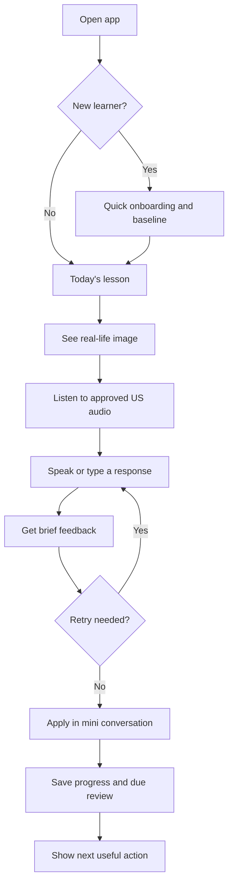
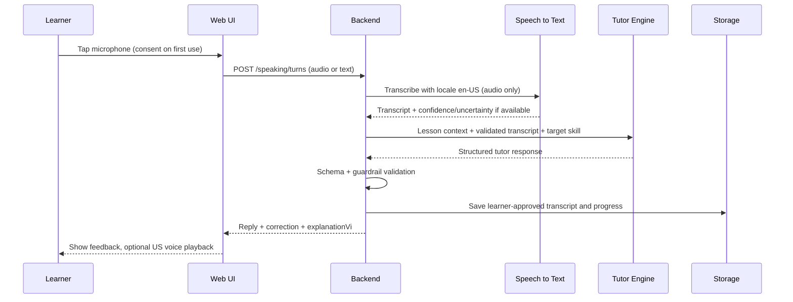
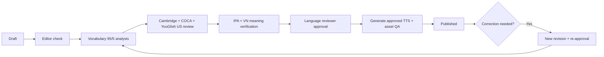
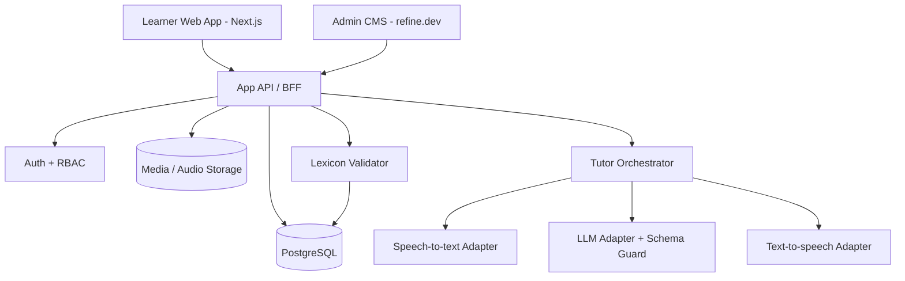

# NATURAL ENGLISH — TÀI LIỆU ĐẶC TẢ NGHIỆP VỤ VÀ BÀN GIAO PHÁT TRIỂN

**Mã tài liệu:** ENG-BA-SRS-001  
**Phiên bản:** 1.0 — Baseline đề xuất cho Dev/Design/QA  
**Ngày:** 02/11/2026  
**Loại:** Product Requirements Document (PRD) + Business Requirements (BRD) + Software Requirements Specification (SRS) + Functional Specifications + Technical Handover  
**Sản phẩm:** Natural English — Visual-first Speaking Practice  
**Đối tượng nhận:** PO, PM, ITBA/BA, UI/UX Designer, Frontend Developer, Backend Developer, AI Engineer, Content Editor, QA, DevOps.

> **Tình trạng xác nhận:** Tài liệu hợp nhất các yêu cầu đã nêu, dữ liệu Lesson 01, workflow kiểm duyệt và bản prototype đã có. Các chi tiết chưa từng được chốt (ví dụ phương án lưu trữ, SLA, thuật toán ôn tập, phân bổ nội dung Đạo Đức Kinh) được gắn nhãn **[BA ĐỀ XUẤT]**; không được hiểu là quyết định đã phê duyệt. Đây là bản đủ cụ thể để ước lượng, thiết kế và lập backlog, trước khi ký baseline cuối.

---

## 00. Executive Summary

**Sứ mệnh:** Xây dựng ứng dụng học **tiếng Anh Mỹ giao tiếp tự nhiên cho người Việt trưởng thành đang đi làm**, ưu tiên tình huống **xã hội, gia đình, đồng nghiệp và công việc**, đặc biệt môi trường **IT/Banking, ITBA, UX/UI, PM, PO, Developer**. Người dùng học bằng **hình ảnh → nghe → nói → được sửa → ứng dụng**, không bắt đầu bằng các bài ngữ pháp dài hay một dashboard chứa nhiều chỉ số.

**Định hướng không được thay đổi:**

1. **UI đơn giản, tập trung:** Một màn hình/một nhiệm vụ chính; ít điều hướng; tránh gamification ồn ào, banner quảng cáo, kiến thức lan man.
2. **Ngân hàng 1.500 từ cốt lõi:** Tập hợp từ ưu tiên phục vụ tình huống thật. **Khoảng 95% lượt từ trong nội dung học có biên tập** lấy từ bộ từ cốt lõi; khoảng **5% lượt từ mở rộng** khi cần để nói tự nhiên/đúng ngữ cảnh. Không hiểu sai thành chỉ có 1.425 từ lõi và 75 từ mở rộng trong database.
3. **English-first, hỗ trợ tiếng Việt:** Câu mẫu và hội thoại bằng tiếng Anh Mỹ đương đại; nghĩa, giải thích và lý do sửa bằng tiếng Việt rõ ràng. Đi theo **Basic → Better → Natural**.
4. **Học để giao tiếp:** Mục tiêu phân bổ thời lượng **80% nghe–nói / 20% đọc–viết**; ưu tiên phản xạ và hiểu thông điệp hơn thuộc lòng từng chữ.
5. **Tình huống thực dụng:** Giao tiếp xã hội, giao tiếp nơi làm việc, hỏi đáp, trao đổi trong nhóm, họp và xử lý bất đồng lịch sự; có bài cho IT Banking nhưng không biến toàn ứng dụng thành khóa học thuật ngữ chuyên ngành.
6. **Ứng xử có chiều sâu nhưng đơn giản:** Giữ nhánh kỹ năng giao tiếp–ứng xử (định hướng *Đắc Nhân Tâm* trước đây) và **bổ sung Đạo Đức Kinh ứng dụng**: diễn giải ý tưởng dễ hiểu, không sao chép bản dịch hiện đại, không áp đặt niềm tin hoặc dạy triết học hàn lâm.
7. **Phương pháp và nguồn:** Mỗi bài phải qua bước đối chiếu Cambridge, COCA, YouGlish US, kiểm tra ngữ nghĩa/IPA/giọng Mỹ trước khi xuất bản và sinh audio TTS.
8. **Khả thi và minh bạch:** Lộ trình định hướng 12 tháng/52 tuần, tối đa 60 phút/ngày, hướng tới năng lực tương đương B1. Không cam kết 80% hiểu được mọi hội thoại thật hoặc công nhận B1 chỉ từ điểm flashcard.

### 00.1. Phân biệt ba tỷ lệ — không dùng lẫn nhau

| Chỉ tiêu | Định nghĩa | Phạm vi đo |
|---|---|---|
| **1.500 từ cốt lõi** | 1.500 `lemma`/mục từ được biên tập thành bộ từ ưu tiên; một từ có thể có nhiều nghĩa/cách dùng. | Database curriculum, phiên bản hóa |
| **95% / 5% từ vựng** | 95% lượt từ (*word tokens*) trong **bài học biên tập** ưu tiên nằm trong bộ từ 1.500; tối đa khoảng 5% từ ngoài bộ cần thiết. | Theo lesson và theo cụm bài; không cưỡng ép hội thoại tự do của người học |
| **80% / 20% kỹ năng** | 80% thời lượng hoạt động nghe + nói; 20% đọc + viết. | Kế hoạch học và phân tích thời lượng hoạt động |
| **80% / 20% chủ đề** | Định hướng đã từng chốt: 80% Everyday/Work; 20% Communication Skills. Đạo Đức Kinh ứng dụng nằm trong/đan xen nhánh kỹ năng giao tiếp để tránh tăng thêm một trục nội dung gây loãng. | Kế hoạch bài, không phải tỷ lệ từ vựng |

**Ghi chú nguồn tham khảo:** Oxford 3000 là **danh sách tham chiếu để tuyển chọn**, không đồng nhất với bộ 1.500 riêng của sản phẩm. Chưa có bộ 1.500 từ đã phê duyệt tại thời điểm lập đặc tả; đây là **content deliverable phải biên soạn/duyệt**, không được giả lập một danh sách 1.500 từ như đã hoàn tất.

---

## 01. Business Context, Goals, Success Measures

### 01.1. Vấn đề của người học

- Người Việt trưởng thành thường biết từ đơn lẻ nhưng phản xạ chậm, dịch từng câu từ tiếng Việt, khó nghe giọng Mỹ tự nhiên.
- Bài học sách vở thiếu ngữ cảnh thật: chở con đi học, mua đồ ăn, trò chuyện với đồng nghiệp, đi họp, mô tả tiến độ, trao đổi yêu cầu nghiệp vụ.
- Ứng dụng nhiều menu, bài kiểm tra và thống kê dễ gây bỏ cuộc, trong khi kỹ năng đích là **nghe hiểu và nói được ý mình**.
- Các bài về giao tiếp lịch sự, lắng nghe và điều phối bất đồng thường ở dạng lý thuyết; ứng dụng phải đưa người học vào tình huống nói cụ thể.

### 01.2. Mục tiêu sản phẩm

| ID | Mục tiêu | Kết quả đầu ra/tiêu chí quan sát |
|---|---|---|
| BG-01 | Học được câu dùng ngay | Hoàn thành một tình huống bằng câu tiếng Anh phù hợp ngữ cảnh |
| BG-02 | Tăng phản xạ nghe–nói | Người học nghe câu hỏi và trả lời, có thể luyện lại nhiều lần |
| BG-03 | Kiểm soát tải từ vựng | Kho từ cốt lõi và báo cáo phân tích tỷ lệ 95/5 |
| BG-04 | Học theo nhu cầu người đi làm | Chọn General, ITBA, UX/UI, PM, PO, Developer, IT Banking tùy bối cảnh |
| BG-05 | Chất lượng nội dung có kiểm soát | Bài chỉ publish khi đủ bằng chứng, người duyệt và audio hợp lệ |
| BG-06 | Tạo thói quen ôn ngắn | Luyện 5/10/15 phút hoặc kế hoạch ngày dài hơn, tiếp tục đúng chỗ đã dừng |
| BG-07 | Đánh giá tiến bộ có căn cứ | Báo cáo riêng năng lực theo tác vụ, không biến điểm AI thành chứng chỉ CEFR |

### 01.3. KPIs vận hành — [BA ĐỀ XUẤT, không phải cam kết đầu ra]

- **Activation:** tỷ lệ người dùng hoàn thành khảo sát trình độ ngắn + bài nói đầu tiên.
- **Lesson completion:** số phiên hoàn tất nghe–nói của một bài / số phiên bắt đầu.
- **Speaking turns:** số lượt trả lời có ý nghĩa, không chỉ số lần bấm micro.
- **Review due completion:** số thẻ đến hạn được ôn / số thẻ đến hạn.
- **Task success:** % tình huống thực tế hoàn thành theo rubric minh bạch.
- **Content gate:** 100% bài publish có ít nhất một record review và link chứng cứ; 100% audio gắn phiên bản văn bản đã duyệt.
- **Vocabulary coverage:** cảnh báo khi văn bản authored dưới mục tiêu 95% core tokens; ngoại lệ cần lý do phê duyệt.

---

## 02. User Personas, Roles & Permissions

### 02.1. Người dùng chính

- **Adult Learner / General:** Người Việt đi làm, lịch bận, cần nói về cuộc sống gia đình, đi lại, ăn uống, trao đổi xã hội.
- **Professional Learner:** Người làm IT/Banking: BA/ITBA, UI/UX, PM, PO, Developer, người tham gia họp/phối hợp công việc.
- **Beginner / Returning Learner:** Có thể đọc từ cơ bản nhưng cần trình độ ban đầu để đề xuất bài phù hợp.

### 02.2. Vai trò hệ thống

| Role | Quyền chính | Giới hạn |
|---|---|---|
| Learner | Học, luyện nói, ôn, xem tiến độ, quản lý dữ liệu và quyền micro | Không sửa bài đã publish |
| Content Editor | Tạo/sửa draft, gắn lexical tags, nguồn, hình minh họa, IPA | Không tự publish nội dung mình chưa được review |
| Language Reviewer | Duyệt ngữ nghĩa, tính tự nhiên, IPA, bằng chứng ngôn ngữ | Không quản lý hạ tầng |
| Product Admin | Publish/unpublish, quản lý lộ trình, phiên bản, dashboard quản trị | Có audit trail mọi hành động |
| Support/Operator | Xem trạng thái hệ thống ẩn danh, xử lý ticket có quyền tối thiểu | Không mặc định xem nội dung audio người học |

**RBAC:** API phải kiểm tra quyền server-side; ẩn nút chỉ là UX, không thay thế authorization.

---

## 03. Scope & Priorities

### 03.1. MVP — Must Have

| Nhóm | Chức năng | ID |
|---|---|---|
| Onboarding | Đặt mục tiêu, nghề/ngữ cảnh và đánh giá nhanh trình độ ban đầu | FR-01 |
| Today | Một nút “Tiếp tục học”, bài hôm nay và bài ôn đến hạn | FR-02 |
| Guided Lesson | Ảnh tình huống, nghe Mỹ, nghĩa Việt, Basic/Better/Natural | FR-03 |
| Practice | Ghi âm/ASR hoặc nhập văn bản, nói lại câu, phản hồi tức thì sau lượt nói | FR-04 |
| AI Speaking | Agent Alex giọng nam Mỹ: Guided Talk, Free Talk, Review | FR-05 |
| Flashcard | Thẻ ảnh ↔ câu tiếng Anh / tiếng Việt, âm thanh, lịch ôn | FR-06 |
| Learning Path | Lộ trình tuần/chủ đề; mở bài đã duyệt | FR-07 |
| Applied Wisdom | Đạo Đức Kinh ứng dụng thông qua tình huống giao tiếp ngắn | FR-08 |
| Learner Progress | Lượt nói, số bài, ôn tập, mục tiêu kỹ năng theo tác vụ | FR-09 |
| Content CMS | Draft → Language Review → Approved → Published; version & source | FR-10 |
| Governance | Phân tích 1.500 từ và tỷ lệ 95/5, kiểm tra IPA/audio, license asset | FR-11 |
| Security | Consent micro, privacy audio, export/delete data, error handling | FR-12 |

### 03.2. Should Have — sau MVP

- Shadowing có chia *chunks*, so sánh audio mẫu–audio người học; dictation; substitution drill; bản đồ câu/ngữ cảnh theo timeline; đánh dấu câu thường sai.
- Điều chỉnh mức độ nói chậm/tự nhiên, transcript song ngữ bật/tắt, lặp câu, kịch bản roleplay theo nghề nghiệp.
- Offline cache bài đã tải (không cần offline AI); thống kê theo 52 tuần; thông báo nhắc ôn có consent.
- Đánh giá kỹ năng nghe theo tình huống riêng biệt và rubric nói mở rộng.

### 03.3. Out of Scope MVP

- Mạng xã hội, bảng xếp hạng, mua hàng, livestream giáo viên, khóa grammar đầy đủ, trò chơi phức tạp.
- Dịch nguyên văn/giảng giải toàn bộ 81 chương Đạo Đức Kinh; các màn hình triết học dài.
- Chứng chỉ B1 chính thức, chấm giọng chuẩn bản xứ như một kết luận khách quan, cam kết đạt mức độ hiểu hội thoại theo phần trăm ngoài đời.
- Tự động xuất bản 100% nội dung AI không có người kiểm duyệt.
- Yêu cầu người học nói chính xác 100% theo câu mẫu hoặc sử dụng đúng 1.500 từ trong Free Talk.

---

## 04. Information Architecture & UI/UX Rules

### 04.1. Navigation — learner app, mobile-first

**Bottom navigation 4 mục tối đa:** `Hôm nay` · `Bài học` · `Nói chuyện` · `Ôn tập`.  
`Tiến độ`, `Lộ trình 52 tuần`, `Cài đặt/Tài khoản` được đặt trong nội dung trang tương ứng hoặc menu tài khoản; **không có 6–8 tab cùng cấp**. Desktop có thể mở rộng thành navigation bên trái gọn, vẫn giữ đúng bốn miền tác vụ.

```text
Hôm nay
  ├─ Tiếp tục bài gần nhất (primary CTA)
  ├─ Ôn đến hạn (secondary CTA)
  └─ Tiến độ ngắn / xem lộ trình

Bài học
  ├─ Chọn tình huống: Xã hội · Công việc · Giao tiếp ứng xử
  └─ Chi tiết bài: Nhìn → Nghe → Nói → Ứng dụng

Nói chuyện
  ├─ Guided Talk
  ├─ Free Talk
  └─ Review Conversation

Ôn tập
  ├─ Flashcard ảnh
  ├─ Luyện lại câu sai
  └─ Nghe / Shadowing [P2]
```

### 04.2. Design principles (bắt buộc)

| UI-Rule | Quy định thiết kế và nghiệm thu |
|---|---|
| UI-01 | Mỗi màn hình **01 primary action** dễ thấy; action phụ giảm độ nổi bật |
| UI-02 | Trước hết hiển thị **ngữ cảnh bằng ảnh**, sau đó câu tiếng Anh, nút nghe/nói; không dồn 15 phương pháp học vào một trang |
| UI-03 | Người lớn đi làm: phong cách sáng, thân thiện, hiện đại, chuyên nghiệp nhẹ; **không trẻ con**, không hoạt hình quá mức |
| UI-04 | Dùng ít màu nhấn, chữ dễ đọc, tối thiểu WCAG 2.2 AA ở thành phần thiết yếu; nút mic lớn, trạng thái rõ |
| UI-05 | English-first; tiếng Việt ẩn/hiện theo tùy chọn, không trộn câu dài song ngữ trong một dòng |
| UI-06 | Nội dung **ảnh và audio có ý nghĩa học tập**, không trang trí không liên quan |
| UI-07 | Không auto-play audio khi vừa mở màn hình; không xin micro trước thao tác nói đầu tiên |
| UI-08 | Có thể dùng không có micro: nhập text thay thế; không khóa người dùng khi từ chối quyền |
| UI-09 | Câu mẫu Basic → Better → Natural hiển thị từng mức bằng toggle/chip; mặc định Basic cho người mới |
| UI-10 | Responsive: mobile 360–430 px trước; desktop tối ưu vùng nội dung chính, không kéo câu học full chiều ngang quá rộng |

### 04.3. Màn hình bắt buộc

**S01 — Onboarding (tối đa 3 bước):** mức tự đánh giá; bối cảnh General/IT Banking/roles; thời lượng mong muốn 5/10/15/30/60 phút. Sau đó bài kiểm tra ngắn 1–2 tình huống (nghe + phản hồi), có nút bỏ qua. Không hỏi thông tin gia đình/chức danh chi tiết nếu không cần.

**S02 — Today:** headline ngắn, ảnh/tên bài hiện tại, `Bắt đầu / Tiếp tục`, ôn đến hạn, dòng tiến độ thực tế. Không bày KPI nghe–nói–đọc–viết thành 4 dashboard lớn ở trang đầu.

**S03 — Lesson:** một ảnh lớn, câu mẫu, nút `Nghe` và `Nói`, nghĩa Việt có thể mở, chuyển cấp Basic/Better/Natural, nút `Tiếp theo`. Thành phần IPA tùy chọn, chính xác với câu cuối.

**S04 — Talk:** bubble hội thoại, nút micro, trạng thái `Đang nghe / Đang xử lý / Đang nói`, transcript có thể sửa, phản hồi gồm câu đã nhận → câu sửa → câu tự nhiên → giải thích Việt → mời nói lại; không tự động ngắt mỗi lỗi nhỏ.

**S05 — Review:** ảnh + mặt thẻ Việt/Anh, phát âm, lật thẻ và chọn `Chưa nhớ / Khó / Nhớ / Dễ`; chỉ hiện lời giải sau người dùng thử nhớ. Không yêu cầu bộ thẻ học thuộc 100% từ mới mỗi ngày.

**S06 — Applied Wisdom:** hiển thị một ý tưởng ngắn (tối đa 2–3 câu) + một tình huống ứng xử + một hội thoại 2–4 lượt + nút `Luyện nói`; không hiển thị văn bản cổ dài trong màn hình học chính.

**S07 — Learning Progress:** số buổi học, thời lượng phân theo kỹ năng, mục tiêu năng lực theo task, tiến độ core words (đã gặp / đã ôn / dùng thành công); thông báo “ước lượng” cho các số liệu AI.

**S08 — Admin CMS** (route/app riêng): bảng trạng thái nội dung, editor, evidence URLs, validator, preview mobile, nút gửi duyệt, publish và rollback.

### 04.4. Các tài sản hình ảnh đã có

- `Morning Routine English Flashcard - 01 - EN.png` và `- VN.png`: ảnh người dậy lúc 5:40, dùng làm tham khảo hai mặt thẻ.
- `Morning Routine English Flashcard - 02 - EN.png` và `- VN.png`: ảnh người đưa con đi học, cùng cấu trúc thẻ.
- `Dad’s Daily Routine English.png`: poster tổng hợp — **chỉ dùng làm tài liệu tham khảo**, không xem là trải nghiệm UI chính vì mật độ chữ lớn.
- Kích thước hiện tại: flashcard **1086 × 1448 px**, poster **1055 × 1491 px**; asset cần web optimization, alt text, quyền sử dụng và ràng buộc lesson–flashcard.

**[BA ĐỀ XUẤT]:** Phân tách nội dung ảnh, English, Vietnamese và IPA thành dữ liệu, không nhúng text vào hình mới. Ảnh hiện tại có text có thể dùng ở bản tham khảo, nhưng để tương tác/lokal hóa/accessible, bản sản xuất nên ưu tiên ảnh không chữ + lớp text HTML.

---

## 05. Curriculum Architecture & 1,500-Word Governance

### 05.1. Chương trình học 12 tháng

**Định hướng cũ giữ nguyên:** 52 tuần; 6 ngày có thể học/tuần + 1 ngày nghỉ/ôn nhẹ; tối đa 60 phút/ngày; hướng tới B1 theo khả năng và đầu vào của từng người. Đây là **learning pathway**, không phải lời hứa kết quả hoặc bắt buộc học đủ 60 phút.

| Giai đoạn | Tuần | Năng lực giao tiếp trọng tâm | Chủ đề mẫu |
|---|---|---|---|
| Phase 1 / Foundation | 01–13 | Giới thiệu, hỏi đáp, lịch sinh hoạt, nhu cầu cơ bản | My Daily Routine, Family, Food, Transport, Small Talk |
| Phase 2 / Social | 14–26 | Duy trì hội thoại, cảm xúc, lắng nghe, giúp đỡ, giải thích đơn giản | Colleagues, Weekend, Asking for Help, Apology, Polite Disagreement |
| Phase 3 / Workplace | 27–39 | Mô tả công việc, task, cuộc họp, tiến độ, yêu cầu, phản hồi | Team Update, Issue, Meeting, BA Requirement, UI Review, Developer Handoff |
| Phase 4 / Integration | 40–52 | Hội thoại dài hơn, xử lý tình huống bất ngờ, tóm tắt, thương lượng lịch sự | Roleplay cross-topic, Work–Life, Applied Wisdom, capstone conversations |

**Không bịa nội dung đã duyệt:** Chỉ Lesson 01 *My Daily Routine* có văn bản đầy đủ trong tài liệu dự án hiện tại; tên bài còn lại chỉ là **backlog nội dung gợi ý**, phải biên soạn và review trước khi publish.

### 05.2. Nhóm chủ đề theo ưu tiên

**Everyday & Social:** bản thân, gia đình, hỏi thăm, lời mời, sinh hoạt, đi lại bằng xe máy, đưa đón con, món ăn Việt, mua sắm, sức khỏe ở mức hội thoại phổ thông, gặp bạn bè, công việc gia đình, cảm xúc, giúp đỡ, cảm ơn, xin lỗi.  
**Workplace:** đồng nghiệp, giới thiệu vai trò, trao đổi task, làm rõ yêu cầu, lịch họp, deadline, cập nhật tiến độ, feedback, làm việc với PO/PM/UX/UI/Developer, phối hợp UAT, nêu vấn đề và đề nghị hỗ trợ.  
**Communication Skills:** lắng nghe, chú ý người đối diện, hỏi mở, tôn trọng bất đồng, thừa nhận sai, bình tĩnh khi tranh luận, hợp tác, nói điều cần nói một cách tử tế.  
**Applied Dao De Jing:** tiết chế, giản dị, biết lắng nghe, tránh cưỡng ép, hiểu giới hạn, linh hoạt, hành động đúng lúc. Chỉ chọn ý có thể diễn giải bằng từ vựng thông dụng và tình huống cụ thể.

### 05.3. Quy tắc kỹ thuật 1.500 từ (BR-LEX)

- **LEX-01:** `CoreLexicon` có đúng **1.500 lemma đang active** cho phiên bản curriculum 1.0; mỗi lemma có `id`, `headword`, `part_of_speech`, `priority`, `level`, `meaning_vi`, `example`, `source_refs`, `status`, `version`.
- **LEX-02:** Oxford 3000 dùng làm một nguồn tham chiếu về độ phổ biến và cấp độ; lựa chọn 1.500 theo **tính hữu ích trong bối cảnh người Việt** và giao tiếp thực. **Không sao chép/trưng bày dữ liệu từ vựng của bên thứ ba ngoài phạm vi cấp phép.**
- **LEX-03:** Số liệu 95/5 đo trên **token trong `authored_english_text`** của Basic/Better/Natural, dialogue, bài tập có văn bản chuẩn. Không tính Việt, IPA, dấu câu, số, nhãn giao diện. Proper nouns được tách thống kê riêng (excluded); từ chuyên môn như `clock in`, `UI/UX` phải được đánh dấu expansion nếu ngoài bộ từ.
- **LEX-04:** Token mapping → normalized lemma, bao gồm biến thể số nhiều, động từ chia thì, contractions theo bảng `lexeme_forms`. `get/got/gotten` được gom theo lemma nếu ngữ nghĩa phù hợp; phrasal verb (`drop off`) có record phrase riêng, nhưng vẫn đo token theo quy tắc đã công bố.
- **LEX-05:** `coverage_pct = 100 × core_token_count / (core_token_count + expansion_token_count)`; hiển thị thêm `unmapped_count`; **không cho publish** nếu chưa xử lý từ chưa phân loại.
- **LEX-06:** Target **≥95% core** ở cấp bài biên tập. Nếu để đúng ngữ cảnh yêu cầu ngoại lệ (chẳng hạn chủ đề IT), reviewer có quyền *approve exception* với lý do + thay thế Basic. Không được phá hỏng tính tự nhiên để đạt tỷ lệ hình thức.
- **LEX-07:** Đếm riêng `type coverage` và `token coverage`: **không dùng số từ khác nhau (unique types) để giả định tỷ lệ 95%**.
- **LEX-08:** Freestyle/AI Live không cưỡng ép đủ 95%, nhưng hệ thống **ưu tiên sinh câu dễ hiểu**; thống kê tỷ lệ để quan sát, không ngắt khi người học dùng từ ngoài bộ.
- **LEX-09:** Nguồn và license lưu ở mức lemma/phrase/câu, đủ trace provenance, không giả định Oxford cung cấp sẵn danh sách 1.500.

**Ví dụ [MINH HỌA, không phải kết quả kiểm định từ nguồn]:** một bài có 200 token tiếng Anh hợp lệ, trong đó 192 core, 8 expansion → 96% core. Lưu cả 8 token mở rộng và lý do. Không được quảng cáo rằng 1.500 từ giúp hiểu 95% tiếng Anh ngoài đời; đó là mục tiêu kiểm soát ngôn ngữ của **bài học nội bộ**.

### 05.4. Basic → Better → Natural

| Mức | Ví dụ | Quy tắc |
|---|---|---|
| Basic | `I finish work at 5:30.` | Dễ hiểu, đủ ý, dễ phát âm |
| Better | `I finish work at 5:30 and go home.` | Bổ sung quan hệ ý, mạch nói |
| Natural | `I wrap things up around 5:30 and head home.` | Thực sự dùng trong đúng ngữ cảnh, không cố gắng thêm slang |

**Quy tắc:** Mỗi mức có bản dịch Việt phù hợp ý, audio phù hợp, annotations về sắc thái, tag lexicon và **được review độc lập**. Câu Natural có thể dùng expansion được duyệt, nhưng không thay thế Basic.

---

## 06. Applied Dao De Jing — Specification

### 06.1. Vai trò trong sản phẩm

Đạo Đức Kinh là **nguồn gợi ý chủ đề thực hành tiếng Anh**, không phải mục tiêu học thuộc triết học, không kiểm tra niềm tin. Nội dung luôn được đóng gói thành bài **giao tiếp xã hội/công việc**: một nguyên tắc diễn giải bằng lời phổ thông → hành vi trong đời thật → 2–4 lượt hội thoại → luyện nói. Tỷ trọng không tách thêm phần trăm mới gây loãng mục tiêu 80/20 đã chốt.

### 06.2. Nguồn và yêu cầu trung thực

- Lưu `source_work = Dao De Jing`, `chapter_reference`, `source_url`, `interpretation_note`, `editor`, `reviewer`.
- Bản văn cổ có nhiều diễn giải và bản dịch; nội dung ứng dụng phải ghi rõ **“Diễn giải/ứng dụng hiện đại theo chủ đề”**, **không gắn nhãn trích nguyên văn của Lão Tử** nếu không có bản trích xác định.
- Không sao chép nguyên văn bản dịch hiện đại có bản quyền; soạn câu Anh/Viet riêng, dựa trên ý đã đối chiếu ít nhất một nguồn văn bản và một nguồn học thuật đáng tin cậy.
- Không trình bày ý kiến đạo đức như chân lý bắt buộc; tránh bình luận chính trị/tôn giáo, phán xét tính cách hay khuyên người học cam chịu môi trường làm việc bất công.
- Ưu tiên điều người học **có thể nói**: hỏi để hiểu, bình tĩnh, tránh đổ lỗi, biết lùi một bước khi cần, tôn trọng giới hạn bản thân.

### 06.3. Bài mẫu AW-01: Listen before you answer

**Loại:** Bài minh họa do BA biên soạn; **không phải bản dịch trực tiếp một câu kinh**, chưa qua pipeline nguồn/IPA.  
**Topic:** Calm talk at work · **Language:** Basic  
**Simple idea:** `You don't have to answer right away. Listen first.`  
**Tiếng Việt:** “Bạn không nhất thiết phải trả lời ngay. Hãy lắng nghe trước.”  
**Tình huống:** Đồng nghiệp không đồng ý với đề xuất giao diện.

| Role | Hội thoại tiếng Anh | Ý nghĩa |
|---|---|---|
| Coworker | `I don't think this screen is clear.` | Tôi thấy màn hình này chưa rõ ràng. |
| Learner | `I see. Can you tell me what is not clear?` | Tôi hiểu. Bạn có thể nói rõ chỗ nào chưa rõ không? |
| Coworker | `The next step is hard to find.` | Khó tìm bước tiếp theo. |
| Learner | `Thanks. Let's take another look.` | Cảm ơn. Chúng ta xem lại nhé. |

**Skill marker:** `active_listening`, `polite_question`, `non_defensive_response`.  
**Speaking challenge:** Người học đáp lại một ý kiến trái chiều bằng câu lịch sự, **không lặp lại rập khuôn**.  
**BA acceptance:** Có minh họa tình huống, hội thoại ngắn, bản nghĩa Việt, nguồn ý tưởng gắn chapter sau kiểm duyệt, phân tích từ vựng và audio đã duyệt.

### 06.4. Danh sách chủ đề triển khai — [BA ĐỀ XUẤT]

| Theme | Ý diễn giải không trích kinh | Tình huống ứng dụng |
|---|---|---|
| Listening | Nghe trước khi phản hồi | Review UI cùng đồng nghiệp |
| Simplicity | Giải thích bằng lời đơn giản | BA trình bày yêu cầu nghiệp vụ |
| Flexibility | Thử cách khác khi cách cũ không hiệu quả | Team xử lý trở ngại |
| Humility | Thừa nhận có điều mình chưa biết | Hỏi Developer về giải pháp |
| Moderation | Tranh luận đủ ý, tránh leo thang | Bất đồng trong cuộc họp |
| Right timing | Không vội ép người khác ra quyết định | Hẹn thời gian trao đổi lại |

---

## 07. Learning Flows & Business Processes

### 07.1. Primary journey



### 07.2. Speaking turn (AI)



**AI tutor behavior:** Với lỗi nhỏ không cản trở ý, ưu tiên đáp lời rồi gợi ý sửa sau lượt nói. Với lỗi đổi nghĩa hoặc làm người nghe hiểu sai, đưa sửa rõ, ngay sau khi lượt nói kết thúc. Không chặn hội thoại để sửa phát âm chưa đủ cơ sở.

### 07.3. Content publishing



---

## 08. Functional Requirements & Acceptance Criteria

**Mức độ:** `M` Must, `S` Should, `C` Could. Từng AC là hành vi hệ thống kiểm thử được, không chỉ mô tả giao diện.

| ID | Pri | User story / chức năng | Acceptance Criteria cốt lõi |
|---|---|---|---|
| FR-01 | M | Là người mới, tôi chọn ngữ cảnh học và làm bài baseline để bắt đầu đúng mức. | Có skip; bài nhập môn khả dụng dù không cấp quyền mic; không tự tuyên bố B1 |
| FR-02 | M | Tôi muốn mở app và tiếp tục ngay bài còn dang dở. | Sau login/reload, CTA mở đúng bước cuối đã lưu; số ôn đến hạn cập nhật |
| FR-03 | M | Tôi học từ ảnh qua câu Basic/Better/Natural và audio. | Cùng tình huống có hình, text EN, nghĩa VI, audio matching revision; nút English/Vietnamese |
| FR-04 | M | Tôi nói hoặc gõ câu trả lời và được sửa ngay. | Phản hồi sau turn kết thúc; hiển thị transcript + sửa + lý do + nói lại; có fallback text |
| FR-05 | M | Tôi luyện với Alex ở ba mode Guided, Free, Review. | Mode xử lý đúng context; giọng nam US nếu audio sẵn; báo lỗi provider rõ |
| FR-06 | M | Tôi ôn câu bằng thẻ ảnh/âm thanh. | Lật VN↔EN; rating cập nhật `due_at`; có review retry |
| FR-07 | M | Tôi chọn bài theo lộ trình hoặc nghề nghiệp. | Chỉ lesson `published` được mở; progress tuần có trạng thái thật |
| FR-08 | M | Tôi luyện kỹ năng ứng xử qua bài Đạo Đức Kinh dễ hiểu. | Ý tưởng ngắn + tình huống + hội thoại + thử nói; không đưa bản kinh dài lên màn hình |
| FR-09 | M | Tôi nhìn thấy kết quả thực tế. | Đếm bài, turns, thời gian; ghi nhãn self-assessment cho mức CEFR ước lượng |
| FR-10 | M | Biên tập viên kiểm duyệt bài trước khi publish. | Chỉ reviewer được approve; trạng thái và revision trong audit log |
| FR-11 | M | Admin xác định độ phủ core words cho bài. | Không publish nếu `unmapped > 0`; cảnh báo <95%, cho exception có lý do |
| FR-12 | M | Tôi quản lý quyền audio và dữ liệu của mình. | Permission theo thao tác; text fallback; export/delete yêu cầu được thực hiện |
| FR-13 | S | Tôi nghe chậm/tự nhiên và lặp theo chunks. | Audio đúng voice/version; UI có giới hạn playback; không méo nội dung text |
| FR-14 | S | Tôi ôn từ/câu đến hạn theo lịch thích ứng. | Hàng đợi ôn có `due_at` xác định; idempotent submit rating |
| FR-15 | S | Tôi luyện dictation/substitution. | Đề/đáp án có version; lưu lỗi để ưu tiên ôn |

### 08.1. Detailed use case UC-01 — Guided Lesson

**Precondition:** lesson published; người học có/không có tài khoản tùy chế độ triển khai; tài nguyên tối thiểu tải thành công.  
**Main flow:** (1) vào Today; (2) chọn lesson; (3) xem ảnh và nghe audio; (4) chọn Basic rồi Better/Natural; (5) trả lời bằng mic hoặc text; (6) nhận feedback; (7) làm tình huống mới; (8) lưu tiến độ và thẻ review.  
**Alternate:** mic denied → nhập text; STT thất bại → đề nghị retry / chỉnh transcript; mạng chập chờn → không mất progress đã xác nhận; audio thiếu → hiện text và trạng thái “audio unavailable”.  
**Postcondition:** một `practice_session` hoàn tất/dang dở; chỉ số phản ánh hành động thực tế.

### 08.2. Detailed use case UC-02 — Free Talk with Alex

**Precondition:** user chọn `Free Talk`, có chủ đề; AI provider/queue khả dụng.  
**Main flow:** agent mở đầu bằng câu hỏi A1–B1 phù hợp; user nói; engine trả lời có ngữ cảnh, chỉ sửa lỗi ưu tiên; user có thể `Explain in Vietnamese`, `Say it again`, `Give me a simpler sentence`, `End chat`.  
**Constraints:** không bắt người học thuộc câu mẫu; tránh hỏi sâu thông tin cá nhân; từ ngoài 1.500 dùng khi phù hợp, ưu tiên diễn đạt dễ hơn; xác nhận transcript khi thiếu chắc chắn.  
**Fallback:** nhà cung cấp AI không khả dụng → bài hội thoại định trước vẫn dùng được.

### 08.3. Detailed use case UC-03 — Editorial approval

**Precondition:** draft bài có phrase/IPA/translation/assets.  
**Main flow:** editor submit → validator phát hiện core coverage và unmapped → reviewer kiểm tra Cambridge/COCA/YouGlish, ý gốc → approve → audio synth theo revision → asset QA → publish.  
**Error conditions:** `unmapped > 0`, nguồn không đủ, IPA lệch, audio văn bản sai, ảnh không có quyền dùng hoặc chưa xác định license → **publish bị chặn**.

### 08.4. Business Rules (BR)

| Rule | Enforcement |
|---|---|
| BR-01 | Chỉ nội dung `published` + version hợp lệ mới phục vụ Learner |
| BR-02 | Sửa English sau duyệt làm `audio_status=stale` và đưa về re-review |
| BR-03 | SRS 95/5 chỉ áp vào authored content; không ép giới hạn câu người học |
| BR-04 | Nếu `speech_transcript_confidence` không đủ/không khả dụng, không kết luận lỗi phát âm |
| BR-05 | `CEFR label` chỉ dựa trên rubric/assessment phù hợp; lesson completion không đủ |
| BR-06 | Record nguồn của bài triết học phải ghi rõ chapter và bản chất diễn giải |
| BR-07 | Agent được kiểm soát bởi skill goal và lịch sử hội thoại tối thiểu cần thiết |
| BR-08 | Một practice turn có ID bất biến; retry API không tạo 2 lượt hoàn thành |
| BR-09 | Mọi nội dung publish có source revision và editor/reviewer attribution |
| BR-10 | Người dùng có thể tắt Việt/IPA; mặc định hiển thị theo nhu cầu cấp độ |

---

## 09. Agent Alex — AI Tutor Contract

### 09.1. Định danh và mục tiêu

- **Tên:** Alex (dùng như tên persona của gia sư, không giả danh người thật). **Voice:** nam, American English, khi voice provider hỗ trợ cấu hình giọng tương ứng.
- **Modes:** `GUIDED_LESSON`, `FREE_TALK`, `REVIEW`.
- **Input:** profile mục tiêu, proficiency ước lượng, `lesson_id`, `target_patterns`, 1.500 core lexicon version, recent turns (giới hạn), transcript đã xác nhận, `error_focus`.
- **Output:** không chỉ chat text; bắt buộc trả JSON có cấu trúc và validation.

### 09.2. Behavior policy

1. Giữ nội dung chủ yếu trong tình huống người dùng chọn; tránh độc thoại dài và chuyển đề tài ngẫu nhiên.
2. Dùng câu ngắn, giọng Mỹ tự nhiên, câu hỏi có thể trả lời trong ~1–3 câu khi mức mới học.
3. Mỗi lượt tối đa **1–2 lỗi trọng tâm** để sửa (trừ khi người học yêu cầu sửa toàn bộ); không bắt lỗi dấu câu của transcript lời nói.
4. Phản hồi theo thứ tự: `replyEn` (đáp hội thoại) → `heardText` (nếu ASR) → `correctedEn` → `naturalEn` → `explanationVi` → `retryPromptEn`.
5. Nếu câu đã đúng và tự nhiên, **không bịa lỗi**; ghi nhận và mở rộng hội thoại.
6. Với lỗi đổi nghĩa: giải thích rõ vì sao khác; không chuyển ý gốc sang ý khác chỉ để “nghe Tây hơn”.
7. Với tiếng địa phương Việt Nam/đồ ăn/tên riêng, giữ nguyên ngữ cảnh; không thay thế tùy tiện.
8. Không tạo IPA bịa; nếu chưa review chỉ hiển thị IPA từ nguồn đã chuẩn hóa hoặc ẩn.
9. Nên trả lời ngắn; tiếng Việt trong giải thích, không phá English-first.
10. Có fallback provider lỗi, cơ chế giới hạn rate/cost và không log raw audio mặc định.

### 09.3. Output schema (rút gọn)

```json
{
  "mode": "GUIDED_LESSON",
  "replyEn": "That sounds like a busy morning. What do you do next?",
  "heardText": "I take my son to the school.",
  "meaningPreserved": true,
  "correction": {
    "needed": true,
    "correctedEn": "I take my son to school.",
    "naturalEn": "I drop my son off at school.",
    "explanationVi": "Ta thường nói 'to school' khi nói về việc đi học. 'Drop someone off' là đưa ai tới nơi rồi đi tiếp.",
    "errorType": "naturalness",
    "priority": "minor"
  },
  "retryPromptEn": "Can you say that again in your own words?",
  "suggestedCoreLexemeIds": ["take", "son", "school"],
  "safeToDisplay": true
}
```

**Technical requirement:** validate with typed schema (Zod hoặc tương đương), sanitize/escape input, không render raw model HTML; AI output là đề xuất chưa được kiểm định tuyệt đối, không dùng như kho bài đã publish.

---

## 10. Content Data Model & Example Payloads

### 10.1. Logical entities

| Entity | Key fields | Relations |
|---|---|---|
| `users` | id, locale, created_at, status | 1–1 profile |
| `learner_profiles` | user_id, job_context, initial_level, goal_minutes, vietnamese_help, voice_pref | user |
| `curriculum_versions` | id, name, core_lexicon_version, published_at | lessons, lexicon |
| `lexemes` | id, lemma, pos, level, meaning_vi, is_core, source, version | word_forms, phrase mapping |
| `lexeme_forms` | id, lexeme_id, surface_form, normalization_type | lexemes |
| `phrases` | id, basic, better, natural, meaning_vi, ipa_review_status, usage_note | lessons, evidence |
| `phrase_evidence` | id, phrase_id, source_type, source_url, checked_by, checked_at, note | phrases |
| `lessons` | id, slug, topic, week, difficulty, role_context, status, revision | segments, assets |
| `lesson_segments` | id, lesson_id, segment_type, sequence, prompt, image_id, phrase_id | lesson |
| `assets` | id, type, uri, alt_text, license, owner, content_hash, text_version | segments, phrases |
| `flashcards` | id, lesson_id, phrase_id, image_id, front_language, back_language | review_states |
| `review_states` | user_id, flashcard_id, due_at, interval_days, ease, last_rating | flashcards, user |
| `practice_sessions` | id, user_id, mode, lesson_id, started_at, completed_at, duration_seconds | turns |
| `practice_turns` | id, session_id, turn_index, transcript, source, feedback_json, content_revision | sessions |
| `assessment_results` | id, user_id, rubric_version, task_id, criteria_json, completed_at | profile |
| `content_reviews` | id, resource_id, revision, reviewer_id, status, reason, timestamp | lessons/phrases |
| `lexical_analyses` | id, resource_id, revision, core_count, expansion_count, excluded_count, unmapped_count, coverage, exceptions | lesson revision |
| `consents` | id, user_id, consent_type, granted, timestamp, revoked_at | user |
| `audit_logs` | actor_id, action, resource_type, resource_id, before/after digest, at | admins |

**Lưu ý dữ liệu:** Dùng khóa ID thay vì ghép English string làm PK. Tách asset và metadata học tập. Nội dung có `revision` bất biến khi đã publish. Gắn `content_hash` để không phát audio của câu khác.

### 10.2. Lesson JSON example — cấu trúc đề xuất

```json
{
  "id": "lesson-001",
  "slug": "my-daily-routine",
  "title": "My Daily Routine",
  "difficulty": "A1-A2",
  "topic": "everyday",
  "roleContext": ["general", "itba"],
  "curriculumWeek": 1,
  "status": "draft",
  "revision": 1,
  "segments": [
    {
      "id": "s01",
      "imageKey": "morning-routine-01",
      "basicEn": "I get up at 5:40.",
      "betterEn": "I usually get up around 5:40.",
      "naturalEn": "I usually get up around 5:40.",
      "meaningVi": "Tôi thường dậy khoảng 5 giờ 40.",
      "ipaUs": null,
      "audioKey": null,
      "targetPhrases": ["get up", "around"],
      "reviewStatus": "requires_content_verification"
    }
  ]
}
```

**Quan trọng:** JSON trên là **schema/UI seed minh họa**, không phải lời xác nhận toàn bộ segment đã đạt pipeline. Trong JSON minh họa, `status=draft` để tránh hiểu nhầm nội dung đã được duyệt; chỉ chuyển sang `published` sau khi review hoàn tất. Các file nội dung Lesson 01 có bản câu Natural/IPA, nhưng phải rà soát thống nhất chính tả tiếng Anh Mỹ và IPA; không gán `audioKey` giả.

---

## 11. API Contract — suggested REST endpoints

Base URL: `/api/v1`. Authentication dùng session hoặc token phù hợp nền tảng. Toàn bộ endpoint write phải có CSRF/auth/rate limit phù hợp, server validation và `requestId` để theo dõi lỗi.

| Method | Path | Mục đích | Response chính |
|---|---|---|---|
| `GET` | `/me/learning-profile` | Đọc profile, mục tiêu và tuỳ chọn | `profile` |
| `PUT` | `/me/learning-profile` | Cập nhật ngữ cảnh, thời lượng | `profile` |
| `POST` | `/assessments/baseline` | Lưu assessment nhanh | `result`, `rubricVersion` |
| `GET` | `/today` | Bài hiện tại, thẻ đến hạn, CTA | `nextLesson`, `dueCount` |
| `GET` | `/curriculum/weeks` | Lộ trình 52 tuần | `weeks[]` |
| `GET` | `/lessons/{id}` | Bài đã publish + asset manifests | `lesson`, `revision` |
| `POST` | `/sessions` | Bắt đầu buổi học/nói | `sessionId` |
| `POST` | `/sessions/{id}/turns` | Nhận audio hoặc text, trả feedback | `transcript`, `feedback`, `tutorReply` |
| `POST` | `/sessions/{id}/complete` | Chốt buổi học (idempotent) | `progressDelta` |
| `GET` | `/reviews/due` | Lấy flashcards đến hạn | `cards[]` |
| `POST` | `/reviews/{cardId}/rating` | Lưu rating ôn tập | `nextDueAt` |
| `GET` | `/me/progress` | Lấy tiến độ dựa dữ liệu thật | `totals`, `skills` |
| `POST` | `/me/consents` | Cập nhật consent micro/audio | `consent` |
| `POST` | `/me/data-export` | Yêu cầu xuất dữ liệu | `jobId/status` |
| `DELETE` | `/me/data` | Xóa dữ liệu theo chính sách xác nhận | `requestId/status` |
| `POST` | `/admin/lessons` | Tạo draft lesson | `id/revision` |
| `POST` | `/admin/lessons/{id}/analyze-lexicon` | Tính tỷ lệ 95/5 | `analysis` |
| `POST` | `/admin/lessons/{id}/submit-review` | Gửi duyệt | `reviewId/status` |
| `POST` | `/admin/lessons/{id}/approve` | Reviewer duyệt | `status` |
| `POST` | `/admin/lessons/{id}/publish` | Publish sau tất cả gates | `publishedRevision` |

**Error standard:** `{ "error": { "code": "MIC_PERMISSION_DENIED", "messageVi": "...", "requestId": "...", "retryable": false } }`; không leak prompt system hoặc API keys. HTTP 400/401/403/404/409/422/429/5xx theo ngữ nghĩa. `409 CONTENT_REVISION_MISMATCH` khi publish revision cũ.

---

## 12. Suggested Technical Architecture & Integration Boundaries

**[BA ĐỀ XUẤT dựa trên công cụ lập trình user đang sử dụng — cần Dev Lead xác nhận]:**

- **Frontend:** Next.js (App Router) + React + TypeScript + Tailwind CSS + shadcn/ui; learner app mobile-first với server/client boundary rõ ràng.
- **Admin CMS:** `refine.dev` cho CRUD/quy trình duyệt, không cần mang giao diện quản trị phức tạp sang learner app.
- **Backend:** Next.js Route Handlers / service layer tách module; nếu lưu lượng tăng có thể tách speech/AI service độc lập.
- **Database:** PostgreSQL (đề xuất) với ORM/migration; đảm bảo integrity, versioning, index cho `due_at`, `user_id`, `lesson_id`.
- **Media:** object storage + CDN, signed URLs cho audio private (nếu có); cache audio nội dung đã duyệt; không để API keys ở frontend.
- **AI:** TTS cho bài đã duyệt, STT cho turn người học, LLM tutor service có schema validation; provider adapters để thay được nhà cung cấp.
- **Authorization:** learner RBAC và admin RBAC; server-side permission trên mọi mutation.
- **Observability:** structured logs, tracing theo requestId, metric provider latency, token/audio costs, retry rate.



**Separation of concerns:**

- Learner UI **không** tự gọi trực tiếp LLM/TTS/STT bằng server secret.
- Không generate câu học mỗi lần mở trang; nội dung Lesson chuẩn được quản lý có version và audio đã duyệt.
- Chat AI live được xem là nội dung tương tác tạm thời, có disclaimer và **không tự thêm vào kho bài chính thức**.
- Không đánh giá IPA/pronunciation trực tiếp từ transcript STT; phải tách công cụ chuyên dụng nếu sau này có yêu cầu đo âm vị.

### 12.1. Folder/module structure — [BA ĐỀ XUẤT]

```text
src/
  app/(learner)/today/            # dashboard tối giản
  app/(learner)/lessons/[slug]/   # học theo tình huống
  app/(learner)/talk/             # agent Alex
  app/(learner)/review/           # flashcards + spaced review
  app/(learner)/profile/          # cài đặt và tiến độ
  app/(admin)/admin/              # CMS refine.dev hoặc app riêng
  app/api/v1/                    # BFF endpoints
  components/learner/            # LessonScene, AudioPlayer, MicButton, CorrectionCard
  components/admin/              # ContentEditor, EvidencePanel, LexiconCoverage
  features/curriculum/           # domain models + services
  features/learning/
  features/speaking/
  features/reviews/
  features/content-governance/
  features/applied-wisdom/
  lib/ai/                        # provider adapters, prompts, response schemas
  lib/auth/
  lib/db/
  lib/telemetry/
content/
  core-lexicon/                 # versioned 1500 lemma once approved
  seed-lessons/                 # approved-only imports
  source-references/
docs/
  00_PRODUCT_BASELINE.md
  01_REQUIREMENTS_TRACEABILITY.md
  02_API_CONTRACT.md
  03_CONTENT_QA_PLAYBOOK.md
  04_UX_SCREEN_SPECS.md
  05_TEST_CASES.md
```

---

## 13. Non-Functional Requirements (NFR) & Privacy

| ID | Requirement | Measurement / QA | Pri |
|---|---|---|---|
| NFR-01 | Mobile-first responsive | Không overflow ngang ở 360/390/430/768/1280 px; tap targets dễ bấm | M |
| NFR-02 | Accessibility | Keyboard navigation, alt text meaningful, focus rõ, label mic status, contrast theo WCAG 2.2 AA | M |
| NFR-03 | Performance [BA target] | LCP mục tiêu ≤2.5s trên mạng tốt khi cache; click-to-feedback UI không bị block | S |
| NFR-04 | Reliability | Retry idempotent; không nhân đôi speaking turn/review; lỗi provider có fallback | M |
| NFR-05 | Secure transport | HTTPS, secret server-side, authorization, rate limiting, input sanitization | M |
| NFR-06 | Audio privacy | Explicit consent trước ghi âm; quyền rút lại; mặc định **không giữ raw audio lâu dài** nếu không có nhu cầu/consent riêng | M |
| NFR-07 | Data lifecycle | Chính sách retention phải được PO/pháp chế duyệt; có export/delete flow và audit | M |
| NFR-08 | Cost controls | Limit text/audio duration/session; cache TTS authored; quota và alerts | M |
| NFR-09 | Content traceability | Audit log nội dung + audio hash + reviewer identity | M |
| NFR-10 | Localization | UI tiếng Việt, câu tiếng Anh Mỹ; encoding Unicode tiếng Việt và IPA | M |
| NFR-11 | Observability | Theo dõi 4xx/5xx, STT error, model schema error, content stale audio | M |
| NFR-12 | Legal provenance | License images, audio, dictionary/corpus links; không mass-copy copyrighted text | M |

**Privacy design:** Chỉ thu thập thông tin cần cho học tập. Tách transcript được user sửa/duyệt và audio gốc; có khả năng tắt lưu history; không dùng cuộc nói chuyện của người học để huấn luyện mô hình nếu chưa có consent riêng. Không lưu địa chỉ/định danh gia đình, trẻ em hoặc thông tin ngân hàng nhạy cảm như một yêu cầu bắt buộc. Trong tình huống công việc, tránh yêu cầu nhập dữ liệu nội bộ thực tế của công ty/ngân hàng.

---

## 14. Assessment & Spaced Review

### 14.1. Baseline assessment

- Kiểm tra nhanh nghe một câu ngắn, chọn ý đúng và trả lời tình huống phổ biến; người dùng có quyền bỏ qua.
- Hệ thống đưa ra **starting recommendation** chứ không gắn chứng chỉ CEFR. Nếu muốn công bố B1, cần bộ bài đánh giá và rubrics tương thích mô tả CEFR, kiểm định thực tế.
- Đối với speaking, rubric nên có: `task_completion`, `intelligibility`, `interaction`, `range`, `accuracy`; tránh coi tốc độ nói hoặc giọng giống người bản xứ là tiêu chí duy nhất.

### 14.2. Review scheduler — [BA ĐỀ XUẤT]

Một thuật toán đơn giản (Leitner hoặc SM-2 style) có thể dùng làm MVP, nhưng lịch đến hạn phải **có thông số version hóa** và integration tests. Với rating `Chưa nhớ/Khó/Nhớ/Dễ`, hệ thống cập nhật ngày ôn tiếp theo dựa trạng thái thẻ. Không tự khẳng định phương pháp tối ưu nếu chưa A/B test trên dữ liệu.

### 14.3. Daily lesson budget (mẫu, thay đổi theo 5/10/15/30/60)

| Activity | 15 phút | 60 phút (maximum) |
|---|---:|---:|
| Nghe–nhắc lại câu và chunks | 5 | 20 |
| Nói/roleplay/retell | 7 | 28 |
| Đọc/nhìn cấu trúc | 2 | 8 |
| Viết/nghe chép ngắn | 1 | 4 |
| **Tổng** | **15** | **60** |
| **Nghe + nói** | **12 (80%)** | **48 (80%)** |

**UX:** Thời lượng là gợi ý lên kế hoạch, không khóa người học hoặc báo lỗi nếu nghỉ sớm.

---

## 15. Content Quality Workflow & Review Gates

### 15.1. Pipeline đã có, được chuyển thành chức năng bắt buộc

1. Nêu **ý định giao tiếp và tình huống thực**, không dịch từng từ.
2. Draft `Basic`, `Better`, `Natural`.
3. Kiểm tra nghĩa, grammar, IPA, phát âm US bằng Cambridge Dictionary.
4. Kiểm tra cách dùng/frequency/collocations bằng COCA; ưu tiên spoken, TV/movies khi phù hợp.
5. Xem nhiều ví dụ giọng Mỹ trên YouGlish US; loại cách dùng lạc ngữ cảnh/khác register.
6. Viết câu **nguyên bản** theo mục tiêu bài; lưu URL chứng minh chứ không sao chép nguyên văn corpus.
7. Language Reviewer duyệt câu, nghĩa, IPA và lexical analysis.
8. Chỉ **sau khi duyệt** mới sinh TTS; audio gắn content revision/hash.
9. QA preview trên mobile: chữ/ảnh/audio/trạng thái micro, chuyển VN/EN, flashcard.
10. Publish; nếu sửa câu phải đưa qua review/audio lại và có rollback.

### 15.2. Publish gate checklist

| Gate | Trạng thái điều kiện | Khi fail |
|---|---|---|
| G-01 | English meaning đúng intent tiếng Việt | Block publish |
| G-02 | US spelling thống nhất, đúng register giao tiếp | Block publish |
| G-03 | Có Cambridge/COCA/YouGlish source URLs và reviewer xác nhận | Block publish |
| G-04 | IPA đúng câu cuối; nếu chưa được review thì **không hiển thị IPA** | Block phần IPA; bài chưa đủ điều kiện release |
| G-05 | `unmapped_count == 0`; core coverage đạt mục tiêu hoặc exception approved | Block publish |
| G-06 | Có audio đúng revision, voice chính xác như cấu hình | Block phần nghe/bài có audio bắt buộc |
| G-07 | Asset licensed, alt text, phù hợp đối tượng trưởng thành | Block publish |
| G-08 | Với Dao De Jing: nguồn chương và nhãn diễn giải, không mạo nhận trích dẫn | Block publish |
| G-09 | Ở mốc release: version + audit + người duyệt | Block publish |

**Lưu ý từ Lesson 01:** Đã có câu song ngữ, IPA, nhiều drill; vẫn cần normalize US spelling (`favorite`, `kilometers` ở prose nếu dùng dạng US) và rà soát IPA tương ứng câu cuối. File nguồn của Lesson 01 chưa tương đương bằng chứng toàn bộ các checklist đã completed.

---

## 16. QA Test Scenarios (minimum)

| TC | Given | When | Then |
|---|---|---|---|
| TC-01 | User mới, không cấp mic | Bắt đầu bài và trả lời text | Tiếp tục được, không bị loop permission |
| TC-02 | User học dở Lesson 01 step 3 | Reload/đăng nhập lại | Vào đúng step, không mất progress |
| TC-03 | Bài có 180 core tokens + 20 expansion | Chạy lexical analysis | 90% + cảnh báo; không tự publish |
| TC-04 | Bài có 191 core + 9 expansion | Chạy lexical analysis | 95.5%, qua lexical target nếu không có unmapped |
| TC-05 | Bài có 1 từ chưa map | Bấm Publish | Backend từ chối và trả danh sách unmapped |
| TC-06 | English sentence sửa sau sinh audio | Preview lesson | Báo `audio_stale` và không sử dụng file cũ |
| TC-07 | STT nghe sai một từ | User sửa transcript | Tutor dùng bản đã sửa, không “sửa lỗi” do STT |
| TC-08 | User nói câu đúng | Tutor phản hồi | `correction.needed=false`, không tạo lỗi giả |
| TC-09 | User nói dài có ba lỗi nhỏ | Tutor phản hồi | Chỉ chọn 1–2 lỗi ưu tiên, mời tiếp tục |
| TC-10 | User mở bài Dao De Jing | Nhấn Practice | Có hội thoại ngắn và task, không có văn cổ dài |
| TC-11 | Lesson chưa published | Learner gọi GET lesson trực tiếp | 404/403; không lộ draft |
| TC-12 | User bấm rating review 2 lần do mất mạng | Retry cùng idempotency key | Chỉ một lịch ôn được ghi nhận |
| TC-13 | Không có Internet khi gọi AI | Gửi speaking turn | UI báo rõ, không mất transcript, có retry |
| TC-14 | User yêu cầu xóa dữ liệu | Hoàn tất xác thực và confirmation | Job deletion được ghi nhận, thông báo status |
| TC-15 | Người không có role Reviewer | Gọi API approve | Trả 403, audit attempt |
| TC-16 | Chọn Vietnamese Off | Xem lesson + chat | Nghĩa/giải thích Việt ẩn theo setting, có cách bật lại |
| TC-17 | Đổi role General → Developer | Chọn chủ đề công việc | Gợi ý bài phù hợp, không đổi nội dung đã lưu |
| TC-18 | Audio TTS provider đổi giọng fallback | Play article | UI không khẳng định “male US” nếu giọng không được bảo đảm |
| TC-19 | User học trên 360px | Mở flashcard | Không tràn chữ, nút nghe/mic nhìn thấy |
| TC-20 | User hoàn thành tất cả thẻ | Mở progress | Không tự trao nhãn/chứng nhận B1 |

---

## 17. Backlog & Handover Sequence

### 17.1. Epic breakdown

| Epic | Đầu ra cụ thể | Dependency | Priority |
|---|---|---|---|
| EP-01 UX Foundation | Figma wireframes S01–S07, design tokens, responsive states, accessibility | UI rules | P0 |
| EP-02 Learner Core | Onboarding, Today, Lesson Viewer, audio controls | lesson API, assets | P0 |
| EP-03 Speaking | Recording/text fallback, STT, Alex structured feedback, provider resilience | schema, privacy | P0 |
| EP-04 Review | Flashcard VN/EN, review scheduler, queue | lesson/phrase data | P0 |
| EP-05 Content CMS | Create/review/approve/publish/rollback | RBAC, schema | P0 |
| EP-06 Lexical Governance | Core 1,500 import, lemmatizer, coverage report, exception flow | approved lexicon | P0 |
| EP-07 Applied Wisdom | Short ethics micro-lesson + chapter provenance + speaking | content governance | P0 |
| EP-08 Progress | Reports tied to actual learner events | sessions/reviews | P1 |
| EP-09 Advanced Drills | Shadowing, dictation, mind map, timeline, substitutions | base lessons | P1 |
| EP-10 Hardening | Testing, observability, rate/cost caps, privacy flows | all core modules | P0 |

### 17.2. Work order (không ước lượng ngày khi chưa sizing)

**Milestone A — Definition & Content Baseline:** PO xác nhận business decisions; tạo 1.500 lemma v1; xuất bản 5–10 bài có đủ quality gates; Figma và UX flows; thống nhất schema/API.  
**Milestone B — MVP Vertical Slice:** Xây **Lesson 01: My Daily Routine** end-to-end (ảnh, text, audio, speech/text turn, review, admin CMS, lexical validator).  
**Milestone C — Core MVP:** Tài khoản/profile, Lesson Path, agent modes, ôn tập, applied wisdom, tiến độ, privacy.  
**Milestone D — Pilot:** Kiểm thử người đi làm, QA, đo completion, sửa UI/AI quality và phát hành giới hạn.  
**Milestone E — Scale Curriculum:** Mở rộng bài theo roadmap 52 tuần sau khi duyệt; không coi tất cả 52 tuần đã sẵn content.

### 17.3. Definition of Ready cho story

Một story chỉ được kéo vào sprint khi có: ID, owner, UI state/flow, API contract hoặc mock, data sample, validation/error, AC có thể test, dependency, privacy/accessibility considerations.

### 17.4. Definition of Done cho feature

Code review pass, unit/API/E2E tests theo rủi ro, role/auth server-side, UI responsive/accessible, observability, non-prod secrets, tài liệu cập nhật, QA acceptance pass. Riêng lesson: đủ content QA + IPA/audio + 95/5 (hoặc exception), published revision.

### 17.5. Ma trận trách nhiệm (RACI rút gọn)

| Deliverable | PO/BA | UX | Dev | Language Reviewer | QA |
|---|---|---|---|---|---|
| Chốt phạm vi & AC | A/R | C | C | C | C |
| UI flow + prototype | A | R | C | C | C |
| API & database | C | C | A/R | C | C |
| Tạo và duyệt nội dung | C | C | I | A/R | C |
| TTS/AI integration | C | C | A/R | C | C |
| Test/UAT/release | A | C | R | C | R |

`R` Responsible, `A` Accountable, `C` Consulted, `I` Informed.

---

## 18. Risks, Constraints & Open Decisions

### 18.1. Risks

| Risk | Tác động | Mitigation |
|---|---|---|
| R-01: 1.500 từ chưa được chốt | Không thể enforce 95/5 đáng tin cậy | Content lead + Language Reviewer duyệt bộ từ v1 trước rollout |
| R-02: Ràng buộc 95/5 quá cứng | Câu tiếng Anh thiếu tự nhiên, nội dung IT bị sai | Target + cơ chế approved exception; Basic song song Natural |
| R-03: AI sửa sai vì STT nhận nhầm | Người học mất niềm tin | Transcript editable, uncertainty handling, không chấm accent từ STT text |
| R-04: TTS/ASR chi phí cao | Chi phí scale | Cache lesson audio; turn caps, provider adapters, rate limiting |
| R-05: Nội dung đạo đức bị hiểu là trích dịch | Sai lệch nguồn/bản quyền | Label modern interpretation, chapter references, review |
| R-06: 52 tuần roadmap bị hiểu thành content hoàn chỉnh | Dev seed bài chưa duyệt | Chỉ publish bài approved, roadmap tách lesson inventory |
| R-07: UI thành dashboard/cổng thông tin | Người dùng không tập trung | 4-tab IA + 1 primary CTA per screen + usability test |
| R-08: Lộ thông tin công việc | Vấn đề bảo mật | Prompt warning + PII redaction + retention/consent |

### 18.2. Decisions cần PO/Dev Lead phê duyệt trước production

- **D-01:** Danh sách chuẩn 1.500 lemma, phiên bản và người sở hữu nội dung. Không có danh sách này thì chỉ triển khai validator ở chế độ demo, không công bố tỷ lệ 95/5 chính thức.
- **D-02:** Phân bổ thực tế nhánh **Đạo Đức Kinh** trong nhóm 20% Communication Skills và số bài pilot. **BA đề xuất** tích hợp ngắn, không tạo tab độc lập.
- **D-03:** Chọn auth, database, object storage, nhà cung cấp STT/LLM/TTS và giới hạn ngân sách dựa trên POC.
- **D-04:** Chính sách consent, retention raw audio/transcript, delete/export, legal terms, môi trường deployment.
- **D-05:** Rubric đánh giá và cách truyền thông B1/“80% giao tiếp” để không gây hiểu nhầm chứng nhận.
- **D-06:** License và quy định tái sử dụng ảnh hiện có + từ điển/corpus.

---

## 19. Sources, Provenance & Reference Artifacts

### 19.1. Tài liệu đầu vào của dự án

1. `CONTENT_REVIEW_WORKFLOW.md`: quy trình ý định → 3 cấp câu → Cambridge → COCA → YouGlish US → original lesson → OpenAI TTS; kiểm tra IPA/link nguồn.
2. `lesson_01_my_daily_routine_natural_english.md`: bài My Daily Routine, song ngữ + IPA, 28 câu mẫu, 12 flashcards, Q&A, timeline, mind map, shadowing, dictation, speaking challenge, nguyên tắc học cụm từ.
3. `Morning Routine English Flashcard - 01 - EN.png`, `- VN.png`, `- 02 - EN.png`, `- VN.png`, `Dad’s Daily Routine English.png`: reference visual cho việc học theo hình.
4. Prototype `index.html` (Natural English UI/UX Prototype), và tài liệu Agent Alex/ Daily Speaking đã trao đổi trong Project trước đây: chỉ dùng làm **tham chiếu nghiệp vụ**, không mặc định code prototype là production-ready.

### 19.2. Nguồn tham khảo bên ngoài — xác minh tại thời điểm soạn

- Oxford Learner's Dictionaries, Oxford 3000/5000: https://www.oxfordlearnersdictionaries.co.uk/about/wordlists/oxford3000-5000
- Cambridge Dictionary, American pronunciation: https://dictionary.cambridge.org/pronunciation/
- Corpus of Contemporary American English (COCA): https://www.english-corpora.org/coca/
- YouGlish US: https://youglish.com/
- Council of Europe, CEFR overview: https://www.coe.int/en/web/portfolio/the-common-european-framework-of-reference-for-languages-learning-teaching-assessment-cefr-
- Chinese Text Project, Dao De Jing classical text: https://ctext.org/dao-de-jing/ens
- Internet Encyclopedia of Philosophy, Daoist Philosophy: https://iep.utm.edu/daoismdaoist-philosophy/

**Bản quyền:** Dùng website như nguồn tham chiếu kiểm chứng, lưu link/metadata phù hợp điều khoản sử dụng. Không scraping hàng loạt, sao chép bài báo, ví dụ ngữ liệu hoặc bản dịch Đạo Đức Kinh hiện đại đưa vào ngân hàng nội dung khi chưa xác định quyền.

---

## 20. Sign-off Checklist — PO / Dev Lead / QA

| Checklist | Tình trạng hiện tại |
|---|---|
| Phạm vi sản phẩm & 4-tab UI được mô tả | **Đã đặc tả — chờ duyệt** |
| Nguyên tắc 1.500 từ & 95/5 được định nghĩa kiểm thử | **Đã đặc tả — chờ chốt list từ v1** |
| Lộ trình 12 tháng/52 tuần; 80% nghe nói | **Đã mô tả — chưa có 52 tuần nội dung được duyệt** |
| Lesson 01 reference + assets | **Có nguồn đầu vào — cần QA/publish workflow** |
| Agent Alex + 3 modes, correction schema | **Đã đặc tả — cần POC/provider selection** |
| Applied Dao De Jing | **Mới được yêu cầu — BA đã mô tả cách tích hợp, chờ duyệt số bài** |
| DB/API/permission/contracts | **BA solution proposal — Dev Lead cần xác nhận** |
| Non-functional/privacy/licensing | **Đã đặt gate — cần policy và implementation** |
| Test matrix & DoD | **Đã đặt baseline để QA triển khai** |

### Tiêu chí sản phẩm được coi là MVP usable

Người học mới có thể mở ứng dụng trên điện thoại, bắt đầu Lesson 01, hiểu tình huống bằng hình, nghe câu tiếng Anh Mỹ, tự nói/nhập trả lời, nhận phản hồi đúng nghĩa bằng tiếng Việt, ôn lại câu đó, tiếp tục bài sau khi refresh; song song editor có thể đưa nội dung qua kiểm duyệt, tính 95/5 và publish/rollback mà không sửa code. **Đây là vertical slice bắt buộc trước khi mở rộng số lượng bài.**

---

**END OF SPECIFICATION — ENG-BA-SRS-001 v1.0**
