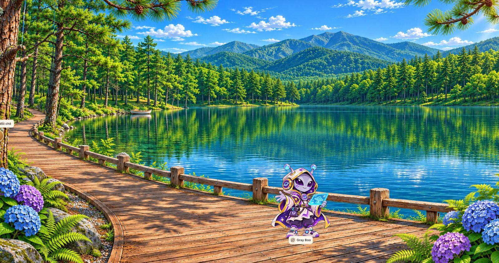

# HƯỚNG DẪN SẢN XUẤT HÌNH ĐỘNG & HIỆU ỨNG TƯƠNG TÁC

**Gray Boo & Pine Lake — Natural English / Cà Phê Vỉa Hè**  
**Mã tài liệu:** ENG-CAFE-ART-ANIM-001 · **Phiên bản:** 1.1 · **Ngày:** 07/11/2026  
**Đối tượng:** Chủ dự án, Artist/Animator, Frontend Developer, QA  
**Trạng thái:** Hướng dẫn thực hiện / thông số hiệu ứng là đề xuất cần thử nghiệm trên asset thật.

> **Mục tiêu:** từ *một ảnh minh họa tĩnh* tạo (1) ảnh động ngắn lặp lại của Gray Boo để dùng trong flashcard/preview; và (2) cảnh hồ thông HTML5 có nước, cây, ánh sáng, nhân vật chuyển động độc lập, có thể bấm để luyện nói. Không biến toàn bộ ảnh thành một GIF duy nhất.

**Ảnh tham chiếu:** cảnh hồ thông và nhân vật Gray Boo (ảnh gốc do người dùng cung cấp).



## 1. Chốt phạm vi và những gì đã có

### 1.1. Đầu vào thực tế

- Ảnh mẫu được cung cấp: `image(20261107-023515).png`, **2048 × 1082 px**, tỷ lệ xấp xỉ **1,893:1**; **không phải 16:9** (1,778:1).
- Ảnh đã gộp sẵn: trời, dãy núi, rừng thông, hồ, sàn gỗ, lan can, hoa, Gray Boo, màn hình hologram và nhãn chữ. Hiện **không có** layer nguồn, nhân vật alpha riêng, hình động hay atlas hoàn chỉnh.
- Trong handover dự án v1.3, cảnh dành cho Gray Boo là `mountain_view` (cảnh 03); `inside_cafe` ↔ `outdoor_terrace` ↔ `mountain_view`, **không tự thêm scene thứ tư**.
- Ảnh hồ thông là **phương án art/reference cho `mountain_view`**, chưa phải phê duyệt thay thế bố cục view đèo trong handover; cần PO xác nhận trước khi đổi art chính thức.

### 1.2. Hai sản phẩm cần xuất

| Gói | Công dụng | Đầu ra | Có tương tác? |
|---|---|---|---|
| A — Animated Preview | Flashcard, avatar, giới thiệu nhân vật | `gray_boo_idle.webp` (ưu tiên) và `gray_boo_idle.gif` (fallback), poster PNG | Không |
| B — HTML5 Live Scene | Người học quan sát hồ, bấm Gray Boo, mở luyện giao tiếp | Clean BG, các PNG/WebP alpha, sprite atlas JSON, PixiJS v8 + HTML DOM | Có |

**Phân biệt bắt buộc:** GIF/Animated WebP là chuỗi khung hình để hiển thị qua ``; PixiJS `AnimatedSprite` cần **sprite atlas/texture frames**. Không mặc định tải một file GIF/WebP động vào PixiJS sẽ tự có state machine hoặc lip sync.

## 2. Chuẩn hóa ảnh và bảo toàn phong cách

### 2.1. Quy tắc style lock

- **Art style:** premium stylized fantasy 2.5D, anime/cel-shading, đường viền gọn, màu xanh ngọc – xanh lá – tím, ánh sáng ban ngày trong trẻo.
- **Không đổi:** góc camera cố định, vị trí hồ/rừng/núi/sàn gỗ/lan can, tạo hình/tỷ lệ/áo/đầu/vị trí chân Gray Boo, chiếu sáng và bóng tiếp xúc.
- **Không dùng:** photorealism, 3D vật lý, camera rung, zoom liên tục, glow quá sáng, particle dày che chữ hội thoại.
- Giữ chuyển động ít nhưng thật: **mắt**, **tay**, **áo**, **hologram** là các bộ phận có animation riêng; không chỉ tăng/giảm scale toàn bộ PNG.

### 2.2. Chỉnh đúng 16:9 mà không làm méo

Ảnh gốc 2048 × 1082. Hai lựa chọn hình học:

1. **Khuyến nghị:** mở rộng canvas thành **2048 × 1152** (+70 px chiều cao), vẽ bổ sung khoảng **35 px phía trên** và **35 px phía dưới** (sky/deck), **không scale méo**. Kiểm tra lại mép cành và sàn gỗ sau khi mở rộng.
2. Nếu bắt buộc crop: giữ chiều cao 1082 px, lấy chiều rộng 1924 px (xấp xỉ 16:9), mất khoảng 62 px mỗi bên; có thể cắt hoa/khung gỗ nên **không ưu tiên**.

- *Master sản xuất:* 2048 × 1152 sau khi mở rộng (hoặc vẽ lại master 3840 × 2160 thực sự nếu có nguồn phù hợp). **Không gọi ảnh upscale là native 4K.**
- *Runtime desktop:* 1920 × 1080, 16:9 **contain**; *mobile:* bản nhẹ 1280 × 720 hoặc 960 × 540 theo kiểm thử.
- Phần label `Gray Boo` và chữ/giao diện ở mép trái phải **xóa khỏi ảnh nền**; nhãn nhân vật/nút tương tác dựng bằng HTML/CSS để dễ dịch và có accessibility.

### 2.3. Pipeline tạo clean background

1. **Sao lưu ảnh gốc** và mở bằng Krita/GIMP/Photoshop/Photopea, tạo file có thể sửa (`.kra` / `.psd` / `.ora`).
2. Kéo canvas ra 2048 × 1152, bổ sung chi tiết bầu trời/sàn gỗ ở biên trên/dưới.
3. Khoanh vùng **toàn bộ Gray Boo, bóng chân, hologram và chữ nhãn**. Tách/mask nhân vật trước khi xóa.
4. Dùng clone/heal/inpainting vẽ lại phần **sàn gỗ, lan can, hồ** vốn bị nhân vật che; kiểm tra đường vân sàn và thanh lan can liên tục.
5. Xóa nhãn chữ góc trái/nhãn tên khỏi clean background (nếu có trong file nguồn).
6. Xuất `bg_clean.webp`; chụp ảnh A/B với bản gốc để đảm bảo không phát sinh vật thể hoặc đổi bố cục.

> **Không thể có parallax đúng nghĩa từ một ảnh phẳng chỉ bằng CSS.** Muốn các cành lá/hồ/nhân vật chuyển động riêng, phải tạo layer alpha thật và phục hồi phần background phía sau các layer đó.

## 3. Tách layer theo chiều sâu và vùng chuyển động

**Sơ đồ thứ tự vẽ** (từ xa tới gần, 1920 × 1080 logical px):

| ID | Asset gợi ý | Nội dung | Hành vi |
|---|---|---|---|
| L00 | `background/sky_mountains.webp` | Trời, núi xa, vùng nền xa | Tĩnh |
| L01 | `ambient/clouds_alpha.webp` | Mây nhẹ tách alpha | Trôi cực chậm, tùy chọn |
| L02 | `background/forest_far.webp` | Rừng thông xa, đường bờ | Tĩnh / parallax rất nhẹ |
| L03 | `water/lake_base.webp` | Mặt nước phía sau lan can | Tĩnh, pixel hồ gốc |
| L04 | `water/lake_shimmer_alpha.webp` | Vệt phản quang trên hồ | Alpha dao động / drift ngắn trong **lake mask** |
| L05 | `foreground/deck_railing.webp` | Sàn gỗ + lan can (giữ perspective) | Tĩnh |
| L06 | `foreground/pine_branch_left.webp` | Cành thông tiền cảnh trái | Rotation nhỏ quanh gốc cành |
| L07 | `foreground/pine_branch_right.webp` | Cành thông tiền cảnh phải | Rotation nhỏ, lệch pha |
| L08 | `foreground/hydrangea_left.webp`, `_right.webp` | Các cụm hoa/cây gần | Sway rất nhẹ |
| L09 | `npc/gray_boo/shadow.webp` | Bóng tiếp xúc ngay dưới chân | Bám pivot chân, đổi alpha rất ít |
| L10 | `npc/gray_boo/gray_boo.atlas.*` | Gray Boo đủ state | AnimatedSprite / puppet rig |
| L11 | `fx/hologram_glow.webp`, `fx/sparkle.webp` | Sáng màn hình, điểm sáng nhỏ | Tương tác theo state |
| L12 | HTML overlay | Hotspot, nút nav, modal, chat, focus ring | DOM, không bake vào hình |

**Quy tắc tách layer:** với cành/hoa xuất PNG hoặc WebP alpha có khung bounding vừa đủ, ghi tọa độ `x`, `y`, `pivot`, `zIndex`; nếu là full-canvas overlay thì giữ tất cả ảnh cùng hệ trục và mask chuẩn. Với mặt hồ, **không kéo dịch chuyển cả ảnh hồ** làm lộ viền bờ; chỉ biến dạng/phủ alpha trong phạm vi hồ.

### 3.1. Bảng asset tối thiểu để chạy MVP

| File | Bắt buộc | Điều kiện nghiệm thu |
|---|---:|---|
| `bg_clean.webp` | Có | Không còn Gray Boo/chữ; sàn và lan can được vá hoàn chỉnh |
| `lake_shimmer_alpha.webp` | Có | Chỉ phủ vùng hồ; có alpha; không sáng trắng toàn hồ |
| `pine_branch_left.webp`, `pine_branch_right.webp` | Có | Mép cành sạch, có pivot ở gốc, không viền trắng |
| `shadow.webp` | Có | Bóng riêng, đúng mặt sàn và vị trí chân |
| `gray_boo.atlas.json` + atlas WebP/PNG | Có | Có `idle`, `blink`, `notice`, `listening`, `thinking`, `talking`, `error` |
| `hologram_glow.webp`, `sparkle.webp` | Có | Không trùm khuôn mặt; được tắt trong reduced motion |
| `water_displacement_map.png` | Giai đoạn 2 | Bản đồ displacement chỉ dành cho hồ, không filter full scene |

## 4. Làm hình động Gray Boo — từ ảnh tĩnh đến GIF/WebP

### 4.1. Tách rig nhân vật

Từ một tấm hình, **cần vẽ/phục hồi những vùng bị che** trước khi tạo rig. Khuyến nghị tách:

- `body`: thân/áo choàng/giày/đai lưng (giữ chân làm anchor).
- `head`: mũ/đầu/khuôn mặt; `eyes_open`, `eyes_half`, `eyes_closed`.
- `mouth_idle`, `mouth_open_1`, `mouth_open_2` (miệng nói đơn giản, **không** coi là lip-sync âm vị).
- `arm_left`, `arm_right`, `hand_hologram` (khớp vai/cổ tay phải nhất quán).
- `hologram_screen`, `hologram_glow`; `shadow` độc lập với body.

Có hai đường triển khai: **(A) frame-by-frame** vẽ từng pose trong Krita/Aseprite; hoặc **(B) puppet/part-rig** tách phần và thay đổi xoay/điểm neo trong PixiJS. Với Gray Boo, kết hợp B cho idle và A cho blink/gesture thường tiết kiệm công sức hơn.

### 4.2. Storyboard GIF idle — đề xuất loop 3 giây

| Thời điểm | Motion | Ghi chú |
|---|---|---|
| 0.00–0.50s | Đứng thư giãn, tay giữ hologram | Giữ chân cố định, áo chỉ nhúc nhích |
| 0.50–1.15s | Thở nhẹ, vai/đầu thay đổi nhỏ | Biên độ tinh tế, không lắc toàn thân |
| 1.15–1.38s | Mắt khép → mở | 3 frame blink, nhanh |
| 1.38–2.45s | Hologram sáng nhẹ, ngón tay đổi tư thế | Cyan glow không cháy sáng |
| 2.45–3.00s | Trở về pose đầu | Khung cuối khớp khung đầu, loop mượt |

**Mốc sản xuất thử:** 8 fps × 3 giây = khoảng 24 frame nếu vẽ frame-by-frame; spritesheet có thể tái sử dụng frame để bớt số hình cần vẽ. Làm **loop seamless** và export ảnh alpha.

### 4.3. Export đúng mục đích

- **Flashcard / avatar:** Animated WebP độ rộng thử **320–512 px**, loop; GIF tương đương chỉ dùng fallback hoặc chia sẻ bắt buộc GIF.
- **Sprite runtime:** atlas PNG/WebP alpha, frame giữ cùng canvas/cùng pivot; JSON có tên animation chuẩn. Không dùng GIF làm nguồn animation stateful trong PixiJS.
- **Poster/fallback:** PNG hoặc WebP tĩnh, luôn hiển thị được khi người dùng bật giảm chuyển động.
- Kiểm tra viền alpha khi chuyển đổi sang GIF (GIF giới hạn bảng màu), đặc biệt sắc tím gradient và ánh sáng cyan.

**Kiểm tra chất lượng:** mắt không nhảy vị trí, bàn tay không xuyên hologram, giày giữ chân trên sàn, không phát sinh thêm tay/ngón tay, và loop không giật.

## 5. Hiệu ứng môi trường hồ thông — P0 trước, P1 sau

| Hiệu ứng | P0 (dễ, ổn định) | P1 (nâng cao) | Biên độ/mốc thử |
|---|---|---|---|
| Hồ | Shimmer alpha + vài dải gợn nước có mask | DisplacementFilter trên **lake layer** | Opacity 0.15–0.35; distortion nhỏ |
| Cành thông | Part rotation/mesh sway | Mesh deformation theo gió | Khoảng ±0.5–1.2 độ |
| Hoa | Cụm hoa alpha sway lệch pha | Cánh hoa trôi theo đường Bézier | Không làm cả bụi hoa rung mạnh |
| Ánh nắng | 2–4 vệt sáng phản quang | Color/glow filter trong vùng nhỏ | Bloom thấp, không cháy highlight |
| Hologram | Đổi opacity + scale nhẹ lớp glow | Pulse theo state / TTS | Nhịp khoảng 1.6–2.2s |
| Parallax | Off mặc định trên mobile | Cảnh xa dịch rất nhẹ theo pointer | Offset khoảng 2–10 logical px |

**Thứ tự ưu tiên dựng:** clean background → Gray Boo idle/blink → click hotspot/chat → lake shimmer → hai cành thông → hologram → particle → displacement/parallax. Không triển khai shader nặng khi chưa có asset sạch.

### 5.1. Mặt hồ: cách tránh lỗi thường gặp

1. Mask chính xác **mặt hồ** theo đường bờ trên và mép lan can dưới; phần trong suốt không được ghi đè sàn gỗ/lan can.
2. Với MVP, tạo overlay alpha màu xanh/trắng ngọc gồm vài nét phản quang nhỏ, loop độ sáng và dịch ngang vài pixel **bên trong mask**.
3. Giai đoạn nâng cao dùng PixiJS `DisplacementFilter({ sprite, scale })`; tạo `displacement-map` mềm, cuộn rất chậm và đặt **filter chỉ trên water container**.
4. Không kéo texture nước nguyên khối khiến cây phản chiếu hoặc bờ hồ bị xé; không dùng noise tần số cao khiến hồ nhấp nháy.

### 5.2. Gió: logic cành lá

- Pivot của cành nằm **nơi cành nối thân cây**, không phải tâm khung ảnh.
- Trái/phải lệch pha (ví dụ 0 và 1.4 rad) để tránh các cành rung đồng bộ như máy.
- Hoa di chuyển ít hơn cành thông; sàn/lan can và thân thông lớn đứng yên.
- Không đổi vị trí vật thể có hotspot nếu hotspot không được đồng bộ transform.

## 6. Tương tác Gray Boo phục vụ học tiếng Anh

### 6.1. Trạng thái NPC

```text
idle ──(hover/focus/click)──> notice ──(mở trò chuyện)──> listening
                                                               │
                                                       (gửi tin nhắn)
                                                               ▼
                                                            thinking
                                                               │
                                                       (nhận phản hồi)
                                                               ▼
                                                            talking
                                                               │
                                                       (đọc xong / đóng)
                                                               ▼
                                                            listening
listening ──(kết thúc phiên)──> idle
thinking ──(lỗi API)──> error ──(retry)──> listening
```

| Tác động người học | Phản ứng hình | UI / hệ thống |
|---|---|---|
| Mở cảnh | Gray Boo idle, blink; hồ chuyển động | Không auto bật mic / không gọi AI |
| Hover/focus Gray Boo | Nhìn lên hoặc vẫy nhẹ; cảnh hồ, cây, hoa, hạt sáng tăng tốc có easing | Hiện affordance/border focus; không tự mở chat |
| Click/tap | `notice` → `listening` | Mở interaction sheet (Nature / Aliens, A1/A2/B1) |
| Gửi câu hỏi | `thinking`: chớp mắt + bong bóng `…` | Gọi API qua server hoặc scripted fallback |
| Có câu trả lời | `talking`: 2–4 mouth shapes, tay gesture | Hiển thị text/hint; TTS **nếu được bật** |
| Đóng hội thoại | Về `idle` | Giữ tóm tắt/flashcard nếu user lưu |
| Lỗi mạng | `error`: biểu cảm nhẹ, không đáng sợ | Retry / scripted fallback đúng nhãn |

**Content minh họa, chưa duyệt bài học:** "Look at the lake. What can you see?" / "Nhìn hồ kìa. Bạn có thể thấy gì?". Nội dung hiển thị chính thức phải qua quy trình review American English của dự án. Với chủ đề UFO/aliens cần phân biệt nội dung giả tưởng và thông tin thật.

### 6.2. Quy tắc UX tương tác

- Dùng **HTML button** làm hotspot trong cùng khung `aspect-ratio:16/9` với canvas; `aria-label`, hỗ trợ Tab/Enter/Space và vùng chạm tối thiểu **44 × 44 CSS px**.
- Không biến toàn cảnh thành click target; chỉ Gray Boo, điểm ngắm cảnh, mũi tên điều hướng có hit area.
- Khi modal/chat mở: khóa điều hướng nền, quản lý focus/ESC/Back, không kích hoạt click hai lần.
- Một người học chỉ có một phiên Café active theo thiết kế backend. Không gọi AI ở trạng thái idle/ambient.
- Nếu voice không được bật/hỗ trợ, dùng text conversation; lip flap có thể chạy theo bubble text, **không tự nhận là lip sync chính xác**.
- Navigation phải giữ graph **inside_cafe ↔ outdoor_terrace ↔ mountain_view**.

### 6.3. Hover Boost — tăng tốc cảnh vật khi hover/focus Gray Boo (BỔ SUNG v1.1)

**Quy tắc sản phẩm:** khi người học rê chuột vào hotspot Gray Boo (hoặc dùng bàn phím Tab để focus), các lớp cảnh *đang chuyển động* tăng **tốc độ chu kỳ** chứ không tăng FPS render và **không tăng biên độ/góc dao động**. NPC chuyển từ `idle` sang `notice` (nhìn lên/vẫy nhẹ). **Không** tăng tốc toàn bộ `app.ticker`, **không** tăng tốc animation miệng/TTS, **không** rung camera hoặc dịch chuyển lan can, sàn, núi.

| Layer | Tốc độ bình thường | Khi hover/focus | Lưu ý |
|---|---:|---:|---|
| Hồ (shimmer / ripples) | 1.0× | **1.8×** | Giữ mask hồ; giữ nguyên biên độ distortion |
| Cành thông (wind sway) | 1.0× | **1.5×** | Cùng góc tối đa ±1.2°, chỉ nhanh chu kỳ |
| Hoa/cây bụi (foliage sway) | 1.0× | **1.5×** | Lệch pha; không bay khỏi vị trí |
| Hạt sáng / cánh hoa (particles) | 1.0× | **2.0×** | Không tăng số hạt hoặc độ chói |
| Hologram (glow pulse) | 1.0× | **1.3×** | Không nháy chớp gắt; mức sáng cố định |

**Chuyển trạng thái:** `idle 1× → hover 1.3–2×` với ease-in ~450ms; `hover → idle 1×` với ease-out ~800ms; hệ số chỉ là baseline thiết kế, cần duyệt art/QA. Khi mở chat, bỏ boost (để người học tập trung nội dung); `pointerleave`/`blur` trả về tốc độ 1×. Trên điện thoại *tap là click*, không mô phỏng hover kéo dài.

**GIF khác PixiJS:** file `.gif` và Animated WebP chạy bằng `` **không có API trình duyệt tiêu chuẩn để chỉnh playback speed theo hover**. Nếu cần phiên bản ảnh động thuần, xuất **hai file** `gray_boo_idle.webp` và `gray_boo_notice.webp` rồi đổi `src` khi hover; cách này có thể khởi động lại loop. Đối với *cảnh* cần tốc độ động mượt, dùng PixiJS ticker + spritesheet/shader.

**Khả năng truy cập & hiệu suất:** `prefers-reduced-motion: reduce` tắt hoàn toàn Hover Boost, giảm/tắt ambient FX; tab ẩn pause renderer; animation không thiết yếu không chạy khi chatbot đang mở. Không có AI call khi hover/focus.

### 6.4. Công thức Hover Boost cho developer

Sử dụng **một biến blend** `0..1`, làm mượt theo thời gian thực `ticker.deltaMS`; mỗi lớp có hệ số tốc độ riêng. Nên tăng `phase` nội bộ cho mỗi lớp, *không* dùng `performance.now()` trực tiếp, vì khó thay đổi tốc độ và dễ giật khi chuyển chế độ.

```ts
const dt = Math.min(ticker.deltaMS, 50) / 1000;
const active = isHoveringGrayBoo && !chatOpen && !reduceMotion;
const target = active ? 1 : 0;
const tau = target > hoverBlend ? 0.45 : 0.80;
hoverBlend += (target - hoverBlend) * (1 - Math.exp(-dt / tau));
const speed = (maxHoverMultiplier: number) =>
  1 + (maxHoverMultiplier - 1) * hoverBlend;
waterPhase += dt * speed(1.8);
windPhase  += dt * speed(1.5);
flowersPhase += dt * speed(1.5);
particlesPhase += dt * speed(2.0);
hologramPhase += dt * speed(1.3);
```

Đây là **chu kỳ hiệu ứng**, không phải tốc độ GPU/FPS: renderer vẫn chỉ chạy 30–60 FPS theo budget. Khi giảm chuyển động: đặt `hoverBlend=0`, các layer ambient ở trạng thái đứng yên/poster.

## 7. Cấu trúc thư mục để artist bàn giao developer

```text
public/cafe/assets/
  scenes/mountain_view/
    bg_clean.webp
    sky_mountains.webp
    forest_far.webp
    lake_base.webp
    lake_shimmer_alpha.webp
    pine_branch_left.webp
    pine_branch_right.webp
    hydrangea_left.webp
    hydrangea_right.webp
    displacement_map.png                 # P1
  npc/gray_boo/
    gray_boo.atlas.webp                  # texture atlas alpha
    gray_boo.atlas.json                  # states + frame definitions
    shadow.webp
    hologram_glow.webp
    sparkle.webp
    gray_boo_idle.webp                   # animated, preview  only
    gray_boo_idle.gif                    # optional fallback
    gray_boo_poster.webp
  configs/
    mountain_view.animation.json
```

**Asset manifest bắt buộc**: nguồn/tác giả hoặc giấy phép, version, kích thước, pivot, tọa độ, zIndex, FPS, duration, alpha status, trạng thái animation, kiểm tra art QA. Bản source `.kra/.psd` giữ trong nơi quản lý asset, không deploy vào `public/`.

### 7.1. Mẫu cấu hình hiệu ứng (đề xuất chưa chốt)

```json
{
  "sceneId": "mountain_view",
  "logicalSize": { "width": 1920, "height": 1080 },
  "background": "/cafe/assets/scenes/mountain_view/bg_clean.webp",
  "npc": {
    "id": "gray_boo",
    "atlas": "/cafe/assets/npc/gray_boo/gray_boo.atlas.json",
    "anchor": [0.5, 1.0],
    "x": 1180,
    "y": 976,
    "states": ["idle", "blink", "notice", "listening", "thinking", "talking", "error"]
  },
  "effects": {
    "lakeShimmer": { "enabled": true, "opacityMin": 0.15, "opacityMax": 0.30 },
    "wind": { "enabled": true, "maxAngleDeg": 1.2, "periodMs": 5500 },
    "particles": { "enabled": false },
    "displacement": { "enabled": false },
    "parallax": { "enabled": false },
    "hoverBoost": {
      "enabled": true, "trigger": ["pointer-hover", "keyboard-focus"],
      "easeInMs": 450, "easeOutMs": 800,
      "waterSpeed": 1.8, "pineSpeed": 1.5,
      "flowersSpeed": 1.5, "sparkleSpeed": 2.0,
      "hologramSpeed": 1.3, "reducedMotionOverride": true
    }
  },
  "hotspots": [
    { "id": "talk_gray_boo", "npcId": "gray_boo", "xPct": 55, "yPct": 62,
      "wPct": 15, "hPct": 30, "ariaLabel": "Talk to Gray Boo" }
  ]
}
```

*Tọa độ trên chỉ là mẫu gần đúng từ ảnh xem trước; phải đo lại trên ảnh clean 16:9 và hiệu chỉnh bằng QA. Không ghi trực tiếp vào JSON production trước khi artist chốt.*

## 8. HTML5 / PixiJS v8 — mẫu tích hợp tối thiểu

### 8.1. Cài package

```bash
npm install pixi.js
```

Ví dụ bên dưới yêu cầu **các file asset ở mục 7 phải được tạo trước**; đây là scaffold cho FE, không phải scene có thể chạy từ duy nhất ảnh PNG gốc. Component cần dùng client-side ở Next.js App Router.

### 8.2. `GrayBooLake.tsx` — Sprite + animation + hotspot

```tsx
'use client';

import { useEffect, useRef, useState } from 'react';
import { Application, Assets, Container, Sprite, AnimatedSprite } from 'pixi.js';

type GrayState = 'idle' | 'notice' | 'listening' | 'thinking' | 'talking' | 'error';
const W = 1920;
const H = 1080;
const toRad = (deg: number) => deg * Math.PI / 180;

export default function GrayBooLake() {
  const hostRef = useRef<HTMLDivElement>(null);
  const setGrayState = useRef<(state: GrayState) => void>(() => {});
  const hoverActive = useRef(false); // mouse/pen hover hoặc keyboard focus
  const [open, setOpen] = useState(false);

  useEffect(() => {
    const host = hostRef.current;
    if (!host) return;
    let cancelled = false;
    let cleanup: (() => void) | undefined;

    async function mount() {
      const app = new Application();
      await app.init({ resizeTo: host!, backgroundAlpha: 0, antialias: true });
      if (cancelled) { app.destroy(true); return; }
      host!.appendChild(app.canvas);
      app.canvas.style.pointerEvents = 'none'; // hotspot do DOM quản lý
      app.canvas.style.display = 'block';

      const world = new Container();
      app.stage.addChild(world);
      const scene = '/cafe/assets/scenes/mountain_view/';
      const npcBase = '/cafe/assets/npc/gray_boo/';
      const [bgTex, shimmerTex, pineLeftTex, pineRightTex,
             flowersLeftTex, flowersRightTex, glowTex, sparkleTex, sheet] =
        await Promise.all([
          Assets.load(scene + 'bg_clean.webp'),
          Assets.load(scene + 'lake_shimmer_alpha.webp'),
          Assets.load(scene + 'pine_branch_left.webp'),
          Assets.load(scene + 'pine_branch_right.webp'),
          Assets.load(scene + 'hydrangea_left.webp'),
          Assets.load(scene + 'hydrangea_right.webp'),
          Assets.load(npcBase + 'hologram_glow.webp'),
          Assets.load(npcBase + 'sparkle.webp'),
          Assets.load(npcBase + 'gray_boo.atlas.json')
        ]);
      if (cancelled) { app.destroy(true); return; }

      const bg = new Sprite(bgTex);
      bg.width = W;
      bg.height = H;
      world.addChild(bg);

      const shimmer = new Sprite(shimmerTex);
      shimmer.width = W;
      shimmer.height = H;
      world.addChild(shimmer); // alpha sạch / mask hồ có sẵn trong asset

      // Demo: các overlay foliage alpha cùng canvas 1920x1080.
      // Production nên crop sát sprite rồi đổi pivot/position theo manifest Art.
      function addSway(tex: typeof pineLeftTex, rootX: number, rootY: number) {
        const sprite = new Sprite(tex);
        sprite.width = W;
        sprite.height = H;
        sprite.pivot.set(rootX, rootY); // gốc cành/bụi cây, không phải tâm ảnh
        sprite.position.set(rootX, rootY);
        world.addChild(sprite);
        return sprite;
      }
      const pineL = addSway(pineLeftTex, 110, 36);
      const pineR = addSway(pineRightTex, 1690, 46);
      const flowerL = addSway(flowersLeftTex, 110, 920);
      const flowerR = addSway(flowersRightTex, 1770, 910);

      const gray = new AnimatedSprite({
        textures: sheet.animations.idle, autoPlay: true,
        loop: true, animationSpeed: 0.1
      });
      gray.anchor.set(0.5, 1);
      gray.position.set(1180, 976); // placeholder: phải đo lại ảnh clean
      world.addChild(gray);

      const hologram = new Sprite(glowTex);
      hologram.anchor.set(0.5);
      hologram.position.set(1280, 760); // placeholder theo bàn tay/thiết bị
      world.addChild(hologram);

      const particles = Array.from({ length: 6 }, (_, index) => {
        const sprite = new Sprite(sparkleTex);
        sprite.anchor.set(0.5);
        sprite.scale.set(0.14);
        world.addChild(sprite);
        return { sprite, index };
      });

      const reduced = window.matchMedia('(prefers-reduced-motion: reduce)');
      setGrayState.current = (state) => {
        const frames = sheet.animations[state] ?? sheet.animations.idle;
        gray.stop();
        gray.textures = frames;
        if (reduced.matches) gray.gotoAndStop(0);
        else gray.gotoAndPlay(0);
      };

      const fit = () => {
        const scale = Math.min(host!.clientWidth / W, host!.clientHeight / H);
        world.scale.set(scale);
        world.position.set((host!.clientWidth - W * scale) / 2,
                           (host!.clientHeight - H * scale) / 2);
      };
      const ro = new ResizeObserver(fit);
      ro.observe(host!);
      fit();

      let blend = 0;
      let waterPhase = 0, windPhase = 0, flowerPhase = 0;
      let particlePhase = 0, glowPhase = 0;
      const update = (ticker: { deltaMS: number }) => {
        const dt = Math.min(ticker.deltaMS, 50) / 1000;
        if (reduced.matches) {
          blend = 0;
          shimmer.alpha = 0;
          pineL.rotation = pineR.rotation = 0;
          flowerL.rotation = flowerR.rotation = 0;
          hologram.alpha = 0.18;
          particles.forEach(({ sprite }) => { sprite.visible = false; });
          gray.stop();
          return;
        }

        const target = hoverActive.current ? 1 : 0;
        const tau = target > blend ? 0.45 : 0.80;
        blend += (target - blend) * (1 - Math.exp(-dt / tau));
        const boost = (max: number) => 1 + (max - 1) * blend;
        waterPhase += dt * boost(1.8);
        windPhase += dt * boost(1.5);
        flowerPhase += dt * boost(1.5);
        particlePhase += dt * boost(2.0);
        glowPhase += dt * boost(1.3);

        shimmer.alpha = 0.22 + Math.sin(waterPhase * 1.35) * 0.07;
        pineL.rotation = toRad(1.05) * Math.sin(windPhase * 1.14);
        pineR.rotation = toRad(0.90) * Math.sin(windPhase * 1.14 + 1.4);
        flowerL.rotation = toRad(0.45) * Math.sin(flowerPhase * 1.55 + 0.8);
        flowerR.rotation = toRad(0.45) * Math.sin(flowerPhase * 1.55 + 2.3);
        hologram.alpha = 0.55 + Math.sin(glowPhase * 3.1) * 0.12;
        particles.forEach(({ sprite, index }) => {
          const p = particlePhase * 0.7 + index * 1.047;
          sprite.visible = true;
          sprite.position.set(1110 + index * 32 + Math.sin(p) * 7,
                              740 - Math.sin(p * 0.8) * 24);
          sprite.alpha = 0.23 + Math.abs(Math.sin(p)) * 0.3;
        });
      };
      app.ticker.add(update);
      const onVisibility = () => document.hidden ? app.stop() : app.start();
      document.addEventListener('visibilitychange', onVisibility);

      cleanup = () => {
        hoverActive.current = false;
        setGrayState.current = () => {};
        ro.disconnect();
        document.removeEventListener('visibilitychange', onVisibility);
        app.ticker.remove(update);
        app.destroy(true);
      };
      if (cancelled) cleanup();
    }

    void mount().catch((error) => {
      // Production: render static poster + retry; never leave blank scene.
      console.error('Gray Boo scene failed to mount', error);
    });
    return () => { cancelled = true; cleanup?.(); };
  }, []);

  const onHoverEnter = () => {
    if (open) return;
    hoverActive.current = true;
    setGrayState.current('notice');
  };
  const onHoverLeave = () => {
    hoverActive.current = false;
    if (!open) setGrayState.current('idle');
  };

  return (
    <div className="scene-frame">
      <div ref={hostRef} className="scene-canvas" aria-hidden="true" />
      <button
        className="gray-hotspot"
        aria-label="Talk to Gray Boo"
        onPointerEnter={(event) => {
          if (event.pointerType === 'mouse' || event.pointerType === 'pen')
            onHoverEnter();
        }}
        onPointerLeave={onHoverLeave}
        onFocus={onHoverEnter}
        onBlur={onHoverLeave}
        onClick={() => {
          hoverActive.current = false; // giảm tốc khi chat mở
          setGrayState.current('listening');
          setOpen(true);
        }}
      />
      {open && (
        <section className="chat-sheet" role="dialog" aria-modal="true"
                 aria-label="Practice English with Gray Boo">
          <strong>Gray Boo · Nature / Aliens</strong>
          <p>Connect this panel to the project's actual chat flow.</p>
          <button onClick={() => {
            hoverActive.current = false;
            setOpen(false);
            setGrayState.current('idle');
          }}>Close</button>
        </section>
      )}
    </div>
  );
}
```

### 8.3. CSS — responsive 16:9 và hotspot đúng tỷ lệ

```css
.scene-frame {
  position: relative;
  width: 100%;
  aspect-ratio: 16 / 9;
  overflow: hidden;
  background: #d5edf1;
}
.scene-canvas, .scene-canvas canvas {
  position: absolute;
  inset: 0;
  width: 100%;
  height: 100%;
}
.gray-hotspot {
  position: absolute;
  left: 55%; top: 62%; width: 15%; height: 30%;
  border: 0; background: transparent; cursor: pointer;
  min-width: 44px; min-height: 44px;
}
.gray-hotspot:focus-visible {
  outline: 3px solid #47d6fa;
  outline-offset: 3px;
}
.chat-sheet {
  position: absolute; right: 2%; bottom: 3%;
  width: min(390px, 92%); padding: 16px;
  background: #fff; border-radius: 14px;
  box-shadow: 0 10px 35px #102e4240;
}
@media (prefers-reduced-motion: reduce) {
  .scene-frame * { scroll-behavior: auto; }
}
```

**Bổ sung v1.1:** Hover Boost đã được đưa vào code với các phase độc lập và easing; cành/hoa trong ví dụ đang giả định alpha overlay cùng khung 1920×1080. Với asset crop thực tế, dùng tọa độ/pivot từ manifest. **Đây là demo tích hợp hiển thị:** sản phẩm thật phải thêm retry/error UI, modal focus-trap, Escape/Back, asset caching, `npcState` từ backend chat/TTS, đồng bộ hotspot sau khi chốt tọa độ và preview fallback. Một số trạng thái chưa có nút kích hoạt trong scaffold vì phải nối với conversation events thực tế.

### 8.4. Nâng cao: hồ displacement (chỉ khi P0 ổn)

```ts
// Mẫu API PixiJS v8: texture displacement-map phải được load trước.
import { Sprite, DisplacementFilter } from 'pixi.js';
const displacementSprite = new Sprite(displacementMapTexture);
const waterFilter = new DisplacementFilter({
  sprite: displacementSprite,
  scale: { x: 2, y: 1 }
});
waterContainer.filters = [waterFilter]; // KHÔNG áp dụng lên app.stage
// Đưa map sprite vào scene và cập nhật chuyển động theo ticker;
// giới hạn mask/filter-area trong vùng hồ và kiểm tra lại seam.
```

## 9. Quy trình thực hành đề xuất (Artist → FE → QA)

| Chặng | Ai làm | Sản phẩm hoàn thành | Gate |
|---|---|---|---|
| 01 — Prepare | Artist | File nguồn + bản 16:9 + clean background | Không thay góc nhìn, không méo |
| 02 — Split | Artist | Hồ/hoa/cành thông/nhân vật alpha | Không halo hoặc lỗ hổng background |
| 03 — Gray Boo | Animator | Rig + 7 state + atlas + preview WebP/GIF | Chân/khớp/loop ổn định |
| 04 — Lake FX | FE/Artist | Shimmer, branches, hologram trong Pixi | FPS và mask đạt |
| 05 — Interaction | FE/BE | Hotspot → chat → state → đóng | Một click, một phiên, focus đúng |
| 06 — QA | QA/PO | Desktop/mobile/reduced-motion test | Go / No-Go |

### 9.1. Điều kiện hoàn tất MVP — checklist

- [ ] Source 16:9 không kéo giãn; clean BG xóa đúng Gray Boo, chữ và vùng bị che.
- [ ] Atlas Gray Boo có ít nhất `idle`, `notice`, `listening`, `thinking`, `talking`, `error`; blink có frame/animation riêng.
- [ ] Có preview **Animated WebP** và **GIF** mẫu của Gray Boo; poster tĩnh.
- [ ] Hồ chỉ nhấp nháy trong mask; cây rung tại gốc cành; hoa/lan can không xuyên lớp.
- [ ] Gray Boo click/tap được; keyboard Tab/Enter/Space; có label và focus visible.
- [ ] Trigger `talking` đi theo trạng thái thực của TTS/chat; không tự gọi AI khi idle.
- [ ] Giảm chuyển động: tắt FX không thiết yếu; tab ẩn: ngừng ticker.
- [ ] Hover/focus Gray Boo: hồ ×1.8, cành thông ×1.5, hoa ×1.5, hạt sáng ×2, hologram ×1.3; không làm thay đổi FPS render.
- [ ] Mouseleave/blur: giảm tốc mượt về 1×; mở chat: hủy boost; mobile tap không giữ hover.
- [ ] Reduced motion: boost bị vô hiệu; không rò memory/listener khi chuyển scene.
- [ ] 16:9 contain và hotspot đồng vị trí trên desktop/mobile; không crop bừa.
- [ ] Test mục tiêu desktop 60 FPS, mobile 30–60 FPS **trên thiết bị thật**; đây là mục tiêu, chưa phải số đo.
- [ ] Kiểm soát dung lượng bản đầu, tránh tải master/upscale 4K; có phiên bản static poster.
- [ ] PO xác nhận ảnh hồ thông có được dùng làm art chính thức cho `mountain_view`.

### 9.2. Lỗi phổ biến và cách sửa

| Hiện tượng | Nguyên nhân thường gặp | Cách xử lý |
|---|---|---|
| Cành cây có viền trắng | Alpha matte sai / viền chưa xử lý | Feather/matte cleanup, export premultiplied phù hợp |
| Mặt hồ bị xé sát lan can | Dịch ảnh hồ thay vì overlay có mask | Tách `lake_base`, chỉ animate vùng nước |
| Gray Boo “trôi” khỏi sàn | Pivot thay đổi giữa frame, scale cả PNG | Giữ anchor chân + cùng frame canvas |
| Hologram che mắt/nhân vật | zIndex và phần tay chưa tách | Hologram ở layer theo tay, occlusion đúng |
| Bấm sai nhân vật trên mobile | Canvas bị `cover` hoặc overlay scale khác | Cùng container 16:9, `contain`, hotspot % |
| Nặng CPU/GPU | GIF fullscreen / quá nhiều filter | Texture nhỏ, PixiFX khu vực, adaptive quality |
| AI trả lời mà NPC không nói | State chưa nối với event chat/TTS | FE dispatch thinking/talking/listening theo callback |
| Bị chóng mặt vì parallax | Biên độ quá lớn, thiếu reduce-motion | Giảm offset/tắt mặc định trên mobile |

## 10. Nguồn tham khảo và phân loại thông tin

**[BASELINE — dự án]:** `Cafe_Via_He_Developer_Handover_v1.3.md` (04/11/2026), đặc biệt mục 3, 5, 6, 7, 13–14: ba cảnh liên thông; PixiJS v8; scene multilayer; NPC states; 16:9; alt/focus/reduced-motion; free-first. `CONTENT_REVIEW_WORKFLOW.md`: nội dung hội thoại chính thức cần kiểm duyệt trước xuất bản.

**[ĐÃ KIỂM TRA — tài liệu kỹ thuật chính thức]:**

1. PixiJS v8 `Application`: https://pixijs.com/8.x/guides/components/application
2. PixiJS v8 `Sprite`/scene graph/masks: https://pixijs.com/8.x/guides/components/scene-objects
3. PixiJS v8 `Ticker`: https://pixijs.com/8.x/guides/components/application/ticker-plugin
4. PixiJS v8 `DisplacementFilter`: https://pixijs.download/v8.21.0/docs/filters.DisplacementFilterOptions.html
5. MDN WebP/GIF image formats: https://developer.mozilla.org/en-US/docs/Web/Media/Guides/Formats/Image_types
6. MDN `prefers-reduced-motion`: https://developer.mozilla.org/en-US/docs/Web/CSS/Reference/At-rules/@media/prefers-reduced-motion
7. MDN `visibilitychange`: https://developer.mozilla.org/en-US/docs/Web/API/Document/visibilitychange_event

**[ĐỀ XUẤT, CẦN ĐO/PHÊ DUYỆT]:** độ rung góc lá, độ sáng mặt hồ, FPS sprite, thời lượng loop 3s, tọa độ Gray Boo/hotspot, kích thước GIF/WebP, chất lượng shader, việc dùng hồ thông làm `mountain_view`. Không coi các mốc này là số liệu production đã đo.

---

**Kết luận triển khai:** hoàn thành **clean background + alpha layers + Gray Boo sprite states** trước, sau đó mới kết nối PixiJS và hiệu ứng. Với dự án English, ưu tiên **WebP/GIF cho preview**, **PixiJS v8 + HTML5 DOM cho interactive scene**; tuyệt đối không phụ thuộc vào GIF toàn cảnh để tạo cảm giác tương tác.

**Bổ sung tham khảo cho Hover Boost (v1.1):** PixiJS Ticker `deltaMS` https://pixijs.download/v8.22.0/docs/ticker.Ticker.html ; MDN prefers-reduced-motion https://developer.mozilla.org/en-US/docs/Web/CSS/Reference/At-rules/%40media/prefers-reduced-motion .
