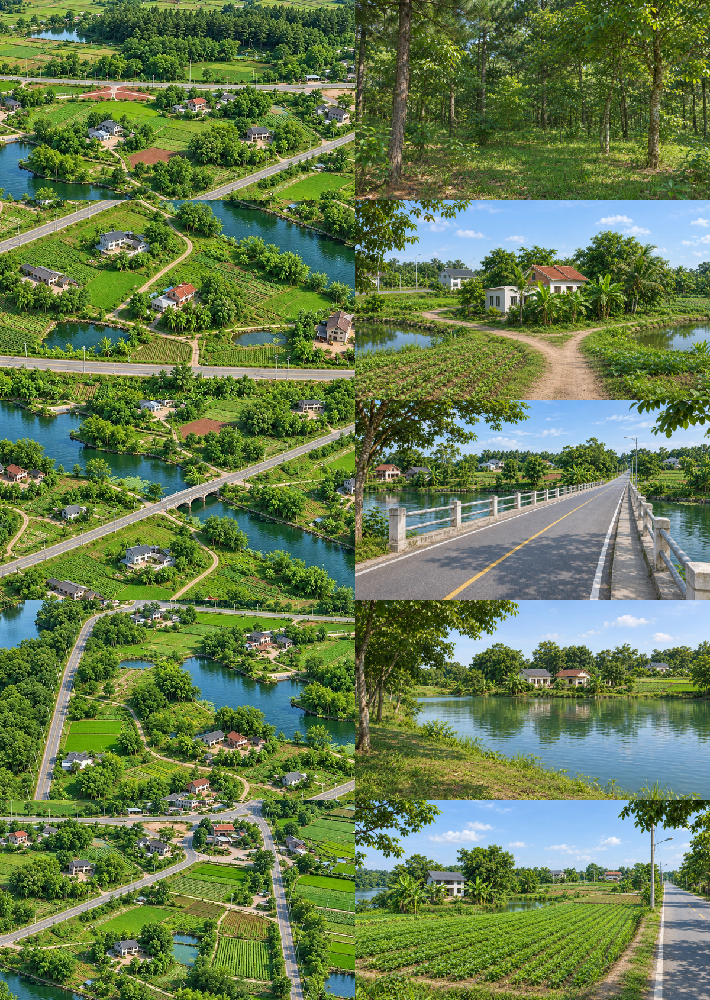
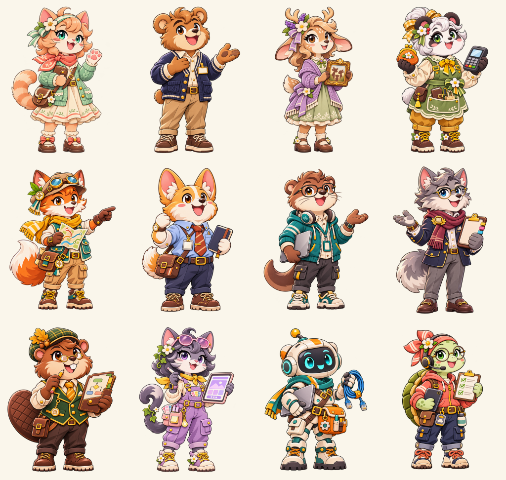

# Bình Nguyên — cảnh và 18 chủ đề

Đã áp dụng cục bộ vào trang café. Từ hồ thông chọn **Đến làng Bình Nguyên**, vào **Khu nhà** để mở cửa hàng, góc làm việc, phòng dự án và studio sản phẩm. Mr. Pink giữ vai trò hướng dẫn ngoài 18 chủ đề.

| #   | Chủ đề                                    | NPC           | Cảnh                 |
| --- | ----------------------------------------- | ------------- | -------------------- |
| 01  | Greetings & Small Talk                    | Nina Cat      | Bờ hồ Bình Nguyên    |
| 02  | Introducing Yourself                      | Ben Bear      | Khu nhà Bình Nguyên  |
| 03  | My Daily Routine                          | Ollie Owl     | Vườn hoa             |
| 04  | Family & Friends                          | Luna Deer     | Rừng Bình Nguyên     |
| 05  | Food, Coffee & Restaurants                | Mây           | Vườn hoa             |
| 06  | Shopping & Payments                       | Penny Panda   | Cửa hàng Bình Nguyên |
| 07  | Transportation & Directions               | Rio Fox       | Cầu qua sông         |
| 08  | At Work                                   | Toby Corgi    | Góc làm việc         |
| 09  | Hobbies & Free Time                       | Mimi Bunny    | Vườn hoa             |
| 10  | Travel & Hotels                           | Đèo Explorer  | Đồi chè              |
| 11  | Health & Feelings                         | Gray Boo      | Hồ thông             |
| 12  | Making Plans & Solving Problems           | Astro Bean    | Đồi chè              |
| 13  | IT Workplace Communication                | Alex Otter    | Góc làm việc         |
| 14  | Project Management & Meetings             | Morgan Wolf   | Phòng dự án          |
| 15  | Business Analysis & Banking Operations    | Bailey Beaver | Phòng dự án          |
| 16  | UI/UX Design & User Experience            | Ivy Cat       | Studio sản phẩm      |
| 17  | Software Development & System Integration | Dex Robot     | Studio sản phẩm      |
| 18  | Testing, Deployment & Production Support  | Tess Turtle   | Studio sản phẩm      |

## Cảnh con lấy từ bản đồ

Nguồn đối chiếu là ảnh đang dùng trong app: `public/cafe/maps/area-map-hq-v2.webp`. Mỗi điểm có ảnh cắt tham chiếu riêng, tọa độ vùng cắt và hướng nhìn được lưu cùng [prompt/manifest](../../art/dalat/map-points/v2/manifest.json).

| Cảnh      | Mốc được đối chiếu trong ảnh mới                                                                                             |
| --------- | ---------------------------------------------------------------------------------------------------------------------------- |
| Rừng      | Cây lá rộng xen cây lá kim, tầng cây thấp và nền cỏ; bỏ lối đi vườn hoa, đá rêu và cẩm tú cầu của bản trước.                 |
| Khu nhà   | Nhà mái đỏ, phần nhà phụ trắng thấp, nhánh đường đất, ao hai bên và cây chuối/cọ; bỏ dãy nhà sát phố bê tông.                |
| Cầu       | Cầu thẳng qua mặt nước, lan can hai bên, vạch đường, tuyến đường tiếp tục sang bờ đối diện; bỏ đường dạo cong ven sông.      |
| Bờ hồ     | Bờ cỏ tự nhiên, đôi nhà mái xám/đỏ phía bên kia, cây và ruộng thấp; bỏ vườn hoa, hàng rào và núi trang trí.                  |
| Cánh đồng | Ô trồng thẳng hàng, nhà mái xám, ao nhỏ, đường nhựa và cột điện ở cạnh phải; bỏ hàng rào tre, đồi chè và nhà mới sát camera. |

Ảnh trên cao chỉ xác định được các mốc nhìn thấy; mặt nhà, nền đất và phần bị cây che vẫn là tái dựng bằng ảnh sinh, không phải phép chuyển camera từ mô hình 3D đo đạc. Các phòng bên trong là bối cảnh học mới, không phải nội thất được xác nhận từ bản đồ.

## Tài nguyên

- Tạo bằng **image_gen tích hợp**, không gọi API key của ứng dụng.
- Nguồn và prompt cho 12 NPC + 4 phòng: [manifest](../../art/dalat/topics-v1/manifest.json).
- 12 ảnh NPC có alpha thực, nguồn giữ nguyên trong `art/npc/topic-pack/`; runtime WebP lossless cao 768px ở `public/cafe/npc/topics/`.
- Nền mới giữ độ phân giải gốc công cụ xuất **1672 × 941**, không phóng ảnh để giả độ nét. Runtime ở `public/cafe/maps/locations/v2/` và `public/cafe/maps/rooms/`.
- Sáu NPC cũ giữ nguyên ảnh/rig. 12 NPC mới hiện dùng một pose trong suốt, chưa có rig khớp riêng. Metadata tách khỏi file do build art cũ sinh lại.
- 18 chủ đề đang chọn dùng nội dung luyện theo kịch bản có câu hỏi, ba mức gợi ý và giải thích. Các ID chủ đề cũ còn đọc được khi mở lịch sử.

## Kiểm tra thực tế

- 2 bài Playwright đi qua đủ 18 NPC, kiểm tra hộp thoại và chủ đề trên 390px / 1440px, vào đủ 4 phòng và quay lại, ảnh tải được, không tràn ngang và không có lỗi JavaScript.
- 2 bài Playwright cho 5 điểm/cảnh trên desktop/mobile: tải ảnh mới, thao tác bàn phím, quay lại và khôi phục focus.
- 2 bài Playwright cho zoom hai chiều và chế độ giảm chuyển động. Zoom dựa vào tọa độ điểm được bấm và kết hợp hai ảnh; đây là hiệu ứng 2D, không phải cảnh 3D liên tục.
- Kiểm tra alpha của cả 12 NPC; xem thủ công ảnh đối chiếu và ảnh chụp 4 phòng.
- Không chạy toàn bộ bộ kiểm thử ứng dụng; không gọi AI hội thoại/giọng nói trả phí trong các bài trên.
