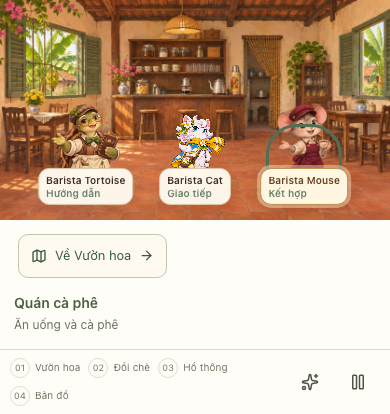
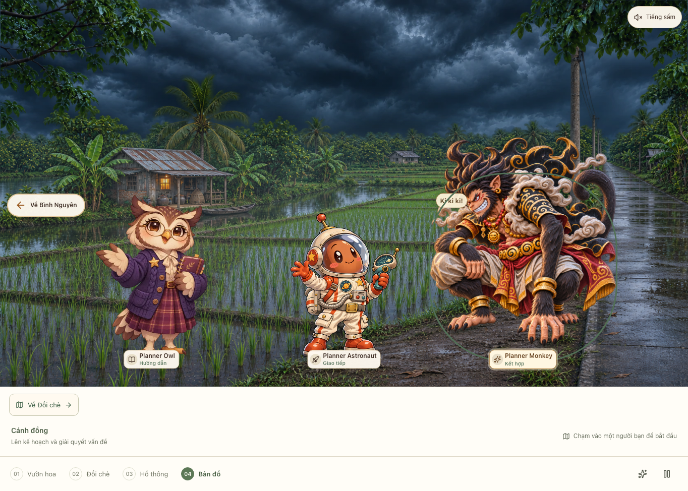
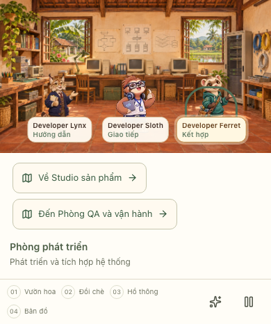

# Cảnh và NPC — đã bổ sung đủ

Mỗi cảnh chỉ có một chủ đề và ba NPC: Hướng dẫn, Giao tiếp, Kết hợp. Có **18 cảnh học, 54 NPC trong cảnh**, cộng Learning Bird hướng dẫn chung. Đã thêm **6 cảnh và 35 nhân vật mới**; Planner Monkey được giữ làm NPC Kết hợp ở Cánh đồng.

| #   | Chủ đề                            | Cảnh                      | Hướng dẫn             | Giao tiếp         | Kết hợp               |
| --- | --------------------------------- | ------------------------- | --------------------- | ----------------- | --------------------- |
| 1   | Chào hỏi                          | Bờ hồ                     | Greeting Red Panda    | Greeting Cat      | Greeting Penguin      |
| 2   | Giới thiệu bản thân               | Khu nhà                   | Introduction Hedgehog | Introduction Bear | Introduction Cockatoo |
| 3   | Thói quen hằng ngày               | Vườn hoa Vạn Thành        | Routine Badger        | Routine Owl       | Routine Sparrow       |
| 4   | Gia đình và bạn bè                | Vườn cây ăn trái          | Family Elephant       | Family Deer       | Family Raccoon        |
| 5   | Ăn uống và cà phê                 | Quán cà phê               | Barista Tortoise      | Barista Cat       | Barista Mouse         |
| 6   | Mua sắm và thanh toán             | Cửa hàng Bình Nguyên      | Shopping Koala        | Shopping Panda    | Shopping Squirrel     |
| 7   | Đi lại và chỉ đường               | Cầu qua sông              | Navigator Crane       | Navigator Fox     | Navigator Husky       |
| 8   | Công việc hằng ngày               | Góc làm việc              | Office Bison          | Office Corgi      | Office Meerkat        |
| 9   | Sở thích và thời gian rảnh        | Thư viện sở thích         | Hobby Sloth           | Hobby Bunny       | Hobby Chipmunk        |
| 10  | Du lịch và khách sạn              | Đồi chè Cầu Đất           | Travel Alpaca         | Travel Bear       | Travel Puffin         |
| 11  | Sức khỏe và cảm xúc               | Hồ Tuyền Lâm              | Wellness Dove         | Wellness Alien    | Wellness Seal         |
| 12  | Lên kế hoạch và giải quyết vấn đề | Cánh đồng                 | Planner Owl           | Planner Astronaut | Planner Monkey        |
| 13  | Giao tiếp trong nhóm IT           | Phòng nhóm IT             | IT Lemur              | IT Otter          | IT Gecko              |
| 14  | Quản lý dự án và họp              | Phòng dự án               | Project Stag          | Project Wolf      | Project Robin         |
| 15  | Phân tích nghiệp vụ và ngân hàng  | Phòng nghiệp vụ ngân hàng | Analyst Heron         | Analyst Beaver    | Analyst Capybara      |
| 16  | Thiết kế UI/UX                    | Studio sản phẩm           | Designer Swan         | Designer Cat      | Designer Chameleon    |
| 17  | Phát triển và tích hợp hệ thống   | Phòng phát triển          | Developer Lynx        | Developer Sloth   | Developer Ferret      |
| 18  | Kiểm thử, triển khai và hỗ trợ    | Phòng QA và vận hành      | Tester Pelican        | Tester Turtle     | Tester Armadillo      |

## Tên nhân vật và Sloths IT

Tên hiển thị dùng cấu trúc **Chủ đề/vai trò + Loài vật đại diện**: ví dụ Tester Turtle, Designer Cat, Analyst Beaver. Developer Sloth ở Phòng phát triển dùng đúng ảnh Sloths IT do chủ dự án cung cấp. Hai nhân vật giả tưởng hiện có dùng Planner Astronaut và Wellness Alien để khớp hình ảnh hiện tại. Learning Bird là hướng dẫn chung.

Mã NPC và mã phiên học giữ nguyên; các tên mới áp dụng cho nhãn trong cảnh, hội thoại, lời chào, lịch sử và nút nghe.

## Chỉ dẫn qua cảnh

Không thêm điểm đánh dấu vào bản đồ hiện có. Các cảnh mới có đường về cảnh gốc.

- Vườn hoa Vạn Thành ↔ **Quán cà phê**
- Vườn hoa Vạn Thành ↔ **Thư viện sở thích**
- Góc làm việc ↔ **Phòng nhóm IT**
- Phòng dự án ↔ **Phòng nghiệp vụ ngân hàng**
- Studio sản phẩm ↔ **Phòng phát triển**
- Phòng phát triển ↔ **Phòng QA và vận hành**
- Đồi chè ↔ Cánh đồng: Planner Astronaut đã chuyển sang đây cùng Planner Owl và Planner Monkey để chỉ còn một chủ đề lên kế hoạch.

## Tài nguyên và phạm vi

- Dùng **image_gen tích hợp** cho từng nền và từng NPC; không dùng API key của ứng dụng để tạo ảnh.
- [Prompt đầy đủ, nguồn ảnh và kích thước thực](../../art/dalat/role-expansion-v1/manifest.json).
- [Ảnh đối chiếu 35 NPC mới](npc-roster.webp).
- Ảnh nguồn: `art/dalat/role-expansion-v1/`; nền runtime: `public/cafe/topics/`; NPC runtime: `public/cafe/npc/roles/`.
- NPC mới có ảnh toàn thân với alpha thật, chưa có rig khớp riêng; giữ chuyển động hiện có của các NPC cũ.
- Phân vai đã áp dụng vào giao diện, API phiên học, phản hồi theo kịch bản và chỉ dẫn cho provider AI hiện tại. Giọng đọc tiếp tục chỉ phát khi bấm nghe.
- Tích hợp Gemini Live và chọn model riêng cho từng vai trò chưa thuộc đợt bổ sung cảnh/NPC này.

## Kiểm tra đã thực hiện

- 3 bài API trong `scripts/cafe-roles.test.mjs`: đủ 18 cảnh / 54 vị trí, đường đi liên thông, phiên học đúng vai trò và chủ đề, mở lại phiên và cho phép nghe lời chào riêng.
- 1 bài API giọng đọc có mock provider trong `scripts/cafe-speech.test.mjs`: cả 55 NPC gồm hướng dẫn chung, cache và chặn yêu cầu đọc ngoài nội dung.
- 2 bài Playwright trong `tests/cafe-topic-roles.spec.ts`: đi qua đủ 18 cảnh, mở đủ 54 NPC, ba nhãn vai trò, bàn phím/focus, tải ảnh và không tràn ngang ở 390px / 1440px; bản đồ giữ 9 điểm.
- Build production, TypeScript và lint các tệp thay đổi đã đạt; kiểm tra alpha thật của cả 35 ảnh NPC mới đã đạt.
- Chỉ chạy các kiểm thử nêu trên; không chạy toàn bộ bộ kiểm thử ứng dụng và không gọi AI hội thoại/giọng đọc trả phí.

## Kiểm tra đổi tên và Sloths IT

- 3 bài API về danh sách/vai trò/phiên học và 1 bài API liên kết NPC cũ đã đạt.
- 2 bài Playwright ở 390px / 1440px đã đạt: đủ 54 tên mới; Developer Sloth dùng đúng ảnh runtime; Tester Turtle hiện đúng tên; Learning Bird mở đúng hướng dẫn chung.
- Build production, TypeScript, lint và định dạng các tệp thay đổi đã đạt. Ảnh nguồn Sloths IT được giữ nguyên từng byte; runtime chỉ chuyển sang WebP.
- Không chạy toàn bộ bộ kiểm thử ứng dụng.

